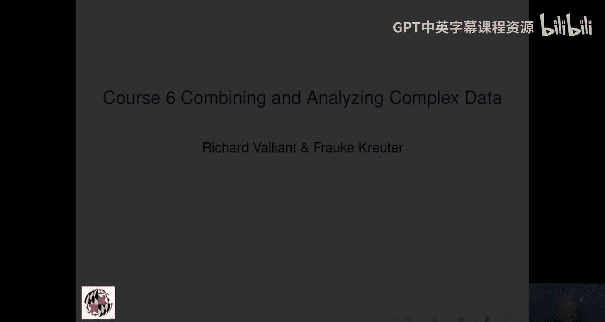
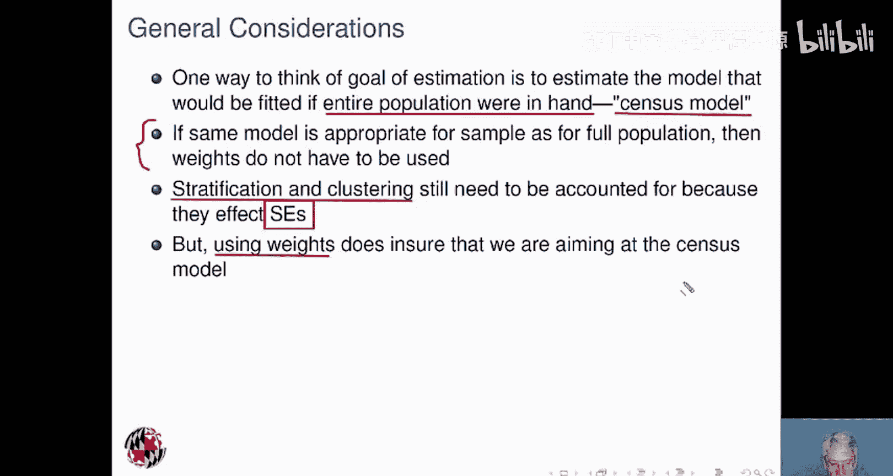

# 调查数据收集与分析：2-6：模型参数估计导论 🎯

在本节课中，我们将学习如何估计复杂调查数据中的模型参数。我们将从理解模型估计的整体框架开始，探讨样本权重的重要性，并解释为何需要考虑抽样设计中的分层与整群效应。

---

上一模块我们讨论了均值、总值等简单指标的估计。本节中，我们将转向更复杂的模型参数估计。

由于我们处理的是有限总体，理解整个过程是有益的。一种思考方式是：假设存在一个上层的超总体模型，这实际上是我们试图发现或估计的目标。该模型会生成一个有限总体。我们从该模型中获得实现值，从而创建出有限总体。然后，我们从有限总体中抽取样本，并基于样本拟合一个模型。

那么，这个拟合的模型在估计什么？如图所示，我们可以从两个角度思考：
*   如果模型设定完全正确，与超总体模型一致，那么拟合的模型将估计这个启动整个过程的超总体模型。
*   另一方面，如果模型设定有误（例如遗漏了某些协变量），我们仍可以说，拟合的模型旨在成为针对整个有限总体的最佳拟合模型。它可能在设定上存在遗漏，但仍在努力瞄准完整的有限总体模型。

另一种理解完整有限总体模型的方式是：它是如果你拥有整个总体数据（即普查数据）时会拟合的模型。因此，它常被称为**普查模型**。这是我们通过后续将展示的拟合算法所瞄准的目标。

在有限总体估计中，一个存在争议的观点是：如果同一个模型既适用于样本也适用于总体，则无需使用权重。当你的样本是总体的一个“微型缩影”时，这确实成立。然而，如果你的抽样设计导致样本与总体失衡（例如，你针对某些子群进行了抽样，或使用了与规模成比例的概率抽样，使得大单位在样本中出现更频繁），那么上述情况可能不成立。为了能估计那个普查模型，你将需要使用权重。

此外，你还需要考虑抽样设计中的**分层**和**整群**效应，因为它们会影响标准误。这些效应可能使标准误变大或变小，但绝对会产生影响，不容忽视。

因此，我们的流程是使用权重。这意味着我们将明确地以估计普查模型为目标。如果我们努力正确地设定模型，那么普查模型在形式上也将与我们希望作为整个过程基础的超总体模型一致。

在接下来的视频中，我们将看到一些如何进行此类估计的示例。

---

本节课中，我们一起学习了复杂调查数据中模型参数估计的基本框架。我们明确了拟合模型的目标（超总体模型或普查模型），理解了在样本与总体分布不一致时使用**权重**的必要性，并认识到**分层**与**整群**设计对标准误的影响。下一节我们将通过具体示例来实践这些概念。