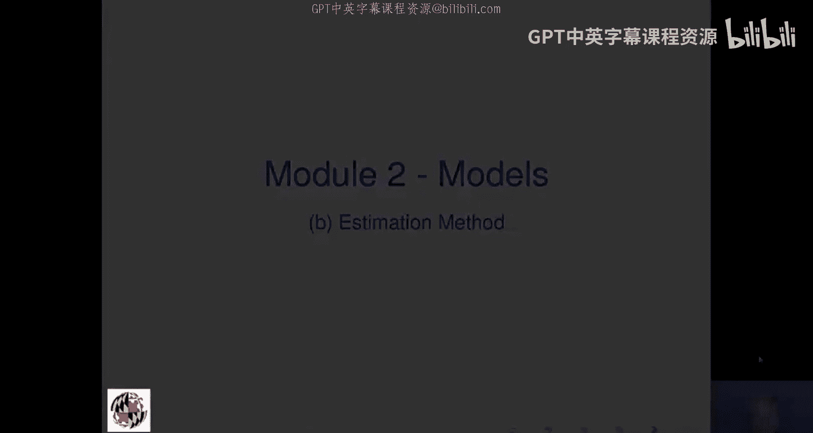
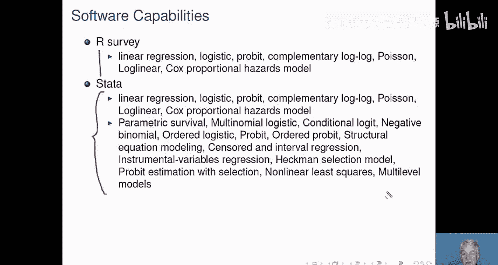

# 密歇根大学《调查数据收集和分析（2-6：方法、社调问卷设计、抽样、缺失数据、分析）｜Survey Data Collection and Analytics》 p157 8_估计方法.zh_en -BV1fw4m1e7Zh_p157-

We'll continue module2 by thinking a bit about how the model parameters are actually estimated。

There's a technique called pseudo maximumum likelihood estimation that's used。And。

This is available in the software packages that analyze survey data。

 so that's what we're going to target。And。The way to do this， the steps are in general pretty simple。

 the details of computation can be pretty complicated， but we won't get into those。

The idea is to start off and write down what's called the full finite population likelihood function。

 which is。If you know any mathematical statistics， it's the joint distribution of all the observations in your sample and then you derive some things that are called estimating equations so the first thing we do is do that。

As if we had a census， as if we had the full finite population in our sample。

The nice thing about these estimating equations is they usually look like finite population totals。

That involve some sort of total of residuals that are associated with the model。 So， for example。

 with linear regression， here is what the estimating equations look like。

 We've got the sum over the sample I an element of S means sum over the elements that are in the set of sample units ask。

 Here's the survey weight W I。This is a vector of covariates that are inner model。

 and then this thing right here you may recognize it as a residual。

 you know I could write it as EI if I wanted to。嗯。It's the data value Yi minus the linear combination of the covariates that predicts Yi。

And betahan is just the estimated model parameter。So。

The idea once we get that far is set that equal to zero and then figure out a way to solve for beta hat。

And that's where the complications may come in in linear regression it's pretty straightforward in linear regression like logistic。

 it's harder。So there are pieces of software that will do this for quite a few models。Our survey。

 for example， will。Do all these things here， linear regression。

 logistic probe but complementary log log， Poisson regression， log linear models。

coox proportionional hazards model， so that's a pretty rich set， but if you look at sta。

 the choices are even richer， we get all those things I named for are plus other things that are many of which are of interest to econometricians。

Things like multinomial logistic。Order logistic probes， censored and interval regression。

 heckman selection models it'll do。Nonline lease squares in general， it'll do multi level models。

 so they're really a nice set of choices if data is the software that you're using。

So we'll look at details of these in later videos。

