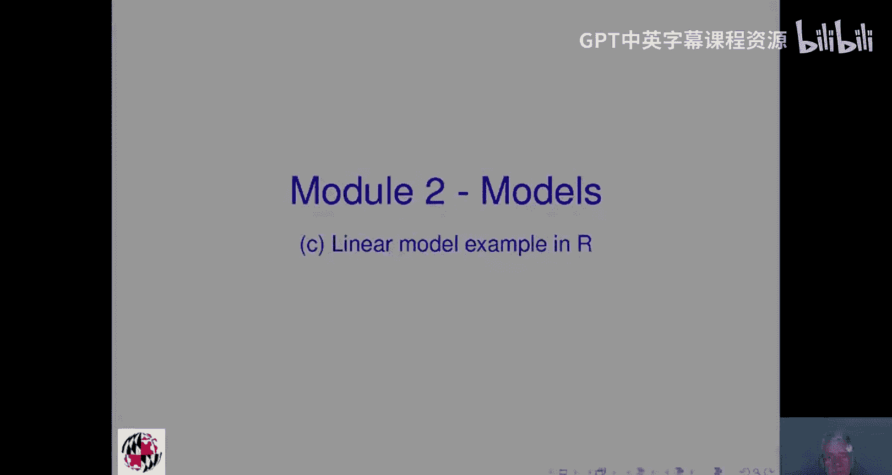
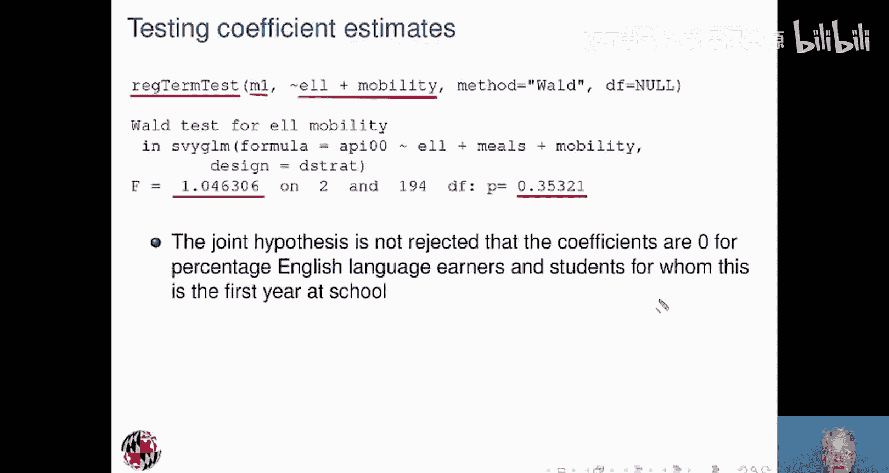

# 密歇根大学《调查数据收集和分析（2-6：方法、社调问卷设计、抽样、缺失数据、分析）｜Survey Data Collection and Analytics》 p158 9_线性模型.zh_en -BV1fw4m1e7Zh_p158-

In this video， we'll see how to actually fiddle in your model in our accounting for a complex sample design。

So the data I'm going to use is one that's bundled with the R survey package。

 it's called the Academic Perance indexex file。This API is computed for all California schools based on standardized testing of students。

 and there are several data sets in this API that's bundled with survey。

It gives information for all schools with at least 100 students and for various probability samples of the data。

 just for illustration， and we've got one record per school in all these data sets。

So how do we set up things for our it's very similar to what we did for descriptive statistics we've got to start with a survey design object to specify。

Things like clusters， strata and weights。We will fit the model with a function called SVY GLM for general linear model。

And it will take certain parameters that I'll illustrate for you in a bit。

The variables that we'll look at just for this illustration are the A Per index 00。

 which is the API in the year 2000。The percent of English language learners in a school。

That means the percentage of students for whom English is not their first language。

Then we've got the percentage of students who are eligible for subsidized meals。I you know。

 poor low income students in California are eligible to get。

Contribution toward lunches or maybe free lunches and sometimes breakfasts， it depends on the school。

And then we've also got mobility， which is the percentage of students for whom this is the first year at the school。

Now to fit the model， first we require surveys so we can get at SVY， GLM and the data set。

 then I say data API that gives me access to a number of these probability samples associated with the academic performance In file。

Survey design， this ID equals till the one just means I've got no clusters。

 I've got stta defined by S type， which is school type。

hass to do with the grade levels in the school the weights are the PW field in this file I tell it what the data set is API strat that's one of the it's a stratified simple random sample without replacement and then there is an FPC on the file which I'll use because we want to get credit for drawing a。

A substantial proportion of。The schools in some of the straum。And now we fit the model with S V， Y。

 GLM。 So what I'm doing is regressing the academic performance index in the year 2001。

English and language learners， meals and mobility。And I tell it， here's my design object。

 so that this function SV I GOM knows what the stlia clusters， weights and FPC are。

Based on this definition right here in the SVY design。So here are my estimates， these are the。

Output from SVI Gm like I called for a survey on M1， my fitted model。 So here's the estimates。

You can see the intercepts by far the biggest， we get the standard errors。

 T values on each of those and then P values associated with each parameter estimate。

 so the first and the third are quite significant the English language learners and mobility are not so much。

Now another thing that we can do that is the nice feature is you can test subsets of the coefficient estimates。

 so the the function for doing that is called reg term test。And I send it my model object。

 so you have to have saved your model fitted model into some object。

 so that's M1 and then I want to test those two coefficients that were non significantant just for illustration so English language learners and mobility I'm going to use wall test。

And here's the output， it gives me an F statistic 1。046 on two and 194 degrees of freedom。P value is。

0。35。 so what does that say it says that you can't reject the null hypothesis and the null hypothesis is that simultaneously both these coefficients are zero。

know just eyeballing and tea statistics and doing this joint test。

 it looks like those two things present in English language learners。

And students for whom this is the first year in school are not too important in predicting the academic performance index。

So we'll follow up this with some diagnostics in the next video。

