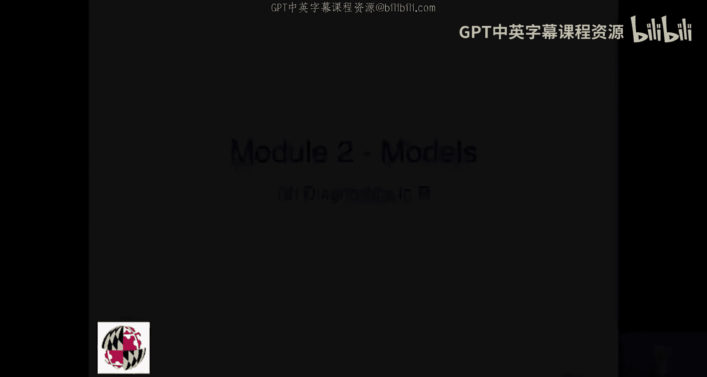
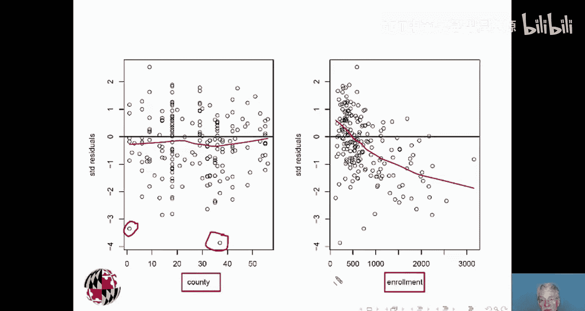

# 密歇根大学《调查数据收集和分析（2-6：方法、社调问卷设计、抽样、缺失数据、分析）｜Survey Data Collection and Analytics》 p159 10_R语言中的诊断分析.zh_en -BV1fw4m1e7Zh_p159-

Let's take a look in this video about how you might do some diagnostics in R。Now。

 there is some literatureature on adapting standard diagnostics for use with survey data。 In fact。

 my students and I have contributed to a bit of that， but there are other things that are out there。

The problem right now is very few of these things are available in packages。

 so you need to program your own。With things like standardized residuals。

 which I'm going to show you， it's easy to do it on your own。

So we'll start with that as an illustration。So how do we compute these things。

 We're going to use the same model as in a previous video。The academic performance。Index data file。

And then we'll look at standardized residuals。 so you may know from other courses that these should have mean0 and variance1 under the model if you've got the model specified correctly。

And they have the form。Data minus prediction， Y I minus Y I hat over the estimated standard deviation in the model of the residuals of the model errors。

Now， that assumes that there is a constant variance。In the model， that may or may not be true。

So how do we estimate sigma hat， it is an estimate of the model error variance。

It's not a design variance， but we can use the survey weights in making an estimate of it。

So an approximately unbiased estimate of the underlying common variance of the errors in the model will be the sum over the elements in the sample I and element of s。

 the weight， the survey weight times the squared residual。

Fitted from the model divided by the sum of the survey weights。So that'll be approximately unbiased。

 assuming that you've got the model specified correctly， so we could use that。

 calculate these standardized residuals here， and take a look at them。So here's the code to do that。

This repeats some of the things that we did in a previous video so I won't spend a lot of time on this。

 we want to require the survey package because that does the model fitting。

 we tell it use the API data， we specify our stratified design object。Using the API Strat data set。

Fitter model with s VY GlM。And same models as before。I calculate the。

Estimate of the underlying sigma squared this way。 I take there's a built in function called weighted mean in。

The stat。Pieace of our so you don't have to do anything special to get at that。

 We just invoke it wayed do mean and。First， you tell it。

 what are the things I want the weighted mean of？The model object that I saved。

 M1 has got a component called residuals， so I square those and then I tell it， here's my weight。

 API strat dollar PW。Which is just the survey weight。

And it'll compute that sigma hat square that we looked at on the last slide， so now I take。

The standardized residuals and calculate those this way。

 I take the model residuals M1 dollar residuals。Divided by the root of S 2， which I just computed。

So we can look at a standard summary of those and you you can see they're a little off balance and since they're not being centered around  zero。

 means minus 0。278 or minus 0。2837。you may know from ordinary leaf squares that the sum of the residuals ought to be zero。

We've actually fit of weighted least squares here， so that's not true。

 but still you'd like to see those centered around zero and they're kind of asymmetric。

 you know the smallest one is minus 3。86， the largest is 2。54。

The in a standard normal distribution the。Bulk of the distribution ought to be between plus or minus3。

 so we're seeing something a little different here。

Now let's start a picture to look at these standardized residuals。

 so ours got some really nice graphics capabilities in their packages that extend those。

 the GG plot package is an excellent one。This is just basic our graphics。

 so I'm setting up a one by two plotting matrix with this par MFO specification。

And then I want a plot in the two。Pieces of the plotting matrix。 First， I plot。On the X axis。

 a variable called API Strat C nu。 C mean nu is county number。And。Then on the Y axis。

 I plot my standardized residuals know just to see if there's some relationship。

In between county and how big the residual is， you know conceivably that could be true you get urban counties。

 rural counties， they could act differently。I put some labels on my plot so I can understand it better。

 and I draw a horizontal line at zero。 That's where the residuals should be centered if all is going well。

 and then a thing that I especially like is to put a nonparmetric smoother through the plot So the if the model specified correctly。

 your residuals ought to be up and down around0 centered on zero。

 So this particular non parametric smoother， which is called low S ought to be wiggling through about on the horizontal zero line。

 So we'll take a look at that。 and I colored it red just so you can see it made it twice as。

Big or wide is the standard。Selection for the line width。Now in the second panel。

 I'm going to plot the standardized residuals versus school enrollment， API Strat Do enroll。

 and I label the axes again， and I hit a nonpar metric smoother through there again。

So here's what it looks like， we've got counties on the left。And。

You know here's my county number on this axis。 So， you know， there's not a whole lot going on there。

 The nonparmetric smoother is down below zero， which is slightly troubling。

There's nothing obvious about extreme residuals。嗯。You know they're not asymmetrically distributed in an extreme way around zero。

 there is， however this one outlier here compared to the other points and maybe that one so you can take a look at those to see what's going on with those。

Then over in this panel， I plotted standardized residuals versus enrollment and here we really see something。

 the nonparmetric smoother is definitely not horizontal at zero。

 you know there's a real linear trend in these residuals。

Which just means that enrollment better get into the model。 you know。

 it's affecting the academic performance index。 It's related to it over here。

 County doesn't much matter。There's not an obvious reason for including county。

 so we learned a little bit by doing this and there may be other diagnostics you can think of that you can easily enough program yourself。

