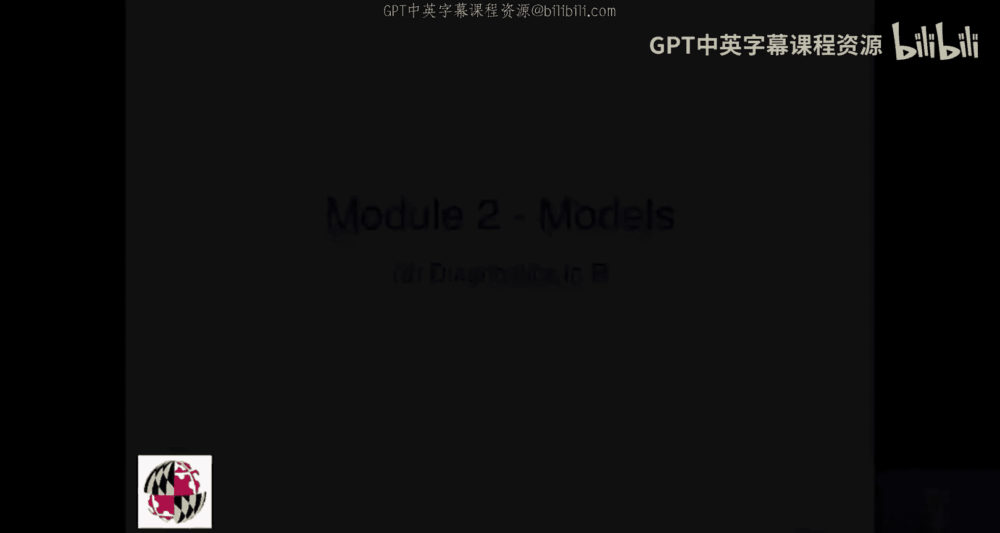
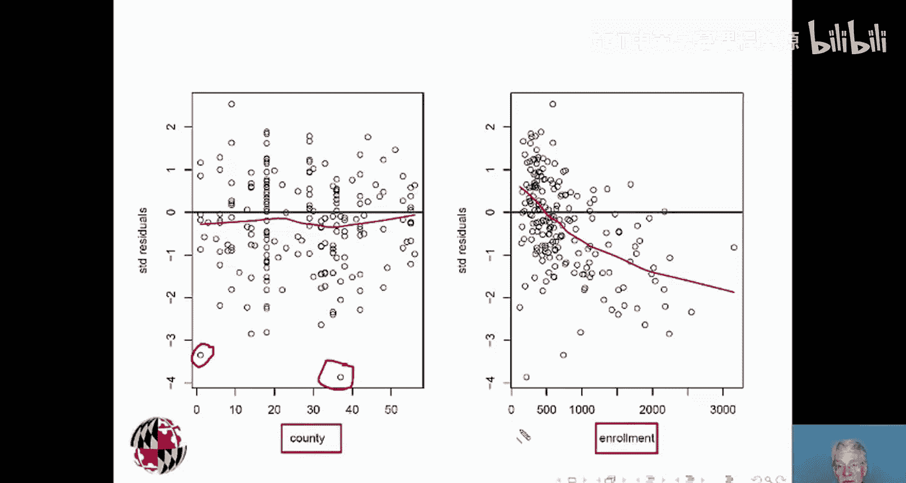

# 调查数据收集与分析：10：R语言中的诊断分析 📊




在本节课中，我们将学习如何在R语言中对调查数据进行诊断分析。诊断分析是检查统计模型是否恰当、数据是否存在问题的重要步骤。我们将重点介绍如何计算和解读标准化残差，并使用图形化方法直观地检查模型假设。

## 概述

在之前的课程中，我们学习了如何为调查数据拟合模型。然而，拟合模型后，评估模型是否合适至关重要。本节将演示如何为复杂调查数据计算标准化残差，并通过绘图进行诊断。目前，专门的R包很少提供这些功能，因此我们通常需要自己编写代码。我们将以标准化残差的计算和可视化作为示例。

## 计算标准化残差

我们将使用与之前视频中相同的模型和数据——学术表现指数数据文件。标准化残差的计算公式如下：

**公式：** `标准化残差 = (Y_i - Ŷ_i) / σ̂`

其中，`Y_i` 是观测值，`Ŷ_i` 是模型预测值，`σ̂` 是模型误差项标准差的估计值。在理想情况下，如果模型设定正确，这些标准化残差应近似服从均值为0、方差为1的分布。

这里的关键是估计 `σ̂`（即模型误差方差）。对于调查数据，我们可以利用调查权重来获得一个近似无偏的估计：

**公式：** `σ̂² = Σ (w_i * r_i²) / Σ w_i`

其中，`w_i` 是第 `i` 个样本单元的调查权重，`r_i` 是该单元从模型中得到的残差。

以下是实现上述计算的R代码：

```r
# 加载必要的包并设定设计
require(survey)
data(api)
dstrat <- svydesign(id=~1, strata=~stype, weights=~pw, data=apistrat, fpc=~fpc)

# 拟合模型（示例：以meals和full为预测变量解释api00）
m1 <- svyglm(api00 ~ meals + full, design=dstrat)

# 计算模型误差方差σ̂²的加权估计值
s2 <- weighted.mean(m1$residuals^2, w=apistrat$pw)

# 计算标准化残差
std_res <- m1$residuals / sqrt(s2)

# 查看标准化残差的摘要统计
summary(std_res)
```

运行代码后，查看标准化残差的摘要。你可能会发现其均值并非精确为0（例如-0.28），且分布不完全对称（例如最小值-3.86，最大值2.54）。在标准正态分布中，大部分值应在±3之间，因此我们的结果提示可能需要进一步检查。

## 可视化诊断

图形是强大的诊断工具。我们可以绘制标准化残差与潜在预测变量（如县代码、学校注册人数）的关系图，并添加非参数平滑曲线来观察趋势。

以下是创建诊断图的R代码：

```r
# 设置图形布局为1行2列
par(mfrow=c(1,2))

# 第一幅图：标准化残差 vs. 县代码
plot(apistrat$cnum, std_res,
     xlab="County Number",
     ylab="Standardized Residuals",
     main="Residuals by County")
abline(h=0, lty=2) # 添加y=0的参考线
lines(lowess(apistrat$cnum, std_res), col="red", lwd=2) # 添加非参数平滑曲线

# 第二幅图：标准化残差 vs. 学校注册人数
plot(apistrat$enroll, std_res,
     xlab="School Enrollment",
     ylab="Standardized Residuals",
     main="Residuals by Enrollment")
abline(h=0, lty=2)
lines(lowess(apistrat$enroll, std_res), col="red", lwd=2)
```

## 解读诊断图

现在，我们来解读生成的图形：

*   **县代码图**：左侧图形展示了标准化残差按县代码的分布。非参数平滑曲线（红色）在零线下方略有波动，但未显示出强烈的系统性模式。图中可能存在一两个异常点（远离其他点的残差），值得进一步查看。总体来看，没有明显证据表明需要将“县”作为变量纳入模型。

*   **注册人数图**：右侧图形展示了标准化残差与学校注册人数的关系。这里的非参数平滑曲线显示出明显的线性趋势，**并非**围绕零线水平波动。这强烈表明，“注册人数”这个变量与学术表现指数相关，且当前模型（未包含该变量）未能捕捉这种关系。因此，**注册人数应该被考虑加入模型中**。

通过这种简单的诊断，我们获得了改进模型的重要线索：需要考虑纳入“学校注册人数”这一预测变量。

## 总结

本节课我们一起学习了如何为基于复杂调查数据拟合的模型执行基本的诊断分析。我们重点掌握了：
1.  **计算标准化残差**：利用调查权重估计模型误差方差，并据此计算标准化残差。
2.  **可视化诊断**：通过绘制残差与关键变量的关系图，并叠加非参数平滑曲线，直观地检查模型假设（如线性、同方差性）以及发现未被模型捕捉的变量关系。



诊断分析是模型构建中迭代和完善的关键一步。虽然针对复杂调查数据的现成诊断工具包较少，但通过自己编程实现核心诊断指标（如本例中的标准化残差）是完全可行的，并能提供极具价值的洞察。