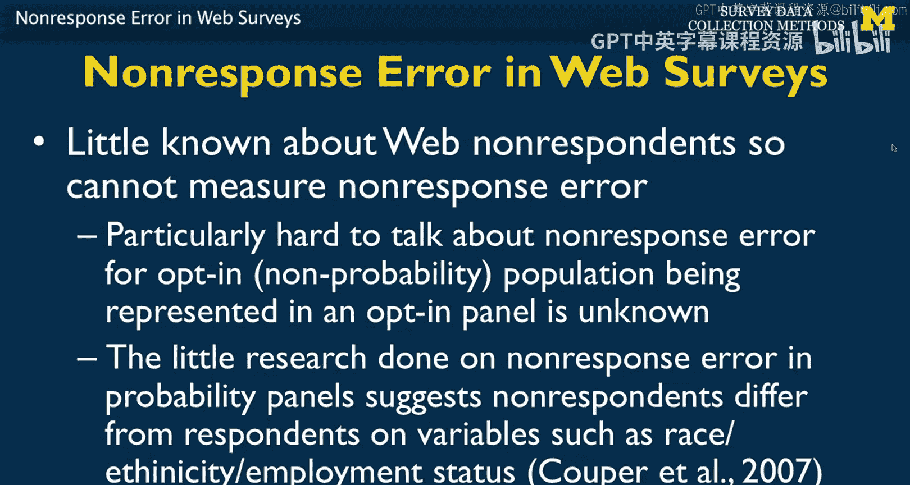
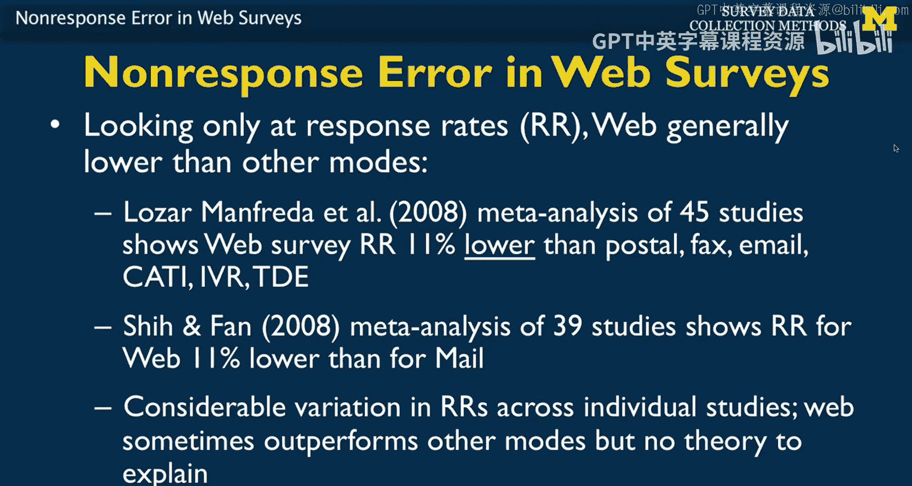
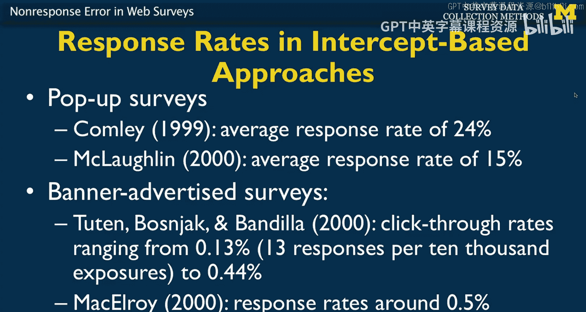
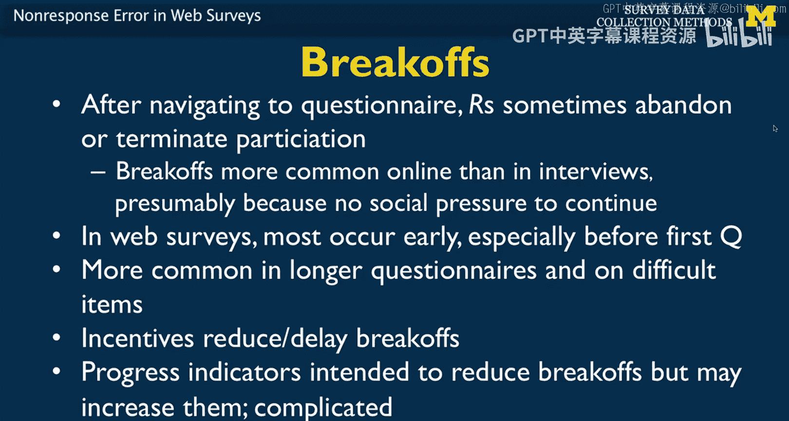

# 密歇根大学《调查数据收集和分析（2-6：方法、社调问卷设计、抽样、缺失数据、分析）｜Survey Data Collection and Analytics》 p16 15_2.2.2 无应答处理.zh_en -BV1fw4m1e7Zh_p16-

嗯。Turning now to non-response in online surveys， we actually don't know a lot about the non-respondents in web surveys which is really required to quantify non-resse error。

 so it's virtually impossible to talk about nonresponse error in for optin or non-probability panels because we just don't know anything about the population that's being represented or again。

 who chose not to say， respond to a banner or advertisement。

The little research that has been done on nonrese error in probability panels in contrast suggests that non respondsents differ from respondents on variables such as race。

 ethnicity， employment status， and so there may well be。

Nonres error in probability panels as a result of the recruitment process。

If we look only at response rates as opposed to non-res error。

 the web generally has lower response rates than other mode。

 so in some sense this makes web surveys more vulnerable to non-response error。

 but as we've discussed， it really depends on the differences between the respondents and the non-respondentents as well as as well as the number of nonresponents。

The evidence that response rates are low comes from a number of meta analysis so Lozarmon Freedda and her colleagues looked at 45 studies and found that web survey response rates were 11% lower than mail questionnaires。

 faxed questionnaires， email and a number of more conventional modes。

 she and conducted a meta analysis of 39 studies and showed that response rates for also 11% lower than for just for mail。

 there's considerable variation in response rates across individual studies。

 in some cases the web surveys actually produce higher response rates than the comparable studies and other modes。

 this is at this point kind of atheoretical there's no good explanation。

 but the general trend is for response rates to be lower in online data collection than other modes。

When it comes to probability panels， there is， as I've mentioned。

 a kind of cumulative response rate or non-response rate that has to do with the fact that there are many opportunities to not respond the panel is initially recruited through as we've discussed a mix of random digit dialing and address based sampling and that produces a response rate and these data by Lee turns out that 36% of the attempted contacts end up recruiting someone into or household into the panel。

Then the panel members without internet access are provided a device and when these data were collected。

 that device was a web TV and only about 67% of those sample members were successfully connected to the internet through the device。

 so you can see that the percent of respondents is dropping as we go through additional steps in this process。

Then the sample members are required to complete a profile and almost everybody does complete the profile。

 but after doing that only 47% remain in the panel that has remain active in the panel and then when the first survey is completed the completion rate is 57。

4% so that's 57。4% of all these other fractions of the original frame so the final response rate is only 5 and a5% again if the non-respondentents resemble the respondents on various attributes and would have answered questions as the respondents answer them this is not a problem but with only 5。

5% of the initial frame ultimately providing survey data nonresponse error is a real concern response rates in other types of web surveys include pop-up surveys where。

Where the response rates of actually， at least in the early days were higher than they are in other types of non-probability surveys。

 web surveys， 24%， 15% two early evaluations of popup surveys so these will be an invitation will appear in a window that's separate from the primary browser window that the user is viewing banner advertised surveys。

 so where there's usually a band across the top of the web page advertising the survey produce very low clickthrough rates under 1% in two studies that were done when this approach was common。

The kinds of factors that affect nonresponse and web surveys are actually similar to the factors that affect non-response in other modes。

 the design is relevant， so if there's pre notification for example a letter or an email message assuming email addresses are available certainly helps the sort of authority of the sender or sponsor matters。

 if they're familiar if they seem authoritative if a reminder is sent after an initial invitation that helps as well this is true in many modes。

 incentives help and prepaid incentives which are much harder to deliver for an online study help more than promised incentives just like in other modes and questionnaire length matters and the length is usually mentioned in the invitation so the longer the questionnaire。

 the lower the response rate generally， and attributes of the sample members matter as well so gender personality。

Whether this is a topic of interest， attitudes towards survey research。

 experience taking part in surveys all affect participation much as they do in surveys and other modes the final topic I want to mention on non-responsive web surveys concerns breakoffs so or abandonment so this refers to situation in which a sample member starts to complete the questionnaire but then terminates somewhere before the end so in fact this is most common on the very first page of the web questionnaire the sample member arrives there and decides you know this is not for me or for whatever reason doesn't go beyond the first page and I call the splash page。

Once the sample member begins the questionnaire， you can think of break offices somewhere between missing date providing missing data or item nonres and unit nonresse。

 not providing any data so if the sample member provides。

Data the respondent provides data for say the first 10 questions and none no data after that。

 it's not exactly the same as missing data intermittently throughout it's an abandonment and it's generally sort of treated as both as I said。

 item missing data and your item nonresse and unit nonresse overall nonresse much more common in longer questionnaires。

 not surprisingly and on difficult items more demanding mentally incentives can reduce breakoffs or delay them that is lead to completion of more items。

 a higher percentage of the items than without an incentive。Progress indicators which。

We'll talk about the primary reason designers use them is to reduce breakoffs。

 the idea being that if you provide。

Respondents with information about how much of the task they have completed and how much of the task remains。

 this will help them， you know information is power。

 but in fact it turns out progress indicators may increase breakoffs， it's a complicated story。

 it's not that simple， but the evidence so far and it continues to build is that progress indicators while they may be sensible on intuitive grounds actually harm completion rates。

 they increase breakoffs。So that's an overview of issues in non-response and web surveys we'll turn next to issues in measurement error。

 and as I said， we'll focus on the impact of the visual features of the design and how they can affect the quality of the data。

