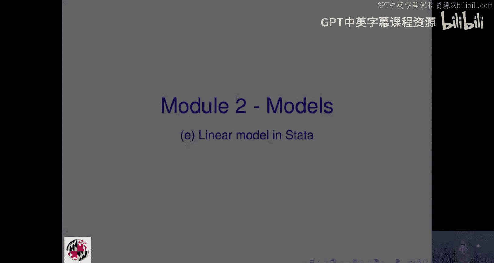
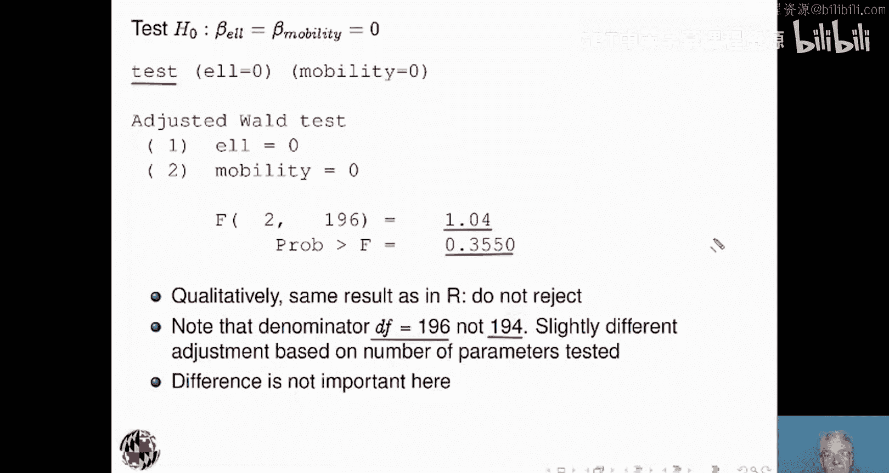

# 密歇根大学《调查数据收集和分析（2-6：方法、社调问卷设计、抽样、缺失数据、分析）｜Survey Data Collection and Analytics》 p160 11_Stata中的线性模型.zh_en -BV1fw4m1e7Zh_p160-

Next， we'll take a very brief look about how to fit the same model that we fit in R in data just to show you what the syntax looks like。

 So just to remind you of what's going on here， we in our。

Previous video regressed school academic performance on。

Pcent of English language learners in the school， a percent of students eligible for subsidized meals and the percentage of students for whom this is their first year at the school。

So here's how you do that in Staum。First thing is to load the data in and I do that by a use statement。

 the clear says clear the memory， if anything that's in there。

 so previous to this within R I used the right dot DTA function。

Which is part of the foreign package to write out that API data set or STat data set。

In state of format， so now I'm using it。And。Then we use the SVY set statement。

 you've got to have a PSU variable defined and in this case this CDS is just a counter。

 so it's essentially saying we've got no clusters in this data set。

 which specify the weight using P weight equals a field name PW in this case。

 and notice that you put that in brackets in state right here， not parentheses， but brackets。

And then a comma and the rest of the syntax here are options， so straight a。Is an option。

 but we have straight a school type， FPC is an option， we have that in the FPC variable。Now。

 how do we regress， we do it in the using the State convention。

 which is you take an existing state command and you preface it by SY colon。

So that's that and then I have the Y variable。So this is Y in my model， API 00。

 and then everything that comes after that are access so ELL meals and mobility。

And here's the output， Sta gives you some good bookkeeping things like the number of observations。

 this is the sum of the weights。Here's a test on the overall model so that F is really big。

And R squares 0。6595 in this case， the coefficients here。Are exactly the same as we got in R。

 And in fact， so are the standard errors because they're using the same formula。 And notice here。

 so you don't get confused。 underscore cons is the constant。

 So it's listed last in state and not first， as it is in R。The same two variables are significant。

Meals and the constant。So mobility and English language learning look pretty unimportant in this。

You can get at residuals with the statement predict， so you say predict。R。

 and then the option is residual。 So the residuals would， in this case。

 would be saved in a variable called R。And then you standardize them by hand。

Just the way we did in are。Now we can test that joint hypothesis that ELL and mobility are simultaneously zero。

 so the way you do that is you use the test statement and then in parentheses。

 you say each parameter equals 0 so ELL equals 0 and then separately mobility equals 0 both inside of parentheses and here's the output。

 the F statistic is 1。04 Pvalue is 0。355 so we can't reject the。Idea that both of those are zero。

 same result qualitatively as in R。Now there is one small difference。

 the denominator degrees of freedom is reported as 196 here， it was 194 in R。

There's a slight difference in the way these two packages adjust based on number of parameters tested。

The difference is not important here。In some models with a small sample size and。

Maybe larger number of parameters you will。Get more of a difference。

 or're more likely to see results that differ in terms of significance。But in general。

 with large samples， it won't make much difference。

