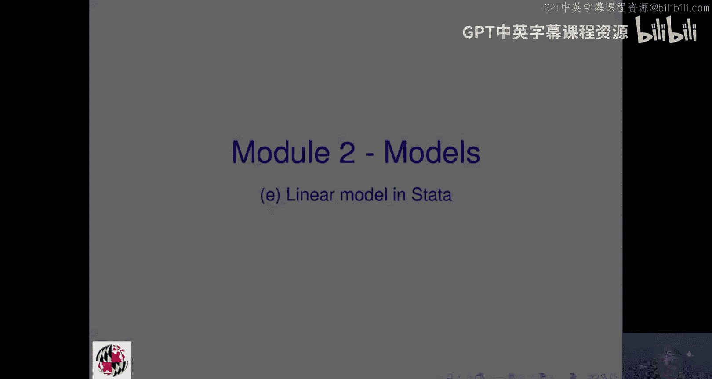
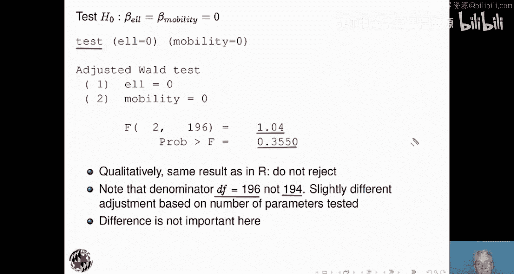

# 调查数据收集和分析：2-6：Stata中的线性模型 📊




在本节课中，我们将学习如何在Stata统计软件中拟合线性回归模型。我们将使用与之前R语言课程中相同的数据集和模型，以便对比两种软件的操作与结果。您将看到如何加载数据、设置调查权重、运行回归分析、提取残差以及进行联合假设检验。

上一节我们介绍了在R中处理调查数据并进行线性回归的方法。本节中我们来看看如何在Stata中完成相同的任务。

## 数据加载与调查设计设置

首先，我们需要将数据加载到Stata中并设置调查设计。这包括指定聚类、权重和有限总体校正。

以下是具体步骤：

1.  **加载数据**：使用 `use` 命令并配合 `clear` 选项清空当前内存中的数据。
    ```stata
    use api_data.dta, clear
    ```

2.  **设置调查设计**：使用 `svyset` 命令。在本例中，`cds` 变量仅作为计数器，意味着数据没有聚类结构。我们使用 `pweight` 选项指定权重变量 `pw`，并使用 `fpc` 选项指定有限总体校正变量。
    ```stata
    svyset cds [pweight=pw], fpc(fpc_variable)
    ```

## 运行线性回归模型

设置好调查设计后，我们可以运行线性回归模型。在Stata中，只需在标准回归命令 `regress` 前加上 `svy:` 前缀即可。

我们的模型以学校学术表现（`api00`）作为因变量，自变量包括学校中英语学习者的百分比（`ell`）、有资格获得膳食补贴的学生百分比（`meals`）以及刚入学第一年的学生百分比（`mobility`）。

```stata
svy: regress api00 ell meals mobility
```

运行上述命令后，Stata会输出结果。输出内容包括观测数量（此处为权重的总和）、整体模型的F检验、R平方值以及各个系数的估计值和标准误。

需要**注意**的是，Stata将常数项（截距）标记为 `_cons` 并放在列表最后，这与R中将截距放在最前的惯例不同。在本例中，`meals` 和常数项是显著的，而 `ell` 和 `mobility` 看起来不显著。

## 提取与标准化残差

模型拟合后，我们可能需要检查残差。在Stata中，我们可以使用 `predict` 命令来获取残差。

以下是具体操作：

1.  **计算残差**：使用 `predict` 命令并指定 `residual` 选项，将残差保存到新变量（例如 `r`）中。
    ```stata
    predict r, residual
    ```

2.  **标准化残差**：与在R中类似，我们需要手动计算标准化残差。这通常涉及用残差除以估计的标准差。

## 进行联合假设检验

最后，我们可能想检验多个系数是否同时为零。例如，检验 `ell` 和 `mobility` 的系数是否同时为零。

在Stata中，我们使用 `test` 命令来进行这种联合假设检验。

```stata
test (ell=0) (mobility=0)
```

命令执行后，会给出F统计量和对应的P值。在本例中，F统计量为1.04，P值为0.355。这意味着我们不能拒绝“这两个系数同时为零”的原假设，结论与在R中分析时一致。

**注意**：Stata报告的分母自由度是196，而R中报告的是194。这种细微差异源于两个软件在根据检验参数数量调整自由度时采用了略有不同的方法。对于大样本，这种差异通常不重要；但在小样本或检验参数较多的情况下，可能会看到更明显的差异，甚至影响到显著性结论。

---



本节课中我们一起学习了在Stata中处理调查数据、拟合线性回归模型的全过程。我们涵盖了从数据加载、调查设计设置、模型拟合、结果解读到残差提取和联合假设检验的关键步骤。通过对比发现，Stata与R在核心计算上结果一致，主要区别在于语法和部分输出的呈现方式。掌握这些基本操作，是使用Stata进行复杂调查数据分析的重要基础。