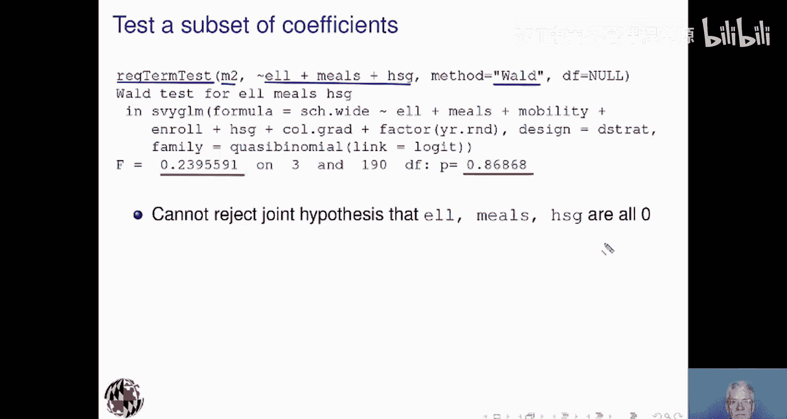

# 密歇根大学《调查数据收集和分析（2-6：方法、社调问卷设计、抽样、缺失数据、分析）｜Survey Data Collection and Analytics》 p161 12_R语言中的逻辑回归模型.zh_en -BV1fw4m1e7Zh_p161-

In this video， we will illustrate how to fit a logistic model in R。

So I'm going to use the same data that we've seen before。

 this academic performance data that comes bundled with the R survey package。

We'll look at a logistic model to predict whether a school met the target for school wide growth in the API score。

In other words， did they improve their scores compared to previous year？

And then we'll see how to test whether their subset of coefficient is zero。

 same way we did in the linear model， and we'll also look at odds ratios for a categorical predictor to see how that goes。

So there's a number of variables in the API data， and here are the ones that we're going to deal with in this illustration。

School SCH。 wide is just an indicator， did the school meet the growth target， no yes？

ELL Me and mobility we've met before in previous videos enrollment is a number of students enrolled in the school。

 HSG is the percentage of parents who are high school grads。

 you know the more educated the parents the better the students may be doing then there's COL。grad。

 that's percentage of parents with college degree。And then also there's an indicator yes or no。

 for whether the school is a year round school or not， you know。

 do they take off in the summer or do they go 12 months during the year？

So here's the R code and some of this we've seen before just to get going。We require the package。

 tell it what data we're going to use， and then create a design object。

Those statements we've seen before。We once again use the SVY Gm function to fit the model。

 This is the same function we use for the linear model。 So we， we set up a formula here for。

School wide as predicted based on all the variables in that last table and the thing that's different here is we use the family parameter。

 so we specify that as quasi binomial link equals logit that leads to logistic regression if you put probit in here then you get probit and。

C log log would give you compliment E log log。So here's the output， I do a summary on M2。

 which is where I saved the model result。What have we got， We've got one variable enrollment。

 highly significant。 We've got two here that are。Significant at the 10% level， mobility and。

College percent college graduates。So， the。Other things though don't appear to be that important year round school close to 10% level of significance。

 but doesn't quite make it and then the other things are test that as being fairly different from zero。

Or not testing out as being fairly different from zero。

Now we can test a subset of coefficients the same way we did the linear model using the reg term test function。

 so I specify my model here。After Tilde， I specify the set of parameters I want to test。

 so I'm doing English language learners percentage with subsidized meals and percent parents with high school grads。

 and I want to do a wall test on that。So。It echoes back what I ask it to do and gives me the F statistic as 0。

2395 on 2 190 degrees of freedom P value is 08686， so that's highly non significant。

 so it looks like you know the evidence is 0 to all three of those parameters simultaneously being 0 in this model。

So in the next video， we'll follow up with how to estimate odds ratios in a logistic model。

