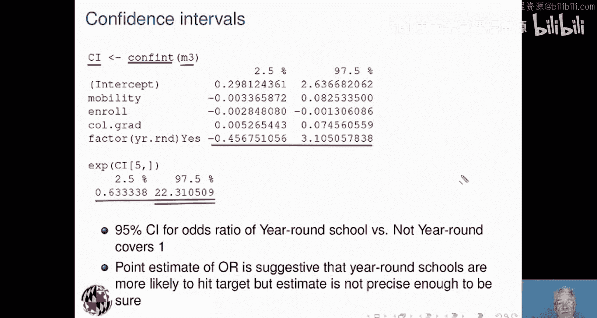
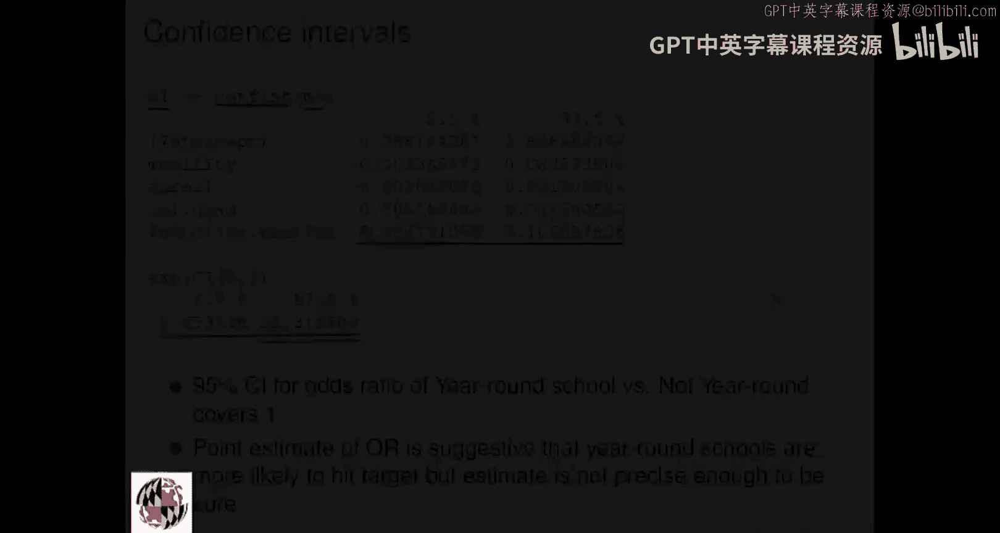

# 密歇根大学《调查数据收集和分析（2-6：方法、社调问卷设计、抽样、缺失数据、分析）｜Survey Data Collection and Analytics》 p162 13_比值比.zh_en -BV1fw4m1e7Zh_p162-

Let's look now at how to calculate odds ratios in logistic models when you're using the R survey package。

So， the。Ods of having a characteristic are defined this way。

 the probability that you get the characteristic divided by the probability that you don't。

And the ratio of the odds for having a characteristic when you're comparing two categories is defined as the ratio of the odds。

Shorthand for that is odd's ratio。And take an example。

 suppose we're trying to estimate the probability of having diabetes， say。

 and we're comparing males and females。Then。What the odds ratio would be would be in the top we'd have the odds of having diabetes if you're male。

 in the bottom wouldd have the odds of having diabetes if you're female。

Now in the logistic regression model， we set up this sort of a model where we're actually modeling the log of the odds。

 the math works out nicely for that formulation is through the way the reason that people do it。

 so the log of the odds for a given set of covariates。That's what these Xs are。

 is modeled as a linear combination of those covariates。So on the loggo scale。

We get the same sort of model we get linear regression and the axis here can be all sorts of things they can be quantitative variables like how much education you've got Did you go to college or not。

Categorical variables like male or female or what region of the country you live in。

 whether you've had a adequate diet throughout your life。All sorts of things are possibilities。

So we estimate that there's software out there that will do it for us。

 so we don't have to worry about that piece。So now let's think about the log of the odds for category one versus2。

 or log of the odds for ratio。 If I take the logarithm of that formula on the last page。

 then I get the difference in the log of the odds and if，My X variable。

 the covariate I'm thinking about is categorical zero or1， like male versus female。

And I set all the other covariates in my model to be the same for males versus females。

 assuming that makes substantive sense。Then the model says that the difference in those log odds is just going to be the difference in the regression parameters。

Say beta 1 minus beta 0 for category 1 versus category0。If the。

Category  zero is a reference category。In other words。

 the category that we set the solution to the regression parameter estimation to zero。Then。

This one zeros out the betaaught， and we're just left with the difference in the log of the odds being beta 1。

Well。You know fold this back up so it's not the difference in the odds。 it's the odds ratio。

 That means to get to the odds ratio scale， all I have to do is exponentiate。

 So if I exponentiate my solution for beta1 beta hat1。

 then that's the odds ratio for having the characteristic like diabetes for males versus。

The odds of having the characteristic if you're female。So that's how logistic regression works。

So let's take a look at the R survey code that would allow you to do that。

Now the first thing I do is require the package as usual， I tell it what data I want to use。

 so I'm using the academic performance index data set again。And I define the same。Sttraatified。

 simple random sampling design that we've looked at before。Now， in this case。

 I'm going to fit a model， logistic model that's the reduced version。

Of the one that we saw in the last video， there were a couple extra parameters in that one that appeared to not。

Having the importance in the model。 So I've left those out。

So I'm predicting whether school wide improvement target has been met or not based on mobility。

 the enrollment in the school， percent of parents that are college grads and a factor for whether the school is year round or not。

Remember that this family equals quasi binomial link equals load， it gives me a logistic regression。

 and here's my output down here。So I。These estimates are a little bit different than the last video because I've left out those parameters that didn't look important。

 so enrollment's a big one。嗯。The intercept mobility is significant at the 10% level。

 college grad is significant at the 5%， year round is not significant。But just for illustration。

 let's think about what would I do to get from here to the odds ratio for year round schools versus not year round schools。

😔，So。As the last slide showed， I just exponentiate that parameter value。

 so I do that at the R prompt and here's my answer。3。76， approximately。

That says that year round schools are about 3。76 times more likely to meet the school wide growth target。

Than our schools that are not。Year round。But。Note this P value here。 The， you know。

 the evidence may not be that strong because our。Test is saying that， wellow。

 maybe this estimate is not that much different than one。Or zero。

Let's follow up on that by looking at the confidence intervals。How do we do that， We have a。

Function in R called Conent。 So I saved the model itself in an object called the M3。

 So I just applied Con to M3。 and I save that in an object called C。

So here's all the confidence intervals it does all at once。

 and the one that we're interested in here is。The year round parameter estimate。

 so you can see that this covers zero。The confidence interval， this is 95%。 I go from minus 0。

45 up to 3。10。And then a back transformed to the odds ratio scale and sure enough。

The confidence interval covers one， which would say that。

Year round schools and non year round schools are about equally likely to meet the target for growth。

On the other hand， you know， things are pretty suggestive。 this upper。

Indpoint is quite a ways from one。This 0。63 is somewhat close to one。So， you know， with more data。

 maybe we would。Be able to say more confidently that year end schools are more likely to have met the target。

But that's how you set up the code in。Go from the parameter estimates to Ads ratios using the R survey package。

