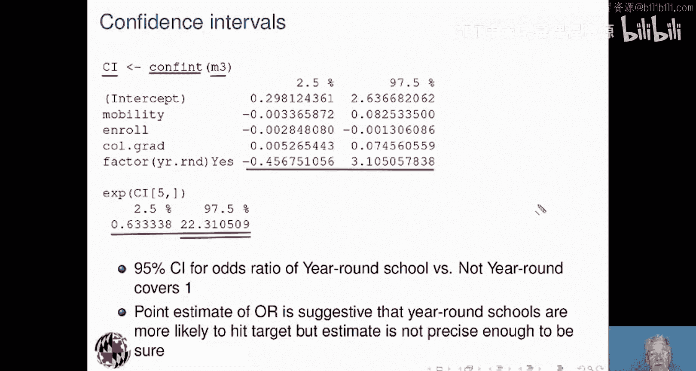
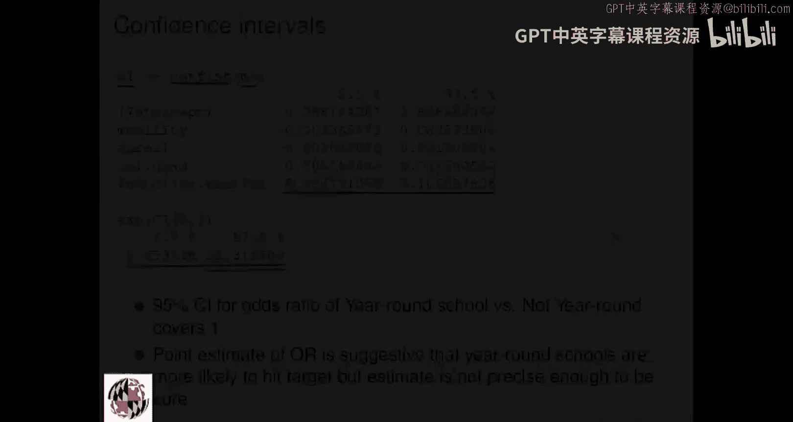

# 调查数据收集和分析：13：使用R survey包计算逻辑回归中的比值比


在本节课中，我们将要学习如何在R语言的survey包中，为逻辑回归模型计算比值比。我们将从比值比的基本概念开始，逐步过渡到如何在考虑复杂抽样设计的模型中实现它，并最终解释其结果。

## 概述

逻辑回归是分析二分类结果变量的常用方法。当我们的数据来自复杂抽样调查时，需要使用专门的包（如R的survey包）来正确估计模型参数。本节课的核心是理解如何从这些参数估计中，计算出有意义的比值比，并评估其统计显著性。

## 比值比的基本概念

上一节我们介绍了逻辑回归的模型设定，本节中我们来看看比值比的具体定义。

**比值** 是指拥有某个特征的概率与不拥有该特征的概率之比。其公式为：
`Odds = P / (1 - P)`
其中，`P` 是拥有特征的概率。

**比值比** 则是比较两个类别（例如男性和女性）时，其比值的比率。例如，比较男性和女性患糖尿病的比值比公式为：
`OR = (Odds_diabetes | Male) / (Odds_diabetes | Female)`

## 逻辑回归模型中的比值比

在逻辑回归中，我们实际建模的是**比值的对数**（log-odds）。模型形式如下：
`log(P / (1 - P)) = β₀ + β₁X₁ + β₂X₂ + ... + βₖXₖ`
其中，`X` 代表各种协变量，可以是定量变量（如教育年限）或分类变量（如性别、地区）。

这种设定使得在log-odds尺度上，模型是线性的，便于估计。当我们比较一个二分类变量（如`X₁`，男性=1，女性=0）的两个类别时，在其他变量相同的情况下，log-odds的差值就是该变量的回归系数 `β₁`。

为了得到更容易解释的比值比，我们需要将log-odds尺度转换回原始尺度。这通过取指数实现：
`Odds Ratio = exp(β₁)`
这个值就代表了男性相对于女性患糖尿病的比值比。

## 在R survey包中实现

现在，让我们看看如何在考虑抽样设计的R survey包中具体操作。

首先，需要加载必要的包和数据，并定义抽样设计。以下是一个示例代码框架：
```r
require(survey)
data <- read.csv(‘your_data.csv’)
design <- svydesign(id = ~1, strata = ~stratum_var, weights = ~weight_var, data = data)
```

接着，我们拟合一个逻辑回归模型。以下是一个预测学校是否达到年度进步目标的模型示例：
```r
model <- svyglm(target_met ~ mobility + enrollment + pct_college_grad + factor(year_round),
                design = design,
                family = quasibinomial(link = “logit”))
summary(model)
```
模型输出会给出各个预测变量的回归系数估计值。

## 计算与解释比值比

从模型输出到比值比的计算非常简单。假设我们关注`year_round`（是否为全年制学校）这个变量，其系数估计为 `β_yearround`。

我们通过指数函数计算其比值比：
```r
or_yearround <- exp(coef(model)[“factor(year_round)1”])
print(or_yearround)
```
如果计算结果约为3.76，则意味着全年制学校达到增长目标的可能性是非全年制学校的3.76倍。

然而，仅有点估计是不够的，我们还需要评估这个结果的可靠性。

## 评估显著性：置信区间

为了判断比值比是否显著不等于1（即无效应），我们需要查看其置信区间。

以下是计算回归系数置信区间并将其转换为比值比尺度的方法：
```r
# 计算回归系数的置信区间
ci_coef <- confint(model, parm = “factor(year_round)1”)
# 将置信区间转换到比值比尺度
ci_or <- exp(ci_coef)
print(ci_or)
```

如果得到的95%置信区间（例如`[0.63, 22.5]`）包含了数值1，则说明在统计上我们没有足够证据表明全年制学校与非全年制学校在达标可能性上有显著差异。尽管点估计3.76看起来很大，但宽广的置信区间提示我们估计存在很大的不确定性。

## 总结

本节课中我们一起学习了在复杂抽样调查数据分析中计算和解释比值比的全过程。

1.  **理解概念**：我们回顾了比值与比值比的定义，以及它们在逻辑回归模型中的对应关系——即回归系数经过指数变换后即为比值比。
2.  **软件实现**：我们演示了如何使用R的survey包，在考虑抽样权重、分层和聚类的情况下拟合逻辑回归模型。
3.  **计算解释**：我们掌握了如何从模型输出的系数中，通过`exp()`函数计算比值比，并理解其实际含义（例如，某个群体发生事件的可能性是参照群体的多少倍）。
4.  **统计推断**：我们强调了仅有点估计是不够的，必须通过检查置信区间是否包含1（或系数区间是否包含0）来评估结果的统计显著性。





记住，当置信区间包含1时，应谨慎解释比值比，因为这可能意味着效应在统计上并不显著。扎实的分析需要将点估计与区间估计结合起来进行综合判断。