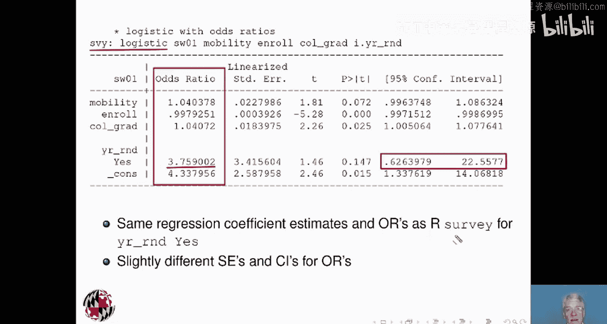

# 密歇根大学《调查数据收集和分析（2-6：方法、社调问卷设计、抽样、缺失数据、分析）｜Survey Data Collection and Analytics》 p163 14_Stata中的逻辑回归.zh_en -BV1fw4m1e7Zh_p163-

嗯。In the last video we looked at how to run a logistic regression and get odds ratio estimates in the R package。

 so now let's do the same thing in sta。So I'm going to use the same regression as in the R example。

 so I'm regressing school wide， which is an indicator variable for whether a school wide growth target in API score was met。

And。The covariates I'm dealing with are enrollment， college grad。

 percentage of parents with college degrees。And whether a school is a year round school or not。

And here's the state code that's appropriate for doing this。

 so the first thing we do is we load up the data with use APIpistrat。

dta clear and this is a state format version of the API Strat data that I wrote out using the right dodta function in the foreign package in R。

So I've created exactly the same data， but in this new format that Sta understands。

Then we use SVUI set to specify the design， CDS is a counter variable， we've got no PSUs。

 but we need an IED variable， the design weight is called PW， the strata our school types S type。

 and I've got a finite population correction factor in this design。

Now the next thing I want to do is recode school wide which I need to do in this in the data in order to get it to understand that I'm dealing with a 01 variable so I generate a new variable called SW01 and that's based on school wide now notice when the DTA form of the data set got written out。

 it changed the dot that was in the R variable name to an underscore。

So it took care of that for me automatically because State doesn't like dots in the middle of its variable names。

And then I recode Sw01 menu variable by saying。If it was one， set it equal to zero， if it was two。

 then set it equal to1。So that way I'm sure of modeling the probability。That。

School I target has been met。You know，If I didn't get that quite right。

 I'll model the target or the an indicator for whether it has not been met， which。Uummerically。

 what it'll cause is the coefficients will be negative in a way that。I don't expect， you know。

 it'll seem like the directions is the wrong way of the influence。

 but it's just because I don't have the package interpreting what true default false is。All right。

 so here are the coefficients and if you look back at the R output， these are the same。

The standard errors are slightly， very slightly different。

 so the internally there's a slightly different formula being used to get these standard errors。

 but it won't have any substantive effect。Now notice on year round that's down here。

 the confidence interval on the parameter goes from negative 0。46 up to 3。11。

 which is similar to what we got in R。So the the。You know， the。

That's saying there's not much evidence that。Year round schools are different from non year round schools。

 at least our sample doesn't appear to be precise enough to pin that down。

Now we can get confidence intervals in data， so you'll notice on the last page。

 let's just check that again。What I did was call the model with SVY。Cohen。Logit。

And what that does is result in getting me parameter estimates and confidence intervals on those。Now。

 in order to get data to give me confidence intervals on odds ratios。

What I need to do is use a slightly different call。 So instead oflogit， I do SVY Lo。

I fit the same model， it just gives me slightly different output。You know。

 that's the convention and status。 So it's just a matter of learning what the how to talk to the package。

 So here are the odds ratios。And those are essentially the same as what we saw in R and notice for year round。

 the odds ratio is 3。76。To two decimal places。You impmplying that it looks like the year round schools are likely。

To meet the targets more so the non year round schools， but when we do the confidence interval。

 we also get about the same thing as we saw in our 063 up to 2。56 or theirabouts。

So even though the value of the odds ratio itself right here is suggestive that year round schools may be more likely to hit the target。

 our sample is not precise enough， our data are not strong enough to give us real evidence that that's the case。

But on the whole， we get。The same。Nummerical and qualitative information by running the model in state as we do in R。

 and that of course is what we would expect to happen。

