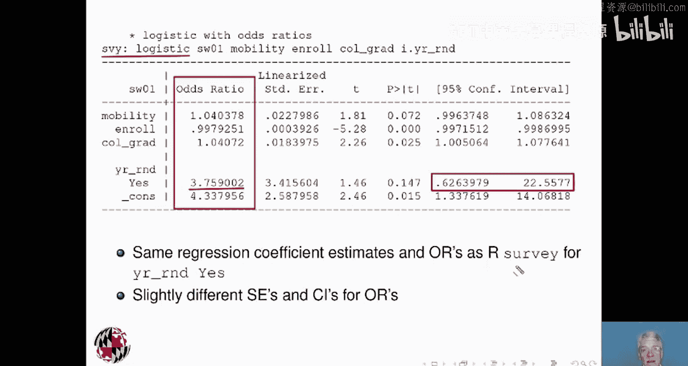

# 调查数据收集和分析：2-6：Stata中的逻辑回归 📊


在本节中，我们将学习如何在Stata统计软件中执行逻辑回归分析，并获取优势比估计值。我们将使用与之前R语言示例中相同的数据集和模型，以便进行直接比较。通过本教程，你将掌握在Stata中处理复杂调查数据、运行逻辑回归模型以及解释结果的基本流程。

上一节我们介绍了在R中运行逻辑回归并获取优势比的方法。本节中，我们来看看如何在Stata中完成相同的分析任务。

## 数据加载与调查设计设定

首先，我们需要加载数据并指定调查设计。以下是相应的Stata代码：

```stata
use APIpistrat.dta, clear
svyset [pweight = pw], strata(stype) fpc(fpc) vce(linearized)
```

这段代码执行以下操作：
1.  使用 `use` 命令加载名为 `APIpistrat.dta` 的Stata格式数据集。
2.  使用 `svyset` 命令设定调查设计。其中，`pweight = pw` 指定了概率权重变量，`strata(stype)` 指定了分层变量，`fpc(fpc)` 指定了有限总体校正因子，`vce(linearized)` 设定了方差估计方法。

## 变量重新编码

为了确保模型正确解释因变量，我们需要将分类变量重新编码为0/1格式。原始变量 `school_wide` 表示学校是否达到了API分数的全校增长目标。

```stata
generate sw01 = school_wide
recode sw01 (1=0) (2=1)
```

这段代码创建了一个新变量 `sw01`。通过 `recode` 命令，我们将原值为1的类别重新编码为0（表示“未达到目标”），将原值为2的类别重新编码为1（表示“达到目标”）。这样，模型将直接预测“达到目标”的概率。

## 运行逻辑回归模型

设定好数据和变量后，我们可以运行考虑调查设计的逻辑回归模型。模型公式如下：

**logit(P(sw01=1)) = β₀ + β₁*enrollment + β₂*college_grad + β₃*year_round**

在Stata中，使用 `svy:` 前缀来运行考虑复杂调查设计的模型。

```stata
svy: logit sw01 enrollment college_grad year_round
```

运行此命令后，Stata会输出模型的回归系数估计值、标准误、z统计量和p值。与之前R的输出结果相比，系数估计值应完全相同，标准误可能因软件内部计算公式的细微差别而有极小的不同，但这不会产生实质性的影响。

例如，对于 `year_round` 变量（表示是否为全年制学校），其系数置信区间可能从-0.46到3.11，这与R的结果相似。这表明我们的样本数据尚不足以精确判断全年制学校与非全年制学校在达标概率上是否存在显著差异。

## 获取优势比及其置信区间

逻辑回归的结果通常以优势比的形式呈现，因为它更直观。在Stata中，获取优势比需要使用 `logistic` 命令而非 `logit` 命令。

```stata
svy: logistic sw01 enrollment college_grad year_round
```

执行上述命令后，Stata将直接输出优势比估计值。例如，`year_round` 变量的优势比可能为3.76，这暗示全年制学校达标的发生比可能是非全年制学校的3.76倍。

然而，关键还需要查看其置信区间。优势比的置信区间可能从0.63到22.56左右。虽然优势比点估计值大于1，但其置信区间包含了1，这意味着在统计上我们没有足够的证据表明全年制学校达标的发生比显著更高。样本数据提供的证据强度不足以下此结论。

## 结果对比与总结

通过比较Stata和R的输出，我们可以确认：
*   模型系数估计值和优势比估计值在两个软件中基本一致。
*   标准误和置信区间有极细微的差异，源于软件内部算法的不同，但无实质影响。
*   对于 `year_round` 变量，两个软件均显示其效应在统计上不显著。



本节课中我们一起学习了在Stata中执行复杂调查设计下的逻辑回归分析的全过程。我们涵盖了数据加载、调查设计设定、变量重新编码、模型运行以及结果解释，特别是如何获取和解释优势比及其置信区间。最终，我们验证了使用Stata与R进行分析能得到数值上和定性上相同的信息，这符合统计分析的一致性预期。