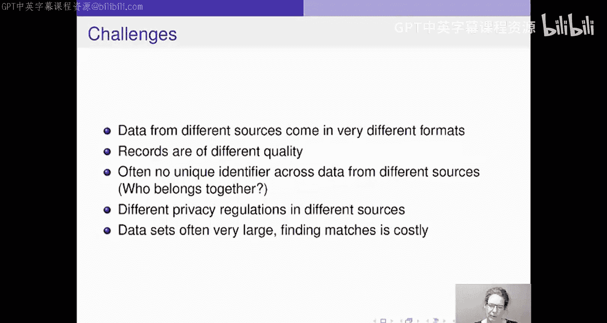
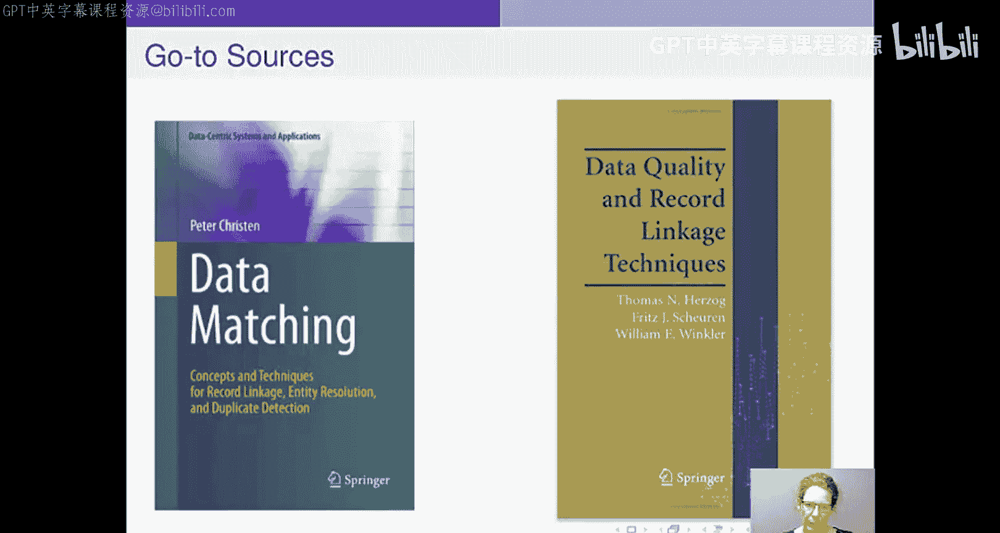

# 密歇根大学《调查数据收集和分析（2-6：方法、社调问卷设计、抽样、缺失数据、分析）｜Survey Data Collection and Analytics》 p164 15_记录链接的意义.zh_en -BV1fw4m1e7Zh_p164-

Hello， welcome to session 3 In to record linkage。I should say up front many thanks to Stefan Benner。

 who is currently at the Bues bank in Germany， Julia Lane。Is provost fellow， professor at the。

New York University， Wgna School。And Manfred An。A colleague of mine at the Institute for Employment Research in Germany。

 as well as Peter Kristen， who is with the Australian National University。

All of these and many others have contributed to my knowledge on record linkage and I shall not forget to mention my the advisor。

 Ryan Nner。I will cite and use material from all of them that they have developed in their own research。

 in their own work。And will indicate when I do so。 But if I fail to mention that on a particular slide。

 you should know that any of the literature contributions of。

These people should be something that you should look up to。

 and that's where we collected all this material from。So let me get started with this topic。

After brief motivation。I will give you a very gentle introduction on what it is that we call record linkage。

In the third lecture on this topic， I will talk about key linkage techniques。

And then we'll touch on a couple of advanced record linkage techniques， mostly an overview of those。

 no deep technical handling of these topics。And then the last module in this course are all the ethical issues that have to do with linkage consent。

 but also with privacy and confidentiality in these linkage techniques。

So let's start with the motivation。Without a doubt。There are more and more data collected everywhere。

 We see this in the public sector， in the private sector。

We see this from specific researchers or individuals。 And you know that from your own life。So。

 you know， when you go to doctor's office， it's not longer hand written cards。

 Everything is captured electronically。 Many of our financial records are。

Kept and processed electronically， leaving traces of data。We all have。More out。

Or a few loyalty cards， credit cards。They produce transaction data every day when they are used。

Scanner data that process or used to process。Food purchases in storess， produce data。

So all of these are kept and create individual files that presumably can be merged together to create a full picture。

We've seen this for a little longer with data from text records or Social Security records。

 and I'll touch upon those。But what is really new in this space are all the social media traces we leave。

 text， messages， blogs。Now it's a little scary to think of a world where all of this would be taken together and used。

But， of course， from a researcher point of view， there's great hope that we can。

Create new insights out of these data and maybe even at a lower cost。And actually。

 there are a couple of fantastic examples out there where this has happened。

A few I want to introduce here and on the course website。

 there's more information on them as well as links to its original resources。

So Julia Lana mentioned her earlier， she was one of the main engines in the LongitudinalEmployer household and Dynamics Project that is part of the Center of Economic Studies at the US Census Bureau。

It's a pretty cool project because here states in the United States share unemployment insurance earnings data in the quarterly Census of  employment and wages with the US。

 Census Bureau。Which themselves adds administrative and survey data to this database。

The mission of this endeavor is to be able to create dynamic information on workers。

 employers and jobs。And remove any additional data collection button。

As I mentioned on your course page， links and background information。

 but just imagine if you were to ask with the help of survey questions。

All of these people about their employment history， what they earned， when they started。

 when they stopped， you know how whether this was were earnings that created Social Security benefits and the like。

 that would be a huge put。And of course， analyzing the data that's already there seems like an actual thing。

 but it is less common as one might think and in fact。

 a lot of countries are struggling right now with how to unlock data that are siloed in the US。

 for example， in the various federal states or at local agencies。As I just mentioned。

 many countries and so the US， they struggled with this question and the US Committee on National Statistics as part of the Academy of Science。

Just wrote a report， you know coming out of a panel that I was part on really trying to figure out how can administrative conservative data be combined not on a technical level per se。

 but the whole notion of you know privacy issues access， who should be able to do this。

 when can this be done， how can one in general make more use of administrative data who should be allowed to access those data and the like。

 so this is a big push in a discussion everywhere， the sources for。

This discussion are also linked on the web page and I encourage you to read that report。

 It gives you a good overview over。The current state here and what's in discussion。

The hope is that with these endeavor， the quality of existing data sources gets improved or the burden of collecting these data from respondent。

 we have some other means， for example， service data is reduced。And as I said before。

 the hope is that new research question can be answered。Now。

 the challenge with these endeavors that they are data from different sources。

 they come in a variety of different formats。The records are of different quality。

They are of no unique identifier across all these data。

It's not clear who really belongs together and how can we figure that out？

And then the issues of privacy regulations that vary across the different data sources。

And an issue of size when the data very launched， it can be quite costly to find the proper matches。

So。With this motivational introduction。I want to a pointpoint you to two books。

 one from Peter Kristen where this presentation heavily relies on material from that book。

 it's called data matchingching。With Springer and another Springer book which I been around for a little longer。

From Thomas Educk first， Choron and Bill Winkler。Data quality and record linkage techniques so between those two you really covered and can wellma the topic they both of course publish material and we can't put them for free up on the Cosera website but I nevertheless want to encourage you to take a look if your local library has them or you will purchase them。

We have additional information and shorter articles on the web hopefully jointly。

 this will be enough background material for you。

