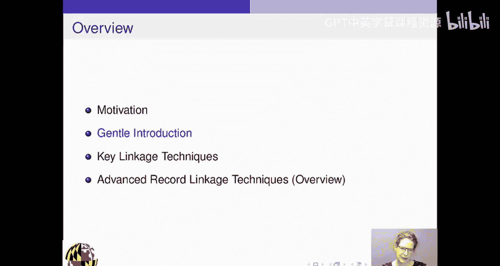
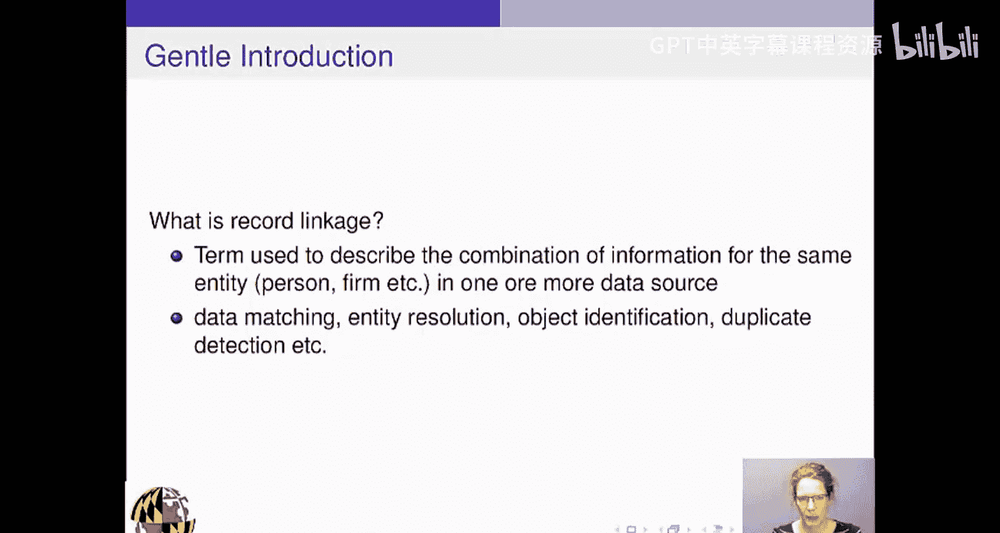
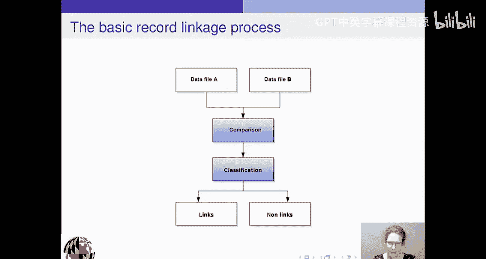
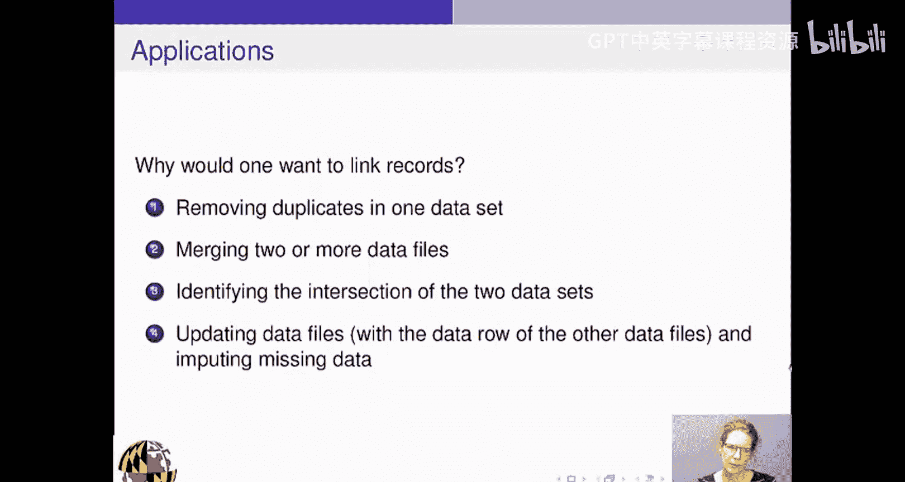
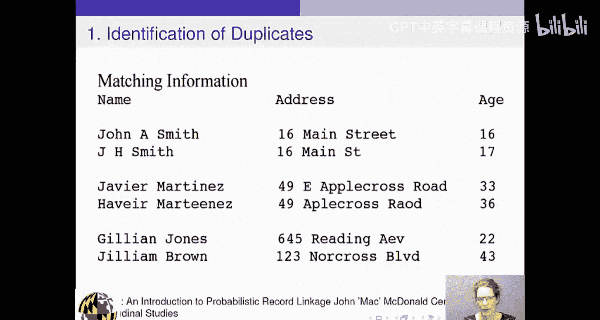
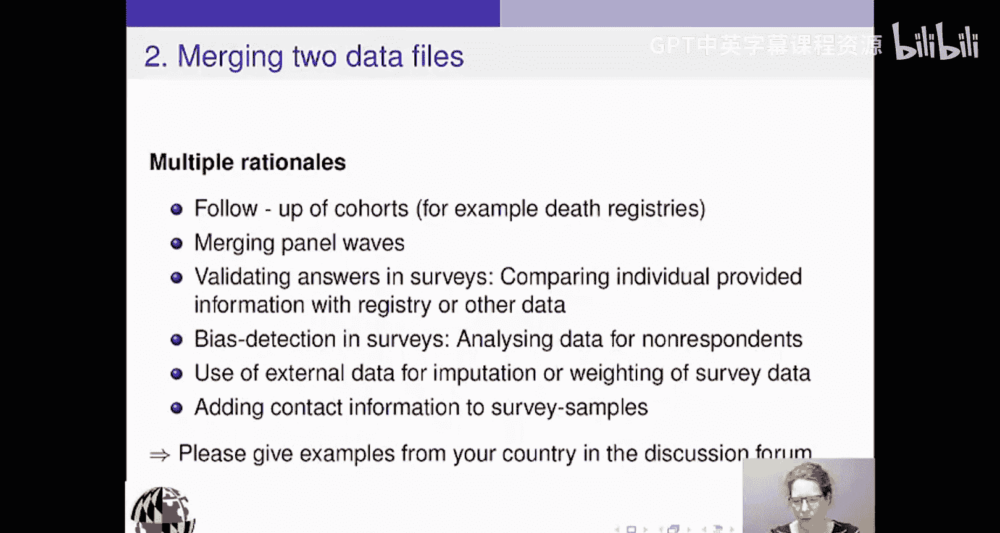
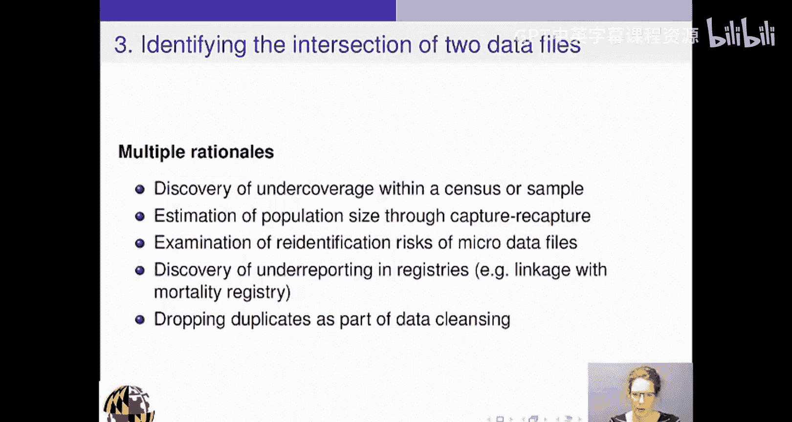
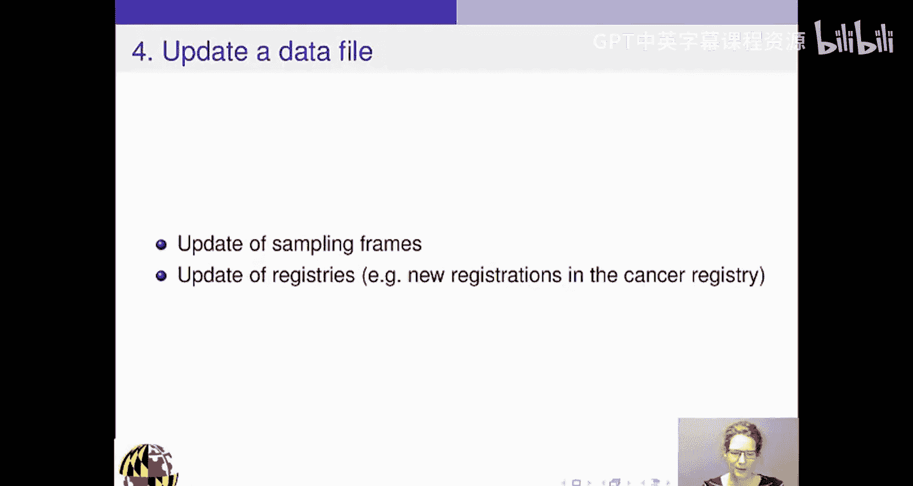

# 密歇根大学《调查数据收集和分析（2-6：方法、社调问卷设计、抽样、缺失数据、分析）｜Survey Data Collection and Analytics》 p165 16_入门指南.zh_en -BV1fw4m1e7Zh_p165-

Let me continue。Our gentle introduction here to record linkage。

With。First， answering the question， what is record linkage？

That term is used to describe the combination of information for the same entity。

 whether this is a person or whom in one or more data source。Okay， so you want to find。

Another person， another company， or what have you。Whose record is in a different data source or might be in the same data source。

This technique might be familiar with these activities might be familiar to you from other disciplines in some instances it's called data matching。

Computer scientists sometimes call this entity resolution or object identification。

Duplicate detection is another term that sometimes is used。

 and there I'm sure are many more that basically get it the same thing for statisticians in health research and other more applied areas。

 the term record linkage is most commonly used， and that's what we're going to use here。

The basic idea is you have two data fieldss， A and B。You compare each record in the data file。

And then you decide is this image。Can you link those， yes？Can you not link them， No。

 that would be the idea world。 Now， you will see it's often not that easy and we'll discuss why。

But。Before we talk about these challenges， why would we even want to link those records？Well。

 if it's just one dataset set， so you compare a with A。

Then these techniques can help you to remove duplicatelics。

You might be interested in merging two data files to identify the intersection of two data sets or to update your data files and I'll give you examples for each of them。

So identifying the duplicates。You could imagine you have a data file that has a lot of cases in it。

And before you do the statistical analysis that we showed earlier in this course。

And you compute averages or percentile or what have you， you probably would want to be sure。

If there isn't another way to ensure that that you are not including multiple cases。

 that really should be one。 So here is an example where we have three people that。Appear or。

Might have appeared multiple times in this record。 So for the first one， there's a John A。

 Smith in 16 Main Street。That has another record in our file here that looks pretty similar for a human。

 We probably would think， well， at the same address， someone。Who was called J。 H。 Smith with。

 you know。Aged just a year po， that might be likely the same person。

It could be an spelling error or an auditory error when the record was recorded。Likewise。

 with Javier Martinez。对啊。Spanish speaking name。Could easily be misspelled by someone who does not know the proper pronunciation of J in Spanish。

And written down with an age。Likewise， the。Appppercro Road has clearly a couple of typos here in the second row。

So likely these two people are the same person in particular the H is not all that far apart。

 it's a little less clear with Jilln Jones and Jilln Brown， theyre probably not the same person。

 different street names， different age groups， but you know these are fantastic examples that John McDonald from the Center for Longitudinal Studies had in one of his presentations。

I highly recommend his introduction to probabilistic record linkage。

 but you can already get a flavor of the challenges on。

Identifying matches and non matches。So in the second application， merging to data files。

 why would we do that， well， there a couple of reasons。You could have。Data set。

 maybe a survey and you want to follow up after a while to see if the people are still alive and you could match that with death registries。

 for example， right so you would have in this case to name and addresses or a name and birth of a particular person from your original data collection and then you go to the registry and want to match those。

Or you might just have simply several panel waves of a survey often， or hopefully。

 you will have a unique identifier that's not a name and an address。 Those things can change。

 but a unique identifier that stays。The same over time and then you would merge those panel waves。

 but that kind of merg could record linkage could happen both whether you have a unique identifier or you have to create those out of other variables。

Then you could have a setting where you try to validate answers in your surveys。

That is an activity that I've done a lot， we compared information provided by individuals to data from other data sources。

 administrative data， for example， where we evaluated the quality of the survey data。

And in the assumption that while there might be errors on some variables in the administrative data。

 we assume that they should not be subject to the kind of errors that we assume。

There to be in the survey data， I'll show you a little bit more of that。

 but also way back in the question and design module。

 you have seen some of these experiments and I'll crosslink that on the course website。

Then we have similar activities where you match survey and administrative data to detect biases and surveys and that too we've done a lot at the Institute for Employment Research because we have all of the Social Security administrative data and we sample out of those so if we know for anyone who does not respond in the survey what their record data look like and so we can look at biases at least with respect to these administrative survey data。

Then linkage can be of interest to if you're trying to impute or wait your survey data and the external data that you link to the records can give you additional information。

Or you would want to just add contact information to your survey samples。

 maybe phone numbers that you link from a separate source。

So all of these examples that happen in my research life and the things I talk to people about。

 but I'm sure you have very different examples and experiences and you if you think of the different application fields。

 whether this is health or you crime or terrorism you know in any of these settings we certainly have a lot of agencies that try to collect and combine data from various sources in order to improve what they are doing。

The third rationale is the identification of the intersections of two data files so that would be often when you in the survey setting you create a frame and you hope to you know see who is not covered by two frames right and so you have a census in the sample and you would look at coverage who is missing。

 we discussed this very early on in the specialization。

Or you try to estimate the population size through capture and recapture method。

 so you do this twice and this is a common sampling technique or you try to。

Examine redification risks of microdata files。Or you would try to discover under reportingporting in the registry。

 so all of these are examples where you look at the intersections of two data files and make an estimate。

From them， we will link a couple of examples， actually research papers that do these things on the course page so that you can read up on that。

And as a fourth example updating of data files， so this would be you know you have in surveys we discussed this too。

 the issue often in telephone surveys that we need dual frames。

 we have a frame of landlines and we have a frame of cell phone numbers and they need to be combined but they also then need to be deuplicated because of course we want。

Only one phone number for every respondent， or if we have multiple。

 then at least we want to be aware of it。Otherwise。

 we couldn't calculate or estimate the sampling probabilities properly。

So I hope these different applications create enough motivation for you and enough context why this is important for us in this specialization。

