# 密歇根大学《调查数据收集和分析（2-6：方法、社调问卷设计、抽样、缺失数据、分析）｜Survey Data Collection and Analytics》 p166 17_挑战.zh_en -BV1fw4m1e7Zh_p166-

Weか。So let's talk a little bit about the challenges in record linkage。

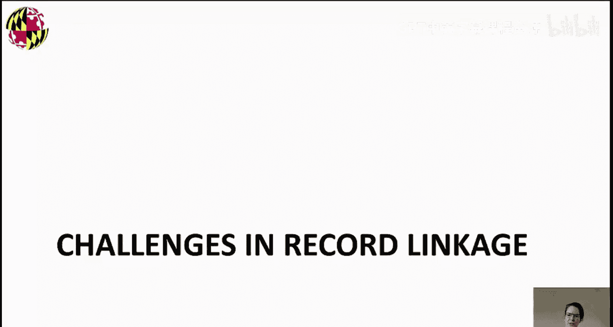

No matter how big the size of your records is， we have some traditional challenges when linking records from multiple data sources。

One big one is the lack of unique identifiers。Let's take， for example， Julia Laine。

 a dear colleague of mine。Professor at the Baragner School in New York at NYU。And。

I search for her on the internet using Google imageage search。Immediately， two other pictures appear。

Share a feature。With her， all three are females， but clearly different people I view。

Not surprisingly because Julie Lane is not that of a unique name。The same can happen with pes。

Summit Conulting is a statistical consulting company here in DC。

 but if we look for summit consulting on the internet， we'll find another company in Texas。

So the lack of unique identifiers across different files can be a real challenge for anyone who wants to make sure that the same entities are matched to each other。

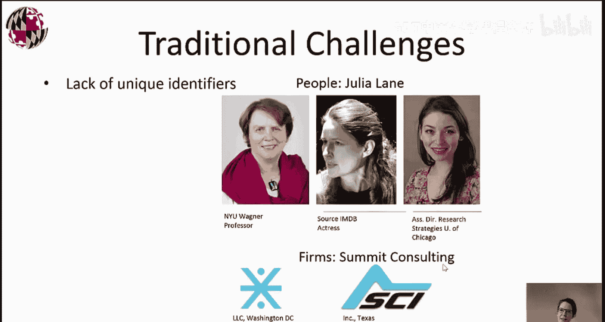

Another challenge are what's often referred to as dirty data。Data can be quite messy and dirty due。

Typographical errors。Variations in a record， so let's assume that for example。

 marital status changed over time or someone moved and the address will be different in different records。

 even so it's the same entity。Values can be out of date in a similar way。

 and of course values can be missing。In which case。

 we hope that we can insert them from one database to the next。

Different coding schemes often appear when we deal with dates that can be a big problem because dates are recorded in one format。

 in one data source， and in a different format in the next。On the right hand side。

 you see some examples to。John Smith being spelled differently， capitalized and not。

 Charless abbreviated to Chuck， same with William and Bill often the same person in different dataset sets。

And the list goes on。But street names too can have very different ways they are recorded， wrote。

 being abbreviated， drive， and so on， and you see in this example a couple of different ways to write down dates as they might appear in different databases。

These examples on the right are taken from an NIH resource。

 the full references giving on the bottom of the slide and you can look at this online book yourself。

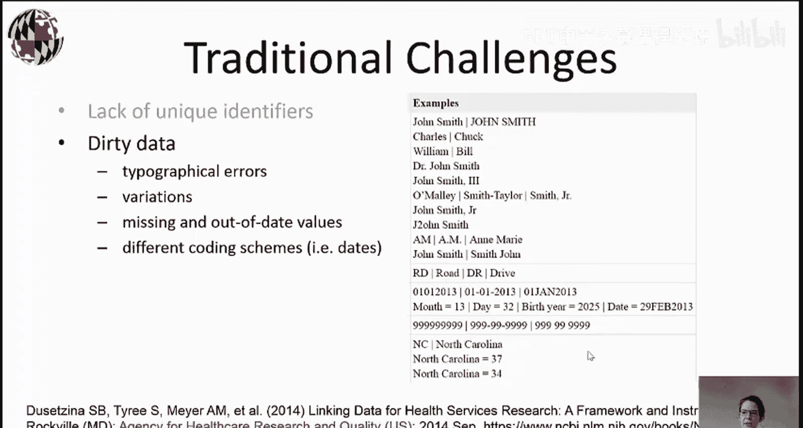

Another challenge that we are aware of and often happens is the issue of privacy and the nature of the data that want to be linked。

So on the right hand side， you see a chart from the Euroruang Barromaa。

Where people would ask how sensitive they would consider the following information to be。

 and you can see that financial information and medical records are considered to be sensitive by a large fraction of the respondents in the survey。

In many countries， you have to give informed consent and we have a separate manual on that and of course the youth will。

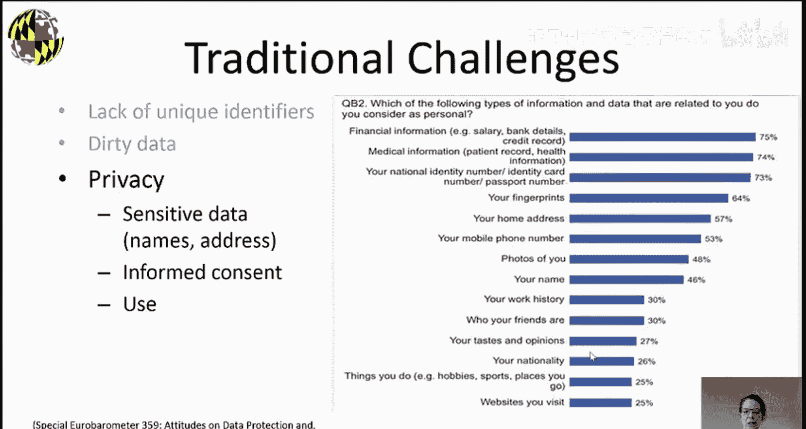

Of the data will affect all of these issues。In the big data context。

 a couple of new challenges arise。One important one is scalability。

 so the naive comparison of one record to another will。Explode。

 you know you have a lot of different records in all of these databases and if you think doing pairwise comparison to see they on the same or not。

 that will take a long time so we need to move to an approach that's much more efficient。

And research needs to be done into those techniques。Also。

 sometimes we have networks and complicated relationships that you might need to take into account when matching these records。

And。Mostly a big challenge is that we often do not know what is the true entity。

 so there aren't really good training data sets available for the algorithms to learn what is the correct match and what is not so this is why there's a lot of new research done in this field currently。

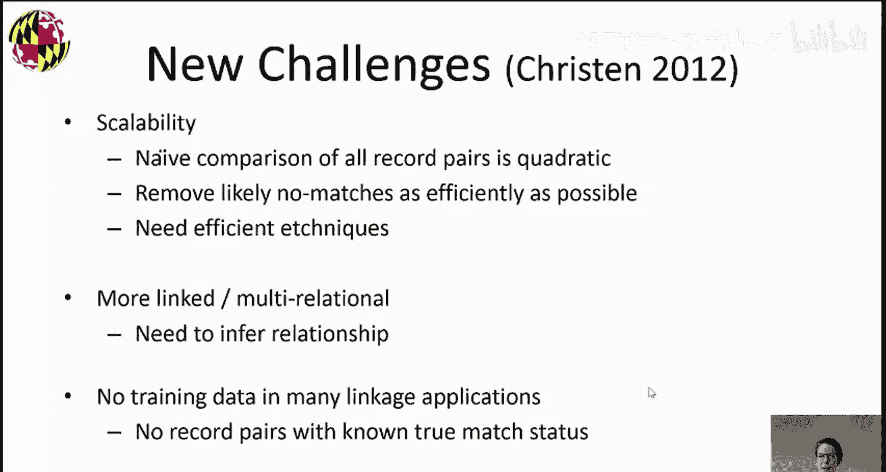

The extended record linkage process， as depicted by Bennder and his colleagues。

 is therefore not one way just compare data file A and B。

 but where there's a lot of preprocess going on。In both files， before you compare them。

So the preproing could include the passing of individual names， correction of typos。

 anything of that nature。Ideally， you also reduce the search space。

 so if you know that someone is in Chicago， maybe you can limit the search just to the area of Chicago and this is referred to as blocking。

 and then you do your comparison within those smaller sets before you classify them as true links or no links。

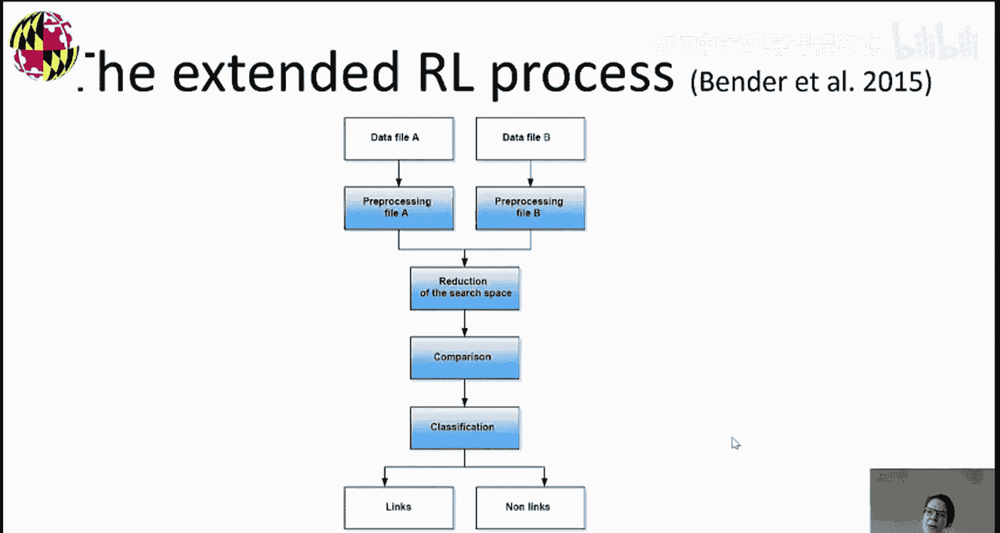

Now， to put this in perspective， it is the case， just like with a lot of analyses that we do。

 that 75% of the work according to Jill in 2001，Amands to this cleaning and passing step。

20% is roughly what the matching checking the matching process is correct。

 and only 5% goes to the actual linkage effort。

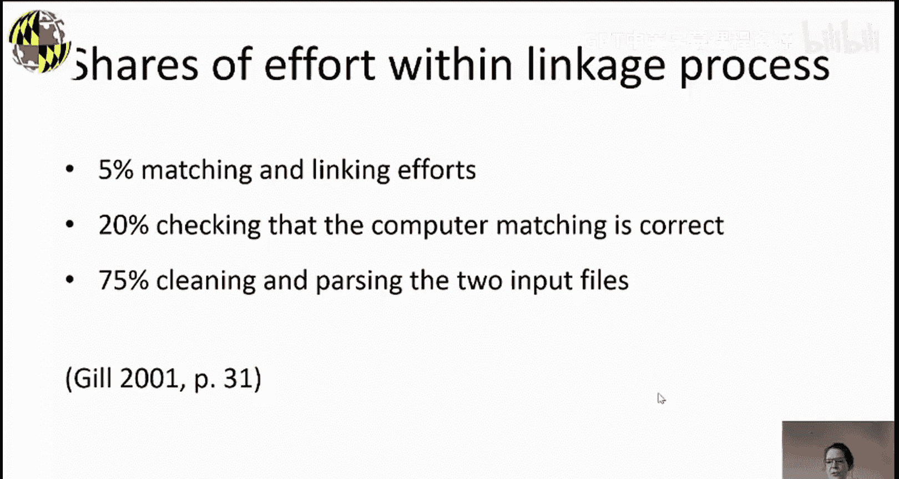

The importance of prepro can't be overstated。I'd like you to read these two quotes by Vinkler by yourself。

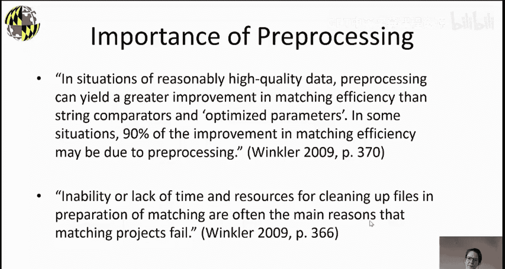

So one last note on identifiers， typically we have first and last name address。

 both date and the like。And you might have across these different records， different identifiers。

 as I said， if theyre from multiple sources， you might see it changes。

 different spelllights and so on。It's a good thing to not throw them away。

 even if you decide that there's sort of a core piece that belongs to all of them because。

If you add additional data sources。It could be helpful to have these original identifiers to then later on link it to one of these different varieties in your dataset。

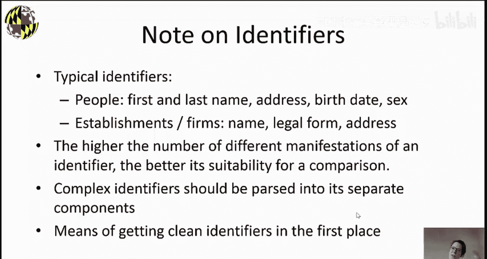

So variations of any the given unit is often possible。Can arise almost anywhere。

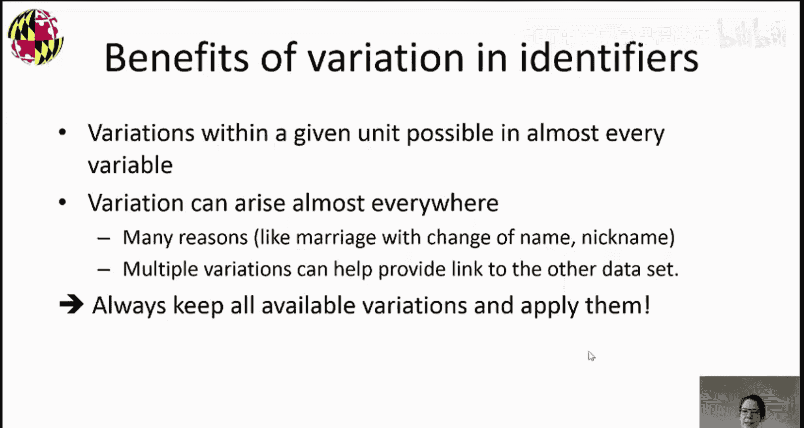

And as I said， it's helpful to keep those。In summary， Kristen， for that reason。

 makes this process even more complicated， I would say。

 where you allow for a couple of feedback loops looking at。The matches， the non matches。

 and potential matches。Add a clerical review and then see if you can improve the process going forward。

How you get to matches， non matches， and potential matches will address in the next segment。

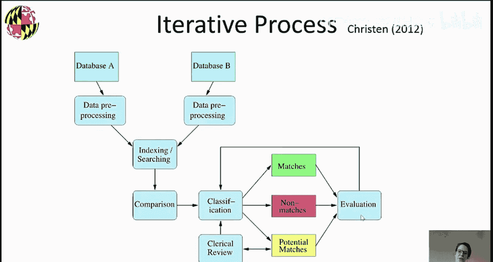

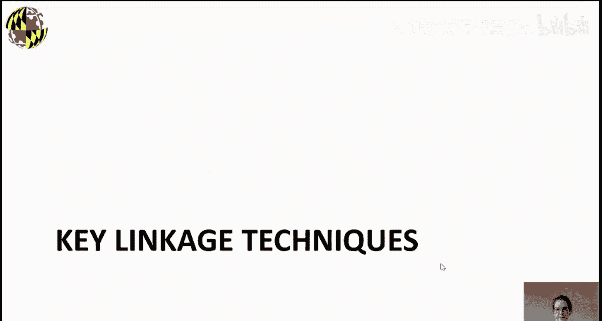