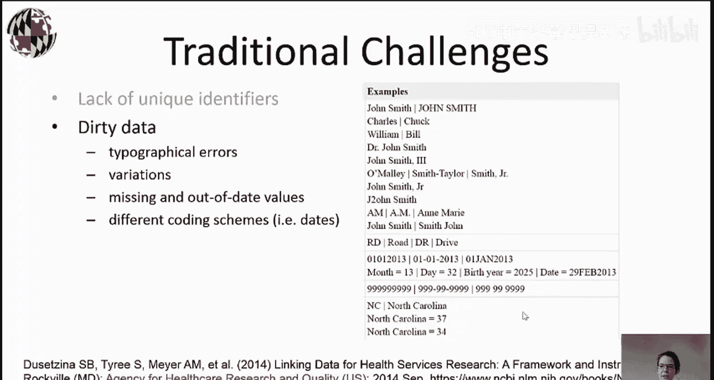
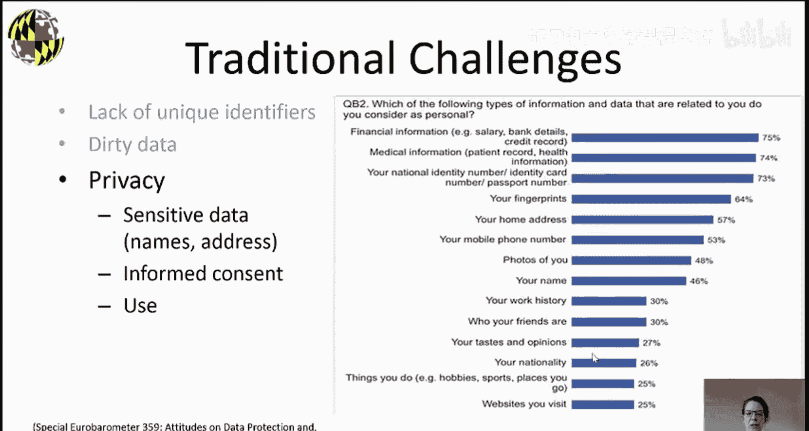
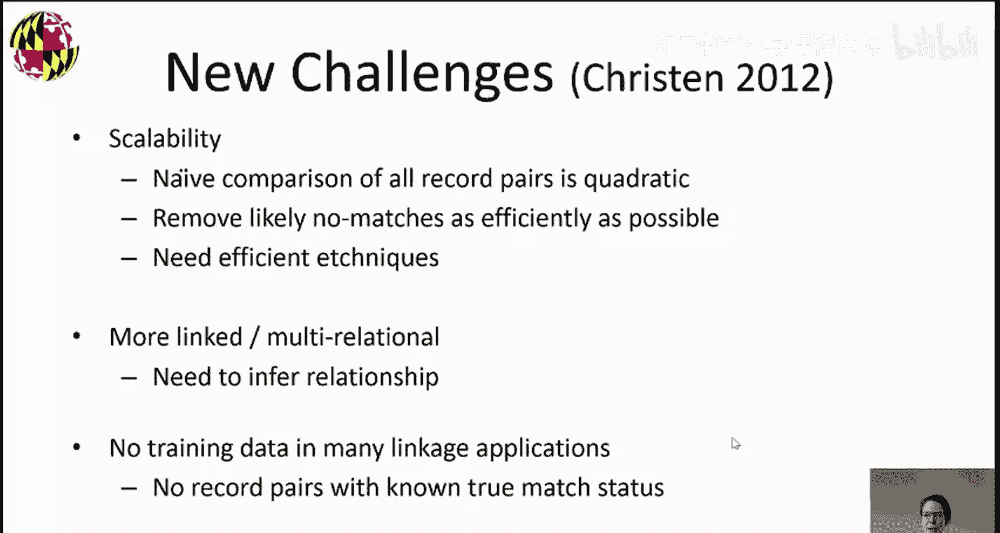
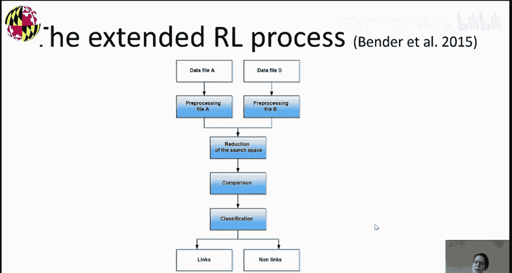
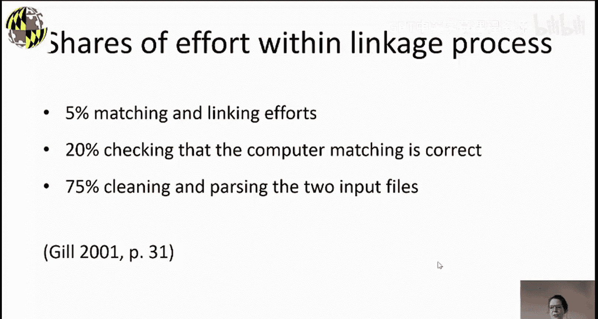
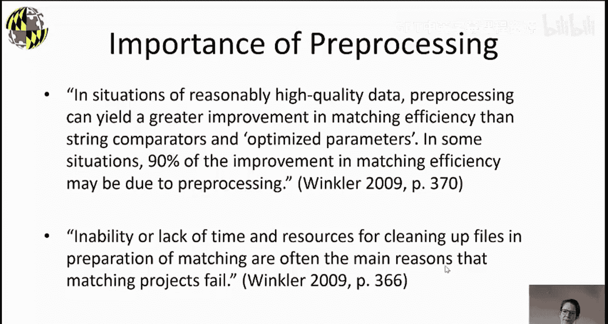
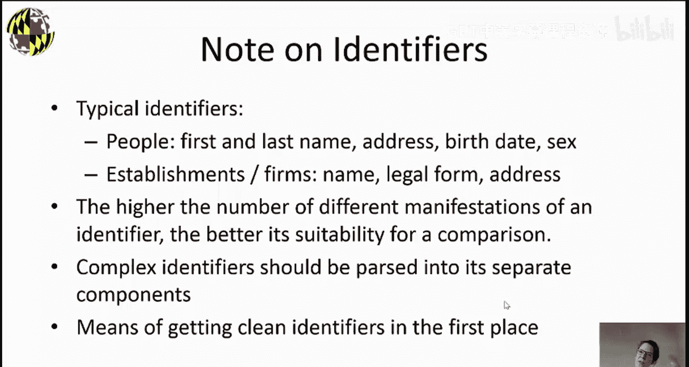
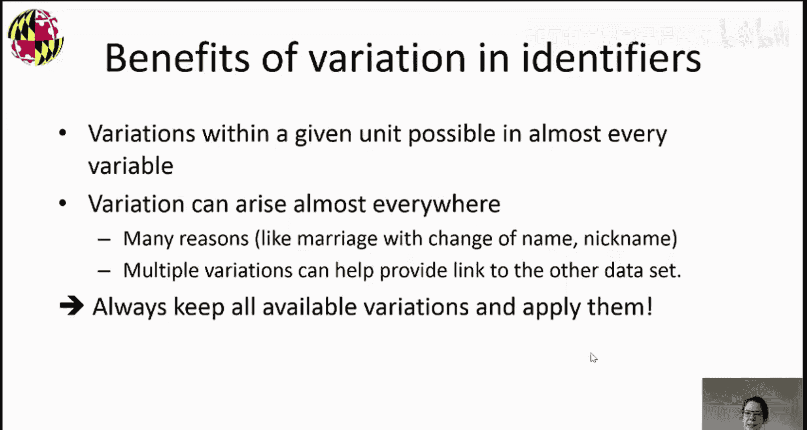
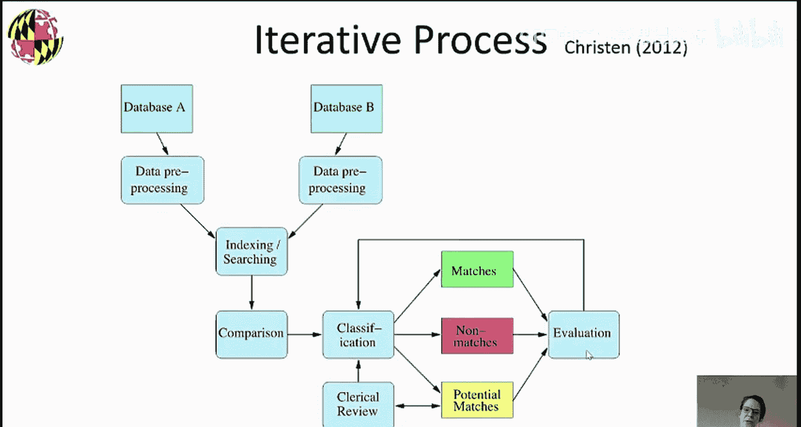

# 调查数据收集与分析：2-6：记录链接的挑战 🧩

在本节课中，我们将要学习记录链接过程中面临的主要挑战。记录链接是指将来自不同数据源的记录进行匹配和合并的过程。无论数据规模大小，这一过程都存在一些固有的困难。

## 缺乏唯一标识符 🔑

无论你的记录集有多大，在链接来自多个数据源的记录时，我们都会面临一些传统挑战。其中一大挑战是缺乏唯一标识符。

以下是缺乏唯一标识符的具体表现：
*   以人名“Julia Laine”为例，在互联网上搜索时，可能会出现多个同名但不同的人。
*   同样，公司名如“Summit Consulting”也可能对应不同地区的不同公司。
*   不同文件之间缺乏唯一标识符，对于任何想要确保正确匹配同一实体的操作者来说，都是一个真正的挑战。

## 数据质量问题 🧹

另一个挑战通常被称为“脏数据”。数据可能因为各种原因而变得混乱和“脏”。

以下是导致数据质量问题的常见原因：
*   **录入错误**：例如拼写错误。
*   **记录变更**：例如，婚姻状况随时间改变，或某人搬家导致不同记录中的地址不同。
*   **数据过时**：记录的值可能已经失效。
*   **数据缺失**：某些字段可能为空，我们希望从其他数据库中补充。
*   **编码方案不同**：在处理日期时尤其成问题，不同数据源可能使用不同的日期格式（如 `MM/DD/YYYY` 与 `DD-MM-YYYY`）。
*   **名称变体**：例如，“John Smith”可能被写成“john smith”；“Charles”可能缩写为“Chuck”；“William”可能被称为“Bill”。
*   **地址缩写**：街道名称可能有多种记录方式，如“Road”缩写为“Rd”，“Drive”缩写为“Dr”。

## 隐私与数据敏感性 🔒

我们意识到的另一个常见挑战是隐私问题以及待链接数据的性质。

根据欧洲晴雨表的调查图表显示，很大比例的受访者认为财务信息和医疗记录属于敏感信息。在许多国家，链接此类数据需要获得知情同意，并且有专门的法规手册进行规范。

## 大数据环境下的新挑战 ⚡

数据的体量会影响所有上述问题。在大数据背景下，出现了一些新的挑战。

以下是大数据环境下记录链接面临的新挑战：
*   **可扩展性**：对记录进行两两比较的朴素方法会因数据量巨大而“爆炸”，计算时间过长。我们需要转向更高效的方法，相关技术仍需研究。
*   **复杂关系**：有时数据中存在网络和复杂关系，在匹配记录时可能需要考虑这些因素。
*   **缺乏真实实体标签**：最大的挑战之一是我们通常不知道真正的实体是什么，缺乏良好的训练数据集供算法学习正确匹配，这也是该领域目前有许多新研究的原因。

## 扩展的记录链接流程 🔄

因此，正如Bennder及其同事所描述的，扩展的记录链接流程并非简单地直接比较数据文件A和B，而是在比较之前，对两个文件进行大量的预处理。

预处理流程通常包括以下步骤：
1.  **预处理**：包括解析个人姓名、纠正拼写错误等。
2.  **缩减搜索空间（分块）**：例如，如果知道某人在芝加哥，可以将搜索范围限制在芝加哥地区，这被称为“分块”。
3.  **比较与分类**：在较小的集合内进行比较，然后将它们分类为“真匹配”、“非匹配”或“潜在匹配”。

## 预处理的重要性 ⏳

预处理的重要性再怎么强调都不为过。根据Jill在2001年的观点，在我们所做的许多分析中，大约75%的工作量在于数据清理和解析步骤，约20%用于检查匹配过程是否正确，只有大约5%用于实际的链接工作。

## 关于标识符的注意事项 📝

最后一点关于标识符的说明：通常我们有姓名、地址、出生日期等标识符。在不同的记录中，这些标识符可能不同，例如来自多个来源时，可能会有变化、不同拼写等。即使你决定使用所有记录共有的核心部分，也不要丢弃这些原始标识符，因为如果添加额外的数据源，保留这些原始标识符可能有助于后续链接到数据集中不同的变体。

任何给定单元的变体都可能出现，几乎无处不在。正如所说，保留它们是有帮助的。

## 总结与展望 📈

总而言之，正因为上述原因，Kristen提出的流程使这个过程更加复杂。该流程允许几个反馈循环，查看匹配、非匹配和潜在匹配的结果，加入人工审查，然后看看是否能改进后续流程。如何得到匹配、非匹配和潜在匹配的结果，我们将在下一节中讨论。

本节课中，我们一起学习了记录链接面临的多重挑战，包括缺乏唯一标识符、数据质量问题、隐私顾虑以及大数据环境下的可扩展性等新问题。我们还了解了扩展的记录链接流程中预处理的关键作用，以及保留原始标识符的重要性。理解这些挑战是设计有效、准确的记录链接方法的第一步。