# 密歇根大学《调查数据收集和分析（2-6：方法、社调问卷设计、抽样、缺失数据、分析）｜Survey Data Collection and Analytics》 p167 18_关键技术.zh_en -BV1fw4m1e7Zh_p167-

let's look at a couple of key linkage techniques here。

There are three techniques that we're going to discuss in a little bit more detail。

 deterministic linkage， probabilistic linkage and。as we label them here。

 computer science methods to linkage。They are techniques that at least in some part are familiar to you guys and there's no need here to go into all the technical details。

But at least you should be aware of them。So let's start with deterministic rule based linkage。

It's a very simple method for matching different data sets。You so your data。

So you aim for an exact match using usually one key， unique identifier to do so。If you have multiple。

 the identifier have equal weight。And they're chosen usually by the researcher themselves。

 So the table that you see here is one example where matching is done with the Social Security numbers。

 and you see here that in dataset A in dataset B， we have，Two assistance that match。And。

The remaining case or record inside B can't be matched because the Social security number is missing。

A common problem and you can already see that this method only works well if you have。A perfect key。

 and if the key is present in all data sets that you want to emerge。As soon as that is not the case。

 you have to start moving on to next best variable in this case name。

 but as a quick glance at the table will show you is that here too。

 names can be spellted differently and have issues。

That would make this kind of deterministic rubbased linkage much more difficult。

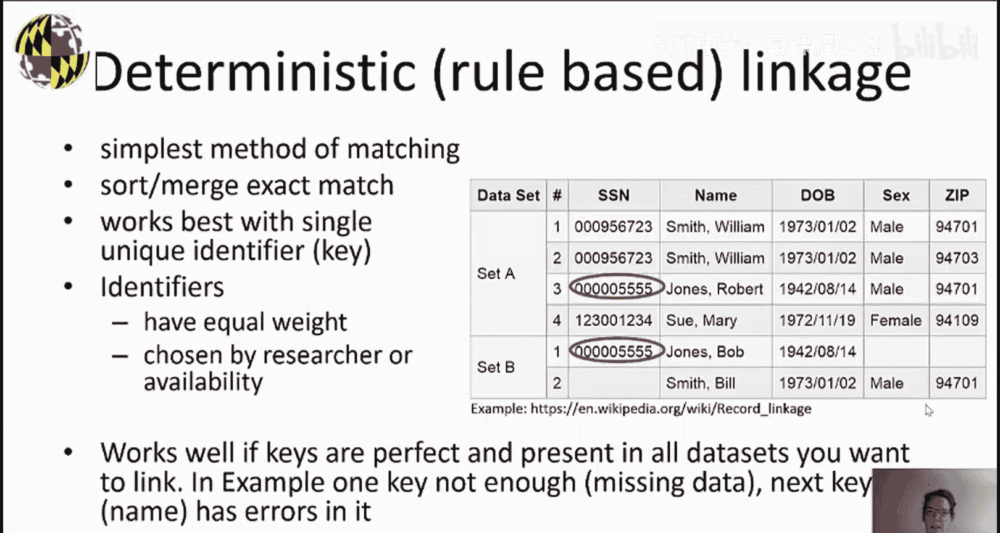

For this reason， a couple of other techniques have been developed。

The basic idea is quite old from New Kon Kennedy in the 60s and the theoretical piece to that was developed by Felici and Santa。

Here in this approach， a wide range of potential identifiers or keys can be used for record linkage。

Computing。The weights is based on estimated ability to match or not match。

So there's a frequency ratio that gets computed。I'll show you in a second how that works and。

Unlike the rule based method that we just talked about here。

 we can use algorithms that can be trained。One problem is that estimating these errors and thresholds。

Go into that in more detail in a moment， to require an independent assumption and clerical review。

 both of them。Mein newly labor intensive or questionable。So what's often done is。

There will be two probabilities estimated， the probability that a field agrees given that the pay of records is a true match。

And the new probability， the probability that the field agrees given that the payoff records is not a true match。

Let me just give you a quick example of what that would be for a U probability if you have。

Month of boost in one record and in another then you have one in a 12 chance that the field agrees。

 given that the payoff records is not a true match just by the probability distribution in here。

So these kind of probabilities are important in the thinking of fegie and Santa。

 let's assume we have two dataset sets， A and B。

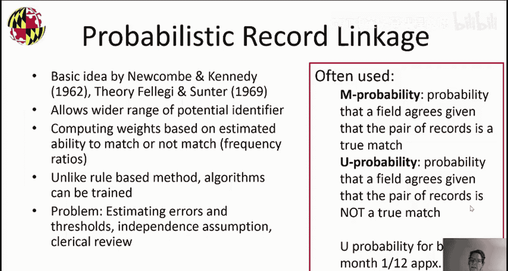

And the goal is to find the true matches。Union of the two where the entities are indeed the same and separate them out from the U records。

 which are entities that are in both dataset sets， but not through matches。

A vector of variables can be used as a comparison and the comparisons are done in pair。

 so every x and every y variable case record from each of these two dataset sets would form a pair and all pairwise comparison would be made in theory。

Then there's a decision rule where we look at the probability of the sector of covariates。

 given that there's a true match。Over the probability of the sector of covariance。

 given that this particular pay is not a true match。If that ratio is larger than a set threshold。

 it's considered a match， if it's smaller than that set threshold， it's considered an nonmatch。

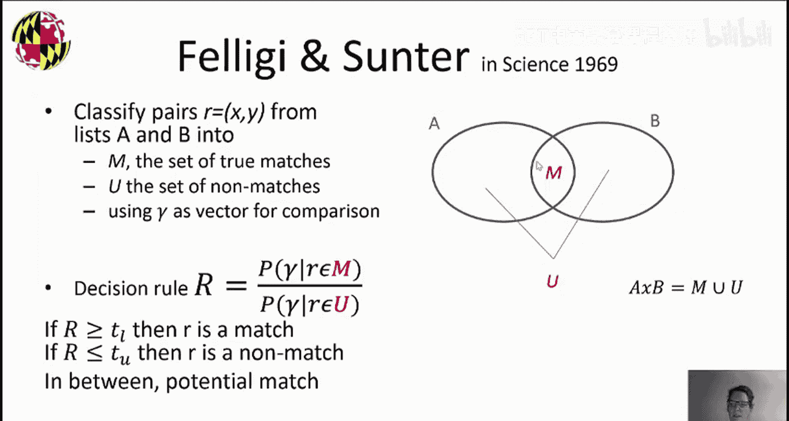

As I said， the assumption behind this is conditional independence。

So given a pair of records representing the same entity being a true match。

 we assume that the agreement in each field is independent of the agreement in other fields。

This is really mostly a mathematical convenience in reality。😊，That is usually not the case。

 you know you can have area codes that covari geography。

 first names that covarirate with sex and a lot of other examples like that can be found。

Age and maritalist status， you know， you can come up。Yourself with a few quite easily。

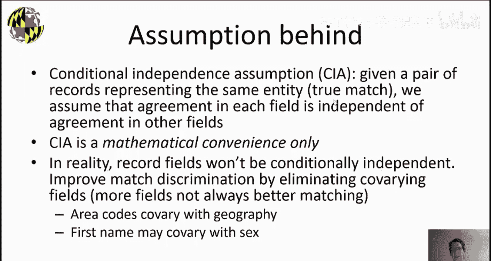

So how does this in work assuming we make this convenience assumption we have first。

Each matching variable compared and assigned a score the weight。Based on how well it matches。

Then there is a frequency analysis of the data values。Uncommon values。

Tend to agree tend to show stronger evidence for linkage。

Remember when we had common values that the name Julia Lane， versus， let's say my name。

 there's different linkage evidence for these two。Then you calculate a score for each field that indicates for any pay of records how likely it is that they both belong to the same entities。

You sum the scores over all the fields， you saw the record pays in the order of their scores。En。

Then find the right matches now that can be very intensive， right？

All POOS comparison is quite inefficient and therefore something called blocking will be quite critical and we get to that in a second。

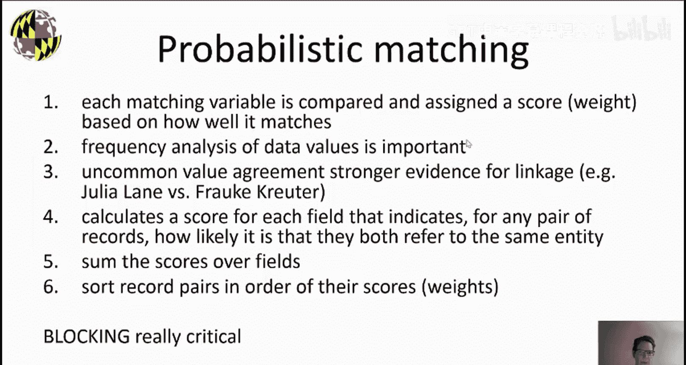

So what are the issues， first one， which models do we use to estimate the M and the U probabil if that's the typical modeling issue。

 how do we set the thresholds？A question of evolution of the model。

Then the question which variables do be used， so which features to be used to do that comparison？

Known to the computer scientists as a problem of feature engineering。

And finally I mentioned it already a couple of times， how do we avoid looking at all possible pairs。

 the sufficiency problem if my set A has 100 cases and my set B has1000 cases。

 then I'm looking at 100，000 possible comparisons and that of course can be quite intensive given that we're often dealing with millions of records。

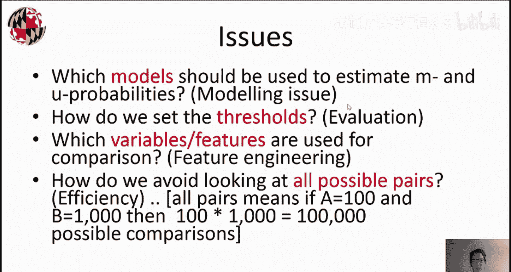

So rememberstrrata from earlier modules that we have， the same idea can be blind to you。

It's usually called blocking and the idea is that in a simple blocking that you pay all payers that hash to the same value so they belong to the same city or same birth year。

And then within those， you search for the matchings。Of course， he could。

Think of extensions where you block on multiple attributes and take the union of all pairs found。

 or you pick ordered attributes in sort。So similar to strategies that we have seen in sampling here too。

 you can be a little bit more efficient in terms of computational power。

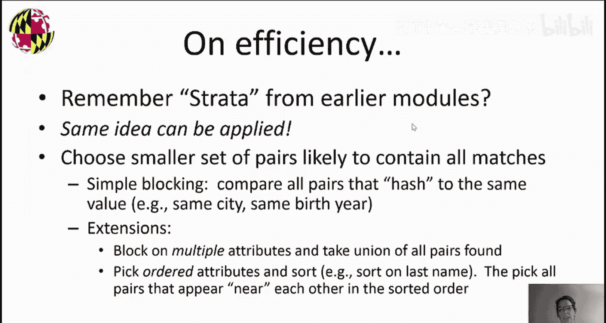

Now all of this should ring a bell。The task at hand， finding a similar case。

 finding a good match might remind you of other techniques you've seen， clustering techniques。

Modeling techniques that solve prediction problems。Actually， even when creating the weights。

 we've looked at propensity go matching， we try to find for nonreing cases。

 cases in the respond set that are quite similar。 So no surprising here that。We have in this。

d linkage context， clustering algorithms or prediction algorithms that are quite similar to methods that you've seen before。

 So the advanced techniques， they shouldn't scare you。 In fact。

 you probably would be able to adapt the methods you've seen before to fit this particular problem。

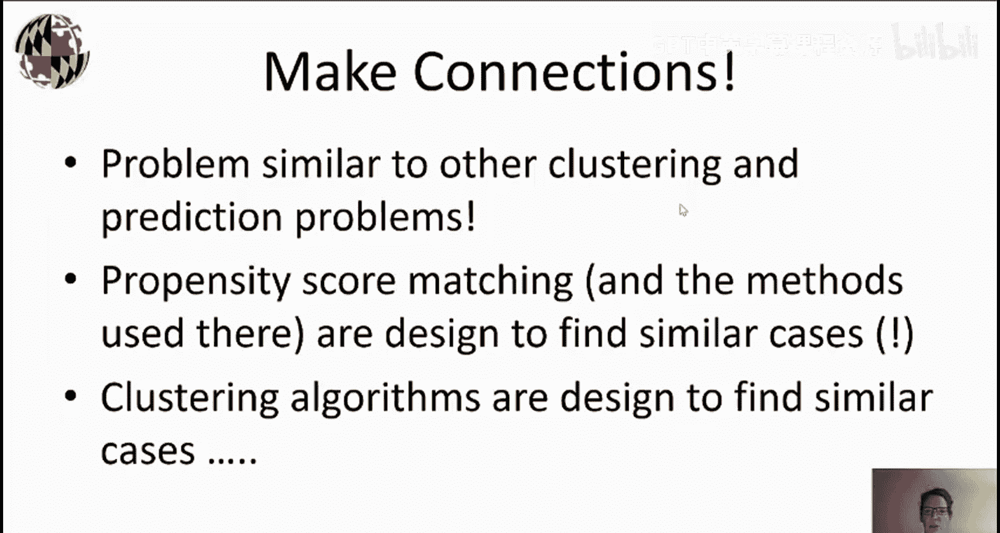

So just here， one example for a comparison or visual comparison here for probabilistic versus。

 machine learning approaches in linking oops。

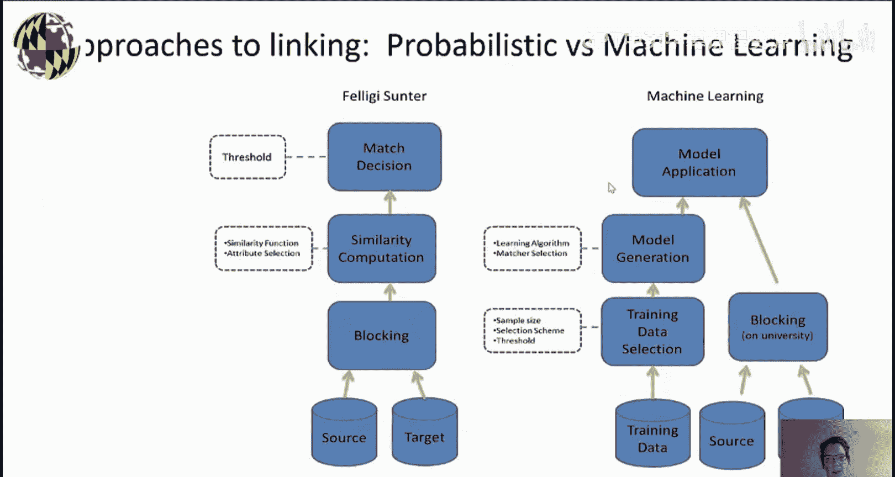

And you we have our source file and target file， we can use the blocking strategy。

Do a similarity computation have a matching decision in the Fgi center approach in the machine learning approach？

Take a similar first step， but then。If we have a training data set。

Hence a set of data where you already know what are the true matches that can help you find the right or even better covariates that finally go into the model itself。

 so it solves one of the problems that we mentioned before。Namely， the。

Modeling issue which features should be used， which we should then have and the like。

Making the whole thing more efficient in addition to the blocking that we discussed before。

So in this very brief overview over key record linkage techniques。

 let me summarize that we have dataministic matching， just a robust method。

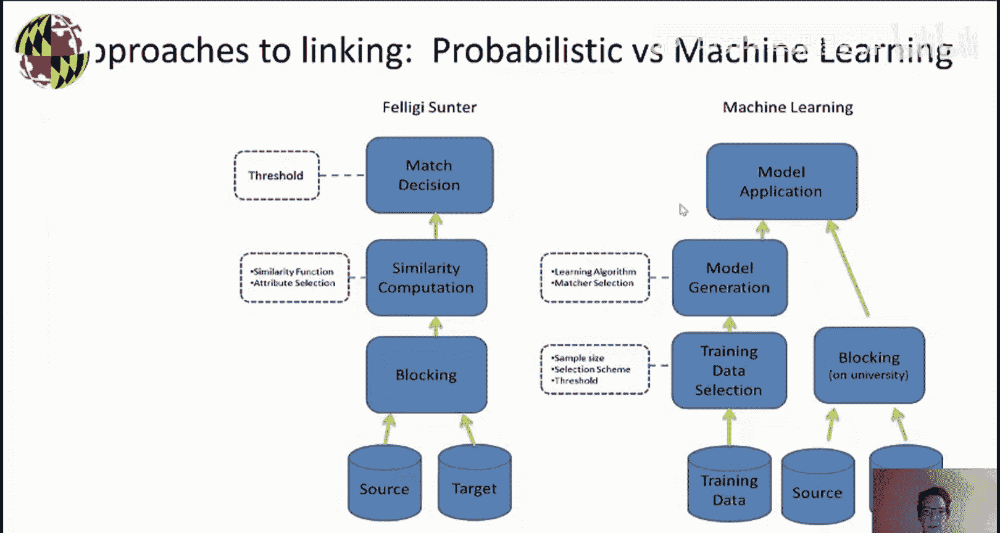

They have probabilistic regular linkage， mostly known by Fey and Santaa paper。It's。

A way to use available attributes for linking many of them。

And calculates match weights for attributes in the file。And then finally。

 we have computer science approaches， many of them based on machine learning， data mining。

 database techniques。And we'll have in the next module additional material for you to review those。

 even so there's not a video introducing them。

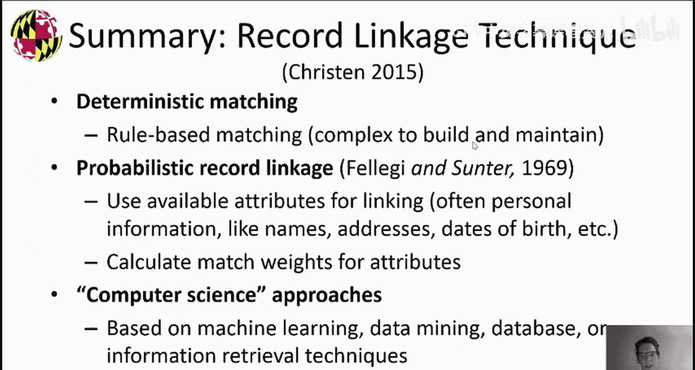

Finally， some software。That is free and available for you to play around with on the web link plus the linking choicemaker to。

FEBRL and the merge toolbox。They all have。Quite good user interface。

 all of them have some restrictions， but depending on your needs。

 we strongly recommend that you try them out。

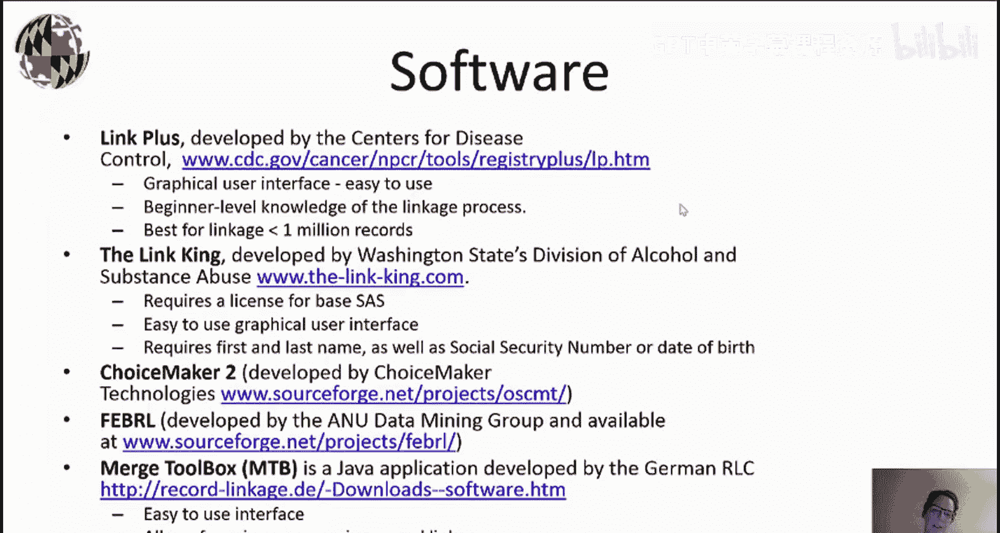

Thank you。

