# 调查数据收集和分析：2-6：关键技术 🔑

在本节课中，我们将要学习几种关键的记录链接技术。记录链接是将不同数据集中代表同一实体的记录匹配起来的过程。我们将详细介绍三种主要方法：确定性链接、概率性链接以及计算机科学方法。理解这些技术对于合并和分析来自不同来源的数据至关重要。

## 确定性规则链接 🔗

上一节我们介绍了记录链接的基本概念，本节中我们来看看第一种具体方法：确定性规则链接。

这是一种用于匹配不同数据集的简单方法。其目标是使用一个（或多个）关键的唯一标识符进行精确匹配。如果使用多个标识符，则它们通常被研究者赋予同等权重。

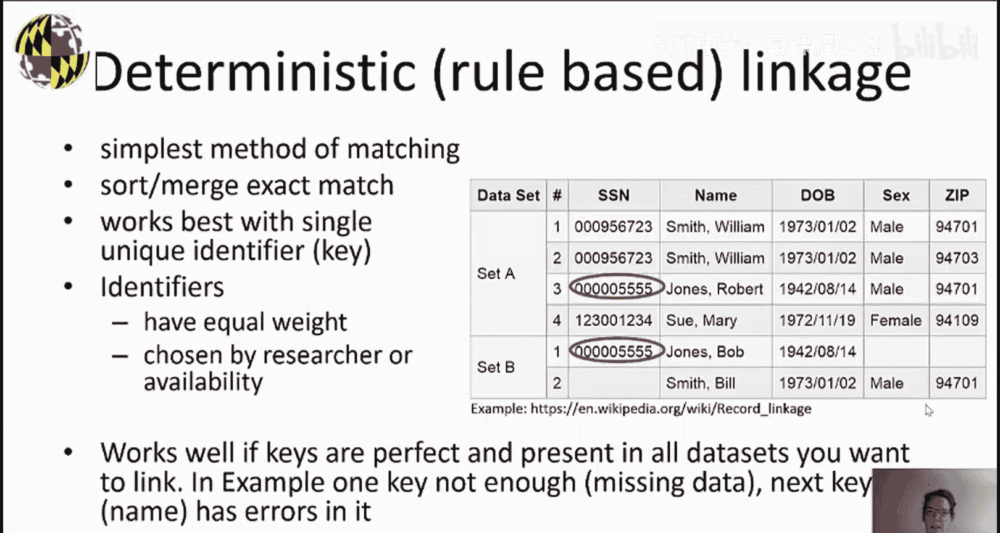

以下是该方法的一个示例，其中使用社会保障号码进行匹配：

| 数据集A | 数据集B | 匹配结果 |
| :--- | :--- | :--- |
| 记录1: SSN=123 | 记录1: SSN=123 | **匹配** |
| 记录2: SSN=456 | 记录2: SSN=456 | **匹配** |
| 记录3: SSN=789 | 记录3: SSN=NULL | **无法匹配** |

可以看到，当关键标识符（如社会保障号码）在所有数据集中都完整存在时，此方法效果良好。一旦标识符缺失，就必须转向使用次优变量（如姓名），但姓名可能存在拼写差异等问题，这使得确定性链接变得困难。

## 概率性记录链接 🎲

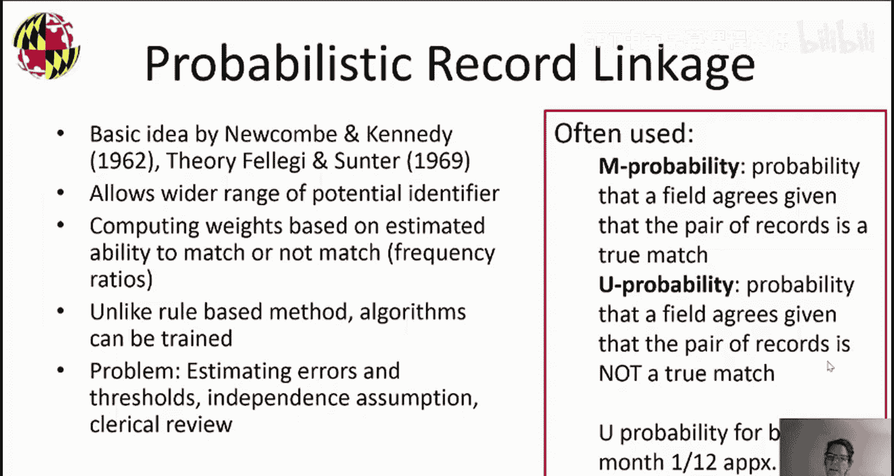

由于确定性链接的局限性，发展出了其他技术。概率性链接的基本思想源于Fellegi和Sunter在20世纪60年代提出的理论。

在这种方法中，可以使用广泛的潜在标识符进行记录链接。其核心是为每个匹配变量计算权重，权重基于该变量在匹配与非匹配情况下一致的概率估计。

以下是该方法涉及的两个关键概率：
*   **m概率**：在记录对是真实匹配的条件下，某个字段一致的概率。公式表示为：`P(字段一致 | 真实匹配)`。
*   **u概率**：在记录对不是真实匹配的条件下，某个字段一致的概率。公式表示为：`P(字段一致 | 非真实匹配)`。

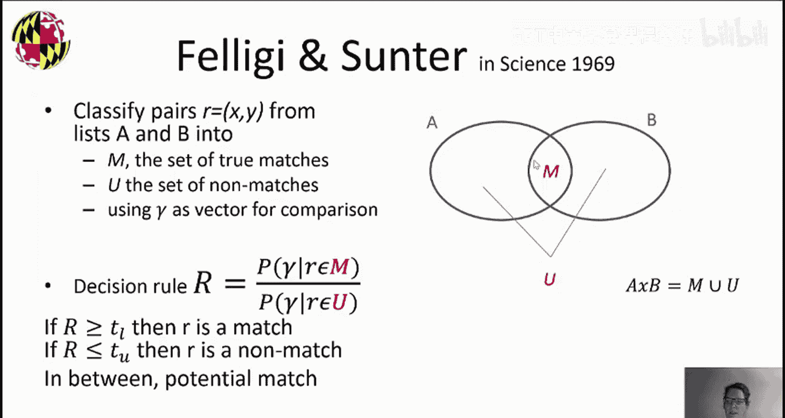

例如，对于“出生月份”字段，如果两个记录不是真实匹配，它们月份一致的概率（u概率）大约是1/12。

该方法的工作流程如下：
1.  假设有两个数据集A和B，目标是找到真实匹配的记录对。
2.  使用一个变量向量进行比较，对所有可能的记录对进行两两比较。
3.  应用决策规则：计算似然比 `P(变量向量一致 | 真实匹配) / P(变量向量一致 | 非真实匹配)`。
4.  如果该比值超过设定的阈值，则视为匹配；否则视为不匹配。

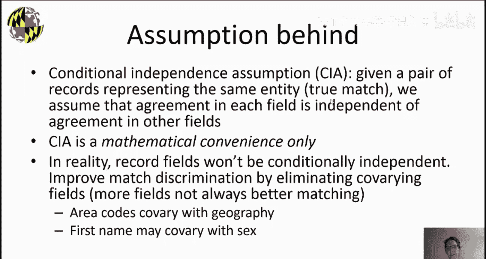

该方法的一个关键假设是条件独立性，即给定记录对是真实匹配，各字段的一致性是相互独立的。这主要是为了数学上的便利，现实中通常不成立。

## 概率链接的实施与挑战 ⚙️

了解了概率链接的基本原理后，我们来看看它的具体实施步骤和面临的挑战。

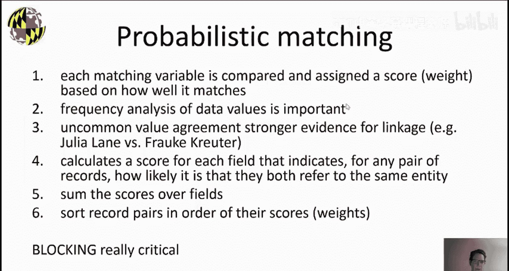

以下是实施概率性记录链接的典型步骤：
1.  **比较与赋分**：比较每个匹配变量，并根据匹配程度赋予权重（分数）。
2.  **频率分析**：分析数据值的频率。不常见的值一致时，能提供更强的链接证据。
3.  **计算总分**：为每个记录对计算所有字段的分数总和。
4.  **排序与判定**：根据总分对记录对进行排序，并确定匹配项。

然而，对所有可能的记录对进行比较（即“两两比较”）计算量巨大。例如，如果数据集A有100条记录，B有1000条记录，则需要比较10万次。为了解决这个“充分性问题”，引入了**分块**技术。

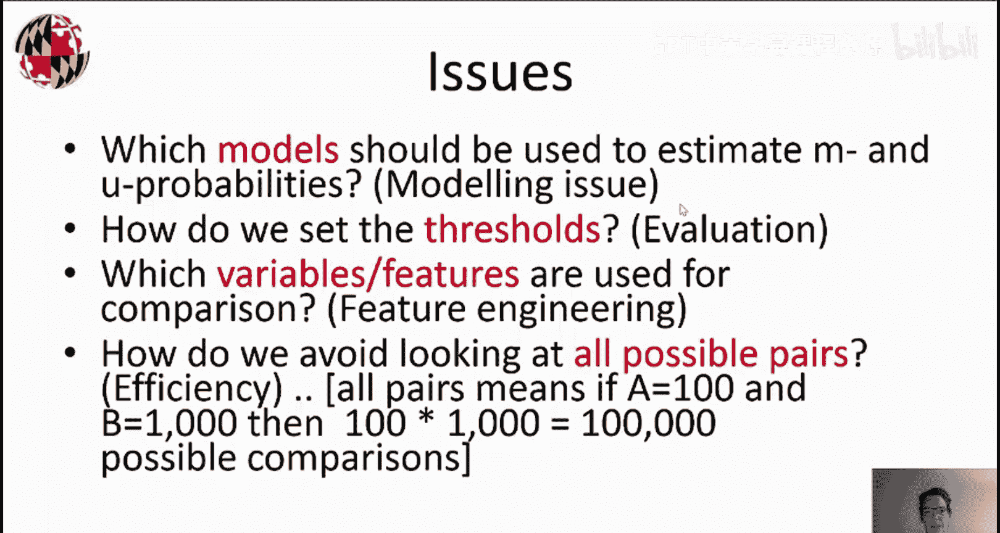

分块类似于抽样中的分层思想。其基本做法是，仅对哈希到相同块值（例如，属于同一城市或同一年出生）的记录对进行比较。这样可以大幅减少需要比较的记录对数量，提高计算效率。还可以进行扩展，例如在多个属性上分块，或对有序属性进行排序。

## 计算机科学方法 🤖

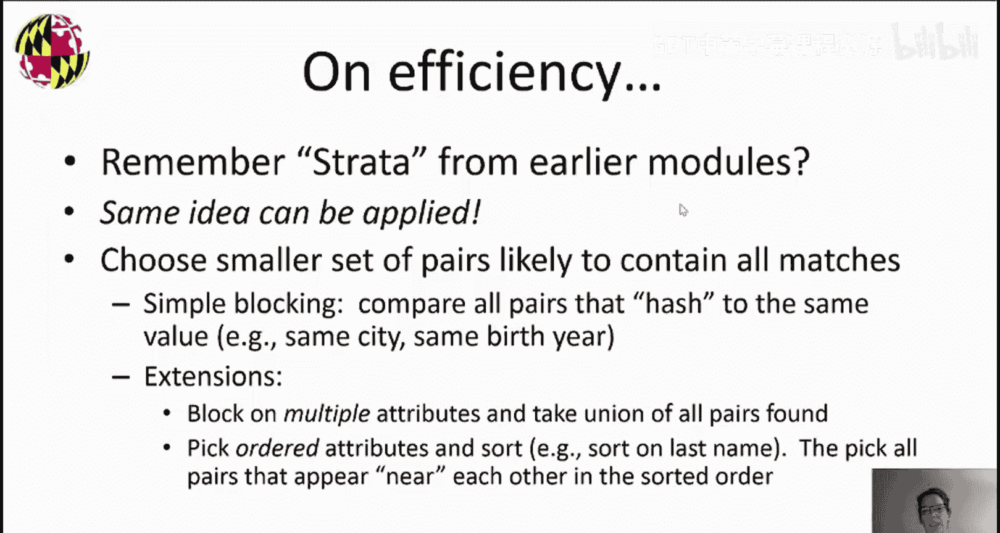

记录链接的任务——寻找相似的案例或良好的匹配——可能会让你联想到其他技术，如聚类或预测建模。确实，在这个领域，计算机科学提供了许多先进方法。

许多计算机科学方法基于机器学习、数据挖掘和数据库技术。与传统的概率方法相比，机器学习方法的一个关键优势是，如果存在**训练数据集**（即已知真实匹配情况的数据），它可以自动学习并选择更好的特征（变量）用于模型，从而解决“应该使用哪些变量”的建模问题。

下图简要对比了两种思路的流程：
*   **概率性方法**：源文件 -> 分块 -> 相似性计算 -> 匹配决策（基于Fellegi-Sunter模型）。
*   **机器学习方法**：源文件 -> 分块 -> 使用训练数据学习模型 -> 匹配决策。

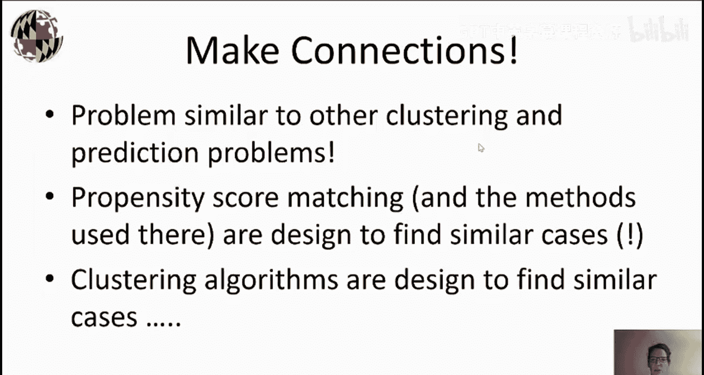

这使得整个过程在分块的基础上更加高效。

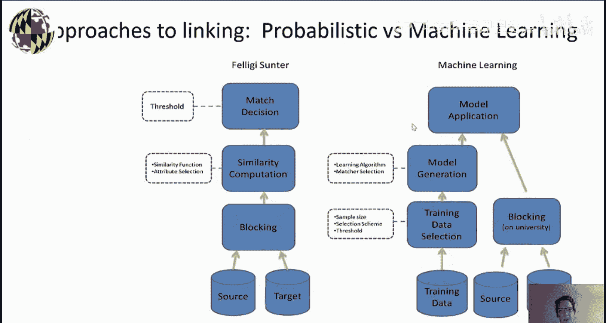

## 总结与软件工具 📚

本节课中我们一起学习了三种关键的记录链接技术。

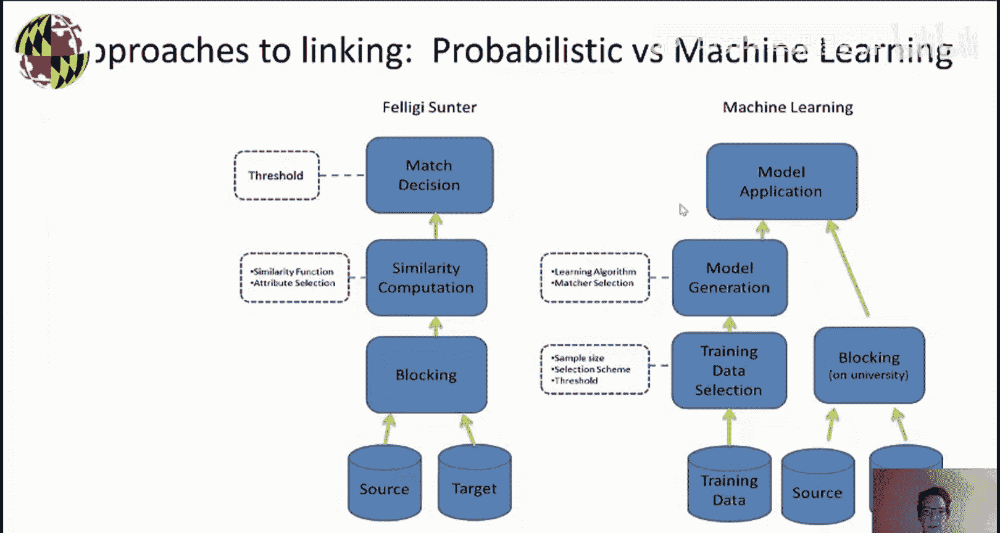

首先，**确定性匹配**是一种简单直接的方法，依赖于精确的关键标识符，但在标识符缺失时效果有限。

其次，**概率性记录链接**（以Fellegi和Sunter的理论为代表）能够利用多个属性进行链接，并为属性计算匹配权重，通过似然比和阈值做出匹配决策。

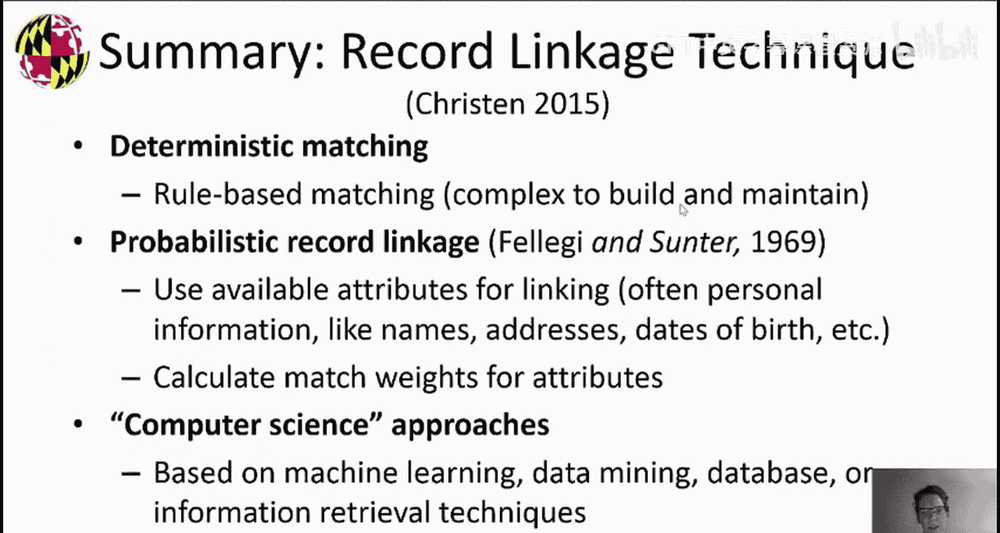

最后，**计算机科学方法**（包括许多基于机器学习的技术）通过利用训练数据，可以自动化特征选择和模型优化，提供了更强大的链接能力。

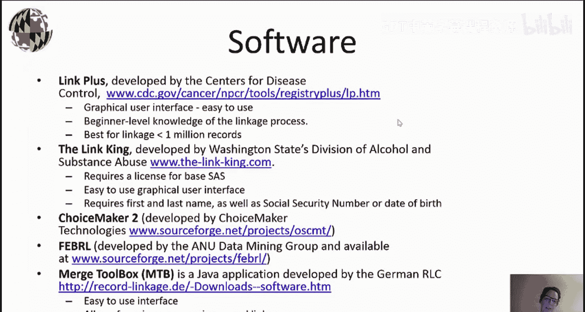

最后，有一些免费软件工具可供你实践这些技术，例如 **Link Plus**、**Choicemaker**、**FEBRL** 和 **Merge Toolbox**。它们都提供了良好的用户界面，尽管各有某些限制，但我们强烈建议你根据需求尝试使用。