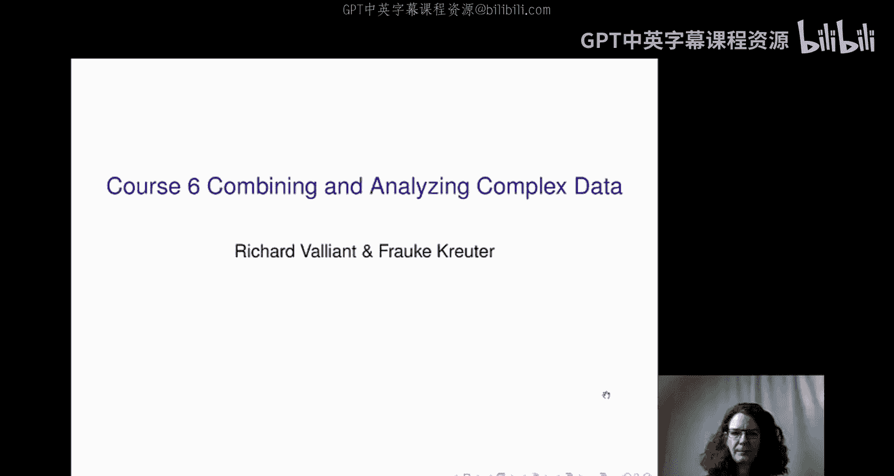
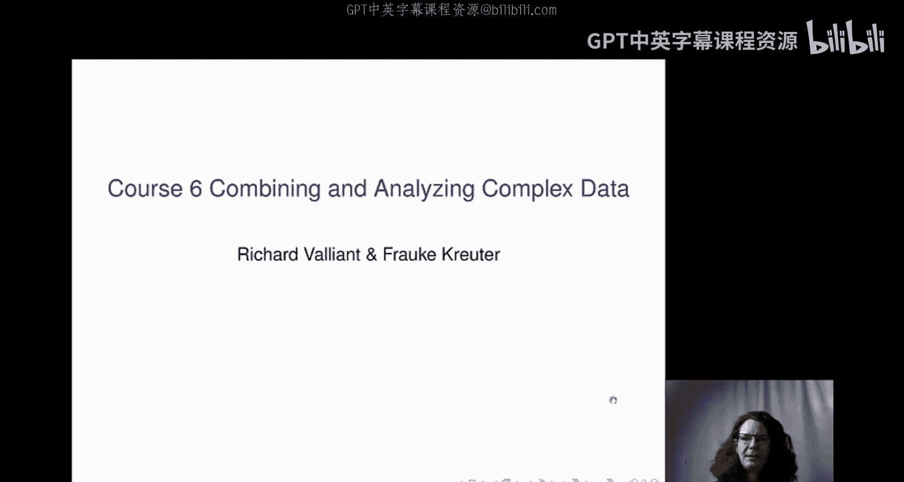
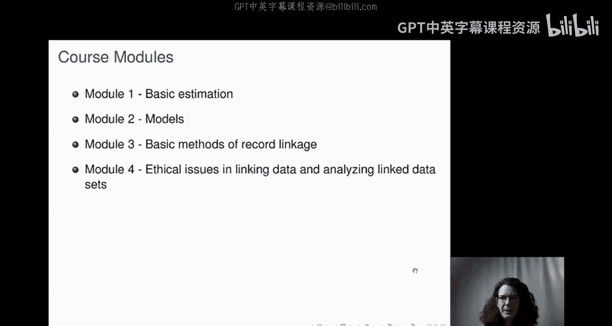
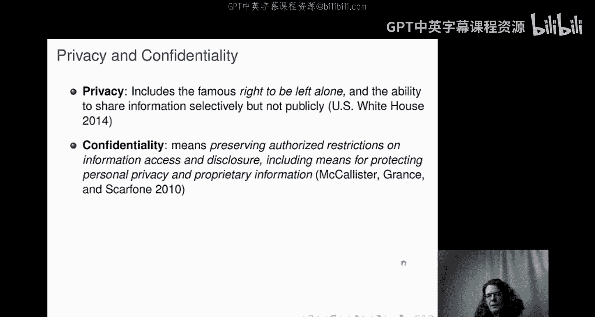
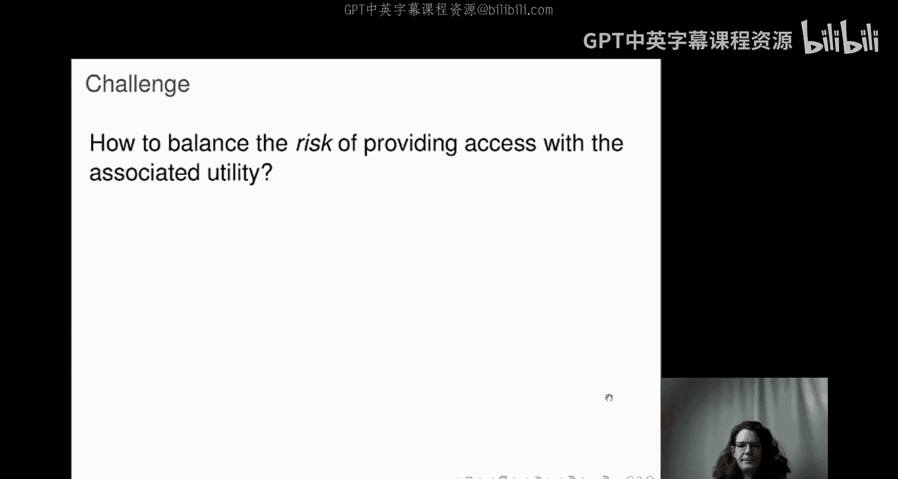

# 密歇根大学《调查数据收集和分析（2-6：方法、社调问卷设计、抽样、缺失数据、分析）｜Survey Data Collection and Analytics》 p168 19_隐私与保密.zh_en -BV1fw4m1e7Zh_p168-

はい。Welcome to Co6 combining and analyzing complex data this is module 4 where we talk about ethical issues and linking and informed consent。

So， let's start with a couple of。Terms that you should know and get a few for。

 so we'll include that in the quizzes。And you have a chance to think through these concepts a bit。

The first one is privacy。It includes the famous right to be left alone。

And it's a pretty interesting concept because it means that this is your ability to share your information selectively。

 but not publicly。Privacy means I can decide what others should know about me。

And if you think about situations in which that might be compromised。

 it might be easy for you to think of Facebook places where you share information with others。

Assuming you have control over what is shared， but depending on what others then do with your information or the privacy settings that you allow。

It might be shared in a way with the public that you did not intend。

 so encourage you to check out the privacy settings on Facebook or if you're not Facebook member to check out readings about that online。

Confidentiality， on the other hand。Means preserving authorized restrictions on information access and disclosure。

The way guarantee to protect privacy and proprietary information。

You might have participated in the survey already or you have collected data and issued a confidentiality pledge。

 I'll show you some examples online about that。And in those， we usually assure that we will。Protect。

The privacy and proprietary information and that is a confidentiality pledge so your data are not anonymous。

 theoretically one could find out who you are and what information there is about you personally。But。

The goal is to provide techniques so that that is secure Now the interesting piece and that's why we're discussing this in the linkage segment is that once you start linking data together。

 that privacy and confidentiality pledge might be in jeopardy and we talk about that a little later on。

For now， think about the challenge that this piece has。

 it's always about balancing the risk of providing access with the associated utility。

 so what can I do with the data， how can I analyze the data and what risk does that provide to the individual。

