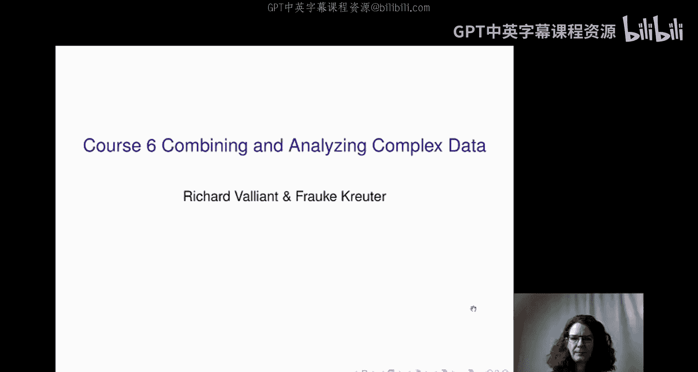
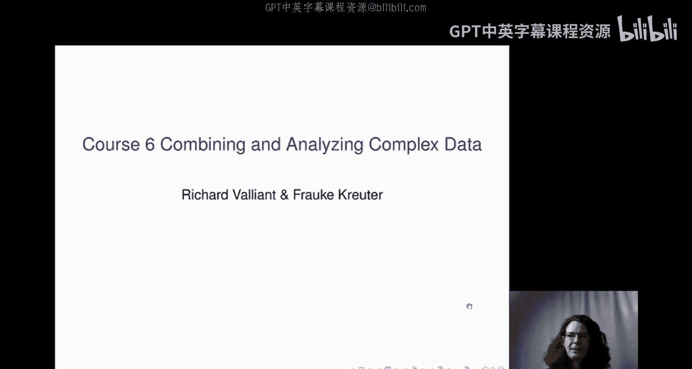
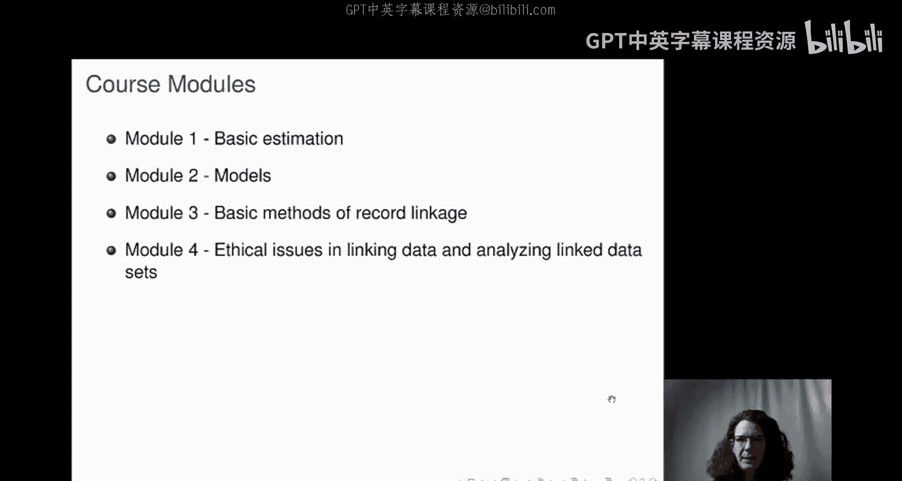
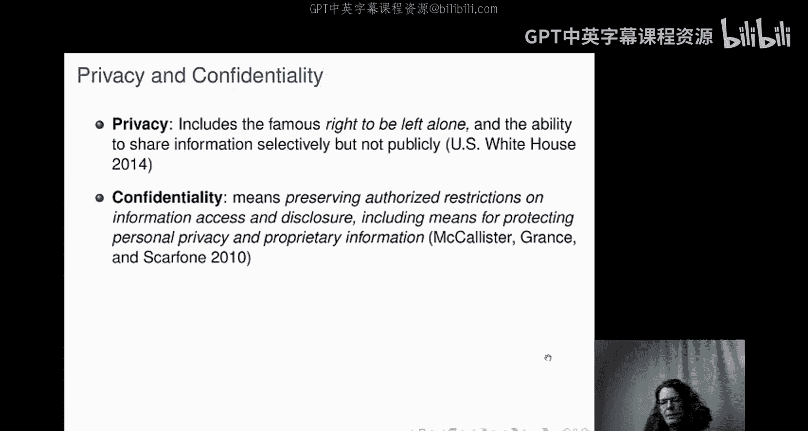
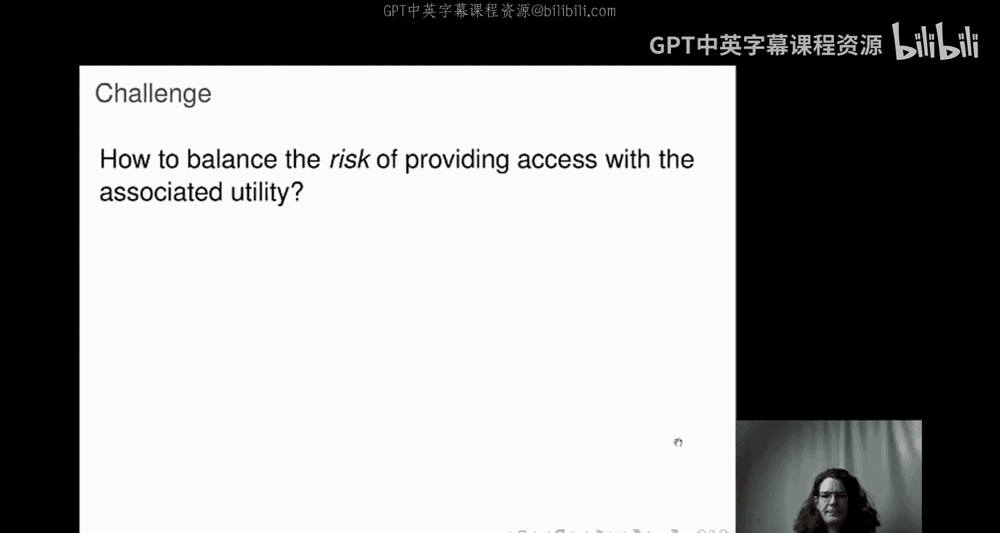

# 密歇根大学《调查数据收集和分析》：4：伦理问题、数据链接与知情同意

在本节课中，我们将探讨数据收集与分析中的核心伦理议题，特别是隐私、保密以及数据链接带来的挑战。理解这些概念对于负责任地进行研究至关重要。

## 隐私与保密：核心概念

上一节我们介绍了本模块的主题，本节中我们来看看两个基础但至关重要的概念：隐私与保密。

**隐私** 指的是“独处的权利”。这是一个关于个人选择性地分享信息，而非公开所有信息的能力。隐私意味着个人可以决定他人应该了解关于自己的哪些内容。

**保密** 则意味着对信息访问和披露施加经授权的限制。这是研究者为保护参与者隐私和专有信息而做出的承诺。当您参与调查时，研究者通常会提供一份保密承诺，保证您的数据将得到安全保护。请注意，保密数据**并非匿名数据**；理论上，仍有可能识别出您的身份和个人信息，但研究者的目标是运用技术手段确保其安全。

数据链接环节之所以要讨论这些概念，是因为一旦开始将不同数据集链接在一起，原有的隐私和保密承诺就可能面临风险。我们稍后会详细讨论这一点。

## 平衡风险与效用

现在，思考一下这个领域始终存在的核心挑战：**在提供数据访问所带来的风险与其关联的效用之间取得平衡**。

以下是需要权衡的两个方面：
*   **数据效用**：我能用这些数据做什么？如何分析这些数据？
*   **个人风险**：数据的使用和分析会给个体带来什么风险？

## 总结

本节课中，我们一起学习了隐私与保密的定义及其区别。我们了解到，隐私是个人控制自身信息分享的权利，而保密是研究者为保护这些信息所做的承诺。最重要的是，我们认识到在进行数据链接时，必须在数据的研究价值与保护参与者隐私的风险之间谨慎地寻求平衡。