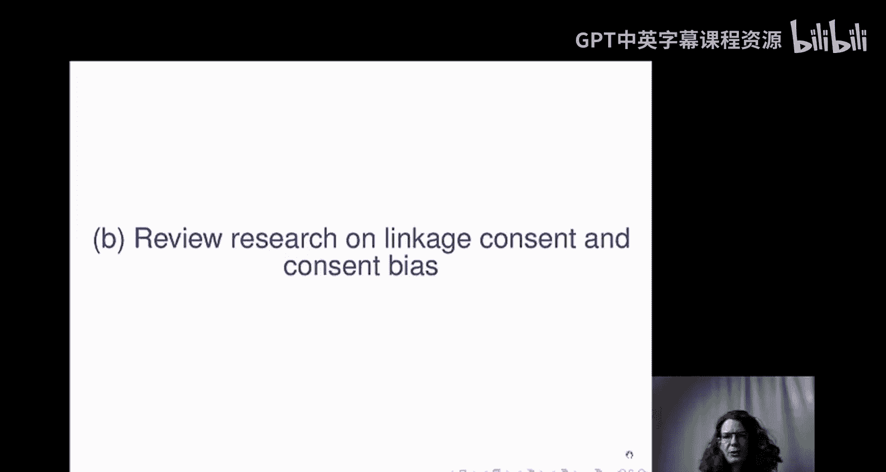
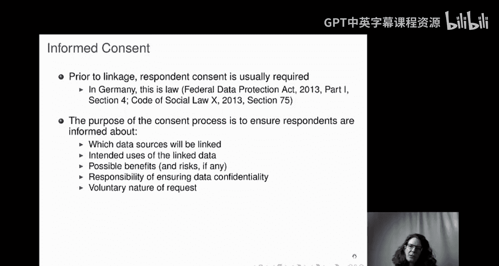
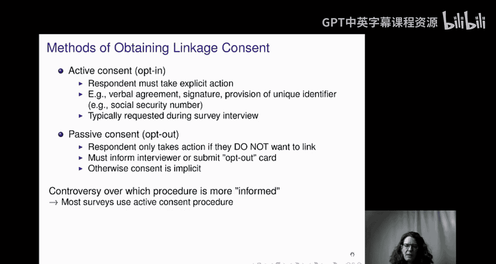
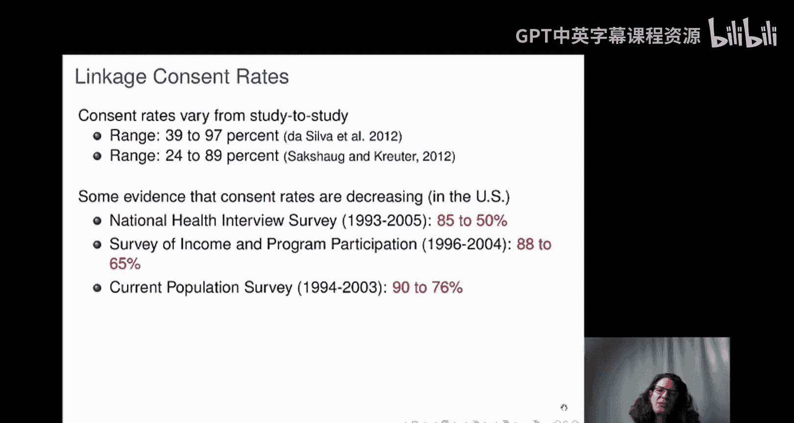
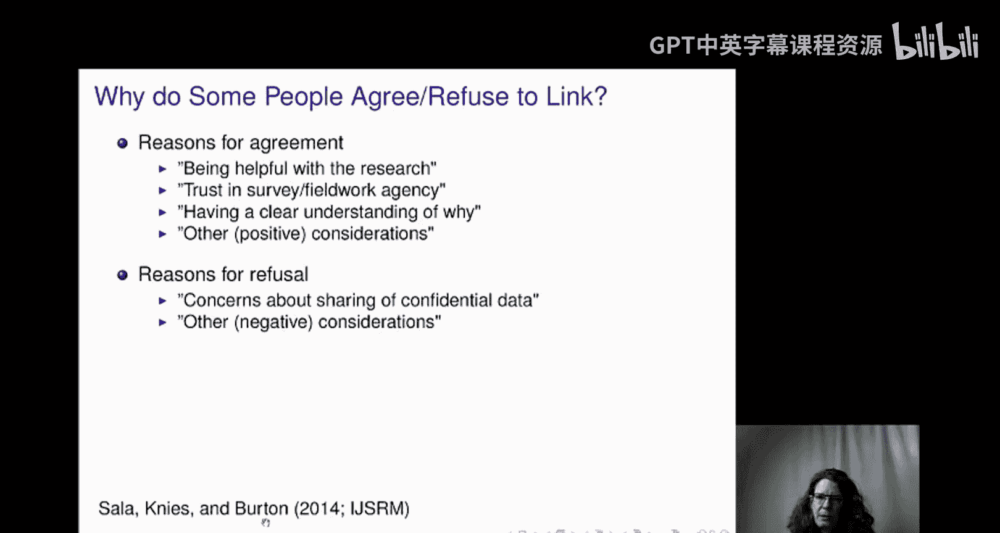
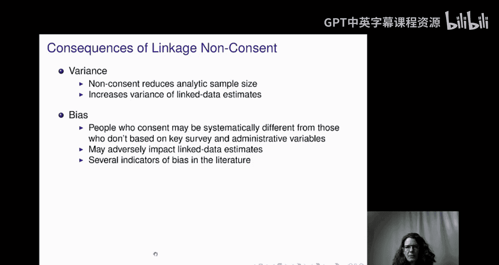
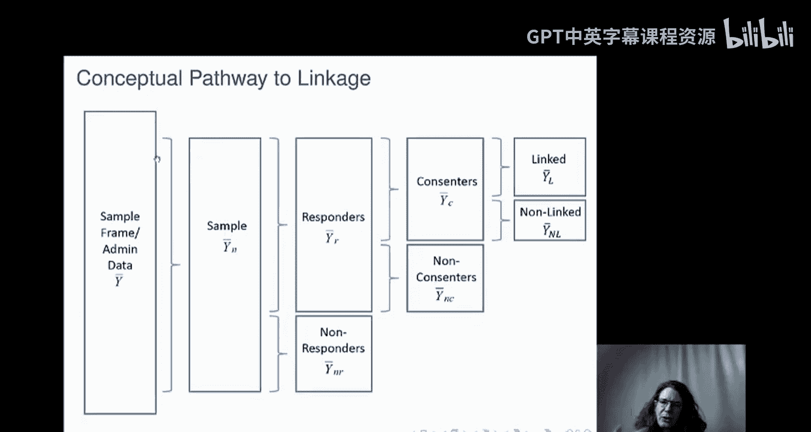
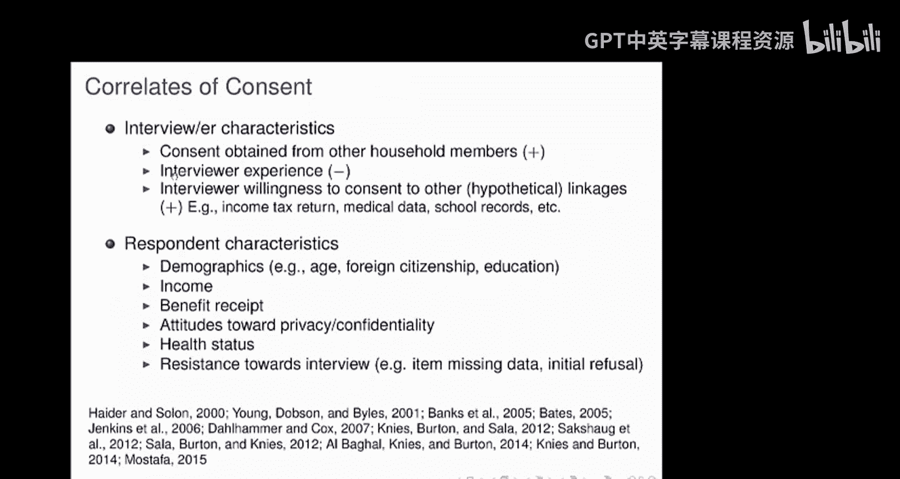

# 密歇根大学《调查数据收集和分析（2-6：方法、社调问卷设计、抽样、缺失数据、分析）｜Survey Data Collection and Analytics》 p169 20_链接同意与同意偏倚.zh_en -BV1fw4m1e7Zh_p169-

So let me share with you some research on linkage consent and linkage consent bias。

 as youve probably already detected from my accent or I've seen on my biography。

I'm working within Germany， I am German， so some of these examples come from the German context。

In Germany， it's required by law， usually that prior to any linkage。

 any combination of data with each other， we need to ask for respondents consent。Now。

 the purpose of this consent process is to ensure that respondents are informed about which data sources will be linked。

 the independenttended use of the linked data， and the possible benefits and risks that there are through this linkage。

You also have to ensure that data will be kept confidential。

 we'll discuss this in the earlier segment and that the request to participate in the data collection is entirely voluntary in nature。

So that's interesting， right， you have to convey all of this。And then so good people to say yes。

 and so an interesting question is， if you talk about these things， do people really understand。

 what are you saying？

And would they agree to any of that？There are a couple of different ways on how people try to obtain linkage。

One is an active consent procedure where you opt in to the linkage。That means you get ask。

And the respondent needs to take an explicit action。

 so either sign literature click a button on a page。 in fact， when you travel to Germany。

 you will see that on your you know， you try to access。

through your computer or on your mobile device website and you need to you get informed that the cookies will be placed and then you have to accept that。

So a very different context， but it is an active statement needed in order for data to be collected or linked。

So typically in a survey， this is done at some point during the interview。

Another consent procedure is a passive consent， more of an opt out， so the default is you take part。

 you can get interviewed， your address is being transport。P it somewhere。

 but if you don't want that to happen， you have to play your opt out card and this。Proteure。

 you know some countries do that with organ donation， for example。

 is something people would not voluntarily opt into。

 but making that sort of the default can help to end up having more organs。

So there's a controversy over which of these procedures is more informed。

And most surveys use an active consent procedure。

Now， these concentrate rates， they vary from study to study。

There are a couple of overview papers on this， that's easily arranged range between 40 and 100% on linkage consent found by Dailva et all in their review paper and at the same time。

 a paper that Joe Sa and I published where we saw the consent procedures range from 24 to 90%。

So there's a lot of variety， some of it depends on the topic of the survey。

 some of it obviously on the sponsor， but not entirely a clear pad on this。

 what we do see is that there's some evidence that concentrates are decreasing in the United States。

 the National Health Inter Sur between 1993 and 2005。

 the concentrate to link those data to medical records dropped from 85% to 50%。

The survey of income program participation from 88 to 65% and the current population survey information dropped consent dropped from 90 to 76%。

So an interesting question is why do people， some people agree and some people refuse to link？

There are different reasons for the argument， one is I want to be helpful for research。

 I want to trust I trust the survey agency， I want to help them。And sometimes。

 you know it's give if people have a clear understanding of why they help。

 then that would be a good reason for agreement。But concerns about the sharing of confidential data and other mostly negative consideration might lead to refusal。

Imanuelola and her colleagues， they published an interesting paper to that in 2014。

Now for us what's interesting here， less so the psychology right now on why people participate。

 but the consequences of linkage nonconsent so one is there's increased variance。

 if I have fewer people consent， my final analytic sample size is reduced。

And what happens when you have smaller sample size variance increases。That is a big problem。

 the other problem could be that there is bias， so people that consent are very different or could be systematically different from those that do not consent and therefore when you analyze the linked administrative and survey data。

 your linked analysis will have biases that you otherwise would have not had before。

So that too is something you need to consider as you collect such data or analyze such data。

 you know， look at them， look at the rates。Check with the S to your variant。

 but also look at the bias and think about where would that come in or could that be a problem？

In the literature， there are a couple of examples for such biases。

Let me show you here a conceptual pathway to linkage all the different biases that could happen。

And you know， oftentimes we start with the sampling frame。Ideally。

 those can be administrative data all the better because then you can link it back to them a subset of these data will be used to form the sample。

That sample， you can split up in those people that respond and the non responders。

In talking about nonresse， we already know here too。

 this will affect variants because we have fewer people responding to our survey than those that were initially in the sample。

And we have a potential for bias because the nonresponents could be very different than the respondents Now the same thing now happens within the responder set。

 right you could have a set of people that consent and a set of people that doesn't consent。

If that set that doesn't consent is systematically different from the others。

 then the linked data will have a bias now on the technical level they can still be a problem。

 they consent， but then if you for example， ask for Social security number or some other information that's necessary for linkage。

 you could still face the problem that the linked data。

Then that even among the consensuss you sometimes can link and you can't link in the same here。

 effect on variance and effect on bias。So even if you're not analyzing the data and you don't have the data available to do the kind of research I'm introducing to you now。

You as a user of such data should be aware of that potential problem。

