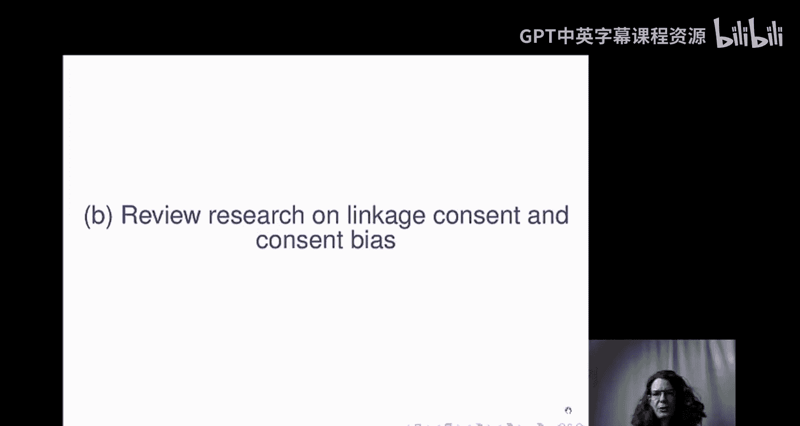
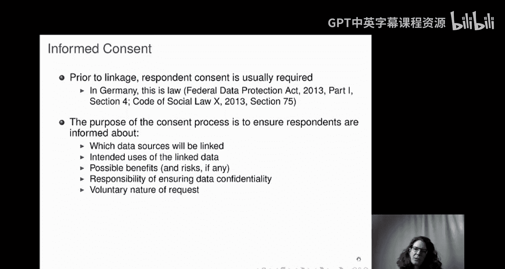
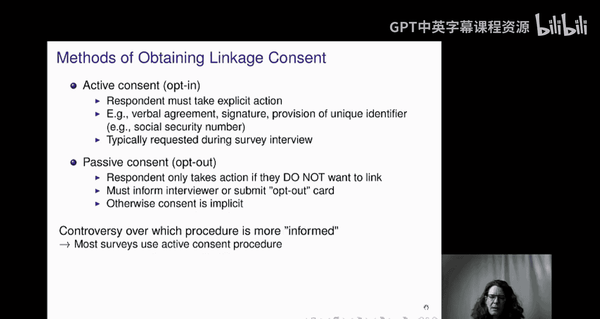
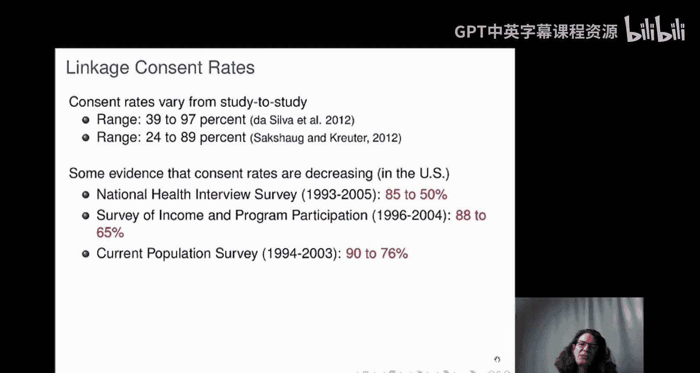
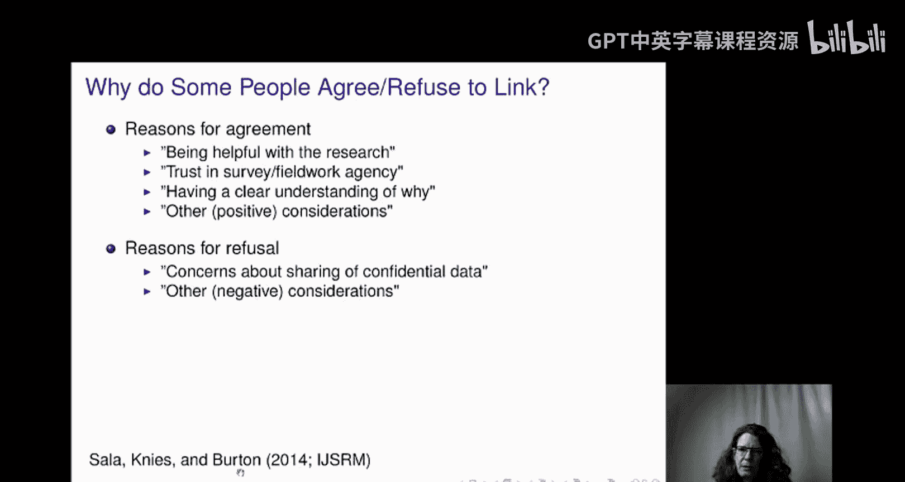
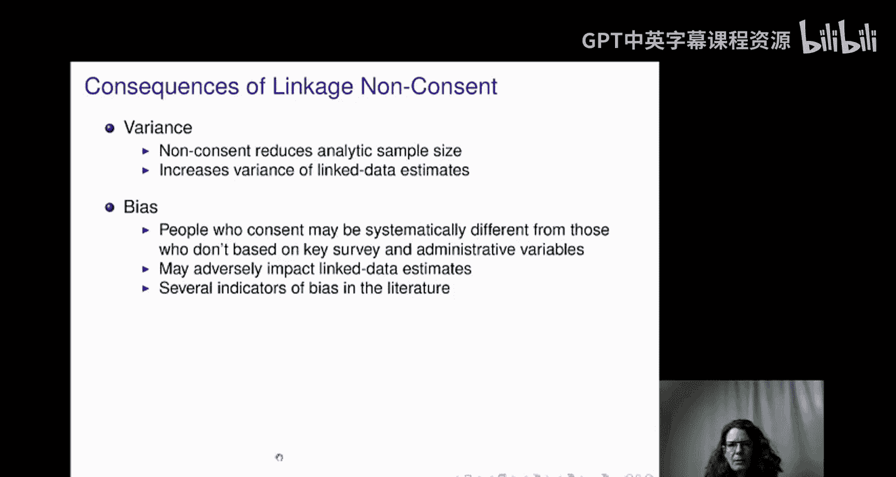
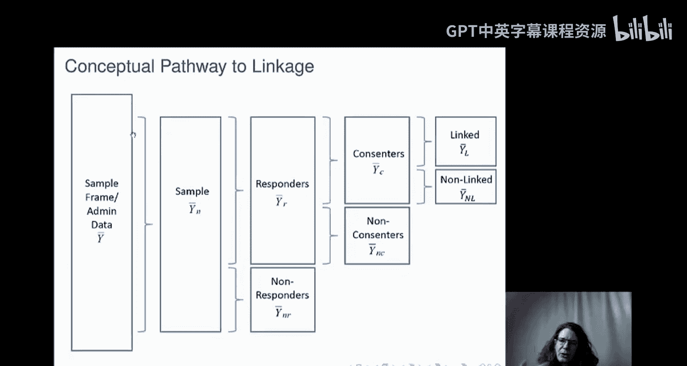
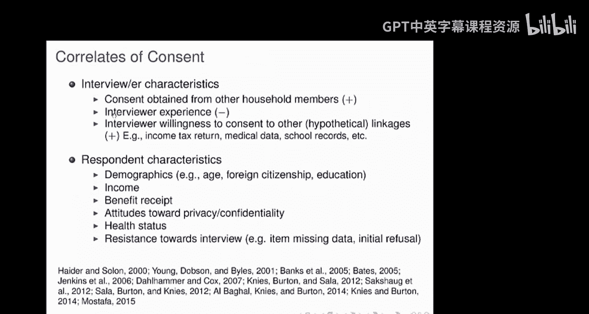

# 调查数据收集与分析：2-6：链接同意与同意偏倚 🔗

在本节课中，我们将学习数据链接中的一个关键环节：获取受访者的链接同意，并探讨因同意率差异可能导致的同意偏倚问题。我们将了解两种主要的同意获取方式，分析影响同意率的因素，并理解同意偏倚对数据分析结果的影响。

## 链接同意的法律要求与目的

上一节我们介绍了数据链接的基本概念，本节中我们来看看获取链接同意的具体过程。在德国等国家，法律通常要求在将任何数据源进行链接或合并之前，必须征得受访者的同意。

这个同意过程的目的在于确保受访者了解以下信息：
*   将被链接的数据源。
*   链接数据的预期用途。
*   数据链接可能带来的收益与风险。

同时，还必须确保数据将被保密，并且参与数据收集的请求本质上是完全自愿的。

## 两种主要的同意获取程序

在介绍了同意过程的目的后，我们来看看实践中获取同意的两种主要方式。

以下是两种常见的同意获取程序：

1.  **主动同意程序**：这是一种“选择加入”的方式。受访者需要采取明确行动（如签署文件或在网页上点击按钮）来表示同意。在调查中，这通常在访谈过程中的某个环节进行。
2.  **被动同意程序**：这是一种“选择退出”的方式。默认情况下，受访者被视为同意参与链接。如果受访者不希望被链接，则必须主动提出反对。

大多数调查采用主动同意程序。关于哪种程序能确保受访者更“知情”，存在一些争议。

## 链接同意率的变化与趋势

了解了获取同意的方式后，我们来看看实际研究中的同意率情况。链接同意率在不同研究间差异很大。

根据文献综述，同意率的范围很广，例如在40%到100%之间，或在24%到90%之间。这种差异部分取决于调查主题和发起方。

有证据表明，在美国，链接同意率呈下降趋势。例如：
*   国家健康访谈调查（1993-2005年）：同意将数据链接到医疗记录的比率从85%降至50%。
*   收入与项目参与调查：同意率从88%降至65%。
*   现时人口调查：同意率从90%降至76%。

## 影响同意与否的因素

既然同意率存在差异和下降趋势，一个自然的问题是：为什么有些人同意链接，而有些人拒绝？

以下是影响受访者决定的一些关键因素：
*   **同意原因**：希望帮助研究、信任调查机构、清楚了解研究目的。
*   **拒绝原因**：对共享机密数据的担忧，以及其他负面考虑。

## 链接不同意带来的后果

上一节我们探讨了人们同意或拒绝的原因，本节中我们重点分析链接不同意对数据分析造成的实际后果。这主要体现为两个方面：

1.  **方差增加**：同意链接的人数减少，导致最终可用于分析的有效样本量减少。样本量越小，估计值的方差就越大，这是一个显著问题。
2.  **偏倚引入**：同意链接的受访者可能与不同意者在系统特征上存在差异。因此，当你分析链接后的行政与调查数据时，分析结果可能会产生原本不存在的偏倚。

作为此类数据的收集者或分析者，需要检查同意率、评估对方差的影响，并思考偏倚可能产生于何处及其是否构成问题。

## 同意偏倚的概念路径

在文献中，可以找到此类偏倚的实例。以下是一个展示链接过程中可能出现的各种偏倚的概念路径：

理想情况下，我们从抽样框（有时本身就是行政数据）开始。其中一部分形成样本。样本可划分为响应者和无响应者。无响应会减少样本量（影响方差），并可能因响应者与非响应者存在系统差异而引入偏倚。

同样的情况也发生在响应者群体内部。你可以将响应者划分为同意链接者和不同意链接者。如果不同意链接的群体与其他人在系统上存在差异，那么链接后的数据就会产生偏倚。

即使在技术层面也可能存在问题：受访者同意了链接，但如果链接需要提供社保号码等关键信息，即使在同意者中，也可能出现部分数据能成功链接、部分不能链接的情况。这同样会对方差和偏倚产生影响。

因此，即使你不是数据的分析者，或者没有现成数据来进行此类研究，作为此类数据的使用者，也应当意识到这些潜在问题。

## 总结

本节课中，我们一起学习了数据链接中的同意获取与同意偏倚。我们了解了主动同意与被动同意两种程序，看到了链接同意率的变化趋势及其影响因素。最重要的是，我们认识到链接不同意不仅会减少样本量、增加方差，更可能因同意者与非同意者的系统差异而引入偏倚，最终影响数据分析结果的准确性与代表性。在使用链接数据时，必须对这些潜在问题保持警惕。