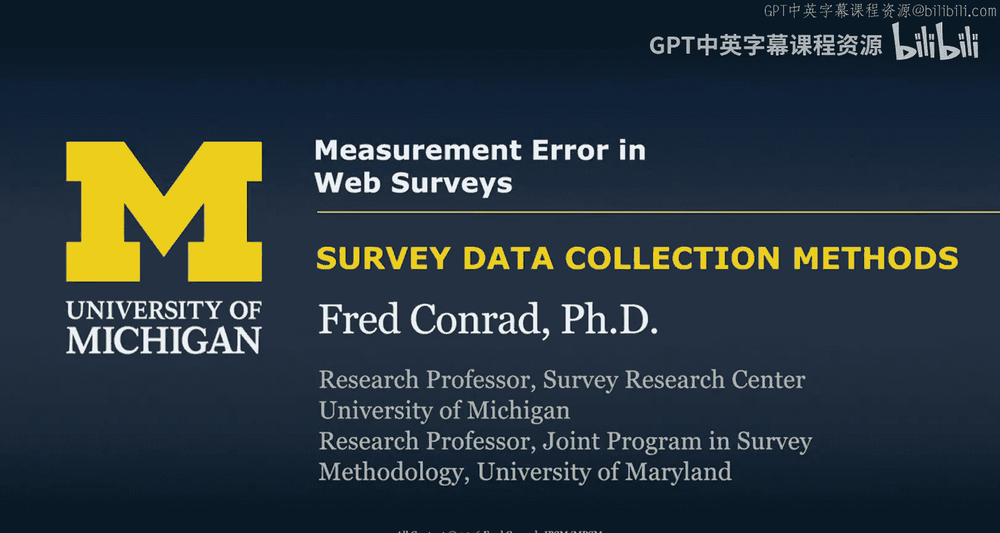
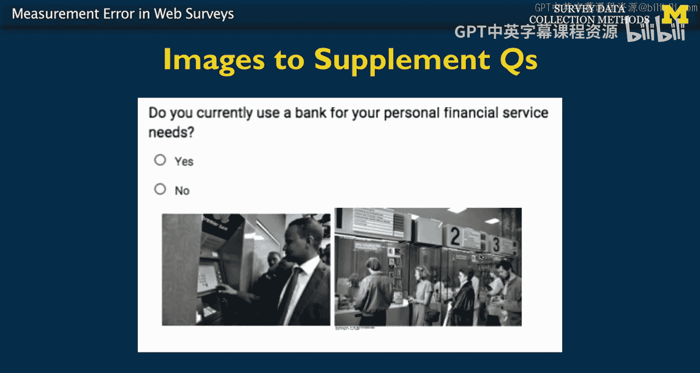
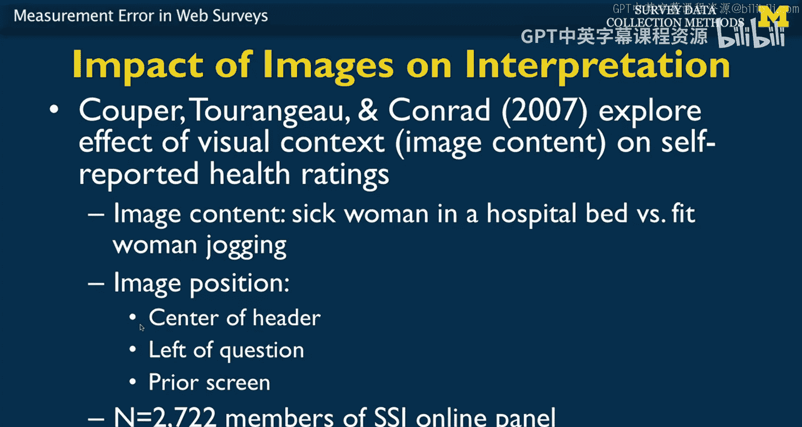
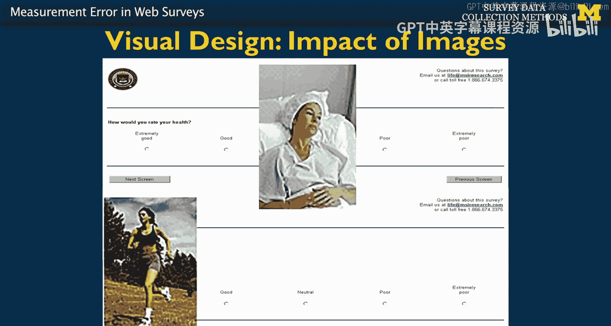
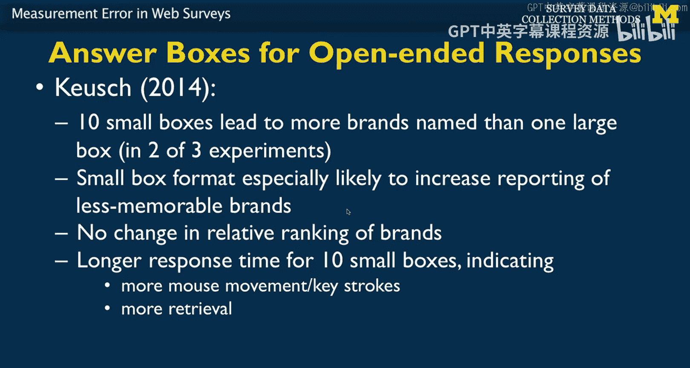

# 密歇根大学《调查数据收集和分析（2-6：方法、社调问卷设计、抽样、缺失数据、分析）｜Survey Data Collection and Analytics》 p17 16_2.2.3 测量方法.zh_en -BV1fw4m1e7Zh_p17-

Welcome back we've been talking about the impact of coverage and nonresponse on web surveys and we've really observed that coverage is probably coverage issues and particular undercover are probably a serious concern with web surveys that not everybody has access and those who don't have access to the web could differ on on the very attributes being studied in a particular survey turning out a measurement and measurement error。

 it's a little harder to make a blanket statement about the impact of measurement on the quality of the data produced in web surveys because there are so many options available in web development for designers it's a rich visual medium and it also enables them to create interactive features and so it really requires looking at designs or features one by one to determine what their impact on quality of answers might be one way to think about。

The options and the attributes of web surveys is how they differ from paper questionnaires。

 they're computerized and automated， like paper questionnaires， they're self- administered。

 they can be rich and visual features will focus on the use of images by designers。

 although there are many other features available in the design of web questionnaires and they're interactive so really in the next segment will explore interactivity in more detail。

 but this is clearly different from paper questionnaires。The main question about self-admin is。

 are there the same kinds of benefits in web surveys for the disclosure of sensitive or stigmatized information that there are in other selfadministered modes in paper and in Cassie in audio Cassie？

And the question for interactivity is which features help and which do not， as I said。

 we'll cover interactivity in the next segment。So turning to self administration。

Poential advantages are that socially desirable responding and other biases associated with the presence of an interviewer will be reduced much as they are in other self-administered modes potential disadvantages are that there's no interviewer present and interviewers particularly as we'll see in the third lesson can add value in a number of ways probing clarifying questions generally assisting the respondent motivating them etc cetera。

 so none of that is present this all has to come from the respondent。

Web questioners may not feel private in the way that say AudioCassie does。

 because of the connectivity of the web， the fact that this is online may undermine the fact that it's self administered。

There's no guarantee that the intended respondent is completing the survey could be another household member or a friend or even a stranger who has somehow intercepted an invitation with a link。

And the context is not under the researchers's control， so as with a paper questionnaire。

 it's possible that the environment is quite noisy and distracting and the researchers will never know。

 but more specific to web questionnaires is there's no control over the display of the questionnaire so different browsers under different operating systems can actually result in quite different presentations of the material and if we want the stimulus to be standardized that's harder to assure with web administration than in other modes so what do the data tell us about the impact of self- administration on disclosure。

Compared to telephone data， web respondents report working out less often。Eating less healthfully。

Watching more TV soaps。And committing more traffic violations。

 all of these are undesirable behaviors， so the fact that respondents are reporting more of them suggests they're being more truthful。

 more candid compared to face to face results， web respondents report voting less often in the last election。

A reduced willingness to donate money for environmental protection and less positive attitudes toward immigrants。

 again these are all socially undesirable behaviors and the fact that respondents are reporting them suggests that they're being more candid in web from these studies it appears that self-administ does work the same way in web questionnaireers that it does in other self-administered modes。

A study that compared the web to two other modes was conducted by Croder Presser and Taranjo and basically they confirmed replicated the pattern of results that we were just discussing。

 namely greater disclosure in web questionnaires than in other modes and they also demonstrated that when respondents give more undesirable answers。

 they are being more honest because they were able to verify their answers by using administrative records。

 so what they did was to randomly assign university alumni to one of three modes。

 a web questionnaire， a touchstone IVR interview and a telephone interview Katy interview。

And asked the respondents about their academic performance。

 some of the questions were potentially sensitive， so they asked them if their grade point average had been less than 2。

5 out of four， or if they had received a grade at least one grade of D or F。

 so failing or very weak performance in a course。What they found was that the web respondents reported more socially undesirable academic performance than the telephone respondents and in fact then the IVR respondents and IVR is self administered。

As well， but it's spoken， at least the questions are spoken。So this， as I said。

 is consistent with and more or less reinforces the pattern of results that we discussed just a moment ago。

 but this study went to step further and showed that respondents were more accurate when they disclosed more so compared to university records。

 the registrar provided the academic records of these alumni to the researchers and compared to those records。

 the web respondents were more accurate than the IVR respondents who were more accurate than the caddy respondents so it suggests that when respondents disclosed more they were doing this truthfully。

 which is the assumption behind most mode comparison studies involving disclosure of sensitive information that more reflects greater candor or honesty。

And there's also a hint that the presentation of questions online affected the way they were perceived and in particular that some of the questions were perceived as being less intrusive。

 which could well account for the greater disclosure and honesty in the web mode than in the other so you can see in the figure this is the percent of yes responses to questions that have undesirable characteristics and the bars is higher in web than IVR than telephone So turning now to the use of images in web surveys again as I said there are many visual features that designers can manipulate images are just one of them but they have been used by designers really from the inception of web surveys so thing about images is that they are easy to use and inexpensive to insert into into web questionnaires。

They are primarily used， it seems， to make pages more attractive and ultimately to increase respondents attention or their engagement。

 which should result in higher completion rates。So they're designed to keep respondents on task。

But how do they affect or do they affect the answers that respondents give？

So that's really what we'll focus on after we look at some examples of ways that that images are used in web surveys。

 so images may be used as the kind of the heart or the core of a question in which respondents are providing some evaluation what's displayed in the image to make the task easier by providing some important background information。

 sometimes they are incidental in that they really are they are just for decoration and attractiveness。

 but not really to provide any substance。Sometimes they're used as a substitute for text。

 this is possible when the text refers to kind of concrete nouns。

And sometimes to supplement the question， to provide information that isn't provided in the verbal information itself。

 often to define terms that are present in the question。So in this first example。

 the respondents are evaluating the scene that's presented in front of them。

 so there really is no text associated with this particular question， just an image。

 or here the image provides background information about heart disease that will be useful to respondents in answering a question about a surgical procedure。

In this case， the image has some relationship to the third question which is about exercises。

 but it's not necessarily the exercise that's depicted there。

 and it really seems that the designer's intent was just to make this more visually appealing and to engage the respondents。

 keep them on task longer。In this example， the images on the left are used in place of text。

 probably also to make the page more attractive and engaging and so on and this is possible to do when the text refers to concrete objects in the world。

And here the image is used to just kind of reinforce what's meant in the phrase men's casual shoes。

 just sort of so there's no confusion about what the designers had in mind。

 it's not quite a definition but it does clarify what the designers intended。

This pair of images really does serve to define a phrase in the question。

 personal financial service needs， so that's pretty vague。

 but there's a picture on the left of a user interacting with an automated teller machine and on the right with customers in the bank interacting with tellers。

And so now a respondent should have some sense of what that phrase personal financial service needs refers to。

So this idea of using images to define terms or phrases in the question was explored systematically by Cooper Tranjo and Kenyon。

 they wanted to see if for question about the frequency of a behavior if images that led to higher or lower frequency interpretations of the behavior affected the frequency reports accordingly。

 so for example in a question about shopping an image accompanying the question about shopping that showed a department store might lead they speculated to lower frequency reports then an image of a grocery store。

 the idea being that people go to grocery stores more often than they go to department stores and so if respondents are using those images to help define what's meant by shopping it could affect the frequency reports that they provide so this graph shows the mean reported frequency for each。

Of the six behaviors that they asked about by the four experimental conditions that they tested。

 so either a low frequency picture， no picture。A high frequency picture or both the low frequency and high frequency picture and it's important to keep in mind that when they provided both the high frequency picture is present。

 so it is potentially able to affect respondents answers of what they observed was for each of the six behaviors the right most pair of bars correspondent to either the high frequency picture or both low and high frequency picture led to the highest frequency reports and so that's just what they speculated would occur so it does seem that respondents are using these images to help define the terms in the question which could be a good practice by designers if this is what they intend if they're clear on the interpretation they intend respondents to arrive at but if the images are used less deliberately it may well be distorting the data given the goals of the question or of the study Turn to another study on the impact of images by。

Cooper and his colleagues， they really wanted to see if images provide the same kind of context that verbal information can provide there's a well-known phenomenon called question order or context effects in which answers to the current question are affected by answers to the previous question because that somehow may serve as a comparison or in other ways sets the stage for the current question and when it's not asked responses are different。

 so the issue here is do images work the same way。What they did was asked respondents to rate their health。

 so called self reported or self rated health questions。

 widely used questions like this in a variety of studies。

And they included with the question one of two images in one of three locations。

 the image content was either a woman in a hospital bed clearly was ill or a fit woman jogging and they varied the location in the question。

 so either in the center of the header。Or to the left of the question， or on the prior screen。

So the question stimulus looked like this， how would you rate your health with the response scale going from extremely good to extremely poor？

In this condition， this example， the image is of the woman in the hospital bed and she's displayed in the center of the question and to zoom in on her。

 she's clearly not in good health and another version of the question the image appears to the left and above the question and in this case it's the fit woman jogging who looks kind of like that so the question is how does the content of the image and how does this location affect the way respondents rate their own health？

And the idea is that they might well use the images as a frame of reference。

Even if the designer didn't intend for that。And so what we see here is that that's really what respondents do in at least two of the three positions。

 so when the image appears to the left of the question， if it depicts the woman in the hospital bed。

 the sick woman， respondents rate their health higher than when the image depicts the fit woman jogging and the idea is that if they're comparing themselves to the woman in the hospital bed。

 they might say my health's probably better than hers not so bad。

 but if they're comparing themselves to the fit jogger they might say well I'm just not as healthy as the way they seem to be defining health here。

 so by comparison， I'm less healthy。And the same pattern is observed when the question appears on the prior screen。

 so respondents are actually carrying that over much like they do with question order effects that I mentioned a moment ago when the image appears in the center within the header。

 there's actually no impact of the image on the answers。

 this little difference that's visually evidence is actually not significant and one explanation that the authors proposed is that this is an example of banner blindness which has been pointed out in the human computer interaction literature with respect to web pages generally and that's that users of web pages as visitors to web pages generally pay less attention to the content in that upper band of the page than in other regions of the page at least that was the phenomenon at the time of this study。

 but the takeaway here is that respondents are using these images as a frame of reference even though designers may never have intended for that to be。

I mean in this case it was done by design， it was done on purpose by the experimenters。

 but as we saw in those previous examples， images seem to be used as almost decoration or at least incidentally。

 and this is an example of what can potentially happen with when that's the practice。

So impact images to summarize respondents use the images much as they use verbal information when interpreting a question。

 namely to define terms in the question such as shopping， or as a standard of comparison。

 much like prior questions in conventional context effects that have spoken about。

So the implication for designers is that images are okay。

 can be okay if they're used after thinking through the likely consequences。

 if they're used deliberately and by design， but if that's not the case。

 then it's probably better not to use an image。The final example of the sort of visual choices that a web survey designer has that will discuss concerns。

 answer boxes or input fields for open form questions。

So the issue really is whether and how the appearance of these boxes affects the answers and the kind of effort and that respondents invest in really the interpretation of the task that they're being given。

So a study by Koch varied the size of the answer boxes and really their structure。

 so in one case respondents were presented with one large answer box and in the other case。

1 small answer boxes and they were asked to generate or come up with as many instances of brands of particular types of products is possible。

 they called this he calls this unaided brand recall。

 and asked respondents to perform this task in three categories， insurance companies。

 airlines and car tires， so you can see the single box on the left。

 which there's no structure at all， they just enter brands and 10 small boxes on the right where it's clear that they were entering one brands per box。

 as you can see the kind of question they're being asked is when thinking about car tires。

 what brands come to mind。The small box format was especially likely to increase reporting of less memorable or less accessible brands and some evidence that respondents were working harder to retrieve these brands comes from the longer response times that were observed when the answers were entered into the 10 small boxes than into the one large box。

 so respondents were apparently investing more effort when they were given10 small boxes because the message that the design seemed to convey。

 or at least this is the implication was that they really are being asked to come up with 10 instances here。

 and by the way the ranking of the brands that were generated was the same in the two cases so the 10 small boxes simply generated more brands but didn't change the way any of them were evaluated relative to the others。

So they kind of conclusion for the。The use of answer boxes is that respondents infer from the design of the answer field what the questionnaire designer expects from them。

Therefore， designers really should have clear measurement goals in mind when they develop the input field because respondents will be interpreting these designs as an indication of what the designer wants them to do。

In the next segment， we'll look at interactive features available to designers such as progress indicators or feedback about the completeness of answers。

 and the issue there is really which of these features are helpful and which of these features are not helpful。

 so we'll see shortly。