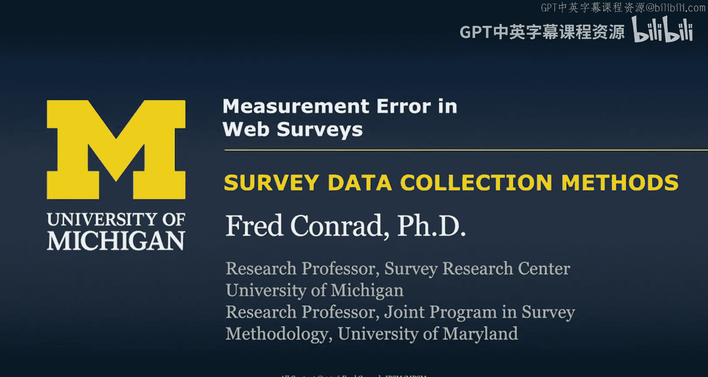
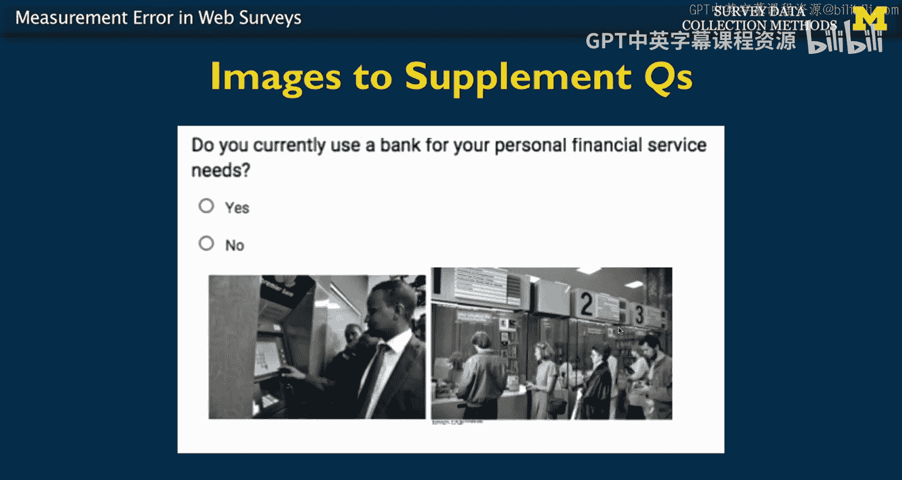
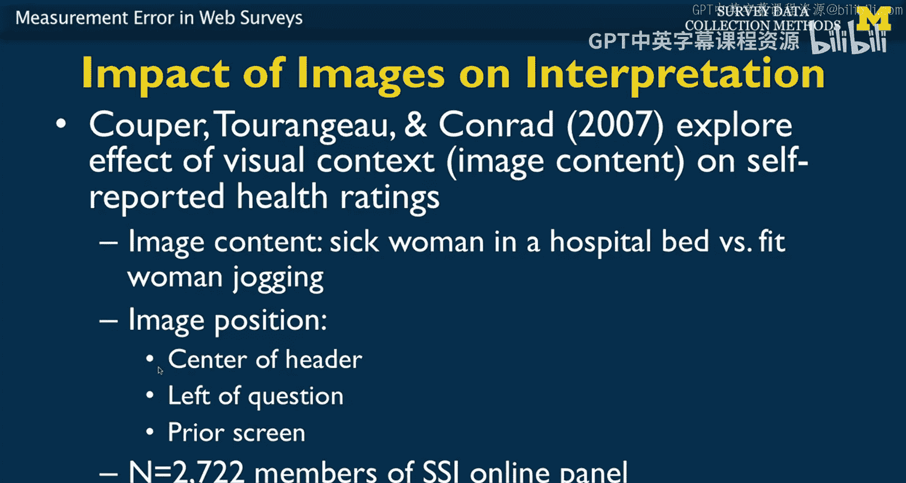
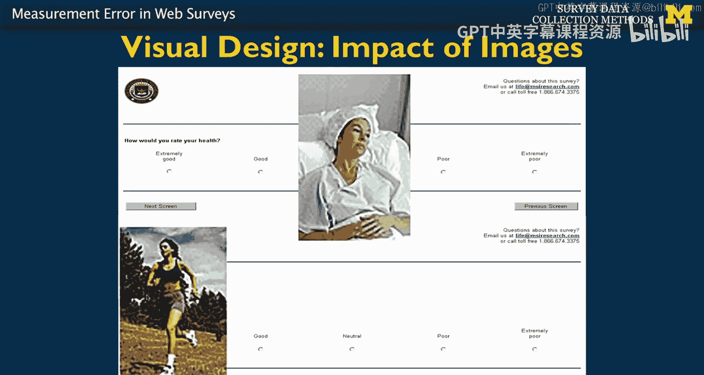
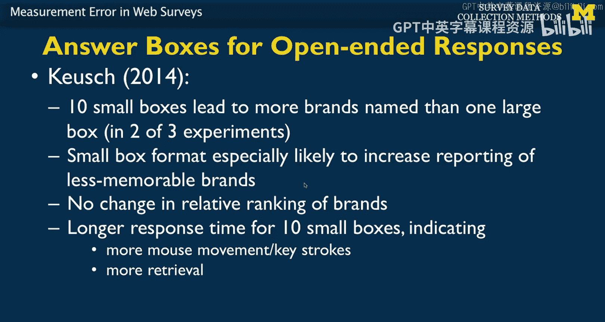

# 调查数据收集和分析：2.2.3：测量方法 📏

在本节课中，我们将要学习网络调查中的测量方法，特别是自我管理和视觉设计（如图像、输入框）如何影响受访者的回答质量。我们将逐一分析这些设计选择可能带来的好处与风险。

上一节我们介绍了网络调查中的覆盖和无应答问题，本节中我们来看看测量误差。关于测量对网络调查数据质量的影响，很难一概而论。因为网络为设计者提供了丰富的视觉媒介和交互功能选项，这需要我们逐一审视不同设计或功能对回答质量的可能影响。

一种思考网络调查选项和属性的方式，是看它们与纸质问卷有何不同。

*   它们是计算机化和自动化的。
*   与纸质问卷一样，它们是**自我管理**的。
*   它们可以具有丰富的视觉特征，我们将重点关注设计者对**图像**的使用（尽管网络问卷设计中还有许多其他可用功能）。
*   它们是**交互式**的，这与纸质问卷明显不同。我们将在下一节更详细地探讨交互性。

关于自我管理的主要问题是：网络调查在披露敏感或污名化信息方面，是否与纸质问卷、CASI（计算机辅助自填）或音频CASI等其他自我管理模式具有相同的好处？关于交互性的问题是：哪些功能有帮助，哪些没有？我们将在下一节讨论交互性。

## 自我管理的影响

现在转向自我管理。其潜在优势是，与社会期许反应及其他与访员在场相关的偏差会减少，这与其他自我管理模式类似。潜在劣势是，没有访员在场。访员（正如我们将在第三课看到的）可以通过多种方式增加价值：追问、澄清问题、协助受访者、激励他们等。这些在网络调查中都不存在，一切都必须由受访者自己完成。

此外，网络问卷可能不像音频CASI那样让人感到私密，因为网络的连通性、在线这一事实可能会削弱其自我管理的优势。无法保证是目标受访者本人在完成调查，可能是其他家庭成员、朋友，甚至是截获了邀请链接的陌生人。研究环境也不在研究者控制之下。与纸质问卷一样，环境可能嘈杂且令人分心，而研究者无从知晓。

但更具体到网络问卷的是，研究者无法控制问卷的显示方式。不同的浏览器和操作系统可能导致材料呈现方式大不相同。如果我们希望刺激（问题呈现）是标准化的，那么通过网络管理比其他模式更难保证这一点。

那么，关于自我管理对信息披露的影响，数据告诉了我们什么？

与电话调查数据相比，网络受访者报告：
*   锻炼频率更低。
*   饮食更不健康。
*   观看更多电视肥皂剧。
*   犯下更多交通违规行为。

这些都是不受欢迎的行为，受访者报告更多此类行为，表明他们更诚实、更坦率。

与面对面调查结果相比，网络受访者报告：
*   在上次选举中投票的频率更低。
*   为环境保护捐款的意愿降低。
*   对移民的态度更不积极。

这些也都是社会不期许的行为或态度，受访者报告这些，表明他们在网络调查中更坦率。从这些研究来看，自我管理在网络问卷中的作用方式似乎与其他自我管理模式相同。

一项由Kreuter、Presser和Tourangeau进行的研究比较了网络与其他两种模式。他们基本证实并复制了我们刚才讨论的结果模式，即网络问卷中的信息披露程度高于其他模式。他们还证明，当受访者给出更多不受欢迎的答案时，他们确实更诚实，因为他们能够通过行政记录验证这些答案。

以下是该研究的具体做法：
*   他们将大学校友随机分配到三种模式之一：网络问卷、按键式电话IVR访谈、电话访谈（CATI）。
*   询问受访者关于其学业表现的问题，其中一些问题可能比较敏感，例如询问他们的平均绩点是否低于4分制中的2.5分，或者是否至少得过一个D或F（即课程不及格或表现很差）。

研究发现，网络受访者比电话受访者（实际上也比IVR受访者）报告了更多社会不期许的学业表现。IVR也是自我管理的，但至少问题是语音播报的。这正如我所说，与刚才讨论的结果模式一致并加强了该模式。

但这项研究更进一步，表明当受访者披露更多时，他们也更准确。与大学记录（注册处向研究者提供了这些校友的学业记录）相比，网络受访者比IVR受访者更准确，而IVR受访者又比CATI受访者更准确。这表明，当受访者披露更多时，他们是诚实的。这也是大多数涉及敏感信息披露的模式比较研究背后的假设：更多的披露反映了更大的坦率或诚实。

此外，有迹象表明，问题的在线呈现方式影响了受访者对问题的感知，特别是有些问题被认为侵入性较低，这很可能解释了网络模式比其他模式有更高的披露率和诚实度。从图中可以看到，对于具有不受欢迎特征的问题，回答“是”的百分比，网络模式高于IVR模式，IVR模式又高于电话模式。

## 图像在网络调查中的使用

现在转向网络调查中图像的使用。正如我所说，设计者可以操控许多视觉特征，图像只是其中之一，但从网络调查诞生之初，设计者就一直在使用图像。图像的特点是易于使用且插入网络问卷的成本低廉。

图像的使用似乎主要是为了使页面更具吸引力，最终提高受访者的注意力或参与度，这应该会带来更高的完成率。因此，它们旨在让受访者专注于任务。

但它们如何影响（或是否影响）受访者给出的答案？这才是我们接下来要关注的重点，在查看图像在网络调查中的使用方式示例之后。

以下是图像在网络调查中的几种常见用途：
*   **作为问题的核心**：受访者对图像中显示的内容进行评估，此时图像是问题的核心，可能没有关联文本。
*   **提供背景信息**：通过提供重要的背景信息使任务更容易。
*   **作为装饰**：图像仅是装饰和吸引眼球，不提供实质内容。
*   **替代文本**：当文本涉及具体名词时，可以用图像替代文本。
*   **补充问题**：提供口头信息本身未提供的信息，通常用于定义问题中出现的术语。

Cooper、Tourangeau和Kenyon系统地探索了使用图像定义问题中术语或短语的想法。他们想看看，对于关于行为频率的问题，如果图像导致对该行为产生更高或更低频率的解释，是否会相应地影响频率报告。

例如，在一个关于购物的问题中，如果伴随问题的图像显示百货公司，他们推测这可能导致比显示杂货店的图像更低的频率报告。因为人们去杂货店的频率通常高于去百货公司。如果受访者使用这些图像来帮助定义“购物”的含义，就可能影响他们提供的频率报告。

图表显示了他们询问的六种行为的平均报告频率，按他们测试的四种实验条件分组：低频图片、无图片、高频图片、或同时有低频和高频图片。需要记住的是，当同时提供两种图片时，高频图片是存在的，因此它有可能影响受访者的答案。

他们观察到，对于六种行为中的每一种，最右边的两组条形图（对应高频图片或同时有低频和高频图片）导致了最高的频率报告。这正是他们推测会发生的情况。因此，受访者似乎确实在使用这些图像来帮助定义问题中的术语。如果这是设计者的意图，并且他们清楚希望受访者得出何种解释，这可能是一种好的做法。但如果图像的使用不那么慎重，则可能会扭曲数据，偏离问题或研究的目标。

## 图像作为参照框架的影响

转向另一项关于图像影响的研究，由Cooper及其同事进行。他们想看看图像是否能提供与口头信息相同类型的语境。有一个众所周知的现象叫做问题顺序效应或语境效应，即当前问题的答案会受到前一个问题答案的影响，因为前一个问题可能作为比较标准或以其他方式为当前问题设定了背景，而当它不被问及时，回答会不同。这里的问题是，图像是否以同样的方式起作用。

他们要求受访者评价自己的健康状况（即自评健康问题，广泛用于各种研究）。他们在问题中加入了两种图像之一，并置于三个位置之一。图像内容要么是一个明显生病的女人躺在医院病床上，要么是一个健康的女人在慢跑。他们改变了图像在问题中的位置：在标题中央、在问题左侧、或在上一屏。

问题是：图像的内容和位置如何影响受访者评价自己健康的方式？想法是，受访者很可能将图像用作参照框架，即使设计者可能从未打算这样。

我们看到，在三个位置中的至少两个位置，受访者确实这样做了。当图像出现在问题左侧时，如果描绘的是医院病床上的生病女人，受访者对自己健康的评价高于图像描绘健康慢跑女人时。想法是，如果他们将自己与医院病床上的女人比较，可能会说“我的健康可能比她好，不算太糟”；但如果将自己与健康的慢跑者比较，可能会说“我没有他们在这里定义的健康那么好”。因此，通过比较，他们觉得自己不那么健康。

当图像出现在上一屏时，也观察到了相同的模式。因此，受访者实际上将这种影响延续了下来，就像我之前提到的传统问题顺序效应一样。当图像出现在标题中央时，图像对答案实际上没有影响。视觉上可见的微小差异实际上并不显著。作者提出的一个解释是，这是“横幅盲点”的一个例子，在人机交互文献中关于网页的一般使用中已被指出。即网页用户（访问者）通常对页面上方横幅区域内容的关注度低于页面其他区域（至少在这项研究进行时是这种现象）。但这里的要点是，受访者正在使用这些图像作为参照框架，即使设计者可能从未打算如此。在这个案例中，这是实验者有意设计的，但正如我们在前面的例子中看到的，图像似乎几乎被用作装饰或至少是附带性的，这展示了当采用这种做法时可能发生的情况。

## 输入框设计的影响

网络调查设计者拥有的视觉选择的最后一个例子，涉及开放式问题的答案框或输入字段。问题在于这些框的外观是否以及如何影响答案，以及受访者在解释所给任务时投入的努力程度。

一项由Koch进行的研究改变了答案框的大小和结构。一种情况是向受访者呈现一个大答案框，另一种情况是10个小答案框。要求受访者尽可能多地想出特定类型产品的品牌实例，他称之为无提示品牌回忆。要求受访者在三个类别（保险公司、航空公司、汽车轮胎）中执行此任务。

可以看到，左侧的单一大框没有任何结构，他们只是输入品牌；右侧的10个小框清楚地表明他们每个框输入一个品牌。他们被问到的问题是：“想到汽车轮胎时，哪些品牌会浮现在脑海中？”

小框格式特别有可能增加对不那么 memorable 或不易想起的品牌的报告。一些证据表明受访者在更努力地检索这些品牌，这来自于观察到当答案输入10个小框时，响应时间比输入一个大框时更长。因此，当给受访者10个小框时，他们显然投入了更多努力，因为设计似乎传达的信息（或至少其含义）是，他们确实被要求想出10个实例。顺便说一下，生成的品牌排名在两种情况下是相同的，所以10个小框只是生成了更多品牌，但没有改变任何品牌相对于其他品牌的评价方式。

因此，关于答案框使用的结论是：受访者从答案字段的设计中推断问卷设计者期望他们做什么。因此，设计者在开发输入字段时，心中应有清晰的测量目标，因为受访者会将设计解读为设计者希望他们做什么的指示。

## 总结

本节课中我们一起学习了网络调查中测量方法的关键方面。

我们探讨了自我管理模式在网络调查中的优势（如减少社会期许偏差）和劣势（如缺乏访员协助、隐私顾虑和环境不可控）。数据表明，自我管理确实能促进对敏感信息的更诚实披露。

我们重点分析了视觉设计元素，特别是图像的使用。图像可用于定义术语、提供背景或作为装饰，但研究显示，受访者会无意识地将图像内容作为解释问题的参照框架或比较标准，从而可能影响回答。因此，设计者必须审慎并有目的地使用图像。

最后，我们考察了开放式问题输入框的设计。输入框的大小和结构（如一个大框 vs. 多个小框）会向受访者暗示任务期望，影响其回答的详尽程度和努力程度。设计者需要根据测量目标来设计输入字段。

总而言之，网络调查的测量质量高度依赖于具体的设计选择。设计者必须深思熟虑，确保每个视觉和交互元素都能服务于研究目标，而非无意中引入偏差。

在下一节中，我们将看看设计者可用的交互功能，例如进度指示器或关于答案完整性的反馈。问题在于这些功能中哪些是有帮助的，哪些是没有帮助的。我们很快会看到。