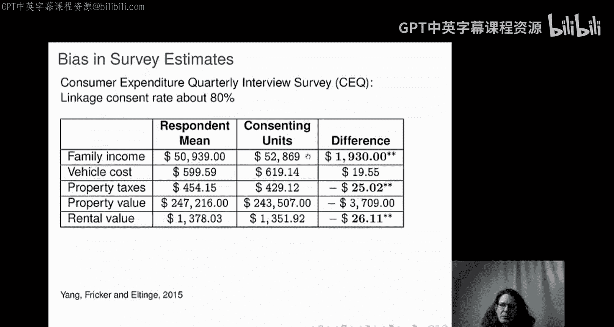

# 密歇根大学《调查数据收集和分析（2-6：方法、社调问卷设计、抽样、缺失数据、分析）｜Survey Data Collection and Analytics》 p170 21_同意相关因素.zh_en -BV1fw4m1e7Zh_p170-

So correlates of consent， we talked about that some people do give consent and others don't and it would be interesting and therefore a lot of papers you see them listed on the bottom of the slides have looked into this。

 what correlates with people giving consent？Are there any particular characteristics of the respondents。

 certain demographic groups， certain income groups？

That could be a problem here and likewise are there interviewer characteristics and indeed they are we have seen that。

Unexperienced interviewers tend to have lower consent rates。

If the interviewer herself is willing to share data and to have her own data linked。

There is a higher concentrate rate among those people interviewed by that particular interview。

 it is very interesting if you think about that consequence， right？

If you have a study that focuses on that kind of linkage and having different data sets together。

 you sure want to make sure that the interview is trains and really fully embraces that concept。Now。

 the list is long of potential respondent characteristics here you can see the direction of these variabless on the consent rates。

 So in the study from。From Nancy Bates from 2005， she saw that there was a lower con rate among females。

 among a negative correlation with age， negative correlation with education and earnings。And。

Very different though， some studies are done a little earlier by Jenkins and young。

 you see opposites effect of education， so bottom line looking at this picture。

 some studies show correlates。Others don't and。I guess with the example of net worth。

 you find studies that show it in all directions， which is you know leaving us a little in the dust of what happens and this could be in part because it depends on what kind of server we are talking about。

Now， here's an interesting analysis that Ting Yang and Scott Friter and John Elting did with data from the Bureau of Labor Statistics。

In particular， they used the consumer expenditure quarterlyly interview survey to look at biases in the survey estimates here they had。

A concentrate rate of about 80%。What you see in these two columns。

 respondent mean and consenting or the mean among the consenting units is for five worry about family income。

 vehicle cost， property tax and property value， rental value how。

The average changes among the consensuss。 So on family income。

It appears that people with lower income。Consentedless and therefore we have。

 if we only analyze the consenting units a higher responded mean。

 that's the way you interpret this table。So differences are not huge。

 but some of these differences are indeed significant， and that is the third column here。

 so the bold phased values in that third column are the significant differences。

