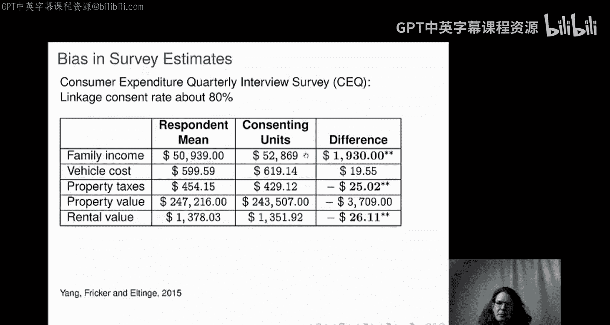

# 调查数据收集与分析：2-6：同意相关因素 📊

在本节课中，我们将探讨调查中受访者“同意”行为的相关因素。理解哪些因素会影响受访者同意参与调查或同意数据链接，对于评估数据质量和潜在偏差至关重要。

## 概述

我们之前讨论了受访者同意率存在差异的现象。本节将深入分析可能与同意行为相关的因素，包括受访者特征和访问员特征，并探讨这些因素如何导致调查估计产生偏差。

## 受访者特征与同意率

多项研究试图找出与受访者同意行为相关的特征。以下是部分研究中观察到的变量及其对同意率的影响方向。

*   **性别**：在Nancy Bates（2005）的研究中，**女性**的同意率**较低**。
*   **年龄**：研究发现，同意率与年龄呈**负相关**。
*   **教育与收入**：在Bates的研究中，同意率与**教育水平**和**收入**也呈**负相关**。

然而，不同研究的结果可能不一致。例如，Jenkins和Young的更早研究显示了**教育水平**的**相反效应**。关于净资产等变量，不同研究甚至可能报告完全相反的方向。这表明，同意行为的相关因素可能因调查的具体类型、内容和背景而异。

## 访问员特征的影响

除了受访者自身特征，访问员的特征也会显著影响同意率。

*   **访问员经验**：**经验不足的访问员**往往获得**较低的同意率**。
*   **访问员态度**：如果访问员**本人愿意分享数据**并支持数据链接，那么由她访问的受访者**同意率会更高**。

这个发现具有重要意义。如果你的研究依赖于数据链接，那么确保访问员经过充分培训并完全理解和支持这一概念，就显得尤为关键。

## 同意行为导致的估计偏差

上一节我们介绍了可能影响同意率的因素，本节我们来看看这种选择机制如何导致最终调查估计产生偏差。Ting Yang、Scott Friter和John Elting利用美国劳工统计局的“消费者支出季度访问调查”数据，进行了一项有趣的分析。

该调查的同意率约为80%。他们比较了“全体受访者均值”与“同意数据链接的受访者子集均值”之间的差异。以下是针对五个变量的分析结果：

*   **家庭收入**：**收入较低**的群体**同意率较低**。因此，如果仅分析同意数据链接的子集，得到的平均家庭收入会**高于**全体受访者的平均值。
*   **车辆成本、财产税、财产价值、租金价值**：这些变量也观察到了同意子集与全体样本之间的均值差异。

下表中的数据展示了这种差异。第三列（差异）中标为**粗体**的值表示差异具有统计显著性。

> **解读上表**：以“家庭收入”为例，“同意者均值”（Consenting Mean）高于“受访者均值”（Respondent Mean），且差异显著（第三列为粗体）。这证实了低收入群体同意率更低，导致仅使用同意者数据会高估总体平均收入。

虽然表中显示的差异幅度并非总是巨大，但部分差异确实显著。这表明，非随机的同意行为可能引入系统性偏差，影响基于同意者子集得出的结论对总体的代表性。

## 总结

本节课中，我们一起学习了影响调查同意行为的相关因素。我们了解到，**受访者的人口统计学特征**（如性别、年龄、收入）和**访问员的特征与态度**都可能影响同意率。更重要的是，这种非随机的同意机制可能导致调查估计产生**显著性偏差**，例如高估整体收入水平。因此，在设计和分析调查时，必须考虑同意率的潜在偏差，并采取相应措施（如精心培训访问员、进行加权调整）来改善数据质量。