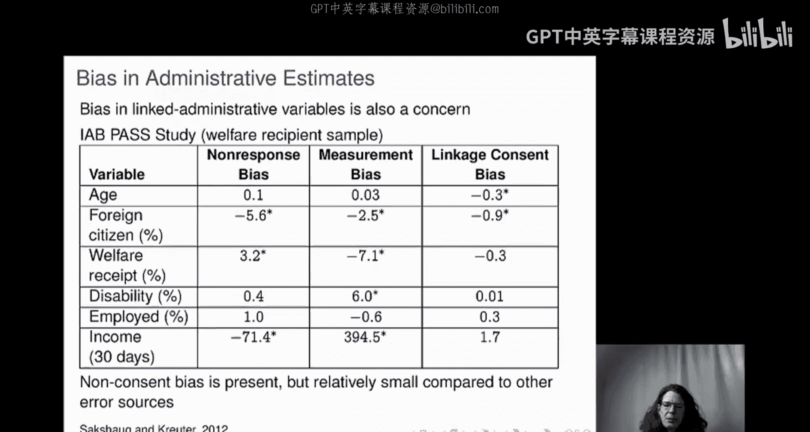
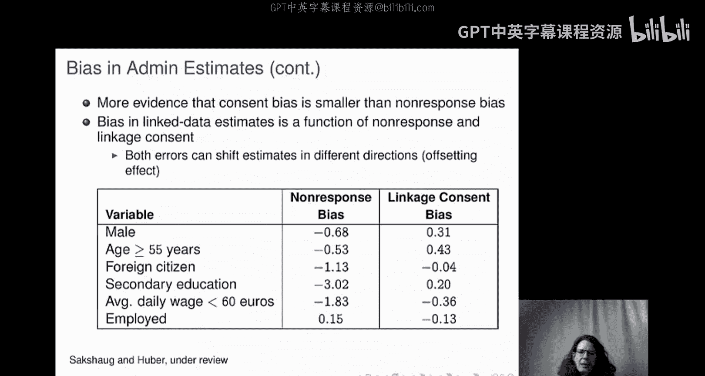

# 密歇根大学《调查数据收集和分析（2-6：方法、社调问卷设计、抽样、缺失数据、分析）｜Survey Data Collection and Analytics》 p171 22_行政数据估计中的偏倚.zh_en -BV1fw4m1e7Zh_p171-

A similar study was done by Josa and myself with data from the German PA study。

 a survey on welfare recipients。And we looked here at the bias in the linked administrative data。

Variable， so what was interesting about that study， we were able to。

Look at the aggregate value of the noncons in the survey as well。

 because we were able to link that indicator variable。

 whether someone participated in the survey or not and whether someone consented to the linkage to the initial sample frame so that we have。

Good estimates of nonres bias and linkage consent bias。 And for those that participated。

 we actually were also able to look at the measurement bias， because we could compare。😊。

The value of what they said in the survey to what is available on them on the administrative data。

Now， the results are somewhat discouraging。When you look at the measurement bias， but。

There's actually not too much nonres biass。And。In this particular study there's very little sorry linkage consent pie。

 so that's pretty good right， we will have here a situation where we do not need to worry about the linkage consent。

 but only because that is the case in this one study that doesn't mean that that is the case everywhere。

So what was interesting for us， we you know， on these variables and from an additional study by Jo Saaka and。

A colleague also from the IAB they found more evidence for other surveys done there that the linkage consent bias is overall small and often smaller than nonrespon bias。

 so focusing on measurement error and that meaning going back maybe to the questionnaire design module in our specialization might be very valuable here。

