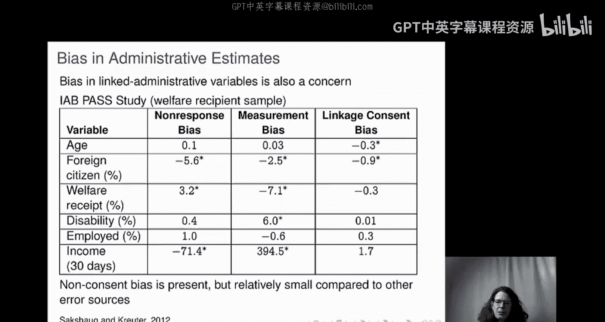
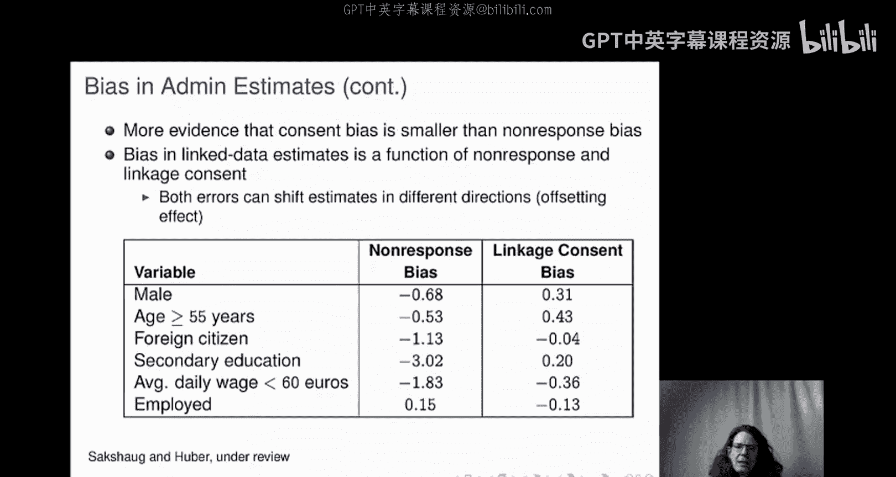

# 调查数据收集与分析：2-6：行政数据估计中的偏倚

在本节课中，我们将学习一项关于行政数据链接研究中偏倚的具体分析。我们将探讨一项针对德国福利领取者的研究，该研究同时评估了无应答偏倚、链接同意偏倚和测量偏倚。

## 研究背景与数据

上一节我们讨论了行政数据链接中的潜在偏倚类型。本节中，我们来看看一项由Josa和我本人利用德国PA研究数据进行的实证分析。这项研究是一项针对福利领取者的调查。

## 偏倚的分解与评估

以下是该研究设计的独特之处，它使我们能够分解并量化多种偏倚：

*   **无应答偏倚评估**：我们能够考察调查中未同意链接者的汇总数值。
*   **链接同意偏倚评估**：我们能够将“是否参与调查”和“是否同意数据链接”这两个指标变量链接回初始抽样框，从而获得对无应答偏倚和链接同意偏倚的良好估计。
*   **测量偏倚评估**：对于参与了调查的受访者，我们还能考察测量偏倚，因为我们可以比较他们在调查中报告的值与行政数据中关于他们的记录值。

## 研究结果分析

现在，让我们看看这项研究的具体发现。结果在某些方面令人警醒，但也包含一些积极的信号。

*   **测量偏倚**：当你查看测量偏倚时，结果有些令人沮丧。这意味着调查回答与行政记录之间存在显著差异。
*   **无应答偏倚**：实际上，无应答偏倚并不太大。
*   **链接同意偏倚**：在这项特定研究中，链接同意偏倚非常小。这相当不错，意味着我们在此情境下无需过度担忧链接同意带来的偏倚。

**重要提示**：但这仅是本项研究中的情况，并不意味着在所有研究中都是如此。

## 延伸发现与启示

对我们而言，有趣的是，基于这些变量以及Jo Saaka和IAB另一位同事的另一项研究，他们发现更多证据表明，在其他同类调查中，**链接同意偏倚总体上较小，且通常小于无应答偏倚**。

因此，**聚焦于测量误差**，并可能回顾我们专项课程中关于问卷设计的模块，在这里可能非常有价值。

## 本节总结

本节课中，我们一起学习了一项具体研究，它展示了如何同时评估行政数据链接中的无应答偏倚、链接同意偏倚和测量偏倚。关键结论是：虽然测量偏倚可能是一个主要问题，但链接同意偏倚在某些情况下可能相对较小。然而，研究者必须针对每个具体研究进行评估，不能将单一研究的发现普遍化。