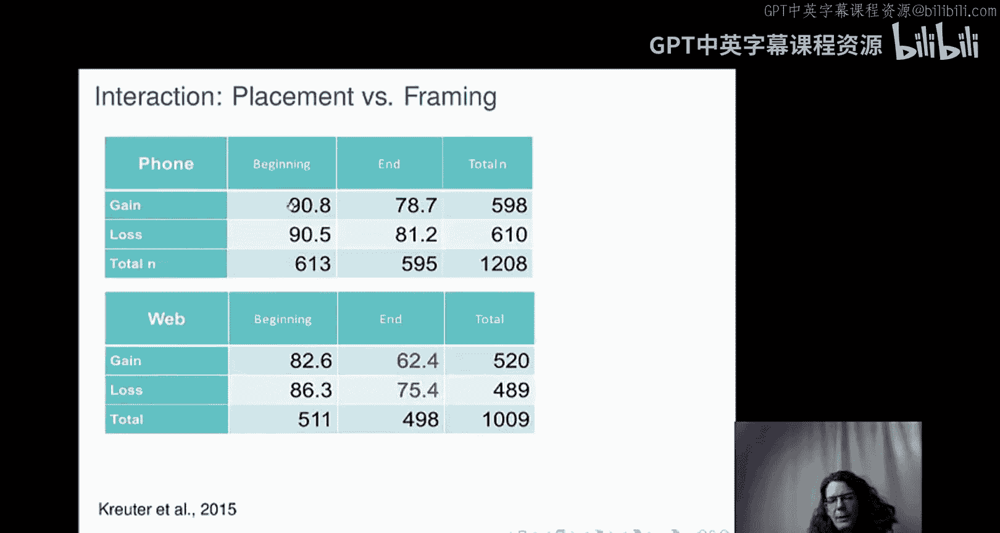

# 密歇根大学《调查数据收集和分析（2-6：方法、社调问卷设计、抽样、缺失数据、分析）｜Survey Data Collection and Analytics》 p172 23_优化链接同意机制.zh_en -BV1fw4m1e7Zh_p172-

So in order to optimize linkage consent， it can pay off to look closely on how you ask about that question and where you ask that question。

I'm going to show you now a series of experiments on placement。

Wooing and framing of the consent request and re asking for consent among prior refuseers so let's start with the placement。

Historically， linkage consent questions as they've been asked， you know。

 they have been asked at the end of interview。 so the notion is that if you have。

Report between interviewer and respondent and they talked for a while。

 then you would be more inclined to say yes to this request at the end of the survey。

But that empirically doesn't necessarily。Seemed to hold。 So what we did was。

Issue a series of experiments will be varied at the placement。And。Placement in two different ways。

 one asking it sort of in the context of the topic related item and asking it at the beginning of the interview。

 we found that asking early and close to the topic can。Significantly increase the consent rates。So。

Here's an example from an establishment survey in Germany。And this is data from about 4，222。

 well not about， I guess， exactly responds to an establishment survey in Germany。

And there were three conditions， this is another research study that Joe Sang started。

 there were three conditions beginning middle and end。

And you can see how the consent rate to link data to the employment register information kept at the Federal Employ Agency went down down down。

 so bottom line， if you ask it， ask it early in the survey。

Next piece is the wording of the consent questions。

 so surveys have some flexibility on how they script that question。

The worst in this particular thing can be if you leave it entirely alone to the interview。

 because remember what I said to you before that the interviewer attitude to this topic might very well affect their effectiveness in gaining consent。

So。There's often a benefit to scripting the request。And， but then the question is。

 how do you do that and what。I guess everyone would do sort of instinctively is to highlight the benefits on why you should say yes to this request。

When， in fact， it turns out that。You know， theory might actually predict you should highlight the negative consequences on not consenting Come to that in a morning moment。

So we've seen that the benefit wording does not help with consent rates in a telephone service visa。

Slightly positive effects on time saving arguments in a web survey， but not。Strongly， and so。

Looking at the theory that I just mentioned， some of you might know Econneman and Tsky's prospect theory。

Actually， Nobel Prize winners for less work。And the terms and things that they coin here with a gain frame and the loss frame。

 so piece of what mindset do people have when they think about a potential request and the theory would predict that you know we have risk a worse。

 so we want to avoid loss。We're not necessarily game seeking。

 which means that if you have a game frame like the one below。

 the information you have provided us so far would be a lot more valuable to us if we could link well。

First of all。If you can't， if you don't have enough information to really access in its situation。

 then you rather forego again than risk a risk， basically right and here it's not even your personal gain。

It's。Again of someone else， whereas in。The loss frame。

Youre sort of emphasizing that the information given so far would be much less valuable。

To the research organization， then if you don't link， right， And so here， the logic is， well。

 people already invested time。 They want to make the information useful。

Now here's an example of a result of a telephone survey in the United States where we implemented this and you see a big difference。

 okay granted， it's a little elevated difference because we don't have the bar data at the zero line right so this but still it's a 10 percentage point different between asking in the gain frame and asking in the loss frame for consent same placement within the survey。

In a more recent study back in Germany， we looked at the interaction between that placement and the framing and we did not see this on the phone that there is an interaction。

 we do see that strong difference at the beginning at the end。

 so in the phone survey again a 10 percentage point different depending on whether you ask at the beginning or you ask at the end for consent。

But on the web there's actually interesting interaction。

 you see that the loss frame gets higher concentrates than the gain frame It doesn't really make sense to test the gain loss difference。

At the beginning， because people haven't invested yet in giving you any answers。

But for completeness sake， we included that into this experiment。

