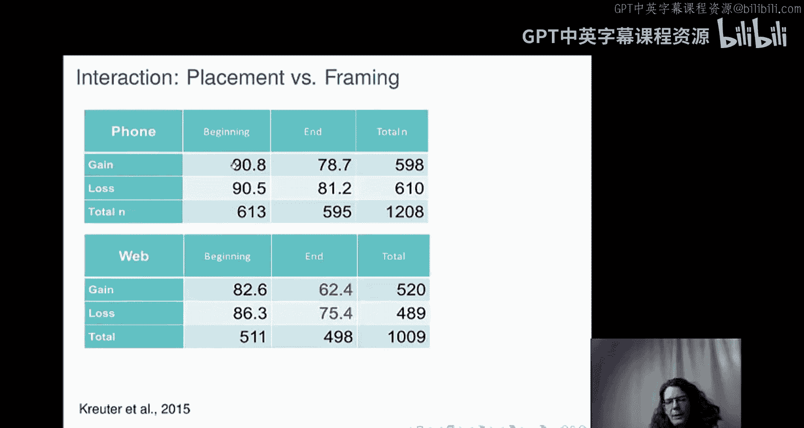

# 调查数据收集与分析：2-6：优化链接同意机制 📊

在本节课中，我们将学习如何通过优化提问方式、时机和措辞来显著提高受访者同意链接其调查数据与其他行政或注册数据的比率。链接同意是获取更丰富、更准确研究数据的关键步骤。

## 引言与概述

上一节我们介绍了链接数据的重要性与基本概念。本节中，我们来看看如何通过一系列实验验证的方法，优化获取链接同意的机制。核心策略包括调整问题的**放置位置**、优化**措辞方式**以及采用**损失框架**进行提问。

## 1. 问题放置位置的优化 🗂️

传统上，链接同意问题通常被放在访谈的末尾。其假设是，经过一段时间的交流，访员与受访者之间建立了良好的报告关系，受访者更可能在调查结束时同意该请求。然而，实证数据并不一定支持这一假设。

我们进行了一系列实验，通过两种不同方式改变问题的放置位置：一是在与主题相关的项目上下文中提问，二是在访谈开始时提问。研究发现，**在调查早期且贴近相关主题时提问，可以显著提高同意率**。

以下是来自德国一项机构调查的示例数据，该调查共有约4222个有效回复。实验设置了三种条件：

*   **开始**：在调查开始时请求链接同意。
*   **中间**：在调查中间请求链接同意。
*   **结尾**：在调查结束时请求链接同意。

结果显示，同意将数据链接到联邦就业机构保存的就业登记信息的比率依次**下降**。结论很明确：**应尽早（在调查初期）提出链接同意请求**。

## 2. 问题措辞的优化 ✍️

调查在设计链接同意问题时有一定的灵活性。最糟糕的做法可能是将问题完全留给访员自由发挥，因为如前所述，访员自身对此话题的态度很可能会影响他们获取同意的效果。

因此，**为同意请求准备标准化的脚本通常是有益的**。接下来的问题是：如何设计这个脚本？许多人可能会本能地强调同意的**好处**（收益框架），即为什么受访者应该同意这个请求。

然而，理论实际上可能预测，强调**不同意**的**负面后果**（损失框架）会更有效。我们观察到，在电话调查中，使用强调好处的措辞对提高同意率并无帮助；在网络调查中，强调节省时间的论点有轻微正面效果，但并不显著。

这里涉及的理论是卡尼曼和特沃斯基提出的**前景理论**（他们因此获得了诺贝尔奖）。该理论提出了**收益框架**和**损失框架**的概念，并预测人们通常是**风险厌恶型**的，即我们更倾向于避免损失，而非追求收益。

这意味着，如果使用如下的收益框架：
> “如果您能同意链接，您目前提供的信息对我们来说会更有价值。”

首先，如果受访者没有足够信息来评估风险，他们宁愿放弃可能的收益（何况这个收益还是研究机构的，而非他们个人的），也不愿冒险。而在损失框架下：
> “如果您不同意链接，您目前提供的信息对我们研究机构的价值将大打折扣。”

其逻辑在于，受访者已经投入了时间，他们希望自己提供的信息是有用的。

以下是美国一项电话调查中实施此方法的结果示例。可以看到，使用损失框架与收益框架获取的同意率之间存在显著差异（约10个百分点的差距）。尽管图表因基线不为零而放大了视觉效果，但差异依然明显。这项实验中，问题在调查中的放置位置是相同的。

在德国一项更近期的研究中，我们考察了**放置位置**与**措辞框架**之间的交互作用。在电话调查中，我们没有看到显著的交互作用，但再次观察到了**在调查开始时提问比在结束时提问同意率高出约10个百分点**的强烈差异。

然而，在网络调查中出现了有趣的交互作用：**损失框架获得的同意率高于收益框架**。值得注意的是，在调查**开始时**测试收益与损失框架的差异意义不大，因为此时受访者尚未投入任何回答。

但为了实验的完整性，我们仍将此条件纳入了研究。

## 总结

本节课中，我们一起学习了优化链接同意机制的三个关键策略：

1.  **尽早提问**：在调查初期、贴近相关主题时提出链接同意请求，同意率最高。
2.  **使用损失框架**：在措辞上，强调“不同意链接会降低已提供数据的价值”（损失框架），比强调“同意链接能增加数据价值”（收益框架）更有效，尤其是在受访者已投入时间后。
3.  **注意模式差异**：上述策略的效果在电话调查和网络调查中可能有所不同，需要根据具体调查模式进行测试和调整。

通过应用这些基于实证研究的优化方法，您可以更有效地获取受访者的链接同意，从而为后续的数据分析奠定更丰富、更可靠的基础。