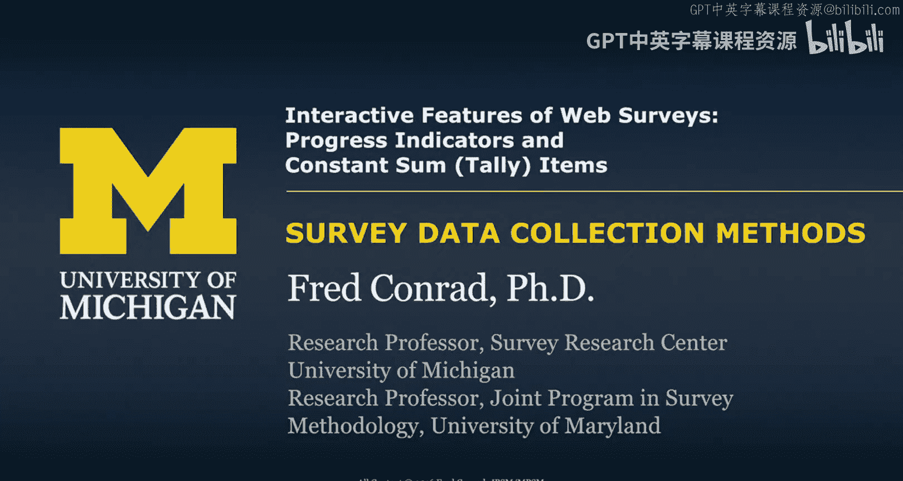
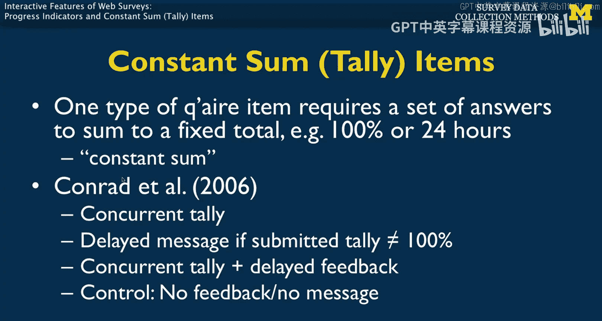
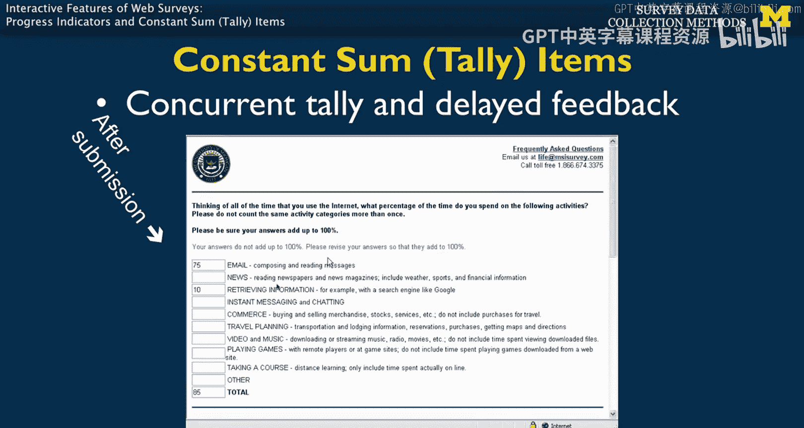
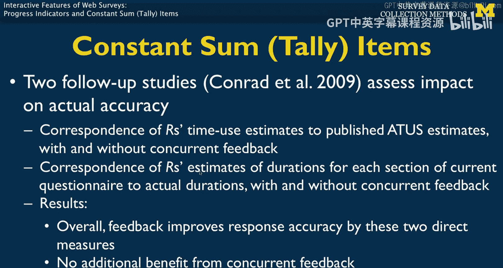

# 密歇根大学《调查数据收集和分析（2-6：方法、社调问卷设计、抽样、缺失数据、分析）｜Survey Data Collection and Analytics》 p18 17_2.3.1 进度指示器与实时统计.zh_en -BV1fw4m1e7Zh_p18-

Welcome back we're turning now to a discussion of interactiveivity or interactive features in web surveys to complement our discussion of visual aspects of web surveys there are both advantages and disadvantages at least conceptually to introducing interactivity to questionnaires advantages are that the instrument the question can now provide feedback so for example progress indicators or inconsistencies can be flagged or the arithmetic errors can be detected or the instrument can actually do some arithmetic for the respondent speeding answering faster than seems one could reasonably think about the question read the question let alone think about the answer speeding can be detected and respondents can be given feedback so those are the kinds of features we mean by interactivity and these seem like they could all be positive in principle。

With paper， we can implement some features of interviewer behavior， so tailored encouragement。

 offers of help essentially make the computerized instrument seem more like it's administered by a human and through interactivity。

 it's possible to provide tools to the respondent that assists them in the task。

 so providing definitions on request for example， or when it seems they might be useful。

So those are all potentially helpful， some possible downsides to interactivity are that some tools requires plugins and specialized software。

 which may make them less widely accessible and the increased use of interactivity may reintroduce social presence effects that is by designing a questionnaire that seems。

More like a human than say a paper questionnaire， more like it's being administered by a human interviewer。

 this may result in inhibiting honest responses to sensitive questions so let's start with a discussion of progress indicators。

As I said， it seems on kind of face value that this could be positive interactive feature to include。

 namely providing respondents with evidence about how much of the task they have completed and progress indicators can be graphical or just numerical the one the example on the bottom is kind of a mix。

 the idea is that if respondents know how they're doing this will motivate them to finish the task that it's the absence of this kind of feedback is what makes it seem like it will never end。

 so that's the question do progress indicators have this positive impact on completion。

 do they reduce breakoffs。A number of experimental studies of progress indicators have been conducted and overall the conclusion is that progress indicators do not work this way。

 that they do not reduce and they may actually increase breakoffs and there's a meta analysis by VRs and colleagues that reviews quite a number of studies and this is the general conclusion progress indicators are especially likely to increase breakoffs to do harm with longer questionnaires The reason progress indicators seem to reduce completion and especially with longer questionnaire seems to be that if the content of the feedback is that the respondent has a long way still to go then that actually is a deterrennce so not it's not just the that the act of getting feedback。

I helpful and helps respondents motivates respondents to complete the task。

 but they're paying attention to what the feedback is telling them and a feedback tells them you've got a long way to go then in many cases。

 in more cases than without that feedback， they abandon the task， they break off。

One of the studies that demonstrated this quite clearly。

 Conrad at all manipulated how progress was calculated and displayed and what progress was displayed at different points in the questionnaire。

 so they had three different ways of doing this plus a control condition with no progress indicator and they either presented feedback that showed that as each page was completed。

 each question was answered， the amount completed increased in a linear way in what they called the fast to slow progress indicator。

 this was sort of rigged so that the early progress seemed quite rapid that respondent were the feedback indicated that they were advancing quickly for the early items。

 but then it slowed down for later items， and then the final condition was kind of the opposite that progress accumulated very slowly over the course of the questionnaire until the end when it sped up。

And they called that the fast to slow progress indicator so the results indicated that for the slow to fast progress indicator where again it took respondents didn't see rapid progress until the very end if they were still in fact respondents at that point the slow to fast progress indicator produced more breakoffs than than the fast to slow progress indicator almost almost 11% more the slow to fast progress indicator produced longer estimates of perceived survey length。

 so respondents were it seemed to be taking a longer amount of time than with the fast to slow progress indicator even though in fact it didn't take them longer so it really affected their perception of the task。

The fast to slow progress indicator resulted in higher ratings of how interesting the survey was than in the slow to fast progress indicator so the way their design makes a lot of difference the sort of garden variety progress indicator is linear and in fact the constant speed progress indicator did not produce reliably fewer breakoffs than no progress indicator so the conclusion for progress indicators is that。

The content of the information conveyed really matters so that encouraging information helps。

 increases completion， discouraging information hurts， promotes breakoffs， for long questionnaires。

 it may be better not to provide progress indicators at all。

Yan and her colleagues found one situation which progress indicators increased completion rates。

 and that's when the invitation to participate in the survey promised that the task would be short。

 only five minutes。And the questionnaire was in fact short。

 but when the questionnaire took more time than was promised progress indicators heard。

 so this suggests that only under kind of atypical conditions are progress indicators helpful namely when their respondents are told the questionnaire will be short and in fact it is short and these are conditions under which there probably least needed if the questionnaire is short and respondents are expecting it to be short。

 then they really don't need any additional motivation to complete the task so progress indicators generally are not so helpful it seems and they may be harmful and there really are really is just this one situation in which progress indicators seem to increase completion。

Turning to another interactive feature known as constant sum or tally items。

 this is a case where some interactivity。Does seem to be overall beneficial。

 so these are items in which the questionnaire requires a set of answers to sum to a fixed total like 100% or 24 hours in a study investigating the use of feedback about the sum as it's accumulating a Conrad and colleagues presented one of four types of feedback to respondents completing constant sum items what they call the concurrent tally or a running tally so as each answer was entered the tally increased a delayed message only if the submitted tally did not equal 100%。

And a combination of the concurrent tally and the delayed feedback。

 they also had a control condition with no feedback。

This is an example of the concurrent tally， you can see down at the bottom there's a total which is just sum of the answers above it。

 and this is increasing as respondents are entering their answers when they submit an answer that's what we called ill form that didn't equal 100% and they're given a message after they've actually submitted the response。

So the results were that this kind of feedback improved， quote accuracy。

 by which we really mean wellform answers， answers that which the component answers added up to the target。

 100%， delayed feedback， getting that message that your answer was illform， led to slower responses。

 then concurrent feedback， the running tally or no feedback at all。

 and that makes sense if you think the respondents have gone through the process of answering as many providing answers to as many of those component questions as possible。

 submitted it， and then they're told that it was illform。In two followup studies。

 the same authors assessed the impact on actual accuracy using direct measures of accuracy rather than just wellformness。

 they looked at the correspondence between respondents estimates of how much time they had spent on a variety of different activities and compared this to published time use estimates from the American Time use survey they made this comparison when the respondents were given concurrent feedback or were not。

 and then in another study they looked at respondents estimates for the duration of each section in the questionnaire they had just completed and compared these with actual durations。

And what they found was that feedback did improve the accuracy by this more direct measure in both studies。

 although there was really no additional benefit from concurrent feedback。

 even delayed feedback alone led to this benefit。So in our next segment。

 we will talk about the delivery of definitions to respond and so that they can better understand the questions that're being asked and this can be done interactively so that not every respondent gets a definition。

 much as interviewers can do this， which we'll talk about in the third lesson。

 so see you in a moment。

