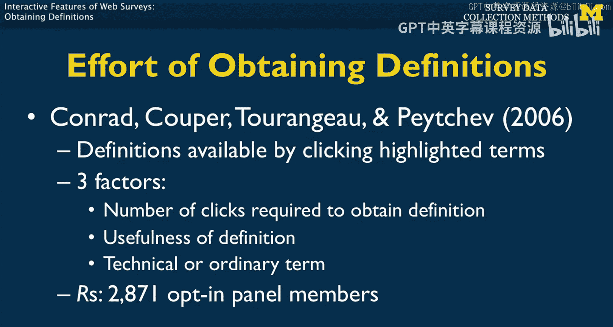
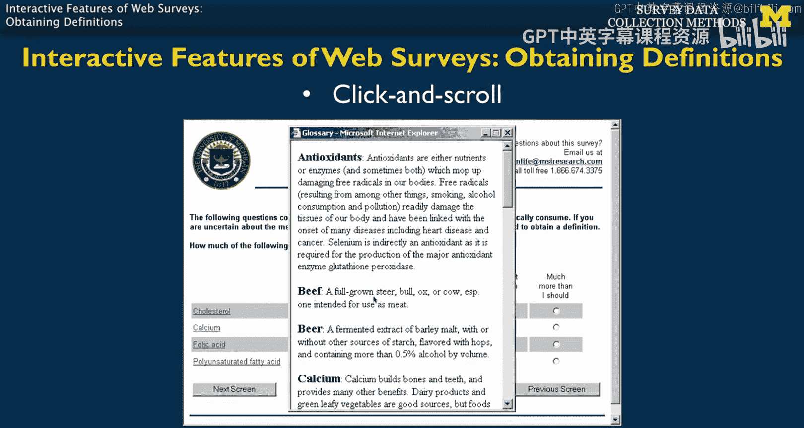
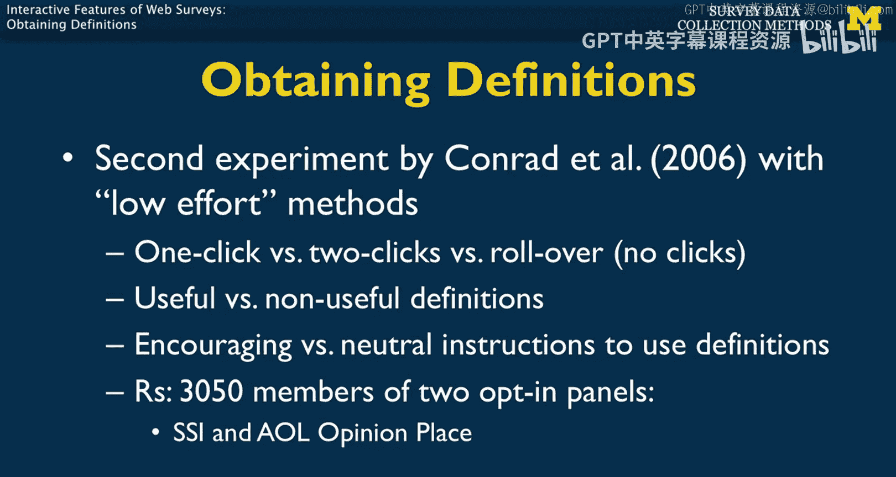
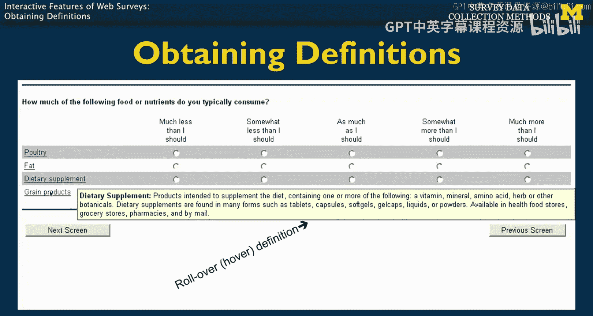
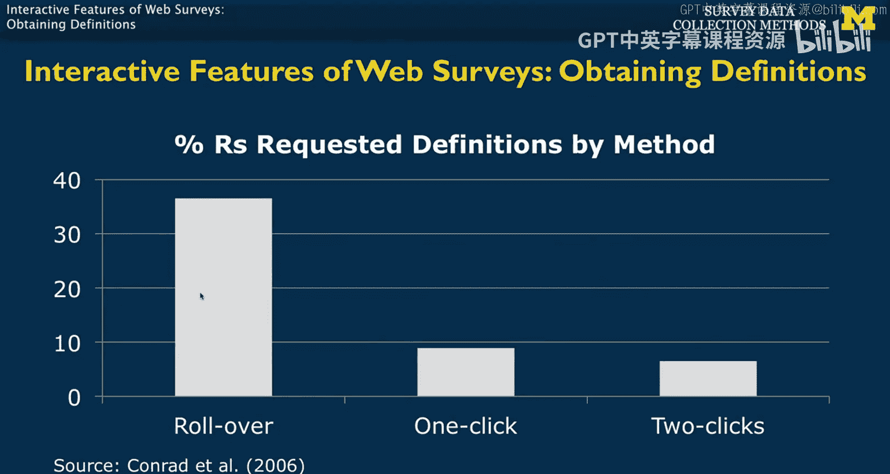

# 密歇根大学《调查数据收集和分析（2-6：方法、社调问卷设计、抽样、缺失数据、分析）｜Survey Data Collection and Analytics》 p19 18_2.3.2 在线调查定义.zh_en -BV1fw4m1e7Zh_p19-

Returning to our discussion of interactive features in web surveys。

 we turn now to obtaining definitions。Respondents might not understand all the terms in the question as the designer intended those terms to be interpreted。

If a respondent recognizes this， this misconception or they recognize they're confused。

They may want to obtain a definition。Interactivity makes it possible for respondents to obtain definitions on demand that is only when they need them。

 instead of presenting definitions to everyone， including respondents who already understand the question as intended。

In addition to recognizing the need for a definition。

 the key issue is how much effort is required of respondents to obtain definitions。In one study。

 Conrad and colleagues tested this by varying three experimental factors。

The number of clicks required to obtain a definition and this was a way of manipulating the effort involved。

 even though clicks are very low effort actions， respondents could potentially notice the number of clicks。

 the usefulness of a definition， so if a definition provides information that's counterintuitive or not what respondents a thought deterant。

 that might encourage them to obtain more definitions。And whether the term is technical or ordinary。

 the idea is that technical terms are easy to recognize that one doesn't know whereas an ordinary term could be used in a special way that and respondents won't realize this。

This is the interface that respondents saw they were asked to rate for a series of nutritional items。

 whether they obtained enough or not enough of this material and the idea is that these in particular are relatively technical terms so respondent could click on polyunsaturated fatty acid in the one clickick interface and up comes the definition that's the simplest interface that we presented to the respondents。

 another not that one would necessarily design an interface this way but for experimental purposes we wanted to increase the effort so the two clickick interface。

alows respondents or requires respondents to click the term for which they want a definition This gives them a list of all the terms for which definitions are available and they have to find the one they want and click on it and then they get the definition so it's two clicks and a little more effort to work through the list and then an interface that required a variable number of clicks but always more than one we called it click and scroll so respondents would click on the term for which they wanted a definition and then they were presented basically a glossary of all the terms for which definitions were available and they had to scroll to the definition they were interested in so you can see how the effort varies although there's not a lot of effort in any of those cases and so what the authors found was that first of all relatively few respondents ever requested definitions only 13。

8% of those who answered the items for which a definition was available ever clicked So in some sense this is just more effort than respondents want to invest or they just didn't recognize that definitions could help them understand。

The questions or they were not particularly motivated to understand the questions as they were intended。

But there's another story if we dig down a little deeper and that's that the amount of effort required to obtain a definition actually affected the frequency with which the definitions were requested。

 so the one click definition which involved the least effort was used significantly more often than either the two click definition or the click and scroll definition。

 especially for ordinary terms， especially if the definitions were useful。

 so examples of useful definition might be an example might be vegetables includes Frenchch fries。

 which is not necessarily what one would think when asked about vegetable consumption。

 and so if respondents were given definitions such as those。

 they were more likely to request subsequent subsequent definitions。

The effort of a click may seem like a pretty minor burden。

 but actually if we replaced clicks with an interface that didn't require any movement of the index finger。

 respondents were even more likely to obtain definitions by this I mean rollover so we in a second experiment we compared the frequency of requests and I'm putting requests in quotes for definitions with one click two clicks or only a rollover so the rollover definition popped up when respondents move their pointer over the hot area and what we found was that in the rollover interface more of those respondents requested definitions than in either of the other interfaces now you might say well some of those must have been by accident they must have just moved their mouse into the hot area and that could be true at least some of the time but one piece of evidence that it's not always true is that the respond。

Distributions for the participants in the rollover using the rollover interface differed from those using the other interfaces。

 suggesting that even if they were requesting definitions accidentally。

 they were reading the definitions and they were taking that information into account when answering。

 but it seems likely that at least some of the time these rollovers were intentional requests for clarification。

So as I said， really effort and recognition that they're needed are the factors that affect requests for definitions。

 what we're doing with definitions is trying to encourage quote  good behavior。

 we want it to be easy， as low effort as possible for respondents to get the information that will allow them to understand the questions as intended。

But there are other uses of interactive features which actually involve discouraging undesirable behavior。

 discouraging the behavior we don't want respondents to engage in。

 such as when they speed when they answer questions way too quickly to have given much thought to their answers。

 and so in the next topic we'll look at an interactive approach to reducing speeding。

