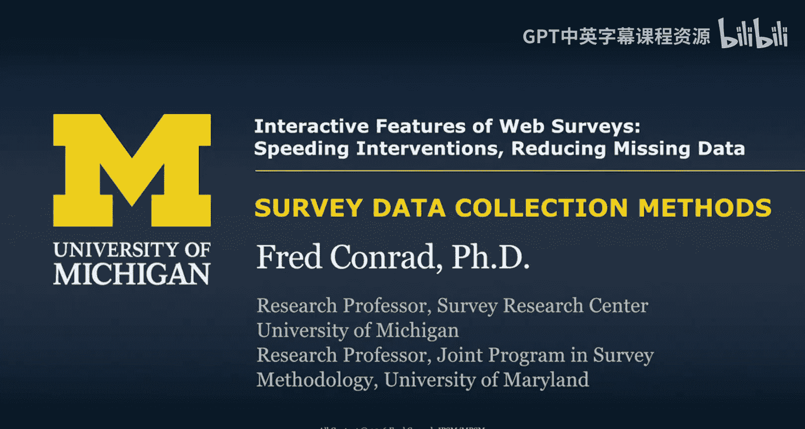
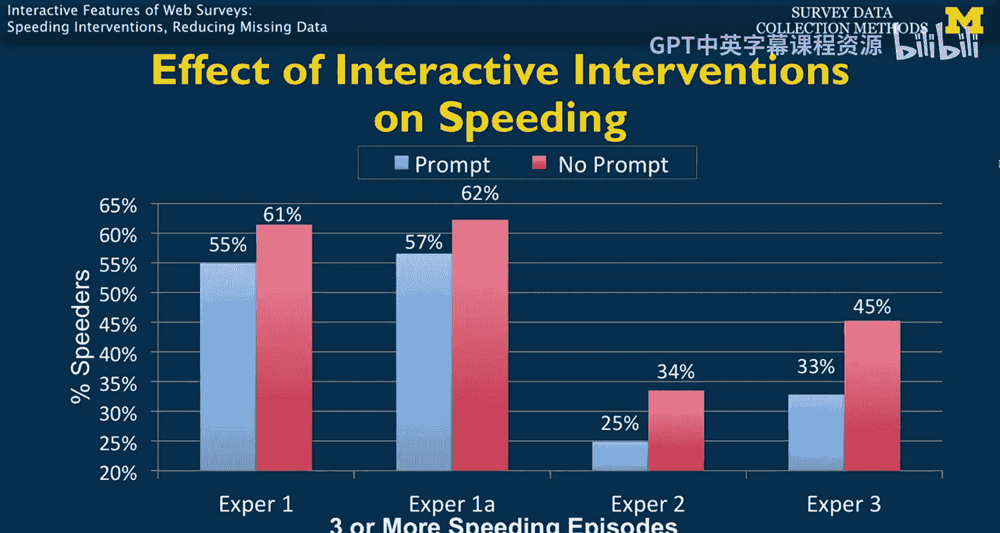
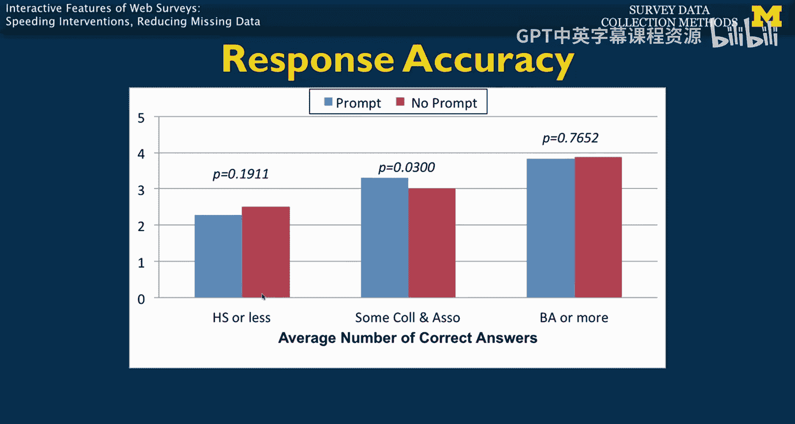
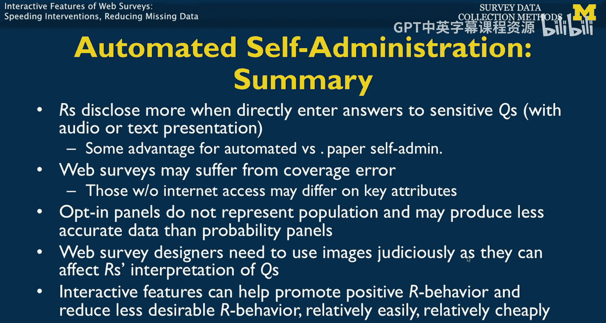

# 密歇根大学《调查数据收集和分析（2-6：方法、社调问卷设计、抽样、缺失数据、分析）｜Survey Data Collection and Analytics》 p20 19_2.3.3 加速干预策略.zh_en -BV1fw4m1e7Zh_p20-

In this segment， we'll talk about two phenomena that involve interactive prompting。

To reduce respondent behaviors that are considered undesirable， in particular。

 we'll talk about prompting respondents who are caught speeding， answering unreasonably fast。

And respondents who don't answer at all， item non response。Turning first to speeding in one study。

 we set 300 milliseconds per word as the threshold below which we considered a respondent to be speeding。

 in other words， in a 10 word question， a response time below 3 secondsd or 3。

00 milliseconds would be considered speeding。This has been proposed that is 300 milliseconds per word has been proposed as the time required for adults in the US to read。

 of course there are exceptions in both directions。

 there are adults who read faster than adults who read slower。

 so to the extent that this is an effective threshold that suggests that interventions of this sort don't have to be tailored to every respondent but can be designed in the aggregate。

In any case， when respondents answered below this threshold， they received a prompt such as this one。

You seem to have responded very quickly， please be sure you've given the question sufficient thought to provide an accurate answer。

Do you want to go back and reconsider your answer？We compared the amount of speeding in a condition an experimental treatment in which these prompts were displayed when respondents answered below that threshold to a control condition in which there were no prompts。

We did this for seven questions about autobiographical quantities。

 like how many nights have you spent away from home in the last year。

 for which the true value is not known， at least we didn't have access to it。

And also for seven simple arithmetic or probability questions for which the true value was known。

 or at least we could determine the correct answers。

And that was useful because it allowed us to assess response accuracy。

So what we want to see is whether there was any less speeding when respondents were prompted upon speeding once than when they were not when they were allowed to speed more or less with impunity。

As you can see here in the no pro condition， speeding it was actually quite prevalent， you， 61。

 62% in two of the experiments， this means speeding at least one time。

But when we prompted respondents， they sped less in all cases。

 so a respondent who was prompted for speeding once or potentially more overall sped less often than their counterparts in the control condition who were never prompted for speeding。

So that suggests that we are slowing them down with this intervention。

 does that mean they're giving more thought to their answers and actually answering more accurately or are they just sort ofbing their time to avoid future prompts like this and then just giving the same kind of superficial treatment to the question？

So in the one experiment with where we could know the true value where they were answering simple arithmetic and probability questions。

 we could look at whether prompting not only slow them down， but increased their response accuracy。

There was actually no effect overall of prompting on response accuracy。

 but there was an effect for one group when we broke the groups down by education level in particular respondents who had some college or an associate's degree were more accurate when we prompted them for speeding so they slowed down and seemed to use the additional time to give more thought to their answers。

 this is account of about 40% of the respondents， the respondents with only a high school degree were unaffected by prompting as were the respondents with a bachelor's degree or more。

 and this could well be because those with a high school degree were struggling with these questions even though they were considered to be relatively basic measures of numerical literacy or numeracy。

 and so for the respondents with a high school degree or less even more time didn't seem to help so that's one explanation for why prompting didn't help them and the group with a bachelor's degree。

or more may have found these questions so easy that they were able to answer quite fast。

 fast enough that in fact we were considering them to be speeding when actually they were giving adequate thought to the questions so it's for this group in the middle that at least for these items that the slowdown due to prompting seemed to improve response accuracy。

Turning to the other use of interactive prompting that we'll cover here， when respondents speed。

 they're in a sense not really answering the question。

 they're just providing sort of an answer at random in some cases respondents don't provide any answers and this is known as item missing data or just item nonrespon。

It could be that you can reduce item nonres by absolutely requiring a respondent to provide an answer by not allowing them to proceed to the next question。

Until they enter something， but that could be annoying if they really don't want to give an answer and that might lead them to break off and then this whole strategy backfires。

An alternative would be to provide don't know or refuse to answer options or decline to answer。

 which in a way invites respondents to use those options。

 but by combining that with an interactive prompt， which says essentially you know we value your answer。

 won't you please consider providing an answer， this could in the end lead to less item nonresse。

 more completed questionnaires。Deff Ray and Cooper tried just this by presenting four variants of a decline to answer option to respondents in one they explicitly provided a decline to answer option after the three substantive options and that appears at the bottom。

In another， they provided an explicit decline to answer option， but in a smaller typeface。

 so might not be as enticing inviting for respondents。In another。

 it was implicit that as respondents could advance without entering anything。

 they weren't explicitly offered that option。And the fourth display presented to respondents was a message which said we would very much like to have your answer to this question。

 if you would like to choose one of the proposed answers。

 please select back if you would prefer not to answer this question please select next thank you so the idea is that this encourage them to provide an answer but it didn't require them to and the idea is that this could sort of strike the balance between forcing them to give an answer and not sort of carrot and stick。

And so what happened， well， as you can see， this is the rate of item missing data or item nonresse and the pop up。

 the fourth option that we just looked at was quite successful in reducing item nonresse compared to the three other interfaces。

We've now gone through a number of different aspects of self administration and we've focused really on web questionnaires。

 we saw in the first segment， the first topic that respondents disclose more when they directly answer answers to sensitive questions into the computer and in fact。

 there were some advantages that we discussed for computerized self- administrationist compared to paper self administration。

This， by the way， we later saw was the case for web questionnaires。

 just like audio cassie in which the interviewer or text cassie in which the interviewer gives the laptop or device。

 other device to the respondent to selfadminister the sensitive questions only。

 sensitive questions are also answered more candidly and accurately in web surveys。

We then looked at issues of coverage in web surveys and it was evident that coverage is not universal when it comes to internet access and that web surveys could suffer as a result。

 so those without internet access may differ on key attributes such as education and income and age and to the extent that questions the researcher wants to ask involve those attributes。

Undercoverage could distort the estimates that are produced。With respect to sampling。

 we talked about two main approaches to recruiting participants into web surveys。

So-called optIn or volunteer panels and probability panels。

 and we saw that optin panels which did not represent any particular population。

 except perhaps the population of volunteer web survey respondents。

 may lead to less accurate data than result from probability panels， where the participants。

 the panel members are recruited with probability methods such as random digit dialing and addressbased sampling。

And then finally， we examined interactive features and we saw that they can help promote positive respondent behavior and reduce less desirable respondent behavior relatively easily and relatively cheaply。

 but we also saw particularly in the case of progress indicators that the use of these features can backfire and actually reduce completion rates。

What we'll turn to in the next module is interviewers and interviewing。

Interviewers can substantially improve survey estimates by increasing response rates。

 by keeping respondents on task。And by explaining the intentions behind questions。

Different interviewing techniques can emphasize any of these particular advantages。

Interviewers can also bring additional error to the total survey error。

 so called interviewer effects。Depending on how they administer the questionnaire and potentially on their fixed attributes like race and gender。

