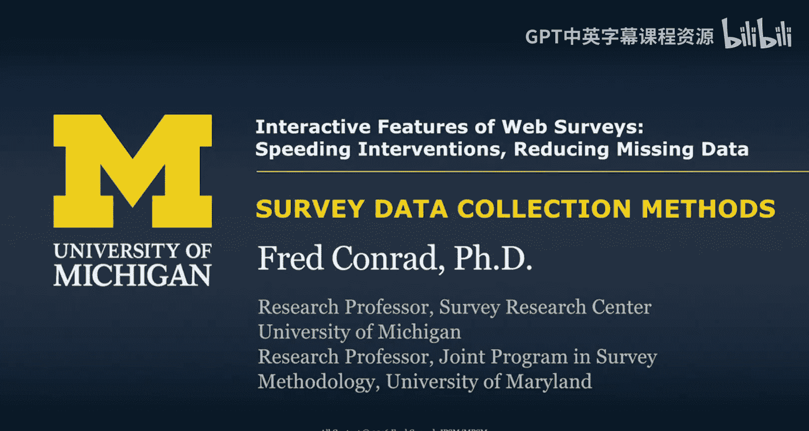
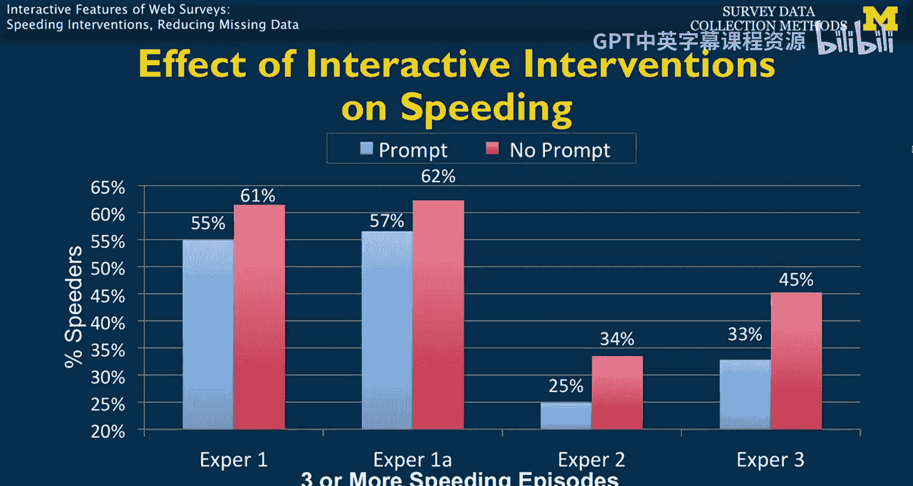
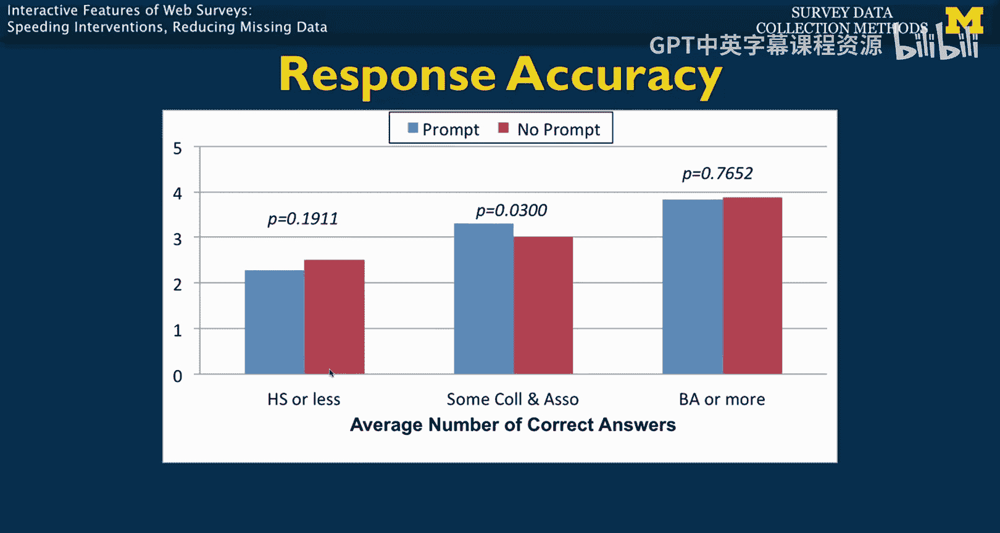
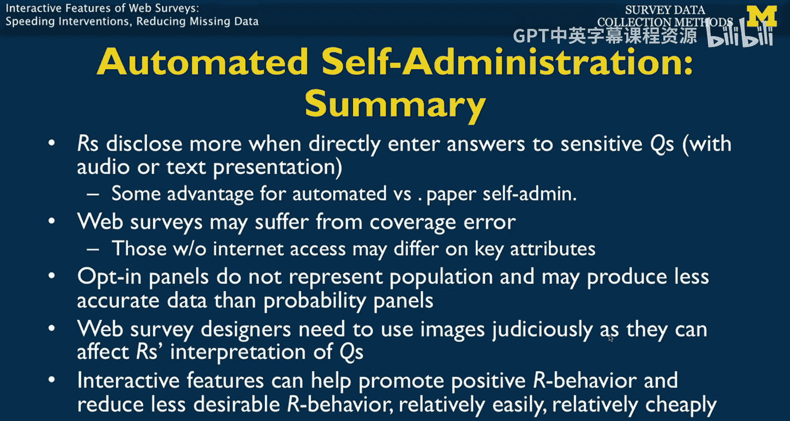

# 调查数据收集和分析：2.3.3：加速干预策略 🚀

在本节中，我们将探讨两种涉及交互式提示的现象。具体来说，我们将讨论如何减少被认为是不良的受访者行为。我们将关注两类受访者：一类是“加速”回答者，即回答速度异常快；另一类是“项目无应答”者，即完全不回答问题。

## 处理“加速”回答行为

上一节我们讨论了交互式功能，本节我们来看看如何应对受访者回答过快的问题。在研究中，我们设定了一个阈值：**每词300毫秒**。低于此速度的回答被视为“加速”。例如，对于一个10个词的问题，回答时间低于3秒（即3000毫秒）即被判定为加速。这个阈值是基于美国成年人平均阅读速度提出的。当然，个体阅读速度存在差异，但这个阈值作为一个整体标准是有效的，意味着此类干预措施无需为每个受访者量身定制。

当受访者的回答速度低于此阈值时，他们会收到类似以下的提示：
> “您似乎回答得非常快。请确保您已给予问题足够的思考，以提供准确的答案。您想返回并重新考虑您的答案吗？”

我们进行了一项实验，比较了两种条件下的“加速”情况：实验组在受访者加速时会收到上述提示，而对照组则不会收到任何提示。实验涉及两类问题：
*   **七道自传体数量问题**（例如，“去年您在外过夜了多少晚？”），其真实值未知。
*   **七道简单的算术或概率问题**，其正确答案是已知的，这有助于我们评估回答的准确性。

以下是实验结果。在无提示的对照组中，“加速”行为相当普遍（约61%-62%的受访者至少加速一次）。而在收到提示的实验组中，所有情况下的加速行为都减少了。这表明，**提示干预有效地减缓了受访者的回答速度**。

那么，这是否意味着他们思考得更深入，从而回答得更准确了呢？还是他们只是为了避免再次收到提示而拖延时间，实际上对问题的思考依然肤浅？

在我们可以知晓正确答案的算术和概率问题实验中，我们进一步分析了提示是否提高了回答准确性。总体而言，提示对回答准确性没有显著影响。但当我们按教育水平细分受访者时，发现了一个效应：**拥有“部分大学或副学士学位”的受访者在收到加速提示后，回答准确性提高了**。他们放慢了速度，并似乎利用额外的时间进行了更深入的思考。这部分受访者约占40%。

而仅拥有高中学历的受访者，以及拥有学士或更高学位的受访者，其准确性未受提示影响。这可能是因为：
*   对于高中学历组，即使给予更多时间，他们可能仍觉得这些衡量基础计算能力的问题有难度。
*   对于学士及以上学历组，这些问题可能过于简单，他们原本就能快速且正确地回答，我们的“加速”判定对他们而言可能过于严格。

因此，**至少对于这些测试项目而言，提示引起的减速似乎主要改善了中间教育水平群体的回答准确性**。

## 处理“项目无应答”行为

接下来，我们看看交互式提示的另一个应用场景。当受访者“加速”时，他们某种意义上并未认真回答问题。另一种情况是受访者根本不提供任何答案，这被称为“项目缺失数据”或“项目无应答”。

一种减少无应答的方法是强制要求受访者必须提供答案才能进入下一题。但这可能引起反感，导致受访者中途退出，使策略适得其反。

另一种方法是在选项中提供“不知道”或“拒绝回答”的选项。但这可能鼓励受访者使用这些选项。Deff Ray和Cooper尝试了一种结合方法：在提供“拒绝回答”选项的同时，配以交互式提示，委婉地鼓励受访者作答。

他们测试了四种界面变体：
1.  明确提供醒目的“拒绝回答”选项。
2.  提供“拒绝回答”选项，但使用较小字体。
3.  不明确提供该选项，受访者可不作答直接跳过（隐含选项）。
4.  显示提示信息：“我们非常希望得到您对本问题的回答。如果您愿意选择其中一个答案，请点击‘返回’；如果您宁愿不回答此问题，请点击‘下一步’。谢谢！” 这旨在鼓励作答而非强制，试图在“强制”和“放任”之间取得平衡。

结果显示，**第四种带有鼓励性弹出信息的界面，在降低项目无应答率方面，比其他三种界面更为成功**。

## 本节总结

本节课中，我们一起学习了两种利用交互式提示改善数据质量的策略：
1.  **针对“加速”回答**：设定速度阈值（如**每词300毫秒**）并在超速时提示，能有效减缓受访者速度。对于部分群体（如中间教育水平者），这种减速可能转化为更高的回答准确性。
2.  **针对“项目无应答”**：在提供“拒绝回答”选项的同时，搭配鼓励性的交互提示（如“我们非常重视您的答案”），能更有效地减少不回答的情况，且比强制要求更为友好。

至此，我们已经探讨了自填式问卷（特别是网络问卷）的多个方面。我们了解到，对于敏感问题，计算机化自填比纸笔自填能获得更坦率的回答，网络调查也是如此。同时，我们也认识到网络调查存在覆盖偏差问题，并非所有人都能接入互联网。在抽样方面，概率样本面板比自愿者样本面板通常能产生更准确的数据。最后，在交互功能上，我们看到它们能以较低成本促进积极受访行为、减少不良行为，但也需谨慎使用（如进度指示器可能降低完成率）。

在接下来的模块中，我们将转向**访员与访谈**。访员能通过提高应答率、确保受访者专注任务、解释问题意图来显著改善调查估计。不同的访谈技巧可以侧重这些优势。同时，访员也可能引入额外的误差（即“访员效应”），这取决于他们的问卷执行方式及其固有属性（如种族、性别）。