# 密歇根大学《调查数据收集和分析（2-6：方法、社调问卷设计、抽样、缺失数据、分析）｜Survey Data Collection and Analytics》 p22 21_3.1.1 访员角色：获取访谈.zh_en -BV1fw4m1e7Zh_p22-

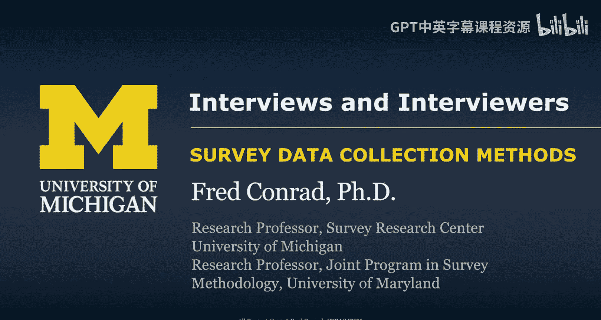

。Welcome back， we're beginning our third lesson on interviews and interviewers。

 we'll first talk about a number of tasks that interviewers engage in that really are not about conducting interviews per se。

 but they're kind of preliminary activities so recruiting sample members that is placing phone calls to or knocking on the doors of households and essentially persuading sample members to become respondents。

And also within household selection or within household sampling。

 which is an additional layer of sampling that interviewers are sometimes required to engage in to select one respondent from the household one since the interviewer has obtained agreement in general。

 this kind of extends the sampling design into the household。

Then we'll talk about interviews themselves and talk about a number of different interviewing techniques which are often sort of presented in counterpoint to one another or in opposition to one another。

 so for example we'll talk about the standardization debate in which on the one hand there's a strong argument for standardizing the word and requiring interviewers to say essentially the same use the same words in every interview they conduct versus allowing interviewers to choose their words in a way that will essentially standardize the interpretation so if it takes different words to establish the same meaning across respondents interviewers are able to do that under this second view so this is known as the standardization debate another distinction is made between what are called what's called personal style of interviewing in which interviewers attempt to basically to establish rapport with respondents and the formal style of interviewing which is more。

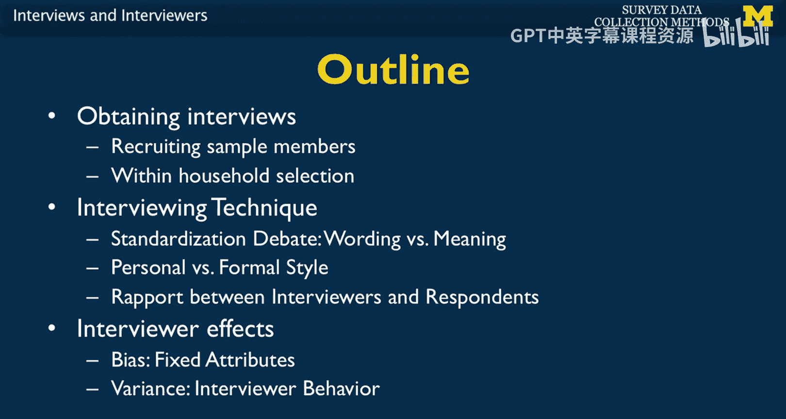

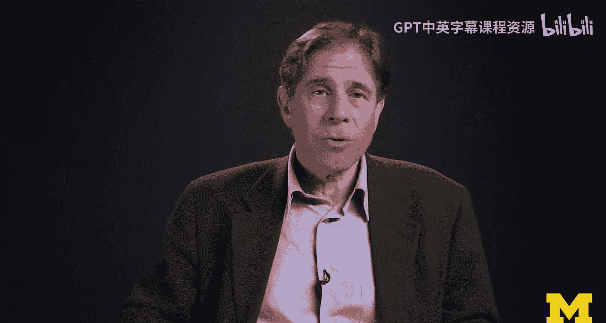

and the question is， as with the previous distinction， which of these produces higher quality data？

Because the personal style is essentially about establishing rapport。

 we'll spend a little bit of time talking about rapport between interviewers and respondents and how this might help or hurt data quality。

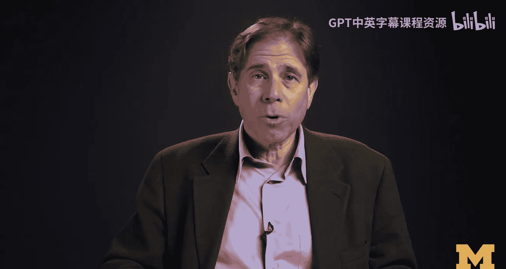

And then finally we'll cover what are known as interviewer effects。

 so while interviewers can add value to the enterprise in many ways。

 they can also introduce error that isn't present in selfadministered questionnaires。

 these interviewer effects come really into varieties， one is bias in which interviewers。

Different interviewers elicit responses in different directions so for example。

 one set of interviewers might elicit more pro feminist responses than another set of interviewers on questions concerning feminism and it turns out that it's the gender of the interviewers that seems to be responsible for this so female interviewers may elicit more pro feminist responses than male interviewers so this is called bias because it's the error is in one direction。

嗯。Or interviewers may increase the response variance by behaving differently from one another and we'll focus on the behavior of probing。

 which is the kind of one unscripted part of standardized interviews if interviewers do this differently。

 the idea is that response variance will increase as a result。

Let's spend a little bit of time talking about the different roles that interviewers play， as I said。

 they do a number of tasks besides asking questions and recording answers。

 and each of these can affect the different sources of error that we've been talking about so when it comes to sampling and coverage they have an impact on coverage by locating and contacting sample households and determining which units are eligible。

 some structures are not residential， for example and would be ineligible in a survey that requires residential structures to be included。

And they sample within the household， as I mentioned a moment ago。

 and to the extent that this is successful or not， can have an impact on sampling error。

When it comes to non-respon error or response rate。

 at least interviewers do have the task of contacting the household and gaining cooperation。

 potentially persuading reluctant household members to become respondents。

 and this can vary between interviewers， again to the extent that this is done effectively the response rate should be high。

 but it does vary between interviewers。Interviewers are probably most closely associated with measurement error because they're asking the questions which are the measurements in conventional surveys where self report is the predominant measure。

So they ask the questions， they probe for incomplete answers。

 they clarify questions and they record answers so what can go wrong here well interviewers can ask questions in different ways。

 they can probe differently as I mentioned a moment ago。

 the questions may be misunderstood and interviewers will be unaware of this。

 or unable to address misunderstanding because for example。

 the interviewing technique that they've been trained in or are required to use。

 requires them to stick to the script and if departing from the script is necessary to clarify questions that are really not able to do that。

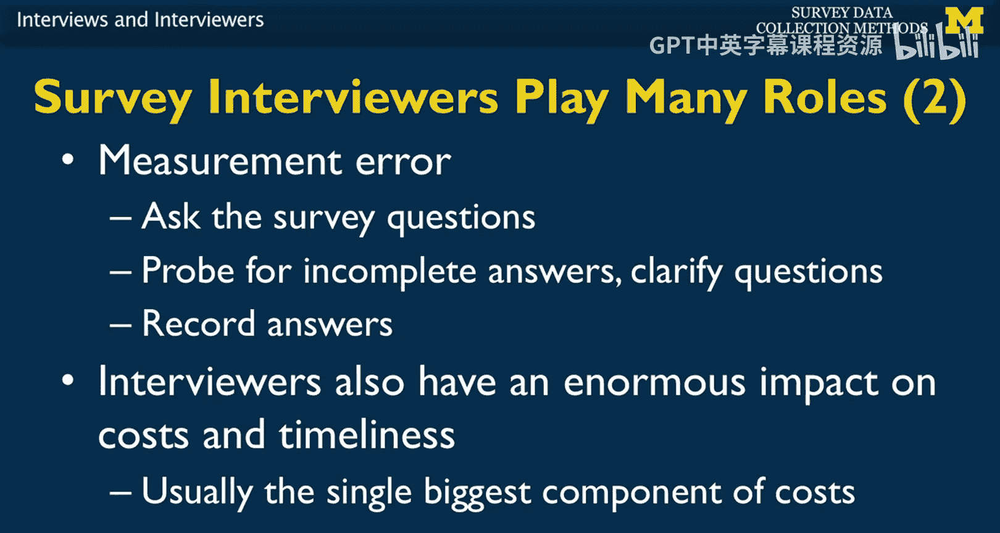

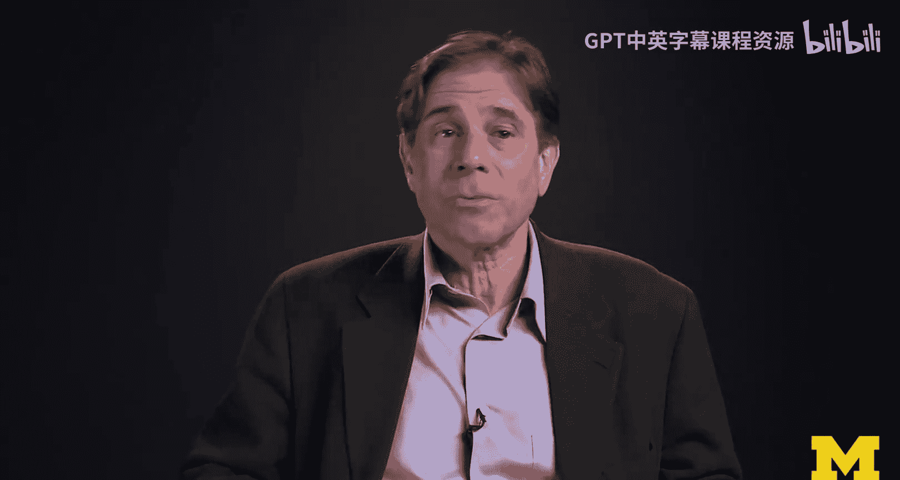

So interviewers can contribute to these different sources of error more or less so they can actually reduce these sources of error。

 so for example response rates are generally higher with interviewers than in self-administered questionnaires so interviewers both add value and introduce error for better or worse they can have an enormous impact on costs and timeliness they're usually the single。

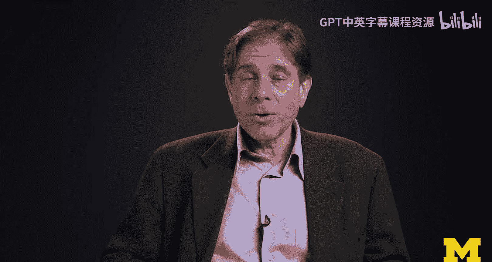

Largest expense in a study that involves interviewers that is more money is spent on interviewers than anything else when there are interviewers in the study。

 so it's a very。

Important decision whether or not the mode involves interviews and one that researchers should make carefully。

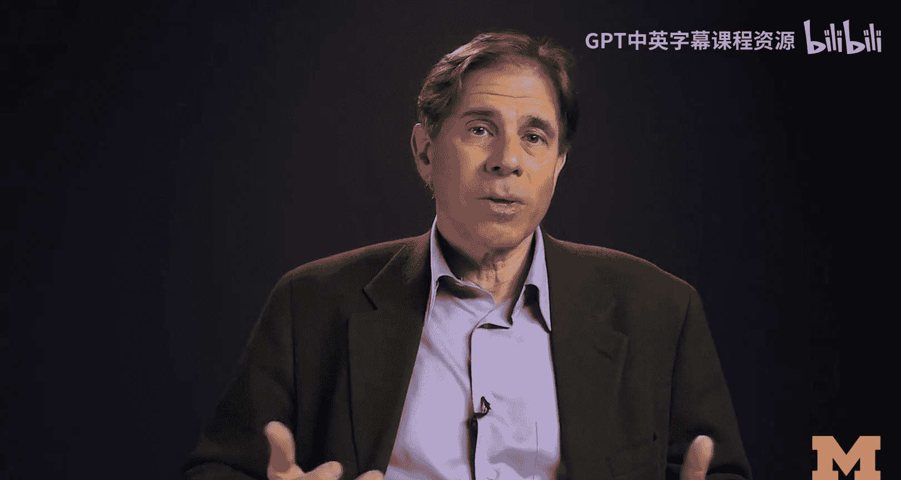

So turning to。Recruitments， one of these tasks that interviewers engage in that really don't involve interviews。

 conducting interviews， some interviewers are more successful than others in obtaining interviews if you look across studies and this is something that's called the lifetime response rate。

 so what might be responsible for this well it could have to do with some interviewers just being better at recruiting perhaps because they're more extroverted or their personalities just lend themselves to persuading strangers to take part in the study。

 another possibility particularly for telephone interviews is that it may have to do with how they speak and interact with respondents。

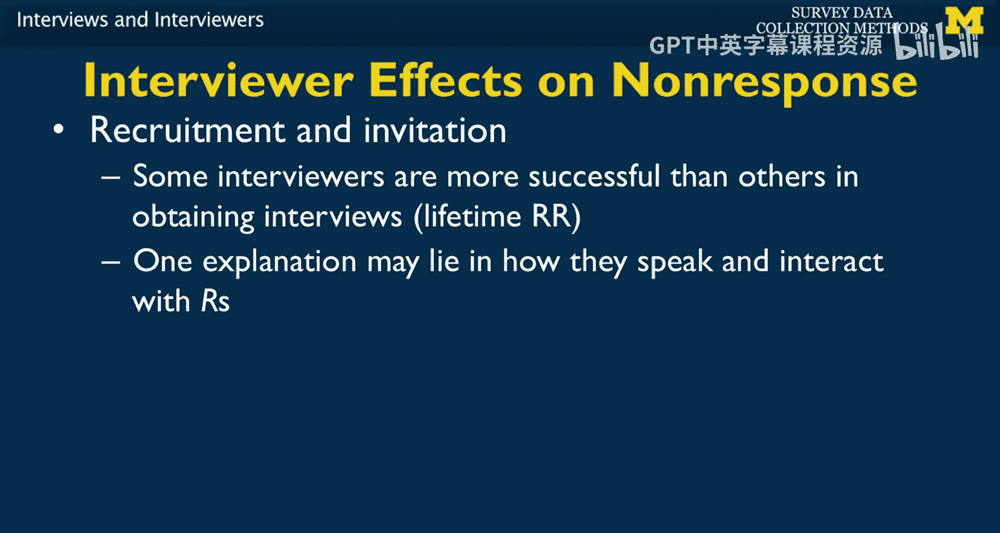

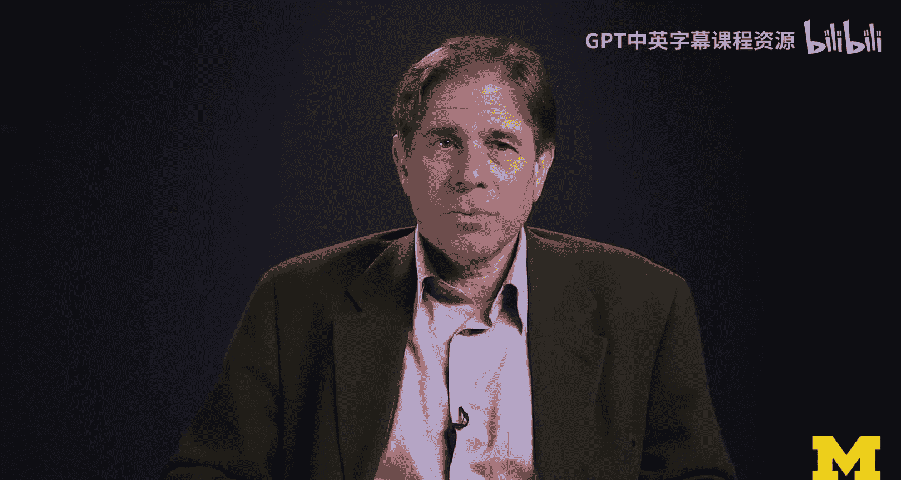

So that's actually what we'll turn to next on the telephone。Really。

 the only information that a respondent has about or a household member has about the interviewer who's trying to persuade them to take part in the study。

Is what they sound like and how they speak， really telephone interviewing may sort of concentrate sample members on interviewers' vocal properties and the way they interact。

In one study， Conrad and his colleagues coded the behavioral attributes of interviewers in 1。

300 telephone survey introductions， these are audio recorded telephone introductions from five studies that were conducted at the University of Michigan。

And the behaviors they coded included disluencies like Us and Us。What are known as back channels。

 these were by the household member， the sample member， not by the interviewer， back channels are。

 for example， saying aha and nodding， although of course on the telephone the interviewer would never see household member nodding but saying aha is generally considered an acknowledgemental way to say to the speaker。

 yet please continue I'm still listening。And overspech or interruption。

 something it's called simultaneous speech， the idea being that these generally signal some sort of troubled interaction if there is a lot of overspech。

And they modeled the impact of these different behaviors on one of three outcomes。

 agreement to take part in the study， refusal， a scheduled callback。

 which basically refers to deferring the decision till later。

 so the interviewer and the household member agree that someone maybe not the interviewer they are currently talking to。

 but somebody will call them back in the future to talk about the possibility of taking part in the study。

 so a scheduled callback is kind of in between an agreement and refusal。

And so they were looking at these three outcomes on the basis of behaviors like dis fluency。

 household member back channels and overspech or interruptions。

 so the first finding was that fillers or disluencies likeums and Us are both good and bad when it comes to participation so this figure shows us the filler rate or the disffluency rate per hundred words and the rates are broken into these quintiles。

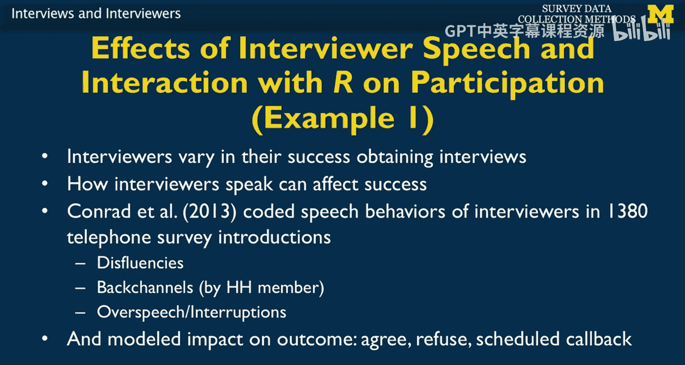

The Y axis is the proportion of agree so as a function of the filler rate。

 so you can see when interviewers are making zero disluencies， that is when they're highly fluent。

 they're actually quite unsuccessful in recruiting household members。

 this is actually the lowest agreement rate of all the quintiles as soon as they make even a small number of disfluencies。

 this is more than0 and less than 1。28 per00 words， so not a lot of disfluency。

 agreement rate goes up substantially the 0。35。It tends to drop off as they get more disfluent until when they're making the maximum number of disfluencies fillers greater than 3。

49 per100 words， it's at its lowest when there are any fillers， however。

 even when interviewers are highly disfluent， they're more successful than when they're perfectly fluent and the thinking was that when they're perfectly fluent。

 they sound robotic and they don't seem to be tailoring the invitation。

 the recruitment speech for the particular household member。

 that seems to be the big disincentive to participate。

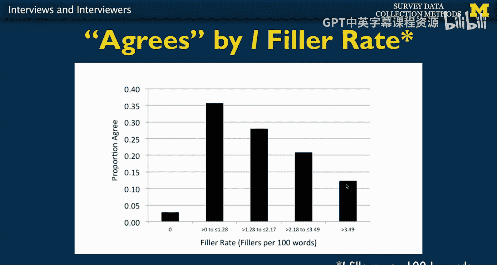

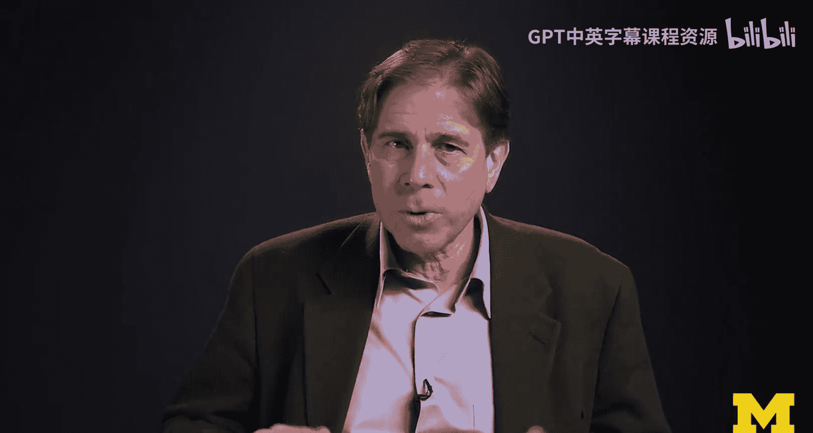

Another speech behavior that's involved in recruitment is as I mentioned back channels。

 household members produce more back channels such as ahu and okay or I see when they ultimately agree。

 so this figure shows us just the proportion of moves or conversational terms with a back channel by the household member and as you can see scheduled callbacks are in between agrees and refusals but really when they're signaling that they are paying attention and sort of authorizing the speaker in this case the interviewer to continue。

 they're most likely to agree。And then the third behavior that the authors looked at was overspe or simultaneous speech。

 as I said before， when there is a lot of overspe， it generally indicates that this is an interaction that's not going well and as you can see overspe is highest when the invitation the case ultimately ends in refusal scheduled callback is lower but not as low as when the invitation led to agreement。

 so the amount of oversch in an invitation is pretty clearly related to the to the outcome， however。

 not all overspe works the same way， what the authors looked at was what they called interruptions which actually just what they sound like。

 this is overspech in which the household member was speaking and then the interviewer began to speak before the household member had finished this type of overspech seemed to have been used quite strategically by the interviewers to essentially block a refusal。

 so as you can see。

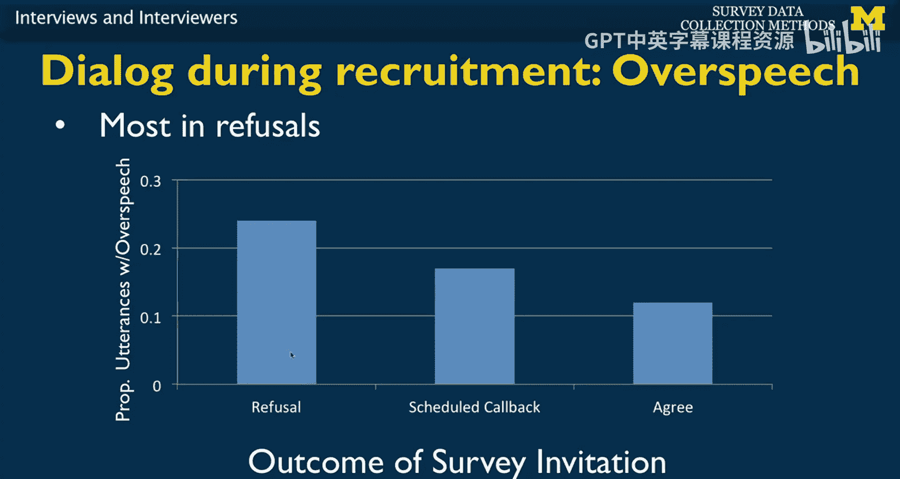

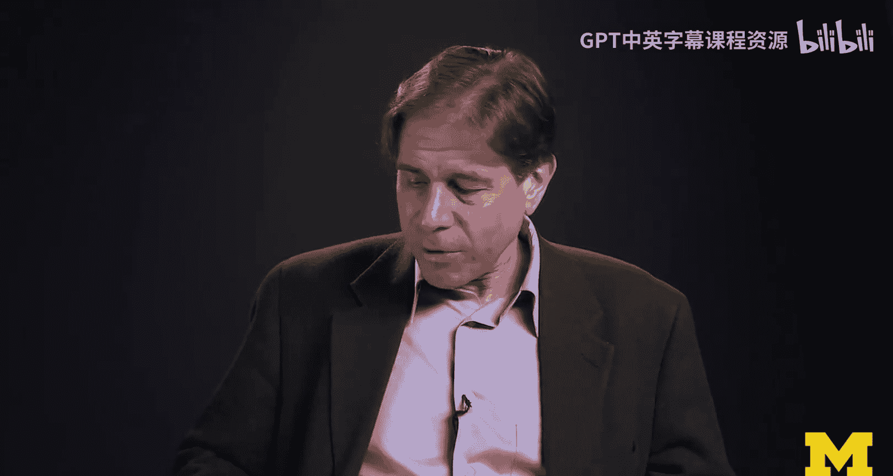

When the invitation ended in a scheduled callback， which again is a deferral to another time to make the decision。

 interviewer interruptions of household members was at its highest。

 and again the idea that the authors proposed is that they were preventing or interrupting an utterance that would have led to a refusal had they not intervened at that point。

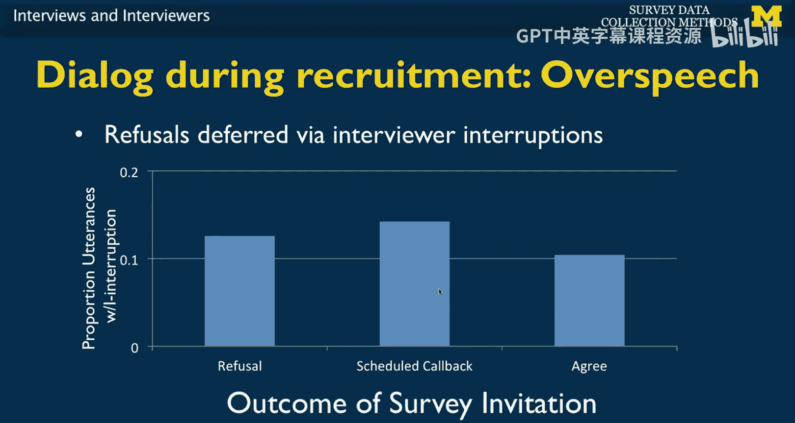

So that's one set of examples of how the speech and vocal attributes of interviewers and how they interact with household members and how household members speak in response can affect outcomes another study published at about the same time by Noracade Schchaaffer and her colleagues looked at pairs of respondents with the same propensity to participate so what they did was they modeled the likelihood to participate on the basis of a number of variables in their data and this was a longitudinal dataset。

 so they had information about these household members going back a number of waves。

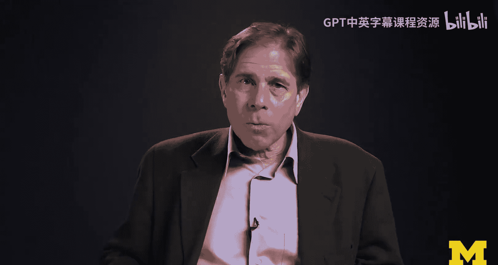

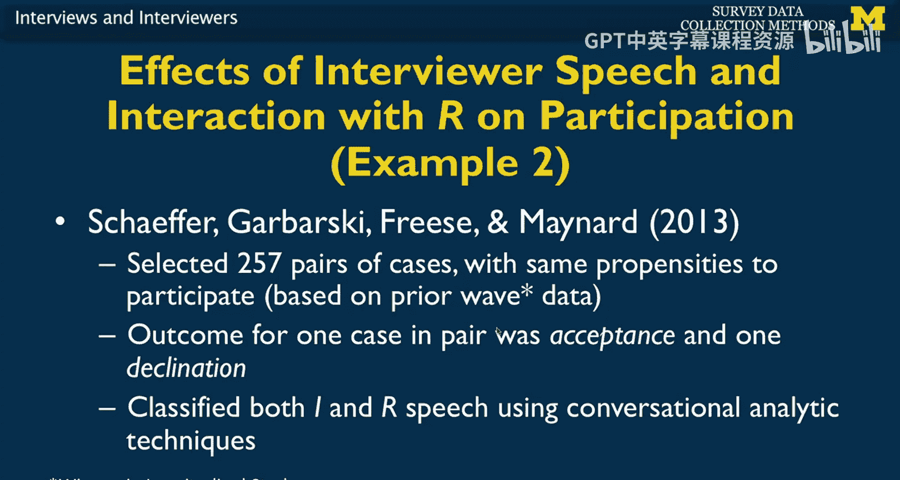

Wavs meaning previous interviews， they found pairs who had the same likelihood。

 same propensity to participate， only one member of the pair accepted an invitation in the wave they were looking at and the other member of the pair declined so they have the same likelihood of participating but different outcomes what can be going on so they looked at the speech of both interviewers and I'm calling them respondents here but again their household members because they haven't yet agreed to to do this interview using conversation analytic techniques similar to but a little different than what was used in the Conrad at all study when they coded the interactions。

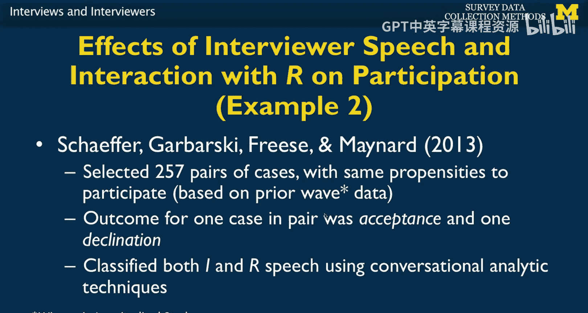

They uncovered a number of interesting provocative explanations for this difference one thing they looked at was when did these sample members decline the invitation and when did they accept it that isn't at what point in the invitation so as you can see if you look at declinations they're occurring at various point during the interview in not exactly even numbers but with non-zero frequency so during the opening during the study description and after the request for participation when you look at acceptance that's only happening after an explicit request for participation so you can see that household members sample members are feel no qualms about declining at any point it's much harder to elicit an acceptance and that really requires an explicit request will you take part in our study essentially。

They also looked at particular interviewer actions and how they affected the odds of participating odds ratio in a logistic regression。

 so if the interviewer said hello versus high after the respondent answered the phone。

 the odds ratio was 1。44 which is marginally significant when the interviewer requested to speak to a sample member in a very polite way versus a not so polite way。

 the odds also were greater that the invitation would lead to an interview marginally significant。

 but you can see in the right direction。And when the interviewer introduced herself or identified herself or himself。

 first versus second， the odds were again higher that the invitation would lead to an interview and in this case significantly higher。

Finally， they looked at a number of sample member behaviors that seem to indicate willingness and interest in participating or an engagement in the process that would make them more likely to participate。

 so if the sample member asked at least one question they were reliably more likely to participate than if they asked none。

 if the sample member asked about the or said something about the length of the interview。

 how long is this going to take much more likely to participate than if they had nothing to say about the length。

 as if to suggest that they would only be thinking about how long will this take if they were considering participating。

If the sample member asks at least one WH type question like what is this about。

 the odds are less likely they'll participate than if they don't ask such a question。

 so this seems to indicate a kind of。Skeptticism or reluctance to participate。

The effect is even stronger if they ask this question before the interviewer requests that they participate。

 but if they ask a WH type question after the interviewer ask them to participate there's no difference essentially between asking that question and not asking that question because by that time the household member a sample member has made up his or her mind about whether they would participate or not and so these questions have a kind of different significance at that point so these are some examples of how interviewers speech and how they interact with household members can affect the outcome of their recruitment efforts at least on the telephone。

This is among the kind of non interview tasks that interviewers engage in next we'll turn to within household sampling or respondence selection。

 which is an interviewer activity that follows acceptance of the invitation or agreement to participate by the household member who first spoke to the interviewer。

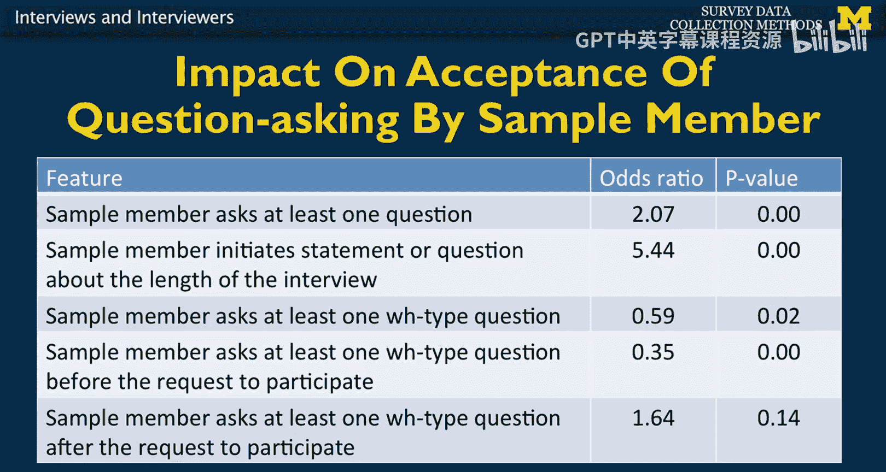

That person doesn't necessarily become the respondent。

 but is considered the gatekeeper and if that person， if that person agrees to participate。

 another household member may still be selected and may have to be convinced to participate。

But this process of within household sampling or respondent selection assures that any eligible member of the household can potentially be selected to be the respondent。

 and that's important in implementing the sample design。

