# 密歇根大学《调查数据收集和分析（2-6：方法、社调问卷设计、抽样、缺失数据、分析）｜Survey Data Collection and Analytics》 p23 22_3.1.2 户内受访者抽样.zh_en -BV1fw4m1e7Zh_p23-

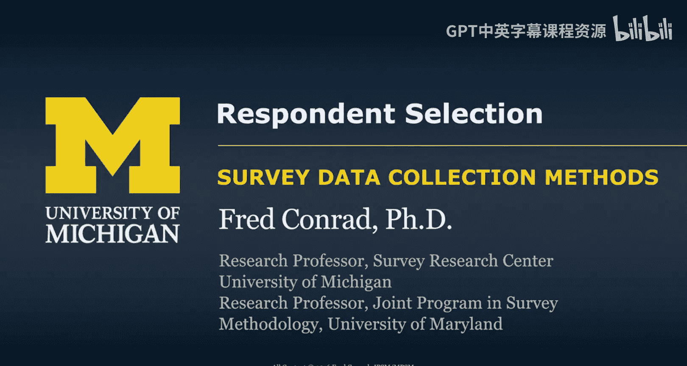

Respondent selection as I mentioned before， this is a kind of extra step in the sampling process that comes about often when the units in the sampling frame don't match the units of analysis that the study is oriented towards so that if for example the frame lists households a street addresses or landline telephone numbers but the survey is about individuals as is often the case then this extra layer of sampling is necessary within the household to pick just one member to be the respondent from among all the household members there are a number of different techniques for doing that。

 we won't go into all of them just to touch on a few of the wellknown ones and a hybrid one the best known is the kish method which is generally considered the gold standard it's actually the oldest it produces by far the most random sample and assures equal。

of selection it's also considered to be the most intrusive because it requires respondents or household members to reveal considerable information about the household the birthday methods are much simpler。

 they simply involve asking who in the household had the last birthday or the next birthday。

 they're much simpler， but they don't necessarily reveal the probability of selection because they don't require the number of people in the household to be indicated by the respondent so there's a tradeoff but they are simpler to administer and then the rizo brick and park model actually uses either the birthday methods or kish and makes use of just sort of coin tos techniques。

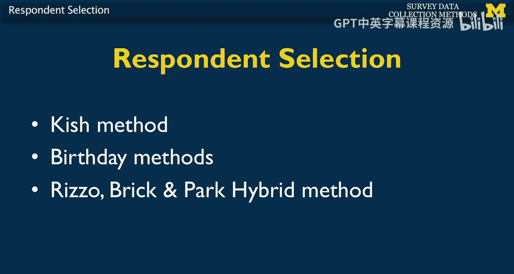

So there are a number of other approaches to selecting a person within the household besides using one of these selection methods。

 there's of course no sampling， just interviewing the person who opens the door or answers the phone。

 and you can give some thought to why this might bias the sample。

 you're invited to post your thinking about this in one of the discussion boards。

Or the interviewers might simply select the most knowledgeable respondent。

 so this is somebody who can generally talk about the entire household or and provide family level information。

 this is not necessarily somebody who's recruited at random quota methods are another technique that are used in which for example。

 for some households， the designated respondent is a female and for others the designated respondent is a male。

And then there are the probability or what are some might called quasi probability methods that I've already alluded to the Kish selection method and the birthday methods。

 and then there are others。

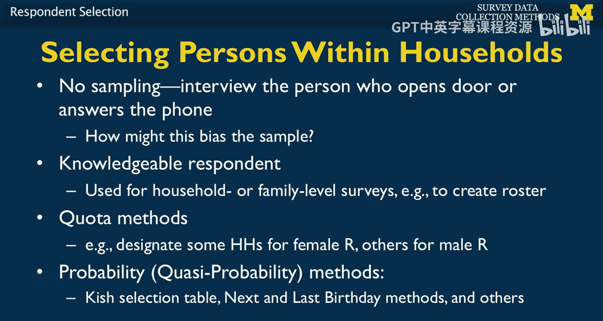

So turning to the KH method， just to give you a taste of it it's a little more complicated than what we'll cover here。

 the interviewer asks the household member to list all of the people living in or who are members of the household or living in the housing unit and then indicate which of them is eligible to take part in the survey so that might require that they be over 18 years of age。

 for example， it varies from study to study so once there's a roster it's called of the eligible household members。

 then the interviewer asks the household member to number or order the eligible males from oldest to youngest and the eligible females from oldest to youngest。

Then with these really two rosters in hand the interviewer uses what's called a selection table and there are eight selection tables that randomly allocate household members to be the respondent so this is an example of what one of the selection tables might look like keep in mind that there are others that are randomly assigned to cases or households so the selection table will indicate in a row the number of eligible persons in the household and then which of them will be selected as the respondent so of course if there's just one eligible person in the household that person that person number one is selected that goes without saying if there are two it could be person one or person two and in this selection table it's person two another selection table would say in a two person household it's person one if there are three people in the household this selection table points to person two but another table would point to person one or person three and if there are four or more。

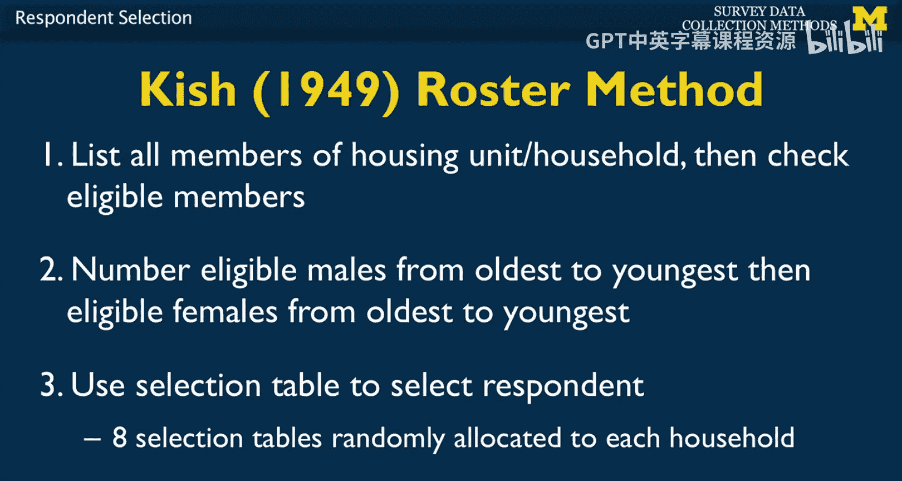

This table selects person three， again other tables would select other people。

 and so when these are all combined and equally distributed。

 every household member for every household size has an equal probability of selection。

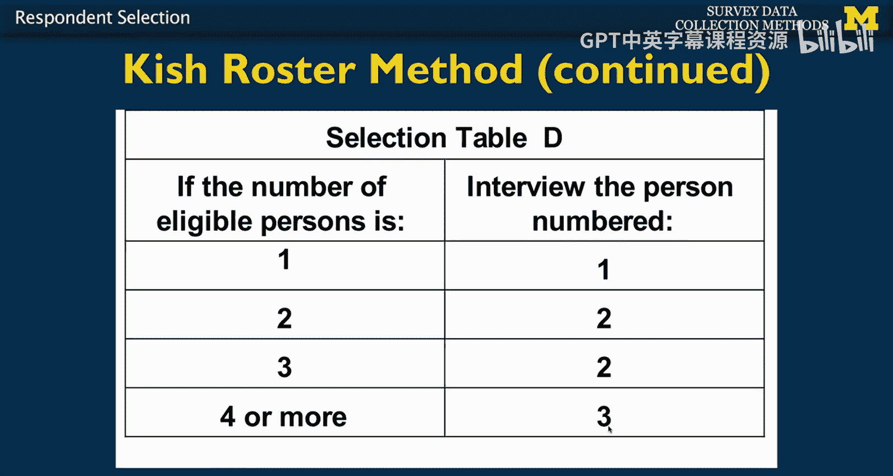

This is the great advantage of the Kish method that is the most precise selection method and gives every household member an equal and known probability of selection disadvantages are that it requires gender and age of all eligible household members to be produced by the household member that the interviewer is speaking with and that's time consuming and can be intrusive。

 this is the interviewer as a stranger at this point to the household member and so this may be a lot of information that feels personal to give to a stranger。

And it may be subject to interviewer error just because it's complicated and interviewers may make mistakes recording this either in a manual way or more likely these days entering it into a computer。

 it can be automated and for example， extended to oversample groups of particular interests like teenagers or males。

 etctera。

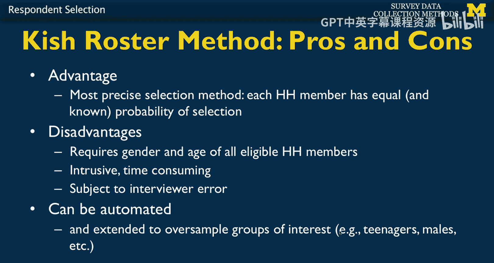

So the Kish method is still in widespread use， despite these drawbacks。

 it still has this one advantage that it's a very precise selection method。

The birthday methods， last birthday， next birthday， example wording is。

 may I speak to the person of the households who was 18 years of age or older and whose birthday was most recent。

 that would be the last birthday method。The next birthday methods exactly the same accepted instead of what most recent would be is next so the interviewer asks the adult member of the household who has the next birthday。

So advantages of the birthday methods， they're relatively easy to administer。

 they yield an equal probability of selection within a household。

 anyone has the same chance of having had the most recent or the next birthday。

 they're much less intrusive than the Kish method and they're brief。

It's low effort for the household member in comparison to what happens when the KH method is used。

And it generates a sample that's more or less random。

Disadvantages are that the exact chance of selection is unknown。

 so while there's an equal chance of selection， we don't know what the actual chance of selection is and for this reason this has been called a quasi probability method。

It's subject to reporting error because it becomes evident quickly why the interviewer is asking about birthdays and so for a household member who doesn't want to be selected。

 it's easy to indicate that somebody else had the most recent birthday。

And it's difficult to verify that the report is truthful。

And so it' for these reasons that Beaer and Liberg recommend against using the birthday methods in what they call rigorous scientific studies。

As I said， there are a number of other methods， this the paper by Gsiano goes through them and critiques them。

 nicely compares them。A comparison of the Kish method and the birthday methods was conducted by Binson and her colleagues。

Looking at dropouts in the two methods in a random digit dial telephone study。Overall。

 the Kish method performed worse， that has led to more dropouts and the next birthday method best with last birthday method in between。

 you can see the dropout rates here， Kish's highest and next birthday is lowest。What was。

Surprising was that much of this effect occurred before the respondent could know what type of screener questions they would be asked they really didn't know what would follow。

 so you can see the percent who dropped out before the end of the introduction that is before the interviewer had actually administered the screening process was highest for Kish and last birthday and lower for next birthday so it's as if the interviewers are telegraphing to the respondents to the household members what would follow as if they were somehow indicating that the KH method is going to be quite burdensome and as a result the household members terminated the interaction at that point there's no guarantee this is exactly what happen。

 but I mean the empirical result is that the Kish method did promote dropouts and so in that sense was less successful when it came to recruitment and presumably this has something to do with its burden whether this was evident before the method was actually administered or not。

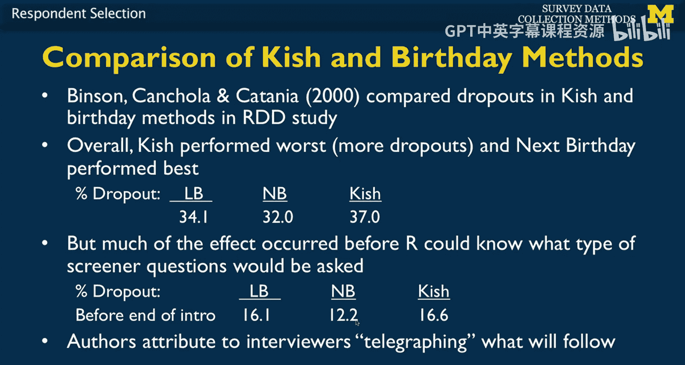

Not 100% clear， but it seems likely from this study。

More recently a hybrid model has been proposed that is much less invasive than Kish alone and in most cases can be explicit about the probability of selection。

 so there's a compromise here， but the idea is this is sort of the best compromise。

 and so the way it works is that the interviewer asks the respondent in a screener interview that's before the actual interview begins。

How many adults are in the household？If there's just one， if it's one adult household。

 then that person， the screener respondent， is selected。

 and that's the end of the selection process if more than one adult lives in the household。

Then a random selection process is administered so that if there are two household members and the screener respondedent is not selected。

 that is the person providing answers to the questions like how many people live in this household if that person is not selected then the other person is selected sort of a coin toss what this means is that there's no need to engage in a a selection method like the Kish method。

 if there are more than two people and the screener respondent person the interviewer is talking to is not selected then and only then and so this eliminates a lot of situation only then is the last birthday method used in very rare cases where where birthdays are unknown。

 the kish method is used so it really reduces the number of situation， number of cases。

 number of occurrences of using any selection method but particularly the kish method so this was tested developed。

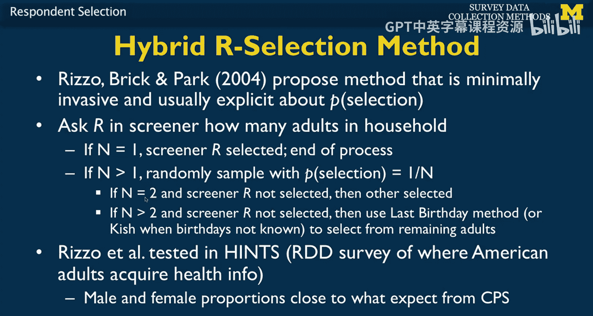

And tested by RISo et all in a study where Americans acquire their health information。

As a kind of first check work， the proportions of males and females who were selected were close to what is expected from the current population survey。

 so that's an indication that this is working well as an indication that this really did reduce the amount of what they called additional sampling that is using the birthday method or the kish method you can see that when there was one person of course no additional sampling is needed。

 when there are two people no additional sampling is needed it's basically a coin tos when there are three people in adults in the household。

 additional sampling is needed two-ts of the time that is when the screen responded is not selected and it continues like that when there are four people additional sampling is needed three- quarterss of the time when there are five or more additional sampling is needed 85% of the time but this substantially cuts down the number of households that need additional sampling when you look overall to 12。

2% so that's a great savings when you look at the impact of this procedure on breakoffs or dropouts for example。

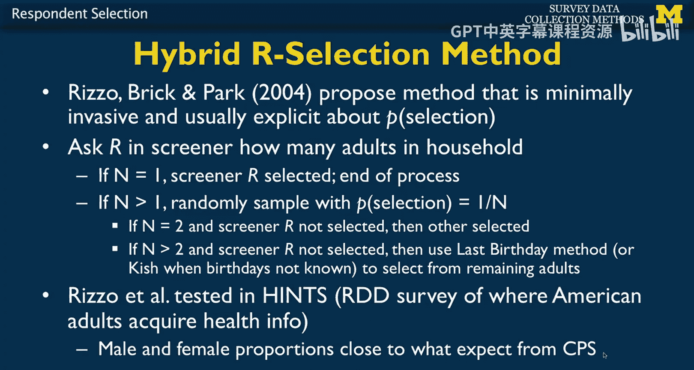

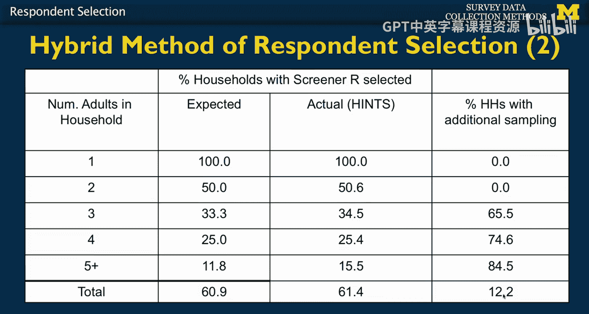

Choosing among the alternative selection methods， they're all subject to response error。

 so the Kish method requires the household member to enumerate who lives in all members of the household and that may not be entirely truthful the birthday methods make it evident why the question is being asked in the first place and this is something that a household member can manipulate if he or she doesn't want to participate。

Full listings of household require that the interviewer explain the rationale to the respondent or to the household member who's being asked to provide this information and that may affect response rate in some cases as we saw there was more dropout in kish than in birthday method which doesn't require a full enumeration Finally there are different organizational cultures regarding preferences for the different methods so some survey shops just use one of these predominantly use one of these and then different clients have different preferences so a survey organization will change the selection method depending on what the client believes to be most appropriate willll talk next about a related topic known as proxy responding and the issue there is what if the respondent the household member who has been selected as a respondent isn't available is it acceptable to have another household。

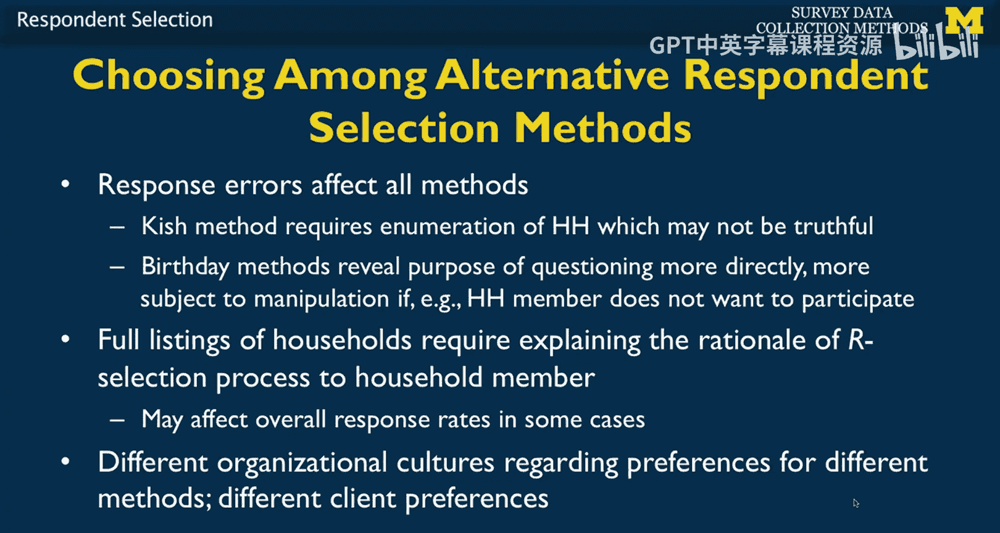

Usually the household member who is engaging in the selection process serve as a proxy。

 a surrogate for the household member who has been selected。

This differs from survey to survey organization to organization。

 but it is done and it can save cost by making it unnecessary for an additional phone call or an additional visit to a household to be made if the interview can be conducted then and there。

 so we'll turn to proxy responding next and take a look at what the implications are for response quality。

