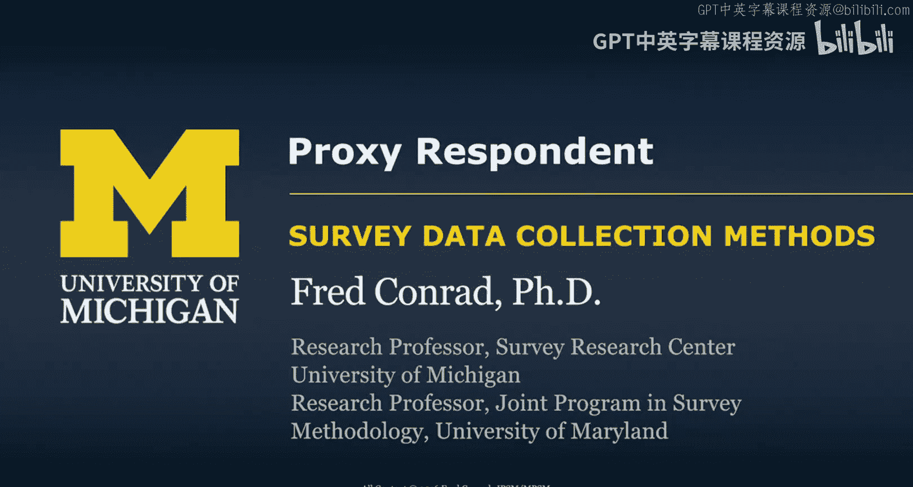
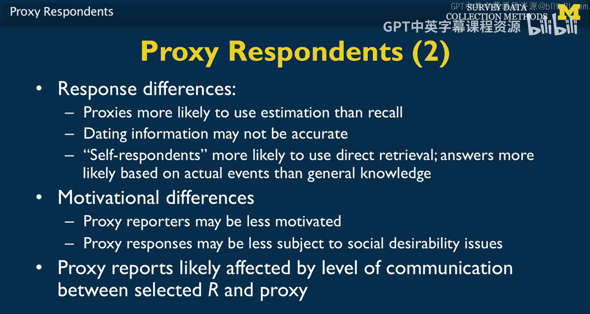
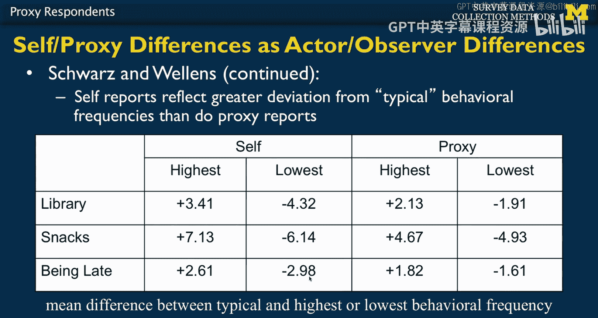
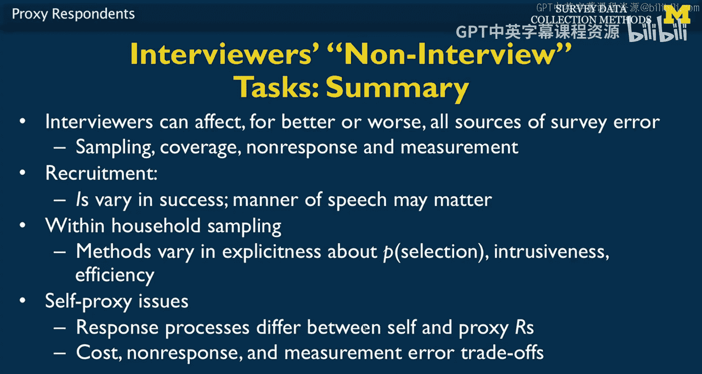

# 密歇根大学《调查数据收集和分析（2-6：方法、社调问卷设计、抽样、缺失数据、分析）｜Survey Data Collection and Analytics》 p24 23_3.1.3 代理应答.zh_en -BV1fw4m1e7Zh_p24-

We've been talking about interviewers non- interviewterviewing tasks generally conducted prior to the interview and we've just been discussing selecting a household member to be the respondent related selection issue concerns the use of proxy respondents for the the selected respondent so if the selection procedure identifies a household member who's not available at the moment。

 some surveys or survey organizations will allow the interviewer to conduct the interview with somebody who is available serving as a proxy that is answering answering as if they were the the selected respondent。

 other surveys， other organizations don't allow proxy responding the general thinking is the data quality is worse。

 but there are。Many well-known organizations that do use proxies。

 there are several advantages to collecting information from proxies。

 it takes less time and therefore less expense if proxies are used when selected respondents are not available for example。

 the current population survey the main government labor force survey in the US reduces its cost by about 12% by using proxies and the use of proxies result in higher response rates simply because if a if the selected respondent is not available。

 this doesn't lower the response rate， if proxies is available instead as I said the general belief is that self-report that is reports of respondents about themselves are better than proxy reports the response process is thought to differ probably does differ between proxies and respondents answering about themselves the general idea is that proxies are more likely to rely on general knowledge。

about the selected respondent as opposed to on the basis of actual events。

 so people are better at answering questions in terms of their actual behavior when the questions are about themselves than about somebody else we tend to use general knowledge or has in this literature been called semantic knowledge or dispositional knowledge about the about the intended or target respondent as opposed to answering about oneself in terms of the episodes or events that have gone on in one's life。

 this can lead to differences proxies are more likely to use estimation than recall that is there based on the kind of general dispositions。

 the general characteristics of the person they're answering about。

 they're going to estimate the answers to questions requiring a number。

 more likely to do this than to recall actual behaviors because they're not aware of the actual。

I mean， really nobody knows as much about anyone else as they know about themselves。

The dating information when events are datad did an event occur within the reference period or not。

 less likely to be as accurate when a proxy is thinking about the date of an event that somebody else engaged in than the events that they themselves have engaged in。

Self-responents on the other hand， are more likely to use direct retrieval just to recall the information necessary to answer the question。

 so the answer is more likely be based on actual events than general knowledge and whether one is answering about oneself for a different household member likely to affect the motivation to work hard in providing the most accurate answer possible。

 proxy reporters may be less motivated because they're not answering about themselves and it may be harder they have to use these estimation processes rather than just directly retrieving information proxies may be less subject to social desirability issues。

 so let's say smoking is stigmatized for one household member if that person answers about let's say himself you know are you smoking or how many cigarettes have you smoked this week。

 there might be a tendency to shade the truth to present one selflf in a better light。

But if someone is asked is your husband smoking or how many cigarettes did your husband smoked last week。

 that may not be as stigmatized or embarrassing for the spouse answering about the husband and so the answer actually may be more truthful from a proxy when the topics are socially undesirable the accuracy of the proxy reports is likely to be affected by the amount of communication between the selected or target respondent and the proxy so family members probably know more about each other and therefore proxies answering about family members probably likely to be more accurate than say roommates or other kinds of living arrangements where the people are not as well connected and and the level of communication is not as。

Great as it is among family members a review paper by Jeffrey Moore in the 1980s investigated the really assumption that a self respondents。

 respondents answered about themselves provide better quality data than proxy respondents and he actually found very little evidence for this in his review of the literature he did point out that the literature then was really quite flawed because number of the studies comparing quality of answered between proxies and self-responents were observational。

 they weren't experimentally they weren't experiments and so the respondents were not randomly assigned to be selfresponents or proxy respondents which is really what you'd need to evaluate the quality of the data from the from the proxies instead what he observed was that what appears to be a difference。

Quality may be a difference in fact， so ideally the contacted household member in a methodological study would be randomly assigned to be a self or proxy reporter。

 but in practice this can never be the case because proxies are used when the selected respondent is not available and so most of the studies that more was reviewing were of this type that is the they were observational studies that is the they weren't conducted as experiments。

The finding that he focused on came from health studies in which proxies were shown to report fewer health events that is。

 for example， going to the doctor or the emergency room for the household member they're reporting about when that person picks that person is not available than they are to report about themselves and the idea of as well。

 the assumption had been this indicates that proxies are not giving as complete and thorough answers about the unavailable but selected respondent as they are about themselves。

 but observed that well， actually if the selected respondent is not available they're not home。

 a person who is available and can serve as a proxy is home and someone who's home is more likely to be home for health reasons and not as healthy as the person who's not availables not at home who may well be at work and so while it appears that proxies may be。

Say not giving complete or thorough answers for。The intended respondent as they can for themselves。

 this is not necessarily the case， and it could just be that there are real differences between the health proxies and the health of the people they're reporting about。

He also observed that most of these studies which were not done for methodological purposes。

 had no validation data， that is no way to verify the accuracy of answers or directly assess the quality of answers and so they're generally not conclusive。

 so at least what he's suggesting is that proxy data might not be any worse than the data from respondents reporting about themselves。

 and he really argued for the need to do controlled experiments where household members are randomly assigned to be proxies or to report about themselves。

More recently， some of the kinds of experimental studies more called for have been done。

 so a study by Schwartz and Wellins is a good example of this。

 it was based on the distinction between in social psychology between observers and actors。

 the idea that if observers are asked to describe actors behavior。

 they'll rely more on the other person's underlying dispositions or traits than actual situations or events。

 but when responding about themselves， it'll be the opposite they'll think more about situations or events。

 similar to what we've discussed about general knowledge versus episodes。

They built on the idea by Jones and Nisbit that actors have richer knowledge of their own behavior and they tend to tell a coherent story that is to find causal explanations for the events in their lives based on this idea。

 Schwartz and Wellins predicted that if，Participants are randomly assigned to be proxies or to report about themselves that the selfreports should reflect inconsistencies in behaviors。

 departures from the usual routines， because somebody answering about their own life is going to be aware of those departures from the norm from regular activities whereas answering about someone else sort of requires answering on the basis of well。

 they typically do this， so I'm going to say that I'm going to base my answer on what I know about their routines。

So to test this idea that there'd be more inconsistency or more variation in the answers from selfreporters than from proxies。

 they had 24 couples report either their own or their partner's typical behavioral frequency。

 like how many times did you or did your partner check out library books from the university library。

 had them rate either their own or their partner's typical behavioral frequency。

 as well as the highest and lowest weekly frequency of that behavior during the preceding month？

So the idea is by looking at the range of the typical frequency。

 they could see if selfreporters actually have a larger range of highest and lowest than proxy reporterers and that's really what they found here so here's the library example in the top row the range between highest and lowest frequencies is larger for selfreporters than for proxies。

 same for snacks same for being late so basically the difference between highest and lowest for all these behaviors is larger for self-reporters than for proxies and the idea again is just that。

Proxies are not going to be aware of the exceptions to the routine。

 the way selfreporters are proxies are not with the self or not with the people they're reporting about all day every day。

 even though they're members of the same couple and so have to rely on routines rather than actual behavior there is some indication that there are different thought processes or different strategies used to answer questions by proxies versus selfreporters which could have a bearing on data quality。

 so to summarize what we've been talking about in the last few segments actually。

 the interviewers non- interviewterview tasks。Interviewers can affect for better or worse。

 all the sources of survey error， sampling， coverage， non response， and measurement。

When it comes to recruitment， which has direct bearing on response rates and non responses error potentially。

Interviewers vary in their success and the manner of speech may matter。

When it comes to within household sampling， the different methods that interviewers use vary in their explicitness about the probability of selection。

 remember the birthday methods really can't tell us what the probability of selection is because we don't know anything about the size of the household。

Their intrusiveness， the kish method required enumerating all the males and all the females and ordering them from oldest to youngest and the efficiency of the method。

 so for example， the kish method is probably least efficient。And with respect to self proxy issues。

 the response processes used by selfreers and proxy reporters seem to differ and cost。

 nonresponse and measurement error all need to be taken into account when deciding whether or not to use proxies in place of。

Self reporters。What we'll turn to next is the actual interviewing techniques that interviewers use。

 so once they've completed all these kind of pre interviewterview non interviewviewing activities。

 it's actually time to conduct the interview and we'll look at some of the different interviewing techniques and their consequences for data quality next。

