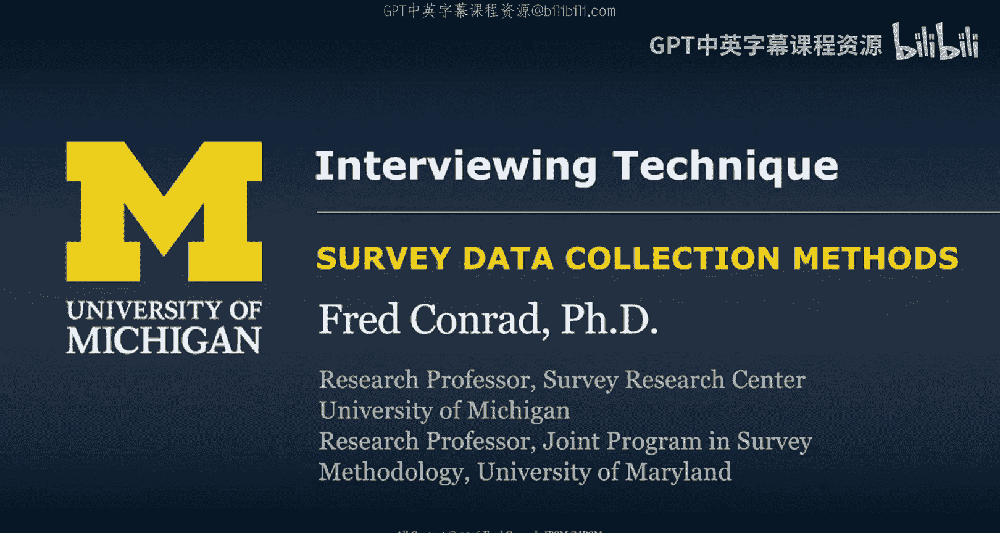
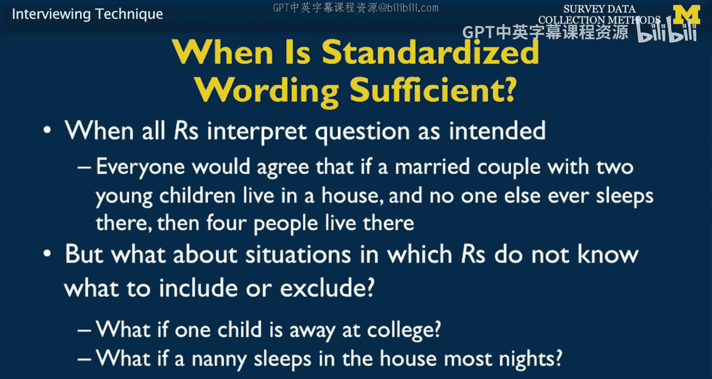

# 密歇根大学《调查数据收集和分析（2-6：方法、社调问卷设计、抽样、缺失数据、分析）｜Survey Data Collection and Analytics》 p25 24_3.2.1 标准化辩论：措辞与语义.zh_en -BV1fw4m1e7Zh_p25-

Welcome back， we've just finished talking about a number of the activities that interviewers engage in besides conducting interviews that they generally do before conducting the interview。

 recruiting participants that is obtaining agreement to be interviewed and selecting a respondent from among the household members。

Now we'll turn to a discussion of the interview itself and the different kinds of interviewing techniques that have been proposed and that are in use by far the most common approach at least in scientific survey organizations is known as standardized interviewing and the idea basically is to control the wording that the interviewer's use so that they're delivering questions in exactly the same form from one interview to the next。

 and then if the respondent answers or says something other than one of the answer categories。

 the interviewers use what's called a neutral or non-directive probe to avoid providing additional substantive information to one respondent that isn't provided to another respondent so there are sound reasons for standardizing wording but there are also reasons why one might want to allow the interviewer to choose her or his wording on some occasions。

There's been a debate about standardization and whether it's better to standardize the words。

 make sure that the words that are produced in the interview by the interviewer are the same or whether it's better to assure that respondents are arriving at the same interpretation of the questions so that the interpretation of the understanding of the questions is what's standardized that's the crux of that debate another distinction has been drawn between formal and personal styles of interviewing where personal style is really about developing rapport between the interviewer and the respondent just by allowing the interviewer to be more human and making a connection with with the respondent。

So this is really about increasing interviewer respondent rapport so turning first to the standardization debate。

 what do we mean by standardized interviewing and why is it used so widely Well at least one of the reasons sort of the key rationale。

 the statistical rationale is to minimize interviewer related error。

We'll talk about interviewer related error in the next topic and the Statistic row int is used to measure an interviewer's contribution to error。

 but the idea is that if interviewers are behaving identically to each other。

 then they will not contribute additional error or variance beyond what's already inherent in the responses。

So that's really the rationale behind standardized interviewing and the way it's implemented。

 the way the interviewer's behavior is replicated from one interview to the next is first interviewers ask the questions at the same pace。

 so it's slowly and one recommendation is two words per second。

If the respondent says anything that's not an acceptable response， as I said a moment ago。

 interviewers use neutral probes such as let me repeat the question to eliminate or reduce the amount of substantive information beyond the question that might be provided to one respondent and not others。

Ask the questions in the order they appear in the questionnaire。

 the question order must be standardized for the responses to particular questions to be comparable because if the interviewer varies the order。

 then the questionnaire context is not the same between respondents。Ask every question。

 even if the respondent has previously volunteered relevant information。

So it may be that in kind of informal conversation during the interview。

 the respondent has said something which actually contains an answer they would give to an upcoming question。

 but the practice is that the interviewer has to ask that question anyway。

 because it's possible the respondent might not answer it as the interviewer thinks the respondent would answer it and maintain a professional stance。

 avoid statements that the respondent might interpret as criticism， surprise。

 approval or disapproval。But really the key， the central aspect of standardized interviewing is that the questions must be delivered with exactly the same words。

So here's an example of why this is the key practice imagine a question that's written as the original version here is where do you get most of your news about current events in this country from the radio。

 the newspapers TV or talking to people Well an interviewer might eliminate what are essentially the response categories and just turn it into an open question。

 where do you get most of your news about current events and that fundamentally changes the question and if that isn't done consistently。

 well first of all it isn't presumably what the designers had in mind if it isn't done consistently then the results the responses are not comparable。

Or an interviewer might add some of his or her own idea about what the question is asking for。

 where do you get most of your news about current events in this country from the radio。

 the newspapers TV or talking to people that is which one do you rely on most the original question doesn't ask about which one do you rely on most it asks for you know where do you get most of your news and presumably any or all of those responses would be acceptable so the interviewer by adding additional words has really changed the intent of the question。

So as I said， when a respondent says something that doesn't correspond to a response category in a closed form question。

 they're instructed to select one from a set of non directive or neutral probes。

 the interviewer might say something like，Is there anything else， Yes。

 I see or aha in an expectant manner， followed by a pause。

 Could I read back what I have taken down to be sure I have exactly what you wanted to say？

What do you mean by that， could you be a little more specific？What comes closest to the way you feel？

And then there's another set of neutral probes generally。

 and of course the exact set of probes and the exact practice varies from one survey organization to the next。

 but another set of probes are really designed to be used after a respondent indicates that they either don't understand the question or would like some additional information some clarification。

I'm sorry， but I don't have that information。It's important that the question be answered as best you can in terms of the way it's stated。

 perhaps I could read it to you again， so repeating the question。And finally。

 whatever it means to you。If you think about it， these different neutral probes are actually so not necessarily neutral。

 not devoid of content， and they may be essentially communicating instructions of one kind or another to the respondents so think about this and in particular what message might whatever it means to you be sending to respondents that the other probes or not。

 and post your thoughts about this on the discussion board the chief criticism of this approach of standardized wording is that it prevents or blocks what's called conversational grounding an idea due to Herbert Clark and his colleagues。

The idea behind grounding is that in ordinary conversation。

 a speaker and listener exchange turns until they agree they understand each other well enough for the current task。

 for the current purposes。And so if you think about this。

 it's a common occurrence you might not understand what the speaker has just said and you might say。

 what do you mean by that and then the speaker generally tells you what she meant by that。诶。

If this were allowed in standardized interviewing， it would lead to variable wording across interviews so some respondents would ask for clarification and the interviewer would provide it and others wouldn't and then one respondent had some wording some additional material that another respondent didn't and then the exact stimulus is not held constant and so the idea is that the responses would no longer be comparable。

 that's the thinking。An alternative approach would be to standardize the meaning to promote uniform interpretation。

 not just standardized wording and that that should be the goal。

 and the idea is that's what conversational grounding makes possible if this is in fact the practice。

 it should promote valid， not just reliable responses that is it should assure that respondents understand the intentions behind the question as opposed to just interpreting the question the same way from one occasion to the next。

 the latter is what standardized wording。Tends to achieve producing the same interpretation from one occasion to the next。

 but it really doesn't address the issue of， is the interpretation the one that was intended。

 is it valid， allowing conversational grounding， introducing that to the interview。

Should promote valid that is the intended interpretation of the question。

 because it allows the interviewer to explain the intentions behind the question and the definitions behind the concepts。

Some of these criticisms have been in the literature for some time。

 as suchman and Jordan and Schefffer and others have， for example。

 noted that the survey interview in particular standardized interviewing conflicts with normal conversational practices for a number of reasons。

One reason is that one actor namely the interviewer， determines the topic of conversation。

 this rarely happens in everyday conversation， so when it's time to move to the next question。

 the interviewer moves the conversation， moves the interaction to the next question。

And the interviewer is not able to engage in conversational processes like grounding as we just discussed。

The respondent is not free to ask about anything beyond the questionnaire。

 so kind of the scope of the conversation is determined by the interviewer。

And then the interviewer determines when the conversation is over。

 says thank you very much we're done none of this happens in ordinary conversation。

 so really the crux of the issue is that even if normal conversation might sometimes promote more accurate understanding of questions and therefore more accurate answers。

 does this outweigh the increased variation in wording that it would introduce？

So one consideration in thinking about this issue of whether to sort of simulate ordinary conversation in survey interviews is when do we need to do this。

 when might standardized wording actually lead to the intended interpretation and when might it not。

 if all respondents interpret the question in the way it's intended we should be fine， of course。

 so for example， everyone would agree that if a married couple with two young children live in the house and no one else ever sleeps there and four people live in the house。

 so the question is how many people live in this house。

That's straightforward but what about situations in which respondents did not know what to include or exclude what if one child is away at college。

 what if a nanny sleeps in the house most nights should the child away at college be counted。

 should the nanny be counted， it's hard to know and it would be hard to clarify this。

 obtain clarification in a strictly standardized interview because the interviewer would be obliged to administer non-directive or neutral probes such as let me repeat the question so what we'll turn to next is a series of empirical comparisons between these two approaches to interviewing looking at the impact on the response accuracy when interviewers can and cannot clarify the intentions behind the questions。

