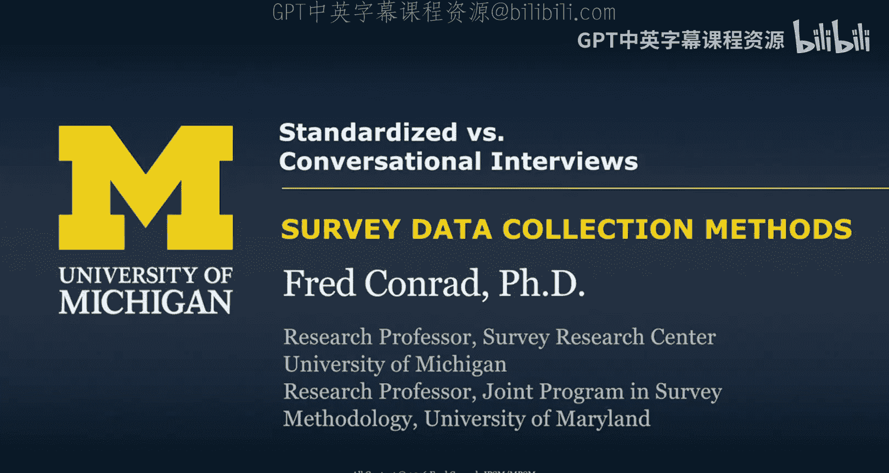
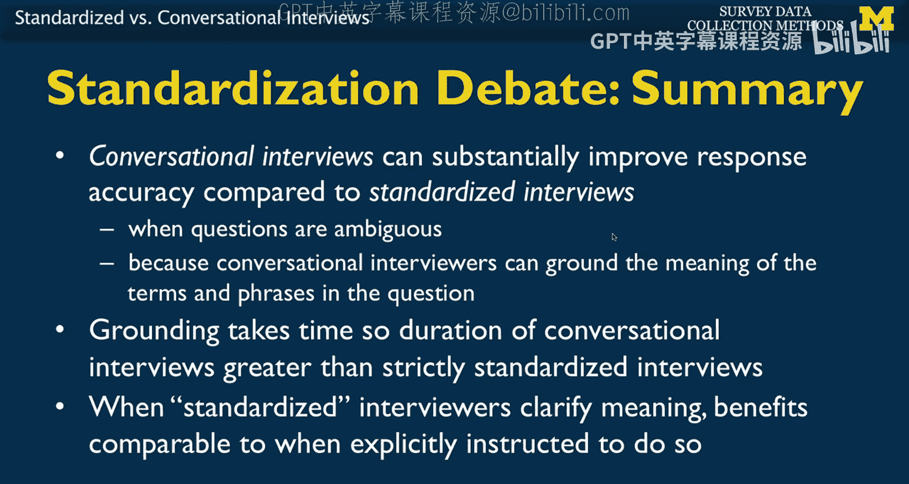

# 密歇根大学《调查数据收集和分析（2-6：方法、社调问卷设计、抽样、缺失数据、分析）｜Survey Data Collection and Analytics》 p26 25_3.2.2 标准化访谈的不同路径.zh_en -BV1fw4m1e7Zh_p26-

There have been a number of empirical comparisons between strictly standardized interviewing。

 standardized wording and alternatives， in particular in an approach that's come to be known as conversational interviewing in which interviewers are able to ground the meaning of the words in the question。

The first of these by Schburn and Conrad in 1997 had interviewers ask laboratory respondents 12 questions from US government surveys using one of two interviewing techniques either the standardized procedure as we've discussed in which interviewers read the questions as worded and then could use only neutral probes and they really couldn't deviate from the script in a substantive way。

 or what in the paper was called flexible interviewing and later came to be called conversational interviewing。

 it was called conversational interviewing because interviewers could engage in conversational grounding。

 but it actually was not particularly conversational unstructure it was in a lot of ways similar to standardized interviewing。

 the interviewers read the questions as worded initially but encouraged respondents to ask questions about the meanings of the questions if they had any。

 and if respondents did， then the interviewers could cl。

the meanings of the words and the questions so for example。

 a respondent might ask if a person who babysits for more than one family should be considered to have one job or more than one job so they could clarify this they could say well according to the definition in this survey that person is considered to have just one job and they could do this either verbatim reading definitions exactly as they were worded or they could paraphrase them so they could use just the part of the definition that seemed relevant and they could communicate it in their own words but it was really up to the interviewers so they used one of two interviewing techniques the respondents answered the questions on the basis of fictional scenarios not about their own lives and the reason for this was that。

When the authors created fictional scenarios， they knew the true value。

 they knew the correct answer based on the definitions of the survey organizations。

 so half of the scenarios presented to the respondents made the questions ambiguous。

 they call these complicated。Situations are complicated mappings ambiguous without a definition。

 so for example， the question might ask if there had been any purchases of furniture。

 household furniture， the complicated scenario might have been a receipt for the purchase of a floor lamp。

Is a floor lamp furniture， people are divided on this and really without knowing how it's defined in that in this survey。

 respondents could easily get the wrong answer or at least won't know how to answer。

For the other half of the questions， the scenarios were called straightforward and were clear without a definition so instead of seeing a receipt for the purchase of a floor lamp。

 the respondent would see a receipt for purchase of a table which is pretty clearly a piece of furniture and no definition would be required to confirm that a table should be considered furniture。

 so there were these two interviewing techniques， one in which interviewers could provide clarification and one in which they couldn't for half the questions that any one respondent was asked the scenario they were using to answer it made the question ambiguous at least until a definition was provided and for the other half the scenarios made the question straightforward so that no clarification was required and what they found because again the scenarios allowed them to directly measure response accuracy was that when the scenarios made the questions straightforward that is no definition was required。

 response accuracy was quite high， nearly 100%。Irrespective of the interviewing technique。

 so in standardized interviewing， reading the question as worded and using neutral probes was sufficient to produce high quality responses。

 accurate responses。But when the scenarios made the questions ambiguous or created a complicated mapping between questions and the scenarios。

 standardized interviewing led to actually quite low response accuracy。

 only 27% of the questions were answered correctly。

 but in the conversational technique in which the interviewers could provide clarification。

 almost 90% of the questions were answered accurately。

 so this is really a conversational grounding in the interview and it does lead to clearly improved comprehension and response accuracy。

But of course， like many good things， it comes at a cost and the cost is additional time。

 so this clarification process just takes time more words are produced in order for interviewers to explain to respondents what the questions are intended to mean what the definitions are what the relevant parts of the definitions are the median interview duration was about three times as long in conversational than standardized interviews now keep in mind that。

Half of the questions required some kind of clarification in order for respondents to get them right and so it could be that in naturally occurring circumstances in interviews outside the laboratory。

 there are fewer such situations and the increase in duration is not as long because not as much clarification is needed。

 but in this laboratory study where half of the questions required clarification。

 conversational interviewing substantially increase the duration of the interviews。

 so what this suggests is that there's a tradeoff between the standardized and the conversational approaches。

 conversational interviewing can produce greater response accuracy than standardized interviewing。

 but it also produces longer interviews which may result in fewer cases being able to be completed for a fixed cost because if interviews take longer and therefore are more expensive。

 fewer of them may be able to be conducted。This raises a few questions how frequent are the complicated situations in the real world outside of the laboratory that require clarification and how much error is tolerable。

 if the stakes are not that high then more error is probably tolerable and the extra expense or duration。

 increased duration of using conversational techniques might not be worthwhile。

 so these are really things that a researcher needs to determine for each particular study。

In a follow-up study， Conradten Schchoer addressed the issue of how frequently do these situations occur where clarification unscripted clarification might be helpful and they did this by reinterviewing respondents is a national sample so in their homes no longer in the laboratory who had initially been interviewed with standardized techniques in the first interview all respondents received a standardized interview in the reinter about a week later half of the respondents participated in a standardized interview again and the other half participated in the conversational interview and the question was how much change was there between their answers in the first and second interviews if a conversational reinterview corrects initial misconceptions that is misunderstandings that went uncorrected in the initial standardized interview because interviewers those interviewers were unable to provide clarification then respond。

ho change their answers more if they're now understanding the question as it was intended in the second interview。

 whereas if both interviews are standardized， misconceptions in the first interview should still be misconceptions in the second interview and so respondents will actually change their answers less when they're unable to obtain clarification in either interview。

And this is what they observed that the amount of response change between an initial standardized and a subsequent standardized interview was 11%。

 whereas it was 22% when the second interview was conversational so again the idea is that this conversational interview made it possible for respondents to understand the questions as they were intended which if that differed from how they initially understood the questions in the initial standardized interview would lead to more response change that difference。

 that 11% difference is what the authors took to be the frequency of complicated situations benefiting from clarification。

 at least for these items for this sample so is 11% enough of a high enough frequency to warrant the extra time that these interviews could potentially take。

That's really a question for a researcher to decide to weigh and make a judgment for a particular project with a particular budget in fact。

 the conversational interviews did take longer in this study as well as in the original lab study but the increase was not as great。

 it's about an 80% increase versus a threefold increase。

 and this is clearly a function of the number of situations in which clarification was needed。

 11% in this study， 50% in the previous study。One question that this line of research raises is howized are standardized interviews。

 that is to what extent do interviewers really follow their training and use only neutral probes and leave respondents to interpret questions on their own。

 essentially？Schoer Conrad and Fricker conducted a follow-up lab study in which they instructed interviewers to do what they ordinarily do and they call this the natural condition。

 they use the same questions and scenarios as in the 1997 laboratory study。

 so it was possible to measure response accuracy as in that original study。

 and they're actually able to compare the results of this natural quotecon to the initial original standardized and conversational interviewing conditions。

And they found that the response accuracy when interviewers were left to their own devices instructed to do what they ordinarily do was quite similar to what they had observed in the standardized interviewing condition in their original experiment。

Except when they examined separately， situations in which the interviewers departed from the script。

Presumably to explain the intention behind the questions。

 the accuracy and the interaction between the interviewer and the respondent was much more similar to what it was in the original conversational interviewing condition so here's the response accuracy in this natural condition for complicated and straightforward questions based on scenarios and again as in the data from the earlier study is presented on the left and in the middle compared to the data from the earlier study the accuracy for straightforward situations is again nearly perfect。

 nearly 100% and the accuracy for the complicated situations is much lower。

 nearly as low as it was in the standardized interviews in the original study。However。

 when the analysis is done separately for exchanges between the interviewer and the respondent that departed from the script in which the interviewer。

wa presumably explaining the meaning of questions or the intentions behind questions the accuracy was much higher so on the left are the cases where the exchanges in which the interviewer stuck closely to the script and again the accuracy for the complicated questions was quite low as in the original standardized interviewing result。

 but when interviewers departed from the script， the accuracy was much higher。

 80% much much more like it was for the conversational interviews in the original study when interviewers were instructed to do this so it suggests that interviewers are almost naturally or spontaneously providing clarification when when they are able to。

 even though their training would require them to use non-directive or neutral probes want to respond and asks what the question is intended to mean。

So to summarize the standardization debate。Conversational interviews can substantially improve response accuracy compared to standardized interviews。

 we saw that the difference between response accuracy was almost 60 percentage points in that original study。

This is the case when questions are ambiguous because conversational interviewers can ground the meaning of the terms in the question。

 terms and phrases in the question。But the cost is that grounding takes time。

 there's additional back and forth， additional conversational turns。

 and so the duration of conversational interviews is almost always greater than in strictly standardized interviews。

And then finally， when standardized interviewers clarify meaning that is despite having been instructed to use only neutral probes。

 the benefits are comparable to when they're explicitly instructed to do so。

In the next and last segment on interviewing technique。

 we'll talk about a different distinction that is the distinction between formal and personal styles of interviewing。

 which is actually kind of orthogonal to or independent of the distinction we've been making here and really the difference is whether interviewers attempt to make a personal connection with respondents or maintain kind of a professional distance。

