# 密歇根大学《调查数据收集和分析（2-6：方法、社调问卷设计、抽样、缺失数据、分析）｜Survey Data Collection and Analytics》 p27 26_3.2.3 个人化与正式化风格：访员亲和力.zh_en -BV1fw4m1e7Zh_p27-

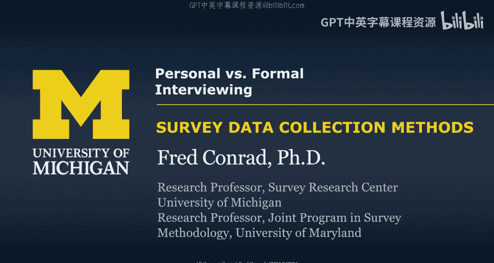

Welcome back， continuing with our discussion of interviewing technique。

 we just finished discussing the distinction between standardized and conversational interviewing。

 where shifting our focus now to another distinction。

 namely the distinction between personal and formal interviewing techniques or interpersonally engaged might be another way to think of personal versus businesslike might be another way to think of formal interviewing and the question is which approach produces higher quality data。

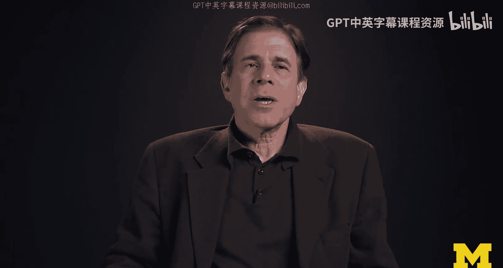

This distinction really， while I think it had been in the literature for some time。

 it really was made clear and studied in depth by Dytra and later with his colleagues。

 Van D Allen and Smith。They explored the distinction between these two interviewing techniques and I should just point out and I'll reiterate it this is really orthogonal to or independent of the distinction between standardized and conversational interviewing so while formal might sound like standardized and personal might sound like conversational。

 they're really not analogous， you can have a formal interview that's not at all scripted it's just that the content and the demeanor of the interviewer very businesslike and you can have a conversational interview that's not particularly personal in which the interviewer doesn't attempt to make a connection with respondents but does clarify the meanings of questions so they just want to reiterate that。

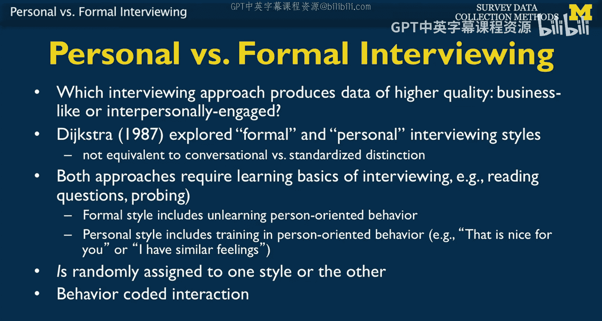

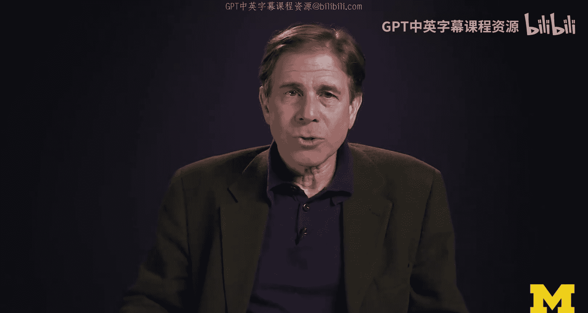

So Dyexter looked at this in 1987 and noted that the two techniques shared a lot。

 namely that the interviewers read questions and probed。

 but it really had to do with whether they attempted to make a connection with the respondent or instead really retained they kind of professional businesslike orientation so for the formal style what Dyexter reported was this actually required interviewers to kind of unlearn their everyday interviewing practices where they did just because it was kind of more natural。

 attempt to connect with the respondents， it required some training to be more businesslike。

 the personal style involved providing feedback to respondents with expressions like that's nice for you。

 I have similar feelings so you can see these are quite different and you might wonder if the personal style is leading or somehow introduces the influence of the interviewer in a way that would be undesirable。

that's really what he wanted to test so in his study the interviewers were randomly assigned to one style or the other and then he behavior coded the interaction between them to better understand how to interviewing techniques worked so Dykster really evaluated the impact of interviewing technique on data quality in two ways by looking at accuracy and social desirability really the question he was after was whether the personal style led to greater motivation by respondents to work hard and provide accurate or as accurate answers as possible versus did it lead to ingratiation that is the tendency to say what they thought the interviewers would want to hear rather than what was actually the case so the accuracy measure was the proportional correctness of a map of their hometown that he asked them to draw that the interviewers asked them to draw it was proportionally correct and did they include the right landmarks among other attributes and the idea was that if they were motivated to try hard and provide。

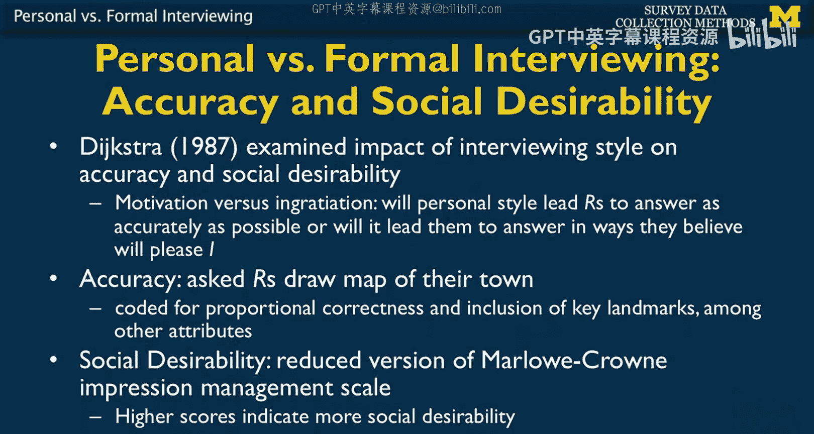

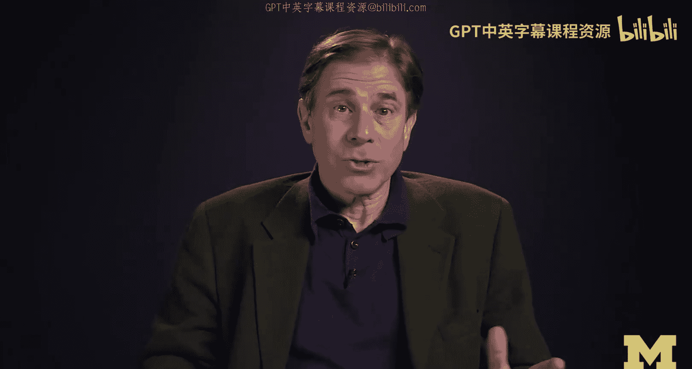

High quality data， they would provide more accurate maps。

And the measure of social desirability was their score on a reduced version of the Marlow Crown Impression management scale。

 which is a standardized questionnaire that operationalizes impression management in a series of items。

And the idea is that if they scored higher on the Marlo Cr instrument then they were more prone to provide socially desirable answers so what he found was if you look first at the accuracy scores in which higher scores in this top table represent greater accuracy if you look across the top row and compare it to the bottom row the numbers are bigger for personal versus formal interviewing so the personal interviewing style is leading to more accurate maps than the formal style。

 which is what the prediction had been， the concern was that this could be the case but it would lead to greater social desirability by increasing ingratiation so if you look at the lower table you can see that actually this concern was not supported the personal style if anything led to lower scores than the formal style for both males and females so it appears that accuracy does not come at the cost of increased social desirability So Dykstra followed up on this initial study。

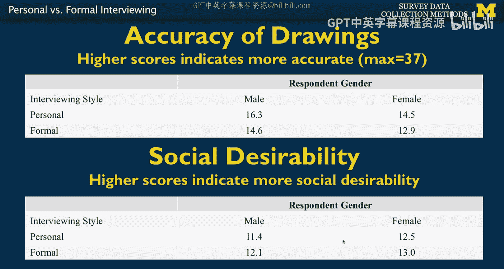

with his colleagues， Vanderzaen and Smith and what they did among other things was to actually ask questions that had more and less socially desirable answers rather than just administering an impression management scale so a more direct measure of whether the personal interviewing style would increase ingraticiation would lead a more socially desirable answers the questions they asked has come to be regarded as moderately socially desirable or moderately socially undesirable。

 so for example they asked the question after moving to this neighborhood did you try to make contact with people living here。

 the desirable answer would be to say yes I did even if that's not the case。

 but it's not so stigmatized to say no to give the undesirable accurate answer that one could imagine respondents would be willing to do this at the same time that they felt they'd made a personal connection with the interviewer will look in a bit at a study which asked more sensitive questions in this and examine whether the relationship with the interviewer。

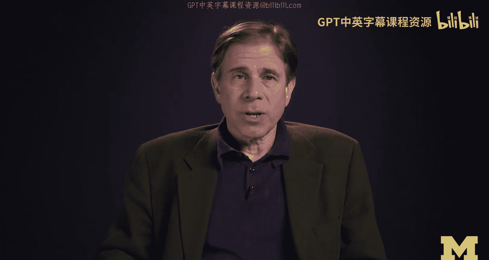

Affected the social desirability of responses， but for this question， if you look across the table。

 you can see that about 18% more respondents answered no gave the undesirable answer。

 the more truthful answer presumably when interviewed in the personal style than in the formal style。

 so that would suggest that they are giving more truthful answers。

 they're not ingratiating themselves to the interviewer when the interviewer has made a personal connection with the respondents。

A second question with a moderately socially undesirable answer is。

 are there people living in this neighborhood who you do not like？

Well there's no difference in the number of respondents to percent of respondents who gave the undesirable and presumably more truthful answer。

 but 5% more said don't know when interviewed in the formal style suggesting that at least some of them were avoiding giving the truthful answer。

 namely yes， so it looks like there is some evidence that when interviewers make a personal connection。

 essentially establish rapport with a respondent that this can not only increase the accuracy of their answers。

 which is perhaps the most important aspect of interviewing。

 but but will increase accuracy without increasing socially desirable answers。

 so-called ingratiation。

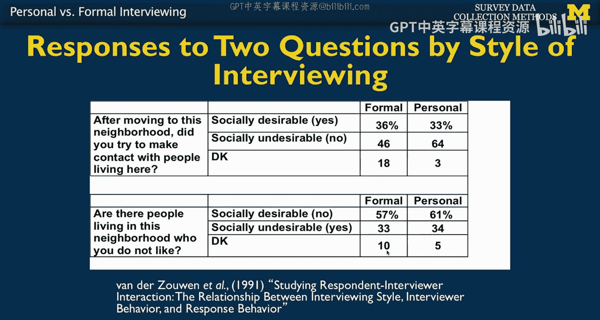

Now the mechanism really does seem to be establishing rapport that leads personal interviewing to improve quality in these ways。

 so there actually is a literature about the rapport between interviewers and respondents which for a long time was relatively inconclusive but Id just like to go over some of the findings because they sort of set the stage for some more recent work that's a little bit more definitive but early on Shesley defined rapport is essentially demographic similarity that is people would be feel a sense of closeness and openness with other people who had more of the attributes that they had so it's kind of the opposite of social distance a sort of social closeness social proximity this is just one interpretation or one way to operationalize it but this is what Sheetsle proposed the idea was that this would lead to more honest and thoughtful survey responding。

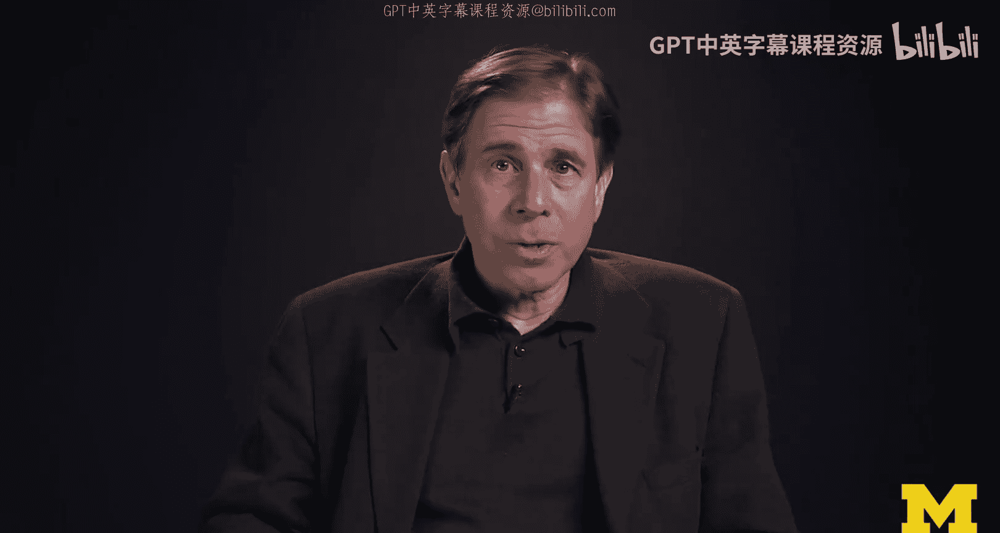

But as I said， the literature has been kind of inconclusive， at least from these early years。

 so Weis found for example， lower validity comparing answers to administrative records when rapport was higher。

 suggesting that rapport actually harms the accuracy of data but Gutian Potter found essentially no relationship between rapport and the interviewer's performance suggesting that rapport might really be kind of a red herring。

 they measured this on a several item scale administered to the interviewer for example。

 during the interview how ill ease did the respondent feel well。

 you know with hindsight we can recognize that this is probably not the best way to get at the respondent's sense of the rapport they had established with the interviewer so this was really the state of the literature for a long time if people kind of abandoned this line of work。

 one kind of unanswered question is whether in fact rapport may be due to the interviewer's behavior。

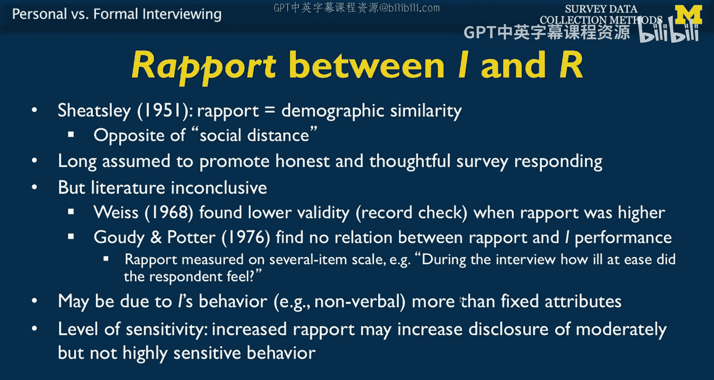

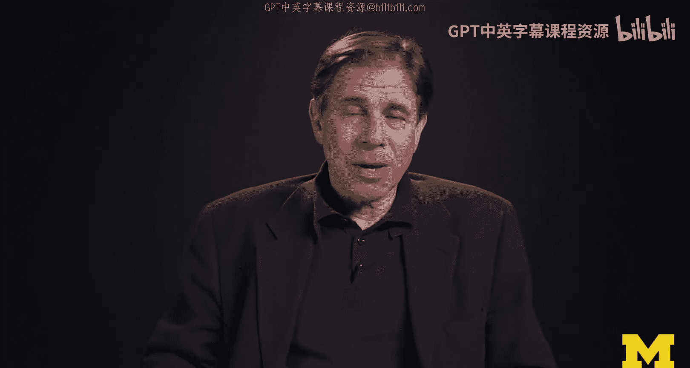

measure the respondent's judgment of rapport for example。

 the interviewer's non-verbal behaviors maybe more than their fixed attributes。

 the social proximity idea， and it may also be that the level of sensitivity of the questions may moderate the effect of rapport so that for moderately sensitive questions。

 increased rapport may increase disclosure but for highly sensitive questions it may reverse and lead people to be less honest because now they actually care about their relationship with the interviewer。

 they've established rapport and they care what the interviewer thinks of them and so to report behavior that stigmatizes them may be something they don't want to do so rapport could cut both ways depending on the level of sensitivity turning first to whether the idea that rapport has to do with fixed attributes is correct or not or maybe it's non-verbal behavior or maybe it's both a study by Johnson and his colleagues suggested that demographic similarity really。

Does increasec disclosure whether it's exactly because rapport has been increased or not。

Evident in this study， but it's a rather startling finding what Johnson did was to operationalize social distance as the overlap of demographic features between the interviewer and respond that much has Shesli had proposed years before。

Where more overlap equals less social distance and greater proximity。

 the attributes that the authors examined， measured and examined the relationship of to disclosure or age。

 gender， race and ethnicity and education and so the question is how does interviewer distance measured by the overlap in those demographic variables affect the disclosure of undesirable behaviors？

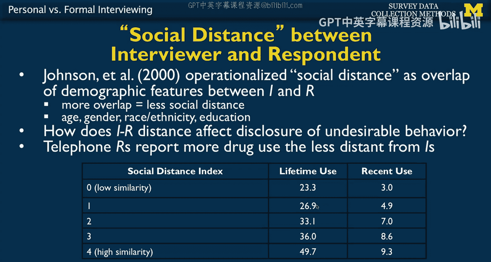

The research was done on the telephone， which is why it's a fairly startling finding that even。

Attributes as opaque to a telephone conversation as education had an impact on disclosure so if you look at the table。

 the amount of disclosure， which is the amount of either lifetime drug use or recent drug use where bigger numbers indicate more drug use increases from no overlap to complete overlap it increases monotonically for both measures lifetime drug use and recent drug use suggesting that this idea of rapport or at least something that promotes disclosure is in fact related to social distance or social closeness but it turns out that nonverbal behavior seems to be by the interviewer seems to be related to rapport as well Foucault analyzed the facial behavior for female interviewers in the National Sur of family growth and then obtained。

The respondents ratings of rapport with the interviewer。

 the ratings were based on agreement that particular adjectives characterized the interview situation。

 so relaxed cooperative unfriendly， so they presented these adjectives and asked respondents to agree or disagree that these characterized the interview both the interview situation and the interviewer herself。

 for example， cooperative friendly cold， this allowed them to compute a rapport measure。

 and then they looked at its relationship to different non-verbal behaviors by the interviewer which they coded in great detail。

 and what they found was that the higher the respondents rated rapport。

 the more the interviewers smiled and nodded。And the less the interviewer looked directly at the respondent。

 so the less direct gazed by the interviewer。They had no direct measure of data quality。

 so did increase rapport which was related to these nonverbal behaviors， increased data quality。

 but in a follow-up report Foucault and Sun found that the answers were more acceptable when rapport was greater and by acceptable they meant that they conformed to the format that the question required。

 didn't there was no need for the interviewers to ask for additional information so we see on the one hand that demographic similarity seems to increase disclosure。

 not exactly sure this is involves rapport we see that the interviewers' nonverbal behaviors affect respondents ratings of rapport and maybe have some impact on the quality of the answers。

 at least the respondents seemed to try harder to give the kind of answer that they were being asked about but as I said before it's possible that。

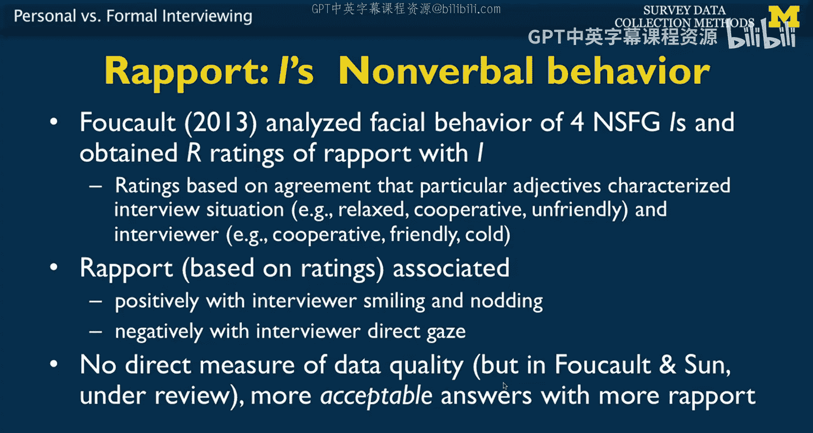

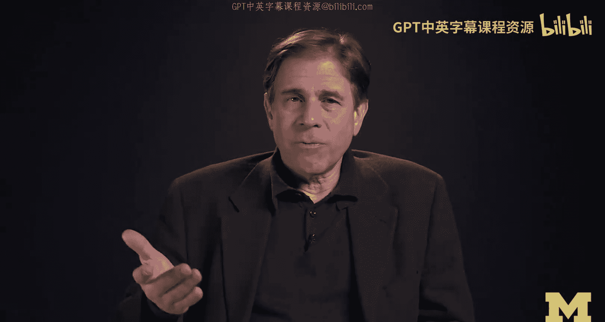

Rapport increases the accuracy of answers to sensitive questions if they're moderately sensitive but not highly sensitive and so this was really the issue that sun looked into mainlyly to see if the level of sensitive of the questions interacted with rapport that is increased rapport when the questions went from not very sensitive to moderately sensitive and then increased disclosure when the questions went from not very sensitive to moderately sensitive and then reduced disclosure when the questions went from moderately sensitive to very sensitive so she obtained ratings of questions actually separate study as either high moderate or low ands and these were asked by interviewers in face to face interviews and actually also in video mediated interviews but whether they were video or face to face had no impact on this part of the analysis and collected respondents ratings。

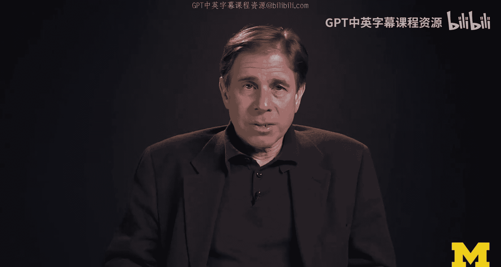

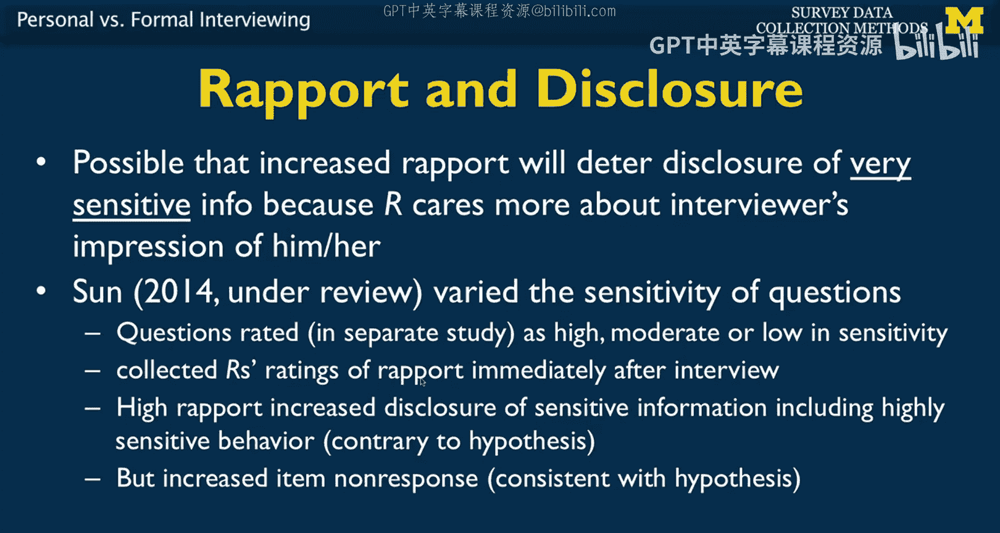

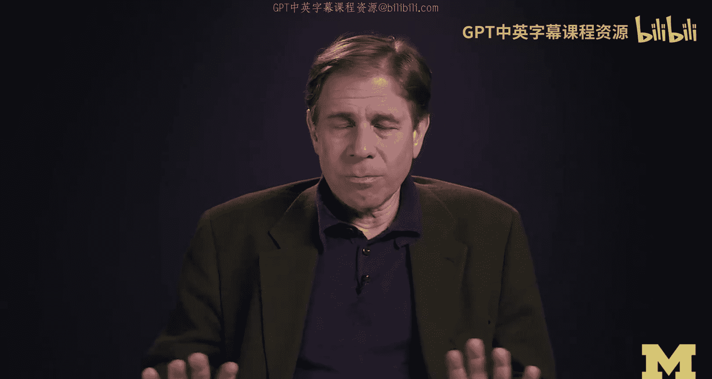

Of rapappport immediately after the interview。And what she found was that high rapport increased disclosure of sensitive information。

 both moderately and highly sensitive information， which was contrary to the hypothesis that there might be a reversal for the highly sensitive questions but increased rapport also led to more item non-respon when the questions are highly sensitive as respondents in some cases chose just not to answer so it seems as though rapport is backfiring somewhat so when respondents answer they seem willing to give truthful answers to highly sensitive questions。

 but in higher numbers they are less willing to answer these very sensitive questions when rapport is high consistent with the hypothesis that as you develop a relationship with the interviewer there's more reason to sort of shade the truth and not answer with complete candor so to summarize what we've been discussing the personal versus formal。

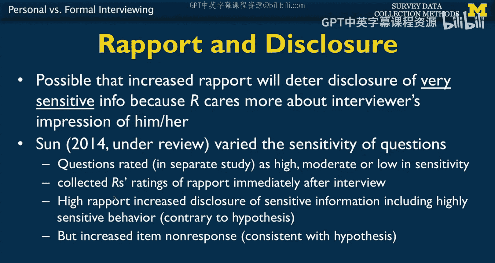

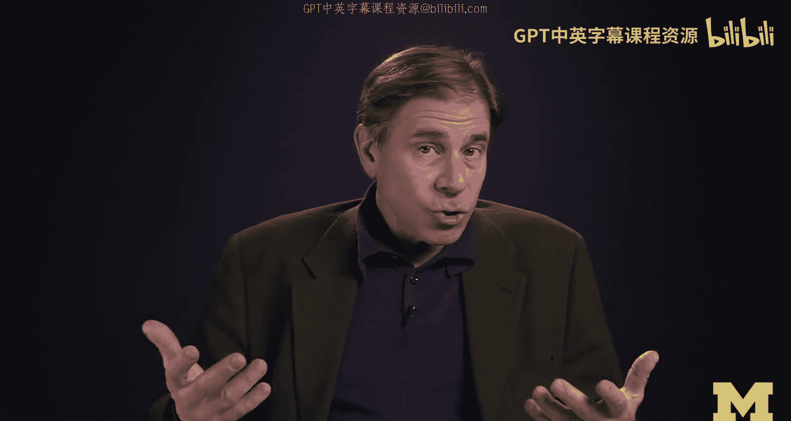

Of interviewing seems to be a real distinction。 The personal style motivates respondents to give accurate and candid responses relative to the formal style so does not seem to increase ingratiation that is respondents don't seem to be more likely to answer these moderately sensitive questions in ways that would present them in a better light to the interviewer in the personal style than in the formal style which was the concern going into it In fact if anything the personal style leads to reports of more socially undesirable behaviors so at least of this moderately sensitive variety the personal interviewing technique seems to work by increasing rapport between interviewers and respondents again I want to reiterate this is not the same distinction the personal versus formal interviewing distinction as conversational versus standardized where rapport really isn't relevant and in the research on rapport increased rapport seems to increase disclosure of moderately and extremely sensitive behavior but also increase。

He non responsese for extremely sensitive items as we just saw in the research by Sun。Finally。

 the study by Johnsonman colleagues is consistent with the idea that less social distance between the interviewer and the respondent seems to increase disclosure。

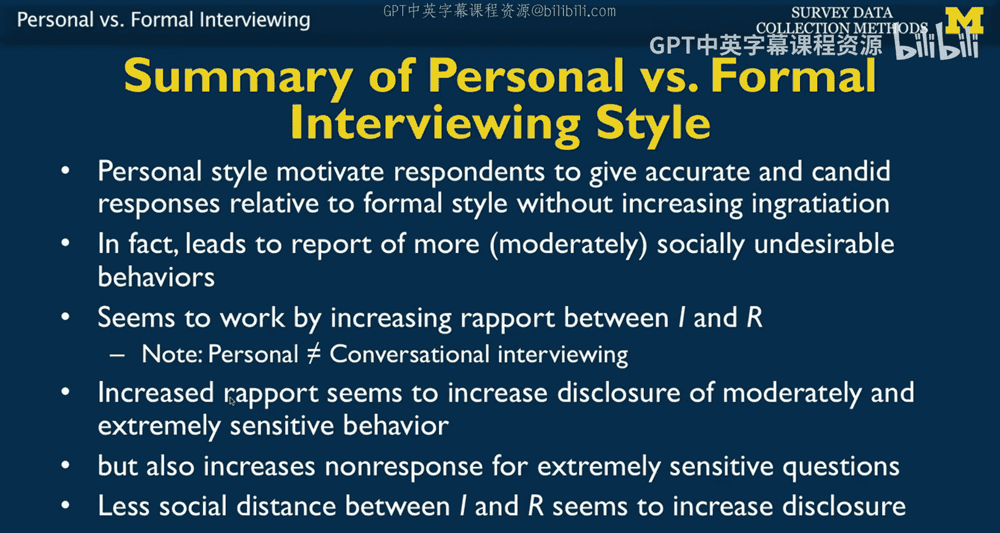

I think the take home message is that interviewers really can add value depending on the technique that they're using。

 so they can produce more accurate and more candid responses with some techniques than others。

 but there are tradeoffs across the board。At the same time。

 interviewers can add error through what are called interviewer effects。

 which is what we'll turn to in the next topic。Interviewer effects seem to come into varieties。

 those that have to do with interviewer behavior， really the extent to which they're administering the questionnaire in the same way for all respondents。

 and the other type of interviewer effect has to do with the interviewer's fixed attributes such as race gender age and the extent to which the questions they ask are related to those attributes。

 so we'll turn first to interviewer effects having to do with their behavior and really this focuses very much on the origins of standardized interviewing and the attempt to really restrict the way interviewers are able to administer the questionnaire。

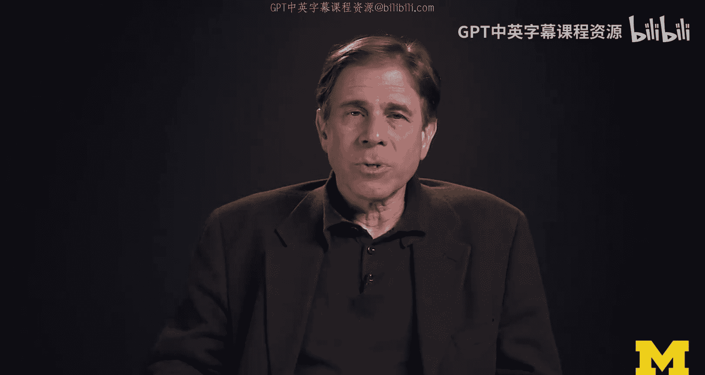