# 调查数据收集与分析：3.2.3：个人化与正式化风格：访员亲和力

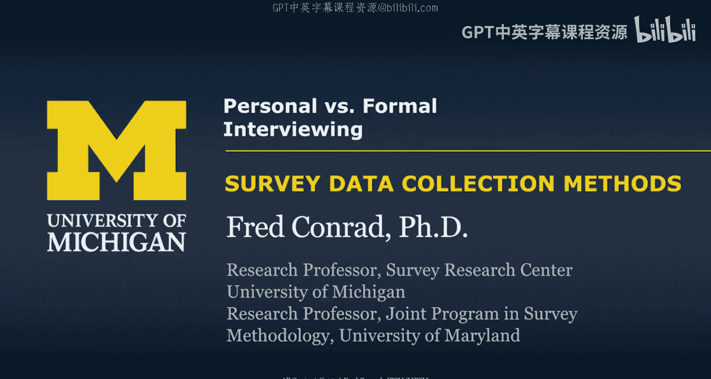

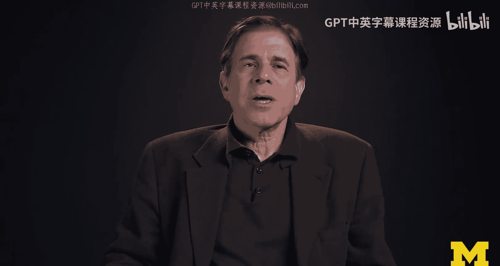

## 概述

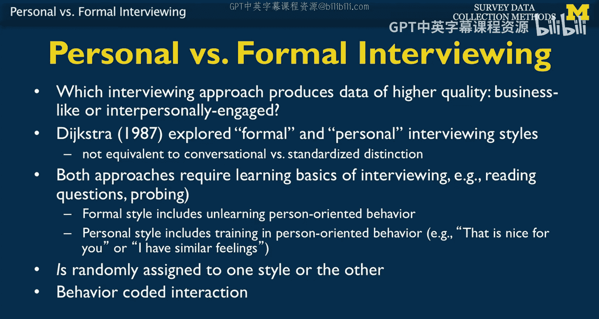

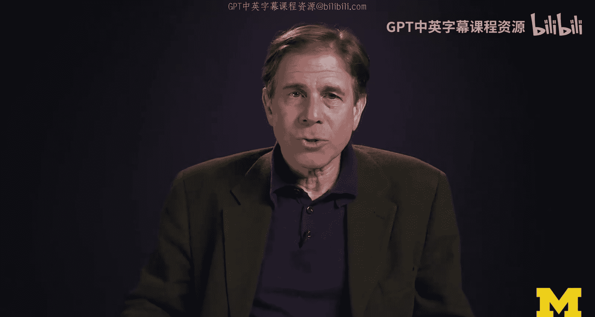

在本节中，我们将探讨访员在访谈中采用的两种不同风格：个人化风格与正式化风格。我们将分析这两种风格如何影响受访者提供的数据质量，特别是准确性和社会期望偏差。同时，我们将深入探讨“亲和力”这一核心概念，了解它如何建立以及它如何在不同敏感度的问题上影响受访者的回答。

---

## 个人化与正式化风格的定义

上一节我们讨论了标准化访谈与会话式访谈的区别。本节中，我们来看看访员风格的另一个重要区分：个人化风格与正式化风格。

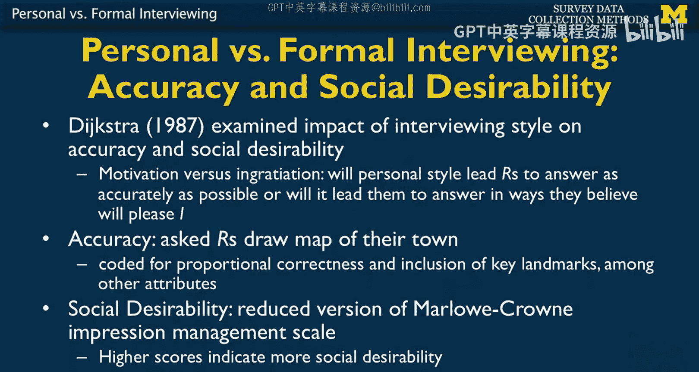

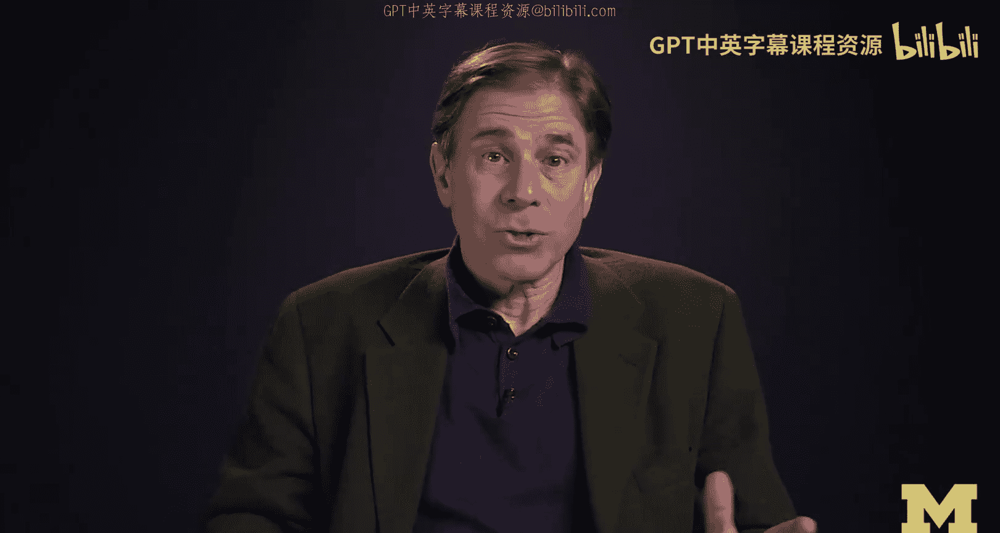

*   **个人化风格**：访员尝试与受访者建立个人联系，表现出人际互动中的投入感。访员可能会提供反馈，例如说“那对你来说真好”或“我也有类似感受”。
*   **正式化风格**：访员保持一种专业、公事公办的态度，不试图与受访者建立个人层面的连接。

需要强调的是，**个人化/正式化** 与 **标准化/会话式** 是两组相互独立的概念。一次访谈可以是正式但非标准化的（即不照本宣科但态度专业），也可以是会话式但非个人化的（即澄清问题含义但不建立个人连接）。

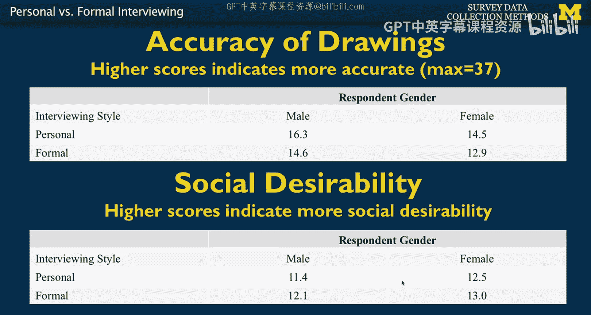

---

## 戴克斯特的研究：风格对数据质量的影响

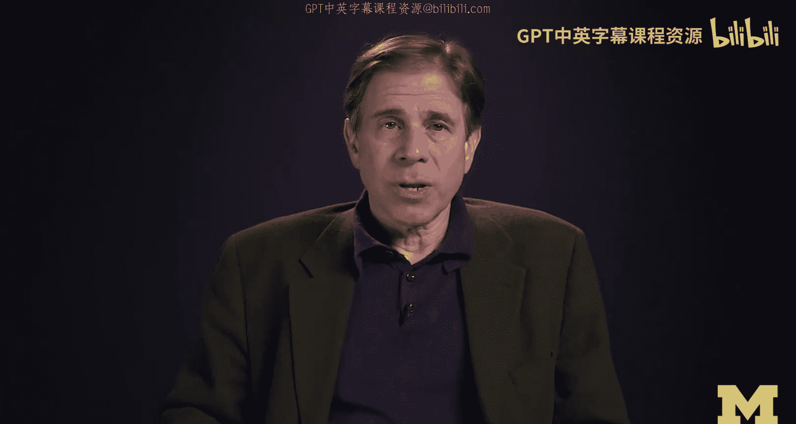

戴克斯特及其同事通过实验研究了这两种风格。在他们的研究中，访员被随机分配使用个人化或正式化风格。

以下是戴克斯特评估数据质量的两个主要维度：

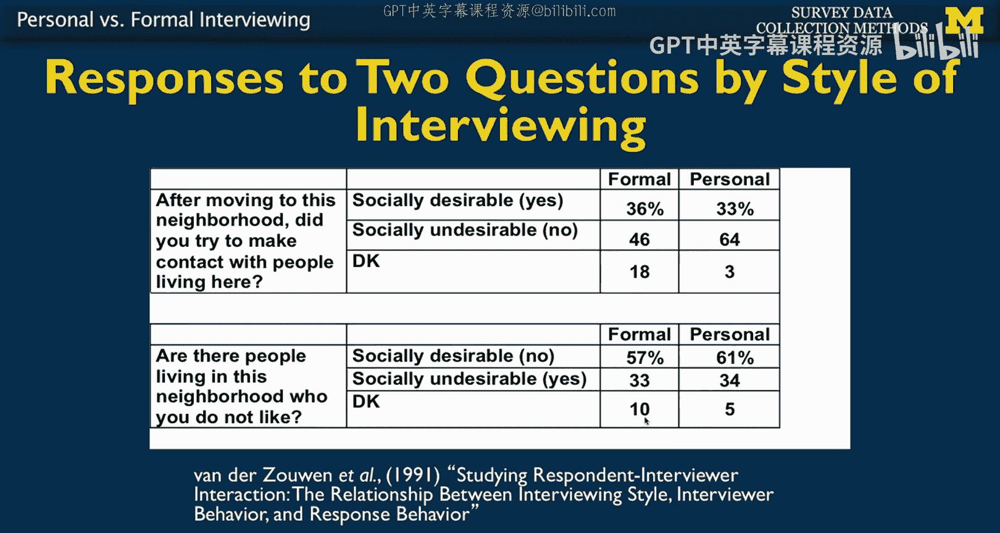

1.  **准确性**：通过要求受访者绘制家乡地图的准确度来衡量。公式可以表示为：
    `地图准确性 = (正确绘制的要素数量) / (地图总要素数量)`
    预测是，个人化风格能激励受访者更努力，从而提供更准确的地图。

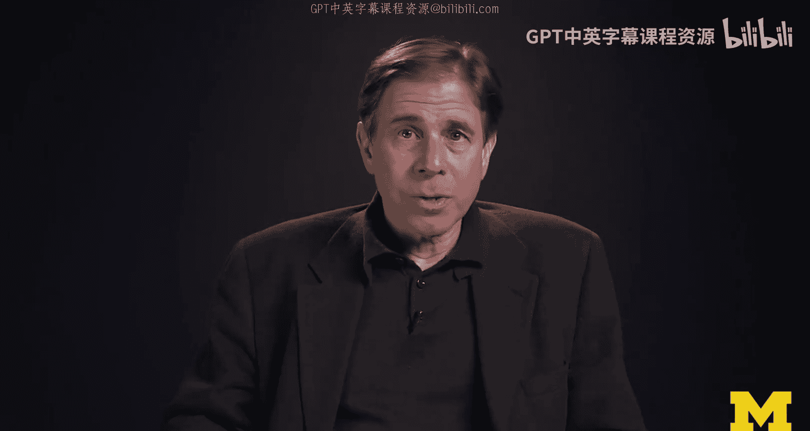

2.  **社会期望偏差**：通过简版的“马洛-克罗恩印象管理量表”得分来衡量。得分越高，表示受访者越倾向于提供符合社会期望的答案（即取悦访员）。担忧在于，个人化风格可能导致更高的社会期望偏差。

研究结果如下表所示：

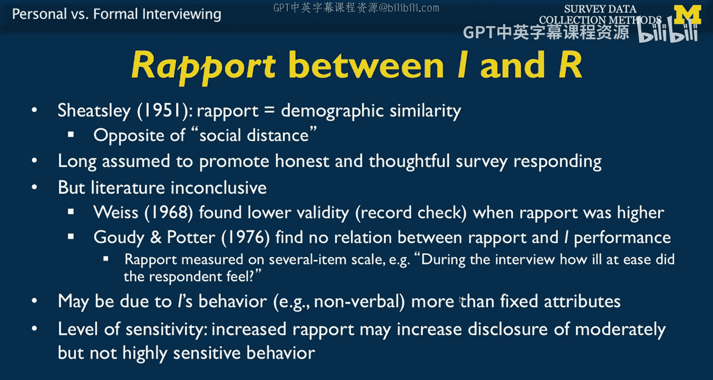

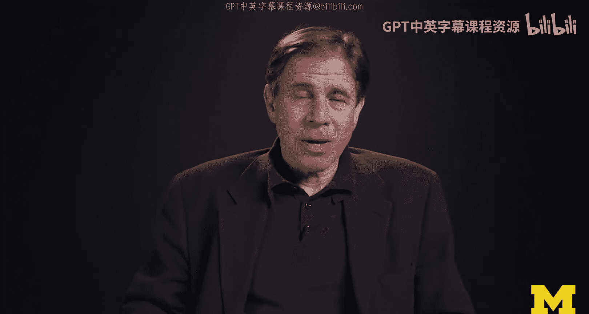

| 访谈风格 | 地图准确性（均值） | 社会期望偏差得分（均值） |
| :--- | :--- | :--- |
| **个人化** | **较高** | **较低** |
| **正式化** | 较低 | 较高 |

**结论**：个人化风格带来了更高的回答准确性，并且**没有**导致更高的社会期望偏差。实际上，在个人化风格下，受访者更愿意报告一些社会期望度较低的行为（即更诚实的答案）。

---

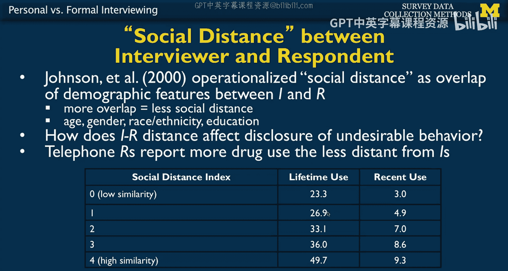

## 亲和力的作用与相关研究

个人化风格提升数据质量的机制，似乎在于建立了“亲和力”。亲和力是指访员与受访者之间建立的融洽、信任关系。

早期研究对亲和力的定义和效果莫衷一是。例如：
*   希普斯利认为亲和力源于**人口统计学上的相似性**（如年龄、种族、教育背景相近），这能减少社会距离，促进诚实回答。
*   但后续一些研究发现亲和力与数据质量关系不大，甚至可能损害准确性。

近期研究提供了更清晰的视角：

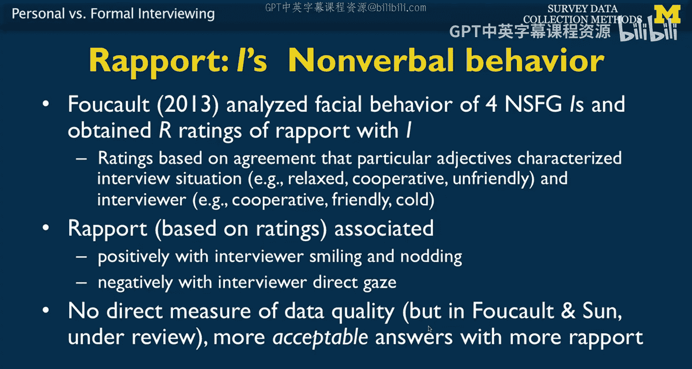

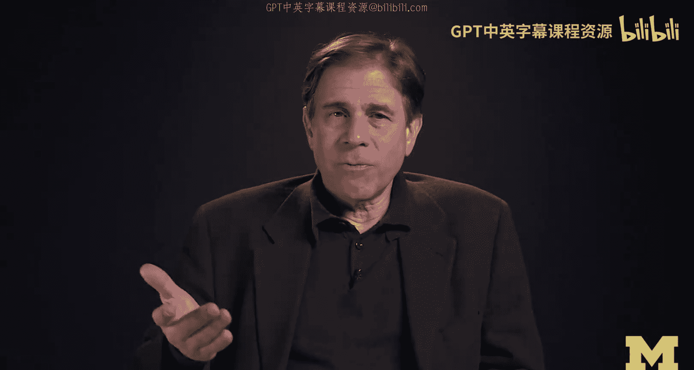

1.  **人口统计学相似性的影响**：约翰逊等人的研究发现，即使是在电话访谈中，访员与受访者在**年龄、性别、种族、教育**上的重叠度越高（社会距离越小），受访者披露不良行为（如吸毒）的比例就越高。这表明相似性可能促进更坦率的回答。

2.  **非语言行为的影响**：福考尔等人的研究发现，受访者感知到的亲和力高低，与访员的**非语言行为**显著相关：
    *   亲和力高时，访员**微笑和点头更多**。
    *   亲和力高时，访员**直接注视受访者的时间更少**。
    *   高亲和力也使得受访者的答案更符合问题格式要求，表明他们更努力作答。

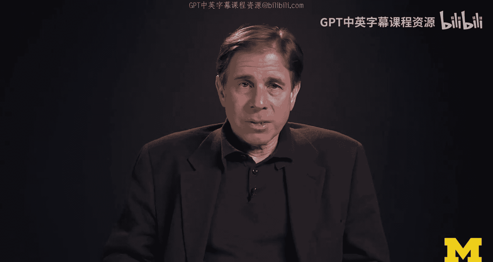

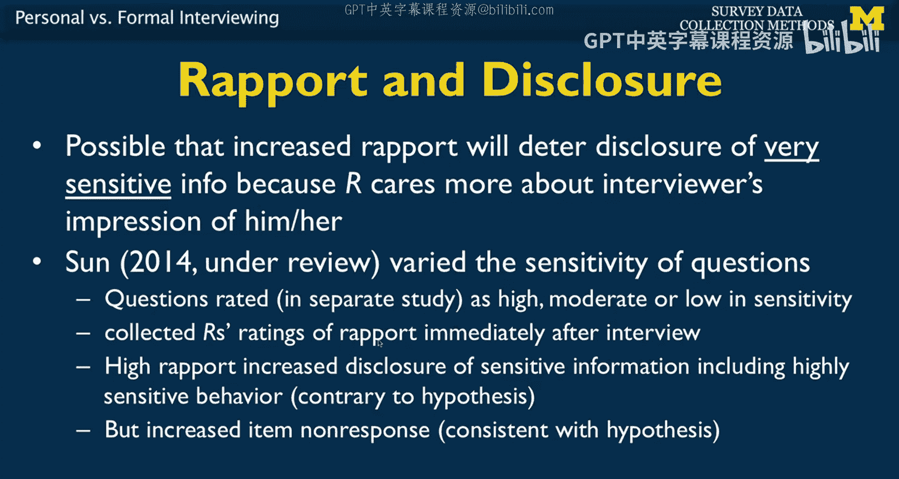

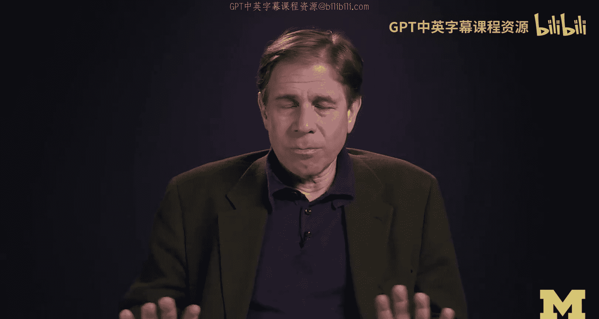

3.  **问题敏感度的调节作用**：孙的研究探讨了问题敏感度是否影响亲和力的效果。她将问题按敏感度分为高、中、低三级。
    *   **发现**：高亲和力促进了受访者对**中度和高度敏感信息**的披露。
    *   **但是**，对于高度敏感的问题，高亲和力也导致了更高的**项目无回答率**（即拒绝回答）。这可能是因为当受访者与访员关系较好时，更不愿意透露那些令自己蒙羞的信息。

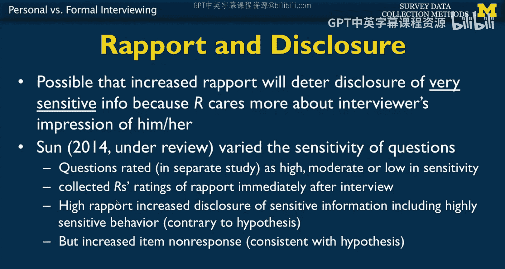

---

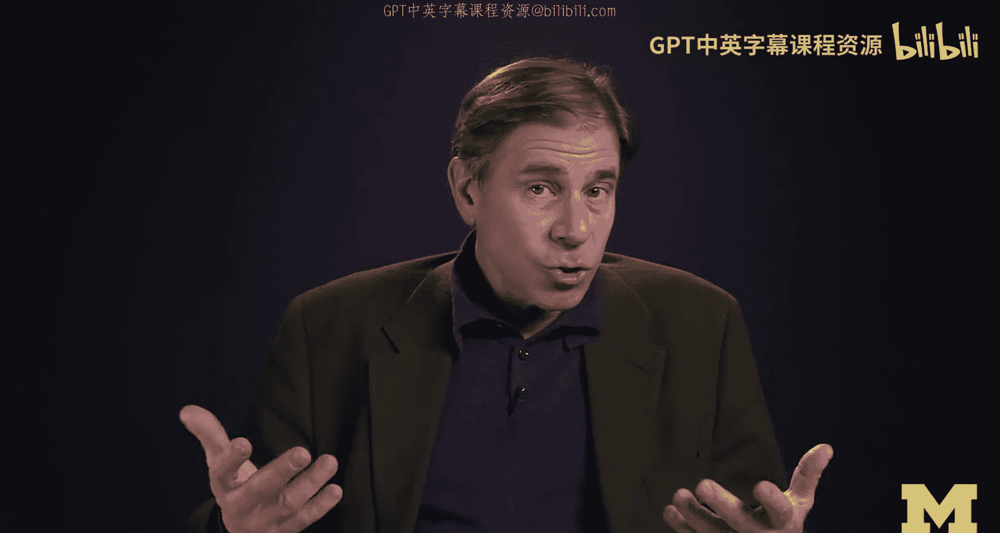

## 总结

本节课中我们一起学习了访员个人化与正式化风格的区别及其对数据质量的影响。

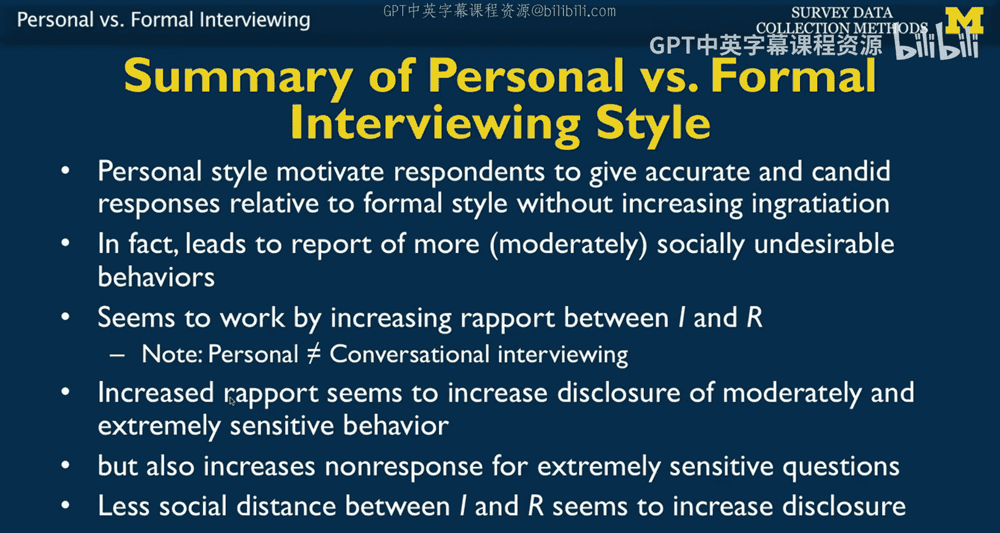

1.  **核心结论**：个人化风格（相对于正式化风格）能激励受访者提供更**准确**、更**坦率**的答案，且不会增加取悦访员的社会期望偏差。
2.  **作用机制**：个人化风格主要通过建立**亲和力**来提升数据质量。
3.  **亲和力的来源**：亲和力既可能来自访员与受访者之间的**人口统计学相似性**，也可能来自访员积极的**非语言行为**（如微笑、点头）。
4.  **复杂情况**：亲和力对数据质量的影响并非绝对正面。对于**高度敏感的问题**，高亲和力在促进部分人坦白的同时，也可能导致更多人选择**拒绝回答**。

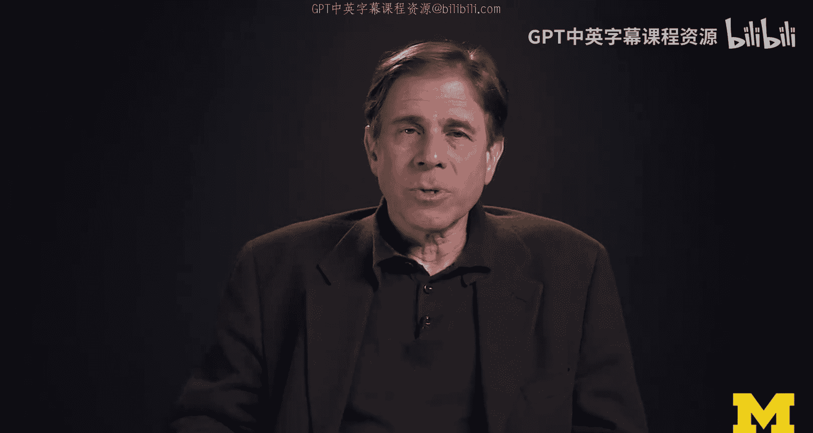

总而言之，访员的访谈技巧能够增加数据收集的价值，但其中也存在权衡。同时，访员也可能引入误差，即“访员效应”，这将是我们下一个主题的内容。