# 密歇根大学《调查数据收集和分析（2-6：方法、社调问卷设计、抽样、缺失数据、分析）｜Survey Data Collection and Analytics》 p28 27_3.3.1 访员行为变异.zh_en -BV1fw4m1e7Zh_p28-

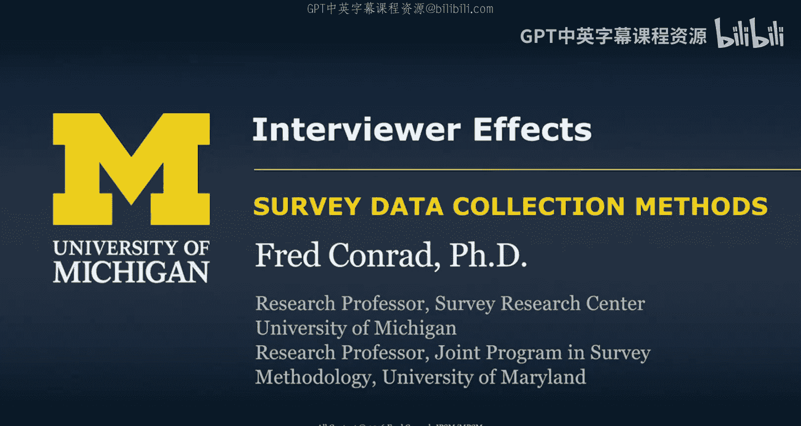

Welcome back， as we've been discussing， interviewers can add value to the survey enterprise in many ways。

 for example， interviewers increased response rates relative to self administered interviews。

Interviewers can explain the meaning of questions if the interviewing technique permits them to do that interviewers can conduct within household sampling。

 which is very difficult to do in self-addministered surveys and it goes on so there are many ways in which interviewers are a really good investment and produce higher quality data in the long run。

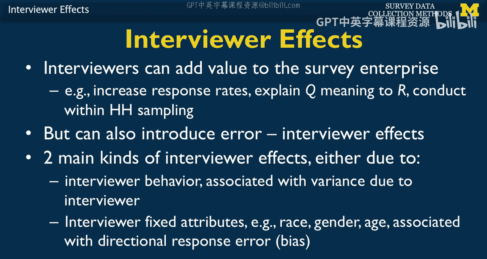

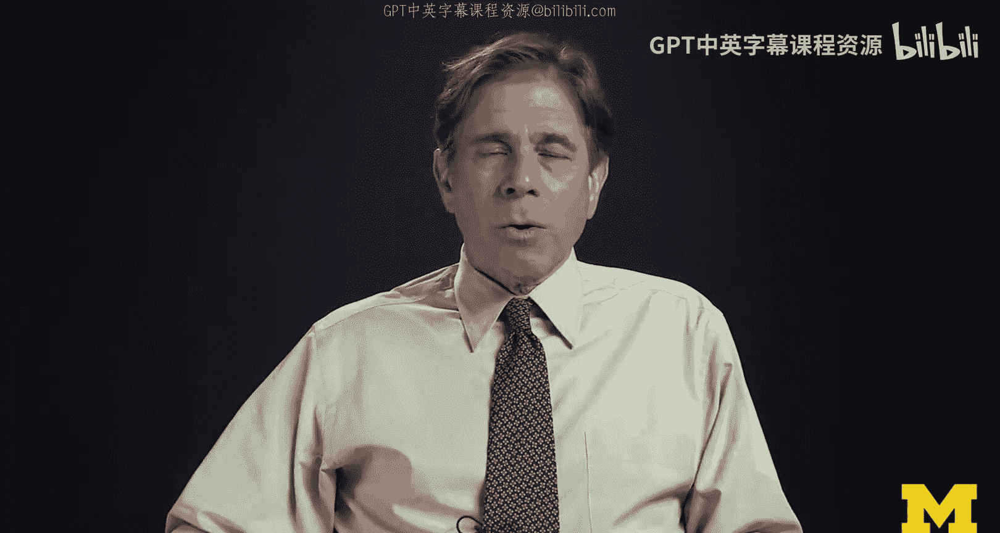

But they can also introduce error that isn't present in self adistered interviews。

 self administered surveys， and these are known as interviewer effects。

There really are two types of interviewer effects， each really with its own set of studies and a dedicated literature。

 one of them is due to interviewer behavior or so it seems。

 and it's associated with increased variance due to interviewers the other is due to interviewers' fixed attributes like race gender age and it's reflected by directional error or bias for example。

 more a profeminist responses to a question of a gender relevant question asked by female than male interviewers so the final topic in our discussion of interviews and interviewers is concerned interviewer effects and we'll turn first to those that are due to interviewer behavior and are reflected in interviewer variant。

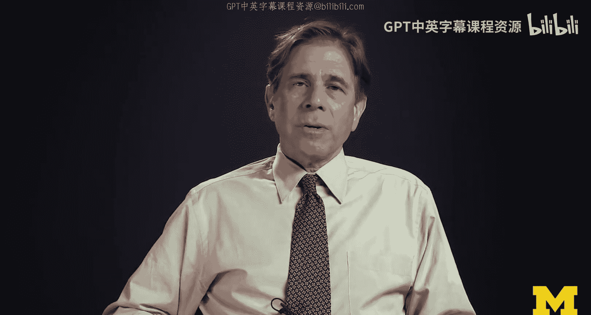

When interviewers are included as a factor or a term in the analysis of survey data。

 the variance that they contribute to total variance is attributed generally to differences in behavior between one interviewer and the next that is to how they administer the questionnaire so for example。

 one interviewer may elicit more strongly disagree responses to a question than another interviewer who may elicit more strongly agree responses than another interviewer So just to make this a little more graphical on the left is a sort of depiction of the true value being the red bullseye in that target and the black small circles being individual responses to a question asked by a number of interviewers and there's no apparent clustering the black circles seem to be distributed around the true value in a kind of random way but on the right again the red bullseye is the true value it's clear that there's clustering of responses the small。

By the different colorsSo the color coding is intended to represent interviewers so you can see that different interviewers are eliciting different ranges of answers from the respondents who they happen to interview and this is generally not something you would want to be happening the idea is that it shouldn't matter who asks the question so to the extent that different interviewers are eliciting different ranges of or different distributions of answers that's generally not a good indication about data quality。

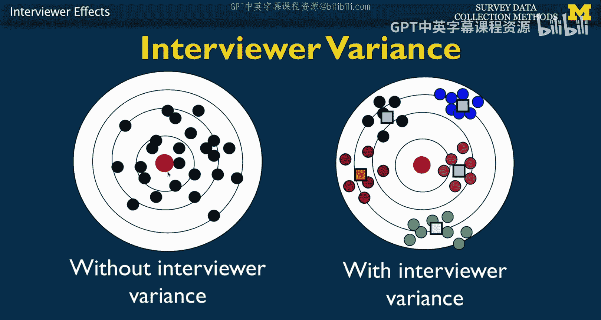

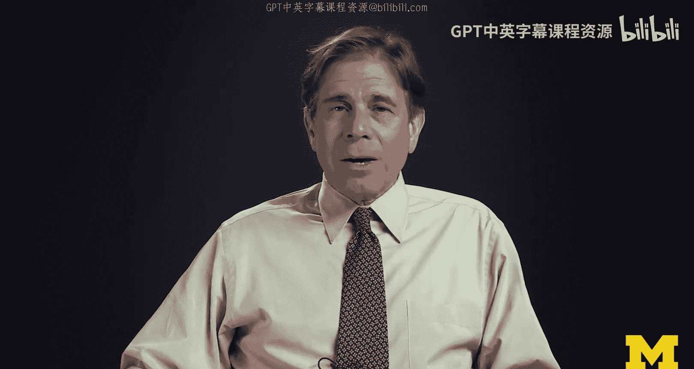

So how would you quantify this kind of clustering Leslie Kiish many years ago introduced the measure row int to capture what is essentially a correlation between interviewers and the answers that they elicit。

 this is sometimes referred to as the intratraclass correlation and it's conceptually kind of straightforward。

 there's a distinction between variance between interviewers。

 which is what you would hope you don't have very much of because you would ideally want very similar distributions of answers to a question elicited by all interviewers。

And within interviewer variant， which is generally fine。

 you would hope that a question is well enough designed that it can elicit a range of answers because if a question is eliciting the same answer from all respondents。

 it's generally not considered very very discriminating。

So row Int really looks at the between interviewer variant。

 the kind of the bad stuff over total interviewer variance。

 which is the sum of between and within interviewer variance。

 so you would like the between interviewer variant to be zero， but it never is， interviewers。

 no matter what their training tend to contribute some variance to the total variance and this type of analysis or or calculating row int really assumes that respondents have been randomly assigned to interviewers something this is called interpenetration。

If this isn't the case， then differences between interviewers in the variance of the responses they elicit could in fact be due to real differences between the respondents that they interview。

 but if there's random assignment， then we assume that the true values for the respondents interviewed by all interviewers is pretty much the same as the distribution of this true values over the cases assigned to each respondent are assumed to be the same one reason to measure Rowan in addition to just quantifying the clustering is it allows us to compute what are called design effects due to interviewers。

 which really is a way to get a handle on the extent to which interviewers are inflating overall variance and essentially reducing the confidence that we have in the estimates。

 so Rowan's been used studied by a number of researchers because interpenetration is required really requires a special design where respondents。

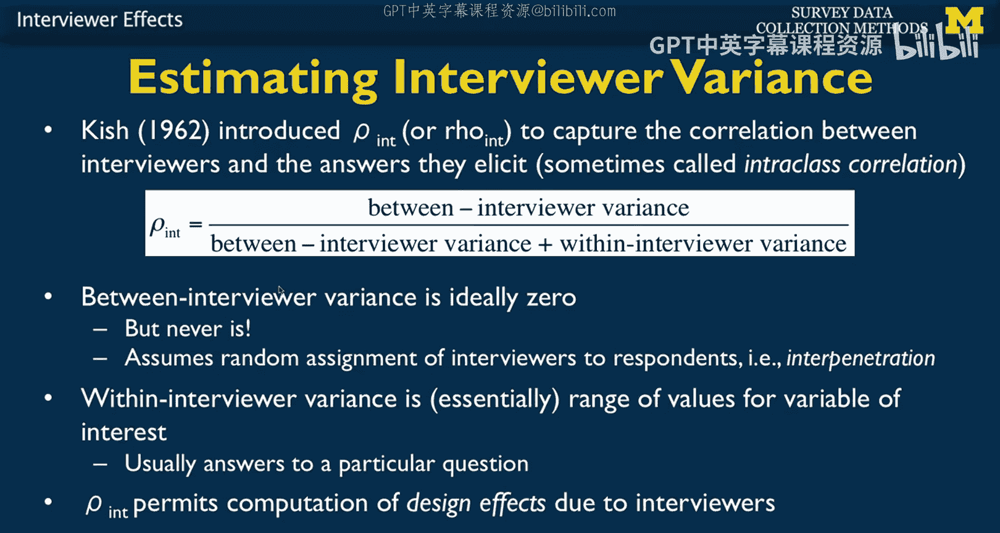

are randomly assigned to interviewers so you can't compute row int for every study that's conducted every survey that's conducted it really only is relevant if they're applicable if the survey isn't used as an interpenetrated design but one study that calculated row in for a number of different types of questions was done by Omercate and Campanelli and they found for example that 26% of the attitude questions asked had a significant row value and attitude questions with liquor scales。

 33% of them had a significant row int value 26% of the factual questions that were asked in the study also produced a significant row int and they actually were able to show that the clustering。

 the inflation of variance due to interviewers was about the same as geographical clustering and does a geographical clustering occurs in face to face interviews when interviewers are assigned respondents or obtained interviews from respondents。

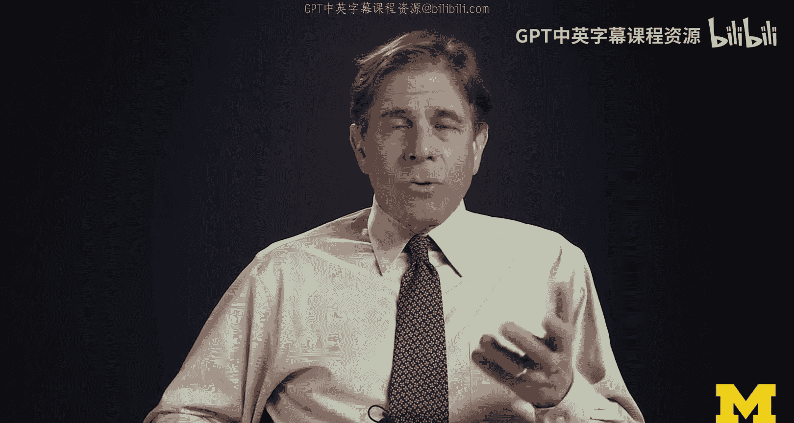

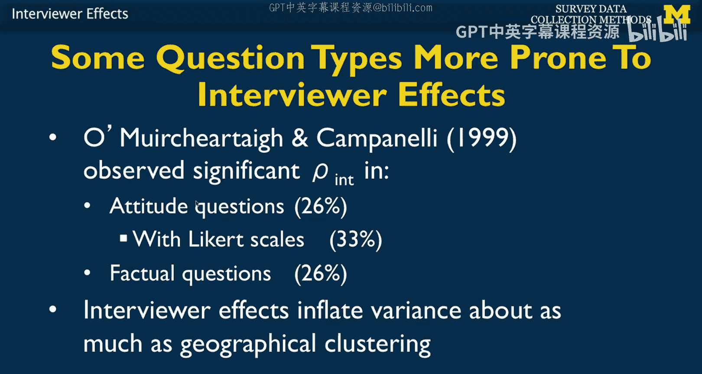

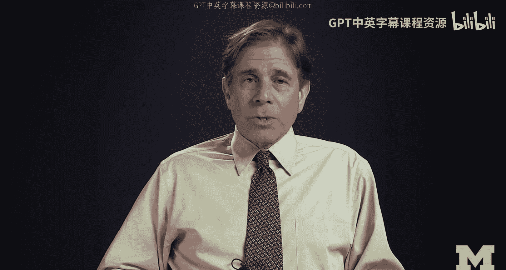

a particular small geographical region， and so it's not surprising that the answer to one interviewer elicits may differ from those and other interviewer elicits。

 but that effect， that kind of clustering is roughly the same as whatmercaane Campaneli found interviewers were contributing even within interpenetrated design Chanel and Croiter did a study that focused just on questions about crime and they looked at the interviewer effects for different types of questions as well they found that the interviewer effects were greater for sensitive to non-sensitive questions for non-fual or really attitudinal or opinion questions versus factual questions or behavioral questions。

For open questions rather than closed form questions。

 so questions that respondents were asked to answer in their own words rather than pick a response option to answer。

And for questions that they judged to be difficult rather than easy。

 they actually calculated an index of what they called harmful question properties。

 properties that led questions to be difficult or in some other way problematic and they found that the effects of interviewers increased as this harmful index increased as well to me this makes sense there's something about sensitive questions that might make them more。

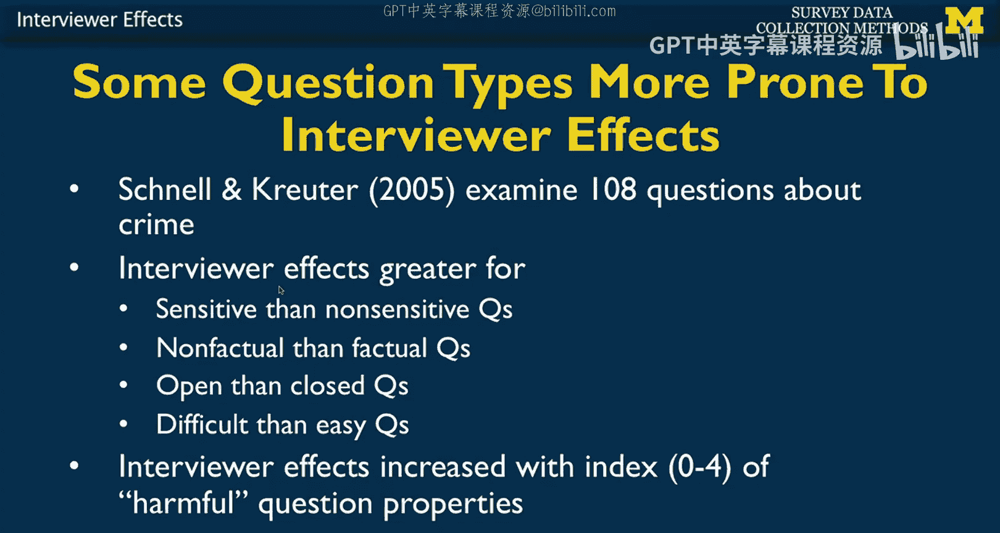

affected by interviewer behavior， I mean we've talked about the benefits of self-administ when collecting sensitive information。

 but if an interviewer is present， you can imagine that there's something about the way some interviewers ask those questions that's different from the way others ask those questions that would lead to a higher impact of interviewers on variants or attitudinal questions may be more。

sensitive to interviewer behavior and particularly if respondents haven't really thought a lot about a question and have the phrase is they don't have a crystallized opinion。

What the interviewer does when asking the question could well affect。

The answers in a way that's less so for factual or behavioral questions where respondents are clearer on what it is they've actually done。

Open then closed questions again， you can imagine that the way the interviewer perhaps prompts for additional information in open questions could differ from one interviewer to another and questions that are difficult versus questions that are easy could again be sensitive to interviewer involvement if interviewers。

 some interviewers try to help responds with a difficult task and some don't or they do this in different ways。

 so just on intuitive ground it seems that there is something about interviewer behavior that could be related to responsible for the size of row the size of the impact interviewers have on on variance。

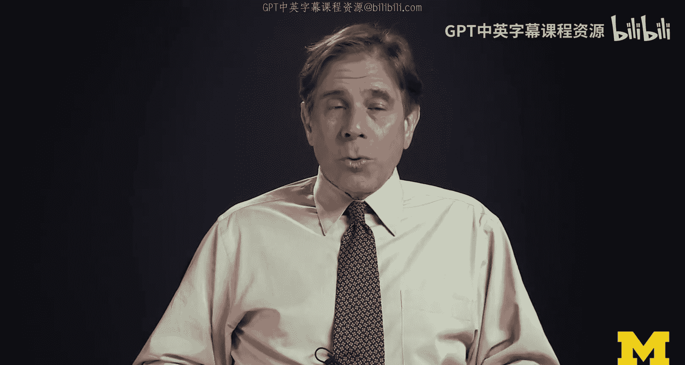

So a study by Manjoni Fowler and Lewis found evidence for a particular interviewer behavior that is closely related to Roe and the particular interviewer behavior was the way interviewers probed。

 as you'll recall from our discussion of standardized interviewing。

 non-directive or neutral probes are really the one part of that technique that allow interviewers to use their discretion and to decide whether to probe or which of the neutral probes available they should administer。

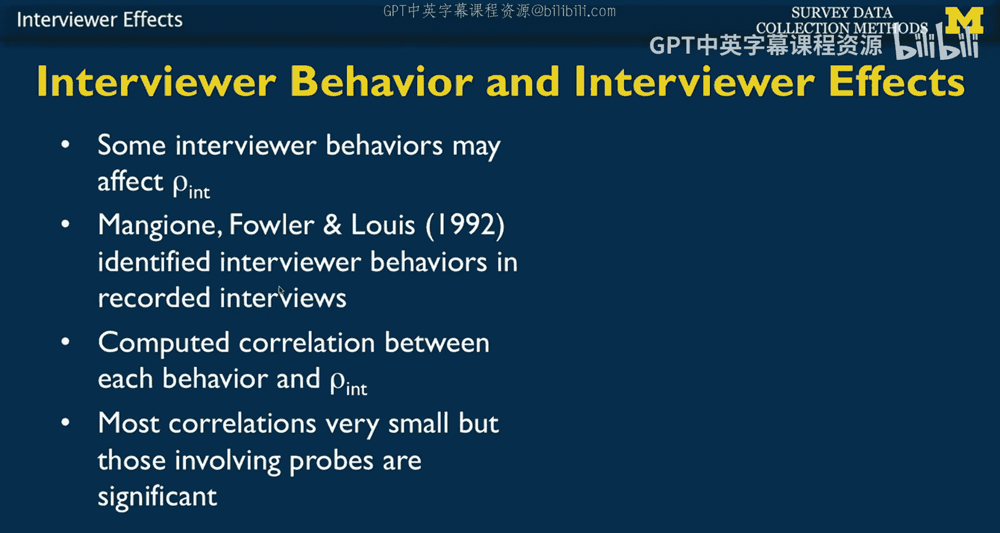

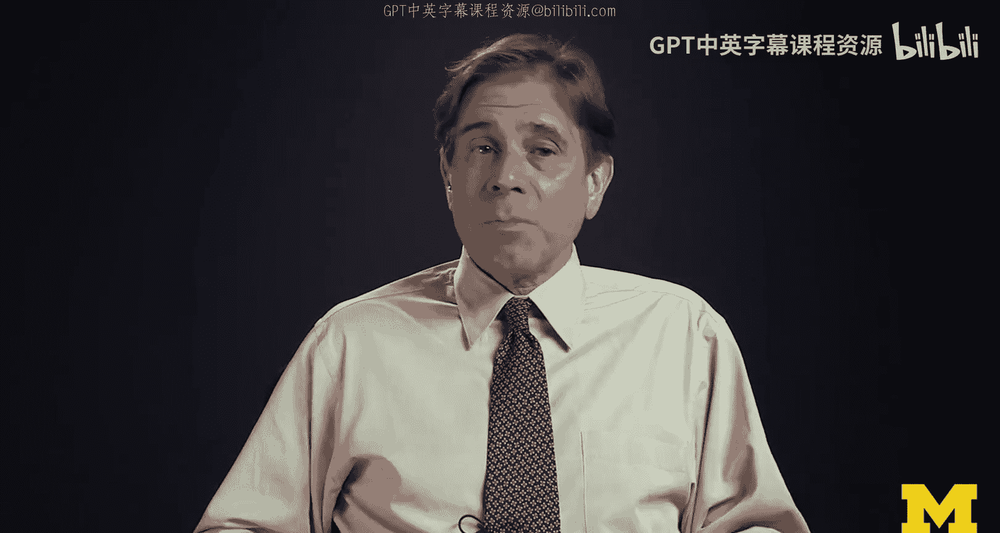

It could well be that it's that piece of its that amount of discretion that is actually responsible for interviewer variant。

 so what they found was they computed a correlation between rowe values and particular behaviors they had behavior coded audio recordings of these interviews。

 and here are the four behaviors that were significantly correlated with roe。

 so questions when interviewers correctly probed， questions when they incorrectly probe that they administered a directive probe were a leading probe questions where they fail to probe and then the fourth categories not really related to probes。

 this is recording error， so questions on which interviewers incorrectly entered the response。

 but the idea is that questions that require more probing require more discretion by the interviewer and so different interviewers will probe differently and this will inflate their impact relative to questions where there's less probing。

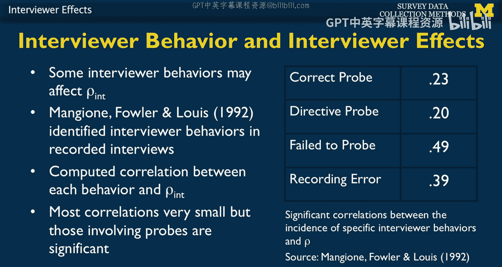

This is consistent with the idea that standardized interviewing by really narrowing the set of possible interviewer behaviors can reduce interviewers' impact on answers。

 or at least as measured by interviewer variants。

But that doesn't necessarily mean that alternative techniques。

 which may give interviewers other kinds of discretion will increase。

Their impact on answers or on interviewer variant As we discussed earlier。

 proponents of standardized interviewing have suggested that departure from the script increases interviewer variance in a recent study by West and his colleagues they looked at interviewer variant in standardized interviewing and conversational interviewing in facetoface interviews in a national sample study he was done in Germany and they found that conversational interviewing improved data quality in 25% of the questions very similar to the findings in studies we discussed earlier about the benefits of conversational interviewing for response accuracy or data quality but the proponents of standardization would argue well that increase in quality will come at the cost of increased interviewer variance but West and his colleagues found that in only 10% of questions did conversational interviewing increased interviewer variant so conversational interviewing improved data quality。

In substantially more questions than it inflated interviewer variance in and even when interviewer variance increased in conversational interviewing。

 it didn't offset the improved quality that came from the interviewing technique and that was explaining the meanings of questions。

 the intentions behind the questions Moreover they found that interviewer variant was similar between the two interviewing techniques and then finally they found that conversational interviewing led to more variance and duration remember in the studies we talked about it almost always led to longer interviews。

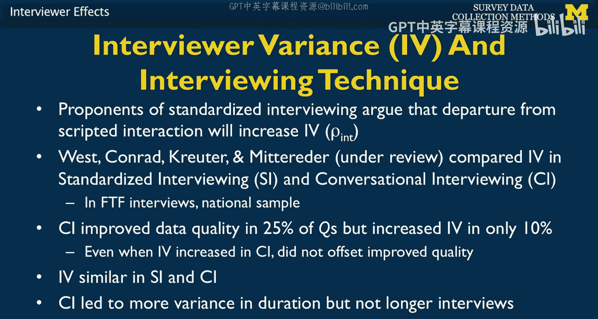

But actually in their study， it didn't lead to longer interviews overall。

 just more variation in the duration and so what this suggests is that conversational interviewing might be implemented。

Morevariably between interviewers， perhaps because more discretion is involved。

But that this is not increasing interviewer variance as the proponents of standardization were concerned would be the case。

So far， we've been talking almost entirely about the impact of interviewers on the accuracy or the quality of answers。

 and this is really a measurement issue or involves measurement error。

Interviewer effects measured by row can also be produced by affected by interviewer' ability to recruit participants to take part in interviews so this would really be a kind of non-response effect of interviewers or non-response origin of interviewer effects。

 so that what appears to be an effect due to measurement may actually reflect differences in recruiting by different interviewers that is different interviewers might recruit different types of respondents for whom the true value differs than other interviewers and this can happen despite an interpenetrated design where cases are randomly assigned to interviewers。

 if different interviewers are recruiting different responseents from those that have been assigned to them。

 we can see something thats really indistinguishable ordinarily from interviewer effects due to something about the way the questions are asked。

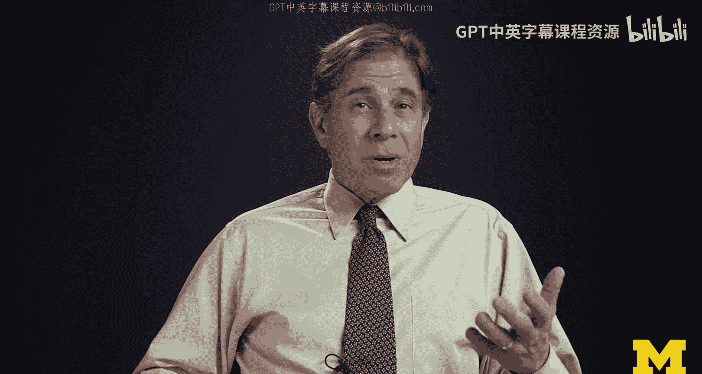

So West Ol。Demonstrated this phenomenon or confirmed that this is a real possibility using administrative records。

 which served as their true value so they could see where interviewer behavior was leading to departures from true value。

 to see if there were also interviewer effects that were due to nonresponse or differences in the true value of the respondents who were recruited。

And what they found was that for two questions， int was reliably different than zero。

 so they focused on those two to see what the records could tell them about the origins of those effects。

And questions were age when the respondent was married and age when the respondent was divorced。

Based on the records， what they found was that the effect for the question concerning age and marriage was due to measurement error。

 kind of the classic interviewer effect， there were errors in the answers they were eliciting differently for some interviewers than for other interviewers。

But for the other question， age at divorce。The effect was due to a significant non-resse error so they were able to confirm that the true values of those who were recruited by different interviewers actually differed。

 so in a way it kind of undermines the inter penetrationration。

 the random assignment of cases to interviewers。So essentially the reason there's an interviewer effect for the question about age of divorce is because some interviewers were recruiting younger respondents than other interviewers in effect undermines the interpenetration even though cases were randomly assigned to interviewers differential recruiting led to a different mix of true values for different interviewers so as I said earlier one reason to calculate R in addition to just quantifying clustering is to quantify the impact of interviewers on overall variance in the study so there's a measure that does this。

 it's called the design effect due to interviewers。

So the design effect due to interviewers is a measure of the extent to which interviewers increase the total error in the survey。

 so you can see that there really are two parts of the equation。

 the first is the number one which just represents the variance in a design where there are no interviewers or no clustering due to interviewers and we're just going to call that one and we want to know what additional variance can be attributed to clustering due to interviewers it has two parts to it row in which we've been discussing and M minus1 and we can just think of this as M where M is the average interviewer workloader。

 the number of interviews and the idea is that the more interviews any one interviewer conducts the greater the impact of their idiosyncrasies or the particular way they administer the questionnaire might be compared to one of their interviewer colleagues。

So the bigger the M， the greater the impact of any one interviewer。

 which is another way of thinking about this is by reducing the workload。

 the number of interviews that any one interviewer conducts the lower the impact of of any one interviewers so for a fixed budget it would be better from this perspective to have a larger number of interviewers each conduct a smaller number of interviews。

 there's a variance on the design effect which is called the design factor often abbreviated by the EFT and it's really just the square root of the design effect so instead of talking about variants we're talking about standard errors as I understand that they're really used interchangeably。

Having done this， having computed the design effect due to interviewers。

 we can calculate the effect of sample size， which is essentially the number of interviews that are conducted。

 the number of respondents divided by the design effect and what this is telling us is that we might have。

 for example，10 conducted 1000 interviews if the design effect is for example， 1。

26 you can sell by looking at the equation that we're going to have the effect of sample size is going to be smaller than the actual sample size of 1000。

 it's going to be turns out 793 and this is a way of saying that our confidence in the results is as if we conducted 793 interviews instead of1000 interviews so this is a useful set of statistics the one can calculate again。

 you can't calculate row int and therefore design effect due to interviewers and effective sample size in this way in most surveys because they don't。

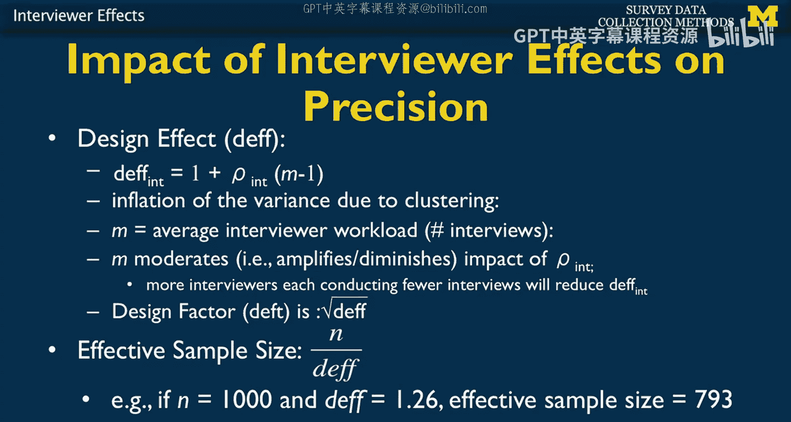

This random assignment of respondents to interviewers。

 but where you can this really I think makes tangible the impact of interviewers on overall precision of the survey estimates and I think you can see that here in this table which comes from paper by Groroves and Maggavy so that you can see that there's a row for average workload a row in the table that is and a row for row and row for design effect due to interviewers and what you can see is that the row value for the survey on the right is actually three times more than three times as big as the row value for the interview represented by the middle column point0067 versus 0。

0018 but if you look at at the bottom row， the design effect due to interviewers is about the same 1。

091。10。And this is because the average workload is different in the two cases。

 it's much smaller in the survey on the right， so while the row value。

 the clustering due to interviewers is much greater than the study in the middle health in America。

 that larger row value that the impact of clustering is diluted because the interviewers are conducting fewer interviews each。

 and so the result is that really about the same impact overall on overall variants due to interviewers。

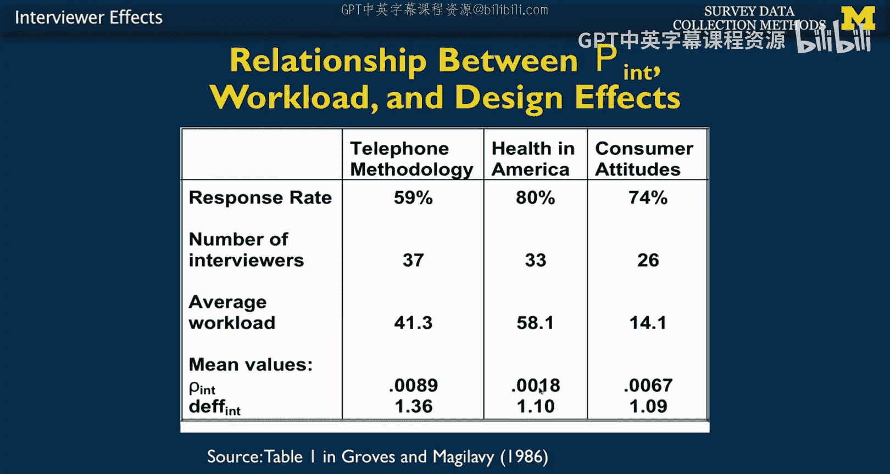

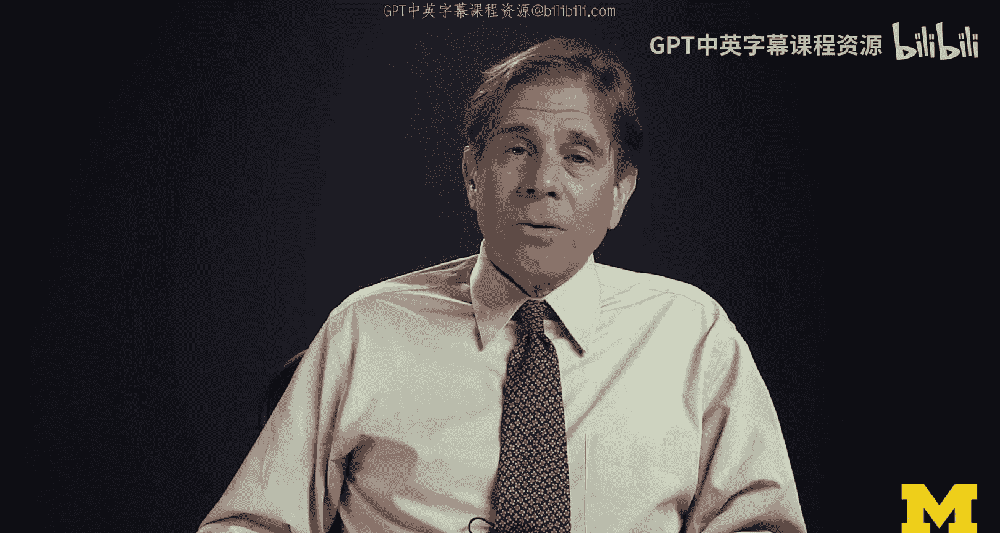

Interviewer related error is essentially a correlation between interviewers and the responses they elicit。

 again it shouldn't matter who asks the question， so any value greater than zero is undesirable。

 it suggests that there's variation in the quality of answers。

And Roe is a very useful statistic for these reasons。

Row is an indirect measure of data quality It's possible for row in to be low which would be good it would mean that with respect to variance。

 there's relatively little impact of interviewers， there's relatively little clustering but at the same time response validity could be low so that a low row doesn't necessarily lead to high quality data if for example all the interviewers consistently collect the wrong answer to a question so you can imagine that interviewers are asking respondents if they have recently visited a doctor and the surveys intended this is hypothetical of course but the surveys intended to measure visits to MDs medical doctors。

 but the interviewers either are not instructed to or maybe because of the constraints of the interviewing technique they're not permitted to define what the survey means by doctor so you can imagine many respondents might adopt a more inclusive definition and consider the question to also be about non-mD so like physician's assistance or die。

So what we would have with this example it would be a case in which。

Row is low because the interviewers are essentially administering this question the same way。

 they're not defining doctor， but data quality would be low because some percent of the responses would have included doctors that shouldn't have been included leading to answers that are greater than the true value。

Just to wrap up our discussion of interviewer effects that are due to interviewer behavior and reflected by increased。

Vance， the assumption anyway is that interviewer variance is related to interviewer behavior and the evidence from the study by Manjoni at all is that interviewer behaviors like probing which are less scripted than other behaviors may be related to the impact of interviewers on variance that is where questions with more probing lead to greater impact of interviewers。

 greater row values， but this doesn't mean that conversational interviewing where interviewers have a certain amount of discretion in what words to use when following up on questions doesn't mean the conversational interviewing involves higher interviewer variance produces higher interviewer variance than standardized interviewing in fact conversational interviewing。

Produced no greater interviewer variance in standardized interviewing in the study by We and his colleagues and it did improve response accuracy response quality row in can be inflated by non-response errors the study by Weston Olson showed so if interviewers recruit respondents whose true values differ from those recruited by other interviewers this can produce significant row values because the answers collected by one interviewer will differ from those collected by another not because of their behavior but because of the true values of the respondents they're actually interviewing the impact of row can be diluted by keeping the workloads small that is fewer interviewers per interviewer so as I said before if you have a fixed budget than having more interviewers conduct fewer interviews will reduce the impact of rowe on the design effect due to interviewers。

And then finally， row int is generally not a measure of response accuracy。

 it's a measure of variance， and so it's an indirect measure of data quality to the extent that one can look at response accuracy。

 which is often difficult to do， requires records or some other external measure of the truth。

 but to the extent that one can do that， one gets a more direct sense of how interviewers are affecting the quality of data。

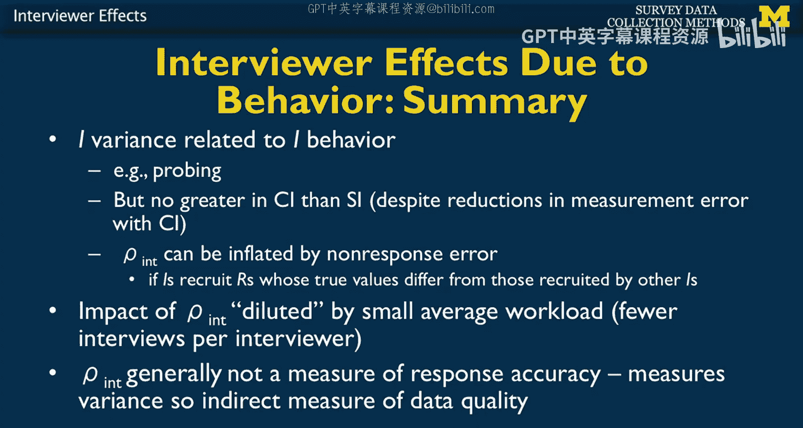

So that concludes our discussion of the first type of interviewer effect that interviewer effects due to behavior reflected。

Interviewer behavior reflected。In interviewer variance。

 what we'll turn to next is interviewer effects that are due to fixed or enduring characteristics of interviewers like race。

 gender， and age。