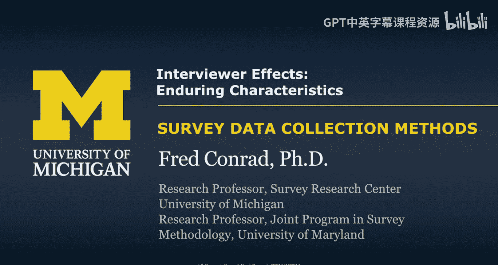
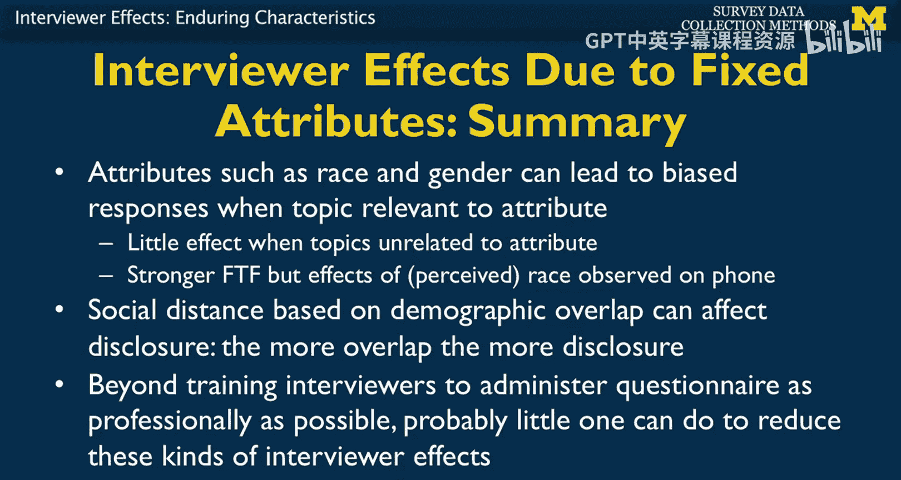

# 密歇根大学《调查数据收集和分析（2-6：方法、社调问卷设计、抽样、缺失数据、分析）｜Survey Data Collection and Analytics》 p29 28_3.3.2 访员固定属性偏倚.zh_en -BV1fw4m1e7Zh_p29-

In the last segment， we talked about interviewer effects that are reflected by increased interviewer variants。

 and we saw that this seemed to be due to interviewer behavior。

 such as when and how effectively interviewers probed the one aspect of standardized interviewing that's not standardized。

We now turn to the other type of interviewer effect in the methodology literature。

 namely differences in response distributions due to interviewers enduring or fixed characteristics such as race and gender。

A well-known study of genderder of interviewer was done by Kana Mcauley。

 and they found that both male and female respondents gave more egalitarian answers to female than male interviewers。

 egalitarian answers to questions that concerned gender somehow。

But that the male and female respondents showed the effect on different。Survey items in particular。

 more men reported sharing childca when the interviewer was female。

 more women supported feminist policy when the interviewer was female。

There was no impact of interviewer gender when the topic of the question was not relevant to gender。

 so this effect showed up just for questions that concerned gender somehow。

Another study by Huty and colleagues report a number of gender of interviewer effects into pre election surveys。

In this case， male and female respondents showed the same gender of interviewer effects。

 so you can see those here in this table， questions that produce gender of interviewer effects。

 namely differences between answers to female and male respondents on a ten0 point scale included feminist identity。

 egalitarian roles， such as childcare and who does the housework， prochoice。

 pro affirmative action among others。So it can make quite a difference whether the interviewer is male or female for questions again。

 for which gender is relevant。Race of interviewer effects are analogous to gender of interviewer effects in that they're only observed for questions for which race is relevant and they're observed typically for face to face interviews。

 although race of interviewer has been shown to affect responses to questions about race over the telephone these results from Hatet and Schumman illustrate what we mean by race of interviewer effects in this case the responsesents。

Were white as you can see when the interviewers were black。

 more respondents endorsed the particular position than when the interviewers were white。

 so for example， more respondents said they would not mind if a relative of theirs married a Negro when the interviewer who asked the question was black than when the interviewer was white or more of these white respondents indicated they believed Negro and white students should go to the same school。

Substantially more respondents indicated they would not be disturbed if a Negro of the same class moved into the block they lived in when the interviewer who asked this question was black and when the interviewer who asked it was white。

And more respondents indicated they believed Negro and white children should play together freely when the interviewer who asked the question was black than when the interviewer was white。

A similar pattern is shown in a study by Schumman and Converse for black respondents。

 more of these respondents indicated they could trust white people。

 trust most whites when the interviewer asked the question was white。

 and when the interview were asked it was black。Or more of these respondents said yes。

 when asked if Negro parents work best with a Negro teacher。

 fewer respondents said yes when the interviewer who asked the question was white and black。

And fewer respondents named only black entertainers when asked who their favorite entertainer was if the interviewer who asked the question was white then black Now the first two of these effects are probably due to a kind of social desirability。

 a desire to answer the question in a way that these respondents believe would be less offensive to or would please the interviewer given the interviewer's race。

 the third of these is the kind of effect that's often attributed to kind of a priming or activation of stereotypes and beliefs。

 so just seeing a black interviewer's face may bring to mind black entertainers more than seeing a white interviewers' face and so it could be that this is not about social desirability at all。

 this third effect， but really just the examples of entertainers that are brought to mind by the attributes of the interviewer。

As the question。So teasing apart these effects that are due to social desirability and due to kind of priming or activation is complicated。

 but some progress is made in a study by Creson and Cooper in which they had interviewers asked racially relevant questions either in face to face interviews or in video recorded interviews。

 so they were live and recorded。They call the video recorded interviews video acasie。

 so this allows one to compare social desirability and live interviews to stereotype activation in video recorded interviews the pattern of results they report is complex。

 but it does help us distinguish between the two types of the two origins of this kind of interviewer effect for example。

 they reported that African American respondents reported less liberal racial attitudes to white than black interviewers。

In live interviews， as we would expect consistent with the two studies we've just talked about。

 but also in recorded interviews， so the first of these effects is probably a social desirability effect。

 the second of these really can't be social desirability because the interviewers are recorded and the respondents wouldn't be motivated to answer in a way that pleases the recorded interviewers。

But it could be much like we saw with the virtual computer animated interviewers in our discussion of audio Cassie it could be that the social presence of the recorded interviewers triggers the same kinds of reactions that live interviewer does white respondents reported more conservative racial attitudes to black than white recorded interviewers this too was attributed to stereotype activation。

 but the pattern is in the opposite direction so if the pattern were in the same direction as that shown by the African- Americanican respondents then these white respondents would have reported less conservative racial attitudes to black than white recorded interviewers but the author suggested that this is a case in which the。

The black recorded interviewers' face served to prime existing attitudes about African Americans。

 which these white respondents。Truthfully， faithfully reported。

 presumably because they were not inhibited， they were not inclined to present themselves in a favorable light to a video recorded interviewer。

So these patterns may seem or the interpretation of these patterns may seem somewhat ad hoc。

 but really if you step up a level， they all demonstrate。

 all these results demonstrate that the respondents are highly sensitive to racial attributes of interviewers。

 whether live or recorded and this study helps distinguish between the different origins for this kind of effect。

Now we focused almost entirely on face to face or at least interviews in which facial features are visible。

 name we recorded video recorded interviews， what about telephone interviews is it possible that there are race of interviewer effects on the telephone the answer is yes。

 just one example comes from a study by Davis who examined race of interviewer effects in the 1984 national black election study。

 this was a telephone survey of African- Americanican respondents。

 there were 48 white interviewers and 27 Africanam American interviewers the effect that demonstrates a race of interviewer effect。

 the finding which demonstrates a race of interviewer effect。

Is a little bit of a kind of second order effect， it's a correlation between the answers to two questions。

 a question about racial consciousness and support for Jesse Jackson。

 who was the first kind of viable African American candidate for president for the Democratic Party's nomination for president in the 1980s。

And the finding was that the correlation between these two items was higher， not high。

 but higher when the interviewer was African American than when the interviewer was white。

 and so the idea is that a respondent，would be more likely or more willing to report being both a high in racial consciousness。

 an African-am Americanic respondent， report being high in racial consciousness and at the same time supporting Jesse Jackson as as if with white interviewers。

 these Africanam Americanican respondents were moderating the impression they gave to the interviewers again。

 this is on the telephone where the only information about the interviewer's ethnicity or race is communicated through voice。

So one study that bears on the issue of how accurately do respondents classify the race of the interviewers who are speaking to them on the phone was done by Davis and Silver and they found first of all that respondents are actually can be quite inaccurate。

 their ability to judge race correctly varied between 14% quite poor and 82% quite good The subject finding was that black respondents correctly answered fewer knowledge questions。

 political knowledge questions when they perceived the interviewer asking the questions on the phone to be white than when they perceived the interviewer to be black the authors attribute this to what's known as stereotype threat which is the tendency for minority students to perform worse on standardized tests than white students because they're exerting so much effort and investing so much tension in disconfirming the negative stereotypes that they believe others ascribe to them namely that they'll perform poorly。

 they work hard to disconfirm that as a result。Are distracted from the task and end up performing poorly。

And the authors argue that knowledge questions which are relatively common on surveys。

 particularly political surveys， are very close to standardized tests and so could trigger a stereotype threat so the point is the black respondents perform worse when they believe the interviewers to be white。

And this was determined through questions by the researchers about what race do you think the interviewer is？

But when the authors took into account the interviewer self reported race， this effect this。

Reduced performance when black respondents thought the interviewers were white， went away。

 and so this suggests that while respondents may find it hard to not classify interviewers race on the basis of what's on the phone。

 they're not very good at it and so they may react accordingly。

 but they're actually incorrect in the judgments that are triggering these behaviors。

One other type of effect that can involve race is we've already talked about and its social distance in which that's defined as the match between attributes。

 the attributes of two people and so in this case the attributes between the interviewer and respondents。

 and as you'll recall what Johnson and his colleagues found was that the respondents were more likely to report drug use。

 the more attributes they shared with the interviewer， including race and ethnicity。

 the study too was conducted on the telephone。This is just another indication that respondents are sensitive to race as well as other enduring attributes of the interviewers。

Johnson and his colleagues showed that。The more attributes the interviewers and respondents shared with each other。

 the more drug use respondents reported both lifetime and recently。

 and so these attributes include race and ethnicity。

 so this is just one more indication that respondents。

 even on the telephone are quite sensitive to the attributes that they at least believe are communicated through the voice and speech of the interviewer。

So to summarize our discussion of interviewer effects that are due to fixed attributes。

Such as race and gender。These attributes matter to the extent that the questions concern those attributes and when they do。

 answers can be quite biased， so for example， more respondents reported being prochoice in questions about abortion when asked by female than male interviewers and these kinds of effects are stronger in face to face than telephone interviews。

 but they are observed in telephone interviews， at least they're observed to the extent that respondents perceptions of the interviewers' attributes。

 are accurate。As we just reviewed， social distance based on demographic overlap can affect disclosure。

 also when communicated over the phone， the more overlap， the more disclosure。

So respondents really do detect these and attend at some level to these attributes when formulating their answers。

Beyond training interviewers to administer questionnaires as professionally as possible。

 there's probably little one can do to reduce these kinds of interviewer effects of the source。

 although they can be addressed analytically。

So to summarize our entire discussion of interviews and interviewers。

 we first talked about interviewers in their role as recruiting units。

 obtaining interviews and also selecting respondents from within the household interviewers' ability to obtain interviews can be affected by how they interact with sample members and what their vocal attributes are like。

With respect to selecting respondents within the household。

We discussed the way particular selection procedures lead to more and less representative samples。

We also discussed interviewing technique and found that this can have a large effect on the quality of answers in particular response accuracy。

 and it may do this without increasing or affecting interviewer variant。

We spent considerable time looking at the comparisons between conversational and standardized interviews where we saw that conversational interviewing can substantially increase response accuracy。

 but the tradeoff is that this increased accuracy takes more time the interviews are longer it takes more time to collect more accurate data interviewer variance is about the same in conversational interviews as it is in standardized interviews。

And in the last two segments we've talked about interviewer effects。

 both due to interviewer behavior and interviewer attributes。

 the main point is that interviewer effects can add error to the survey estimates。But overall。

 interviewers continue to add value to the survey enterprise by increasing response rates。

 clarifying question meaning， and motivating respondents and keeping them on task。

In our next and final lesson， we'll turn to new modes of data collection such as mobile web and SMS and also examine the potential for using new data sources such as social media in place of conventional survey responses。

