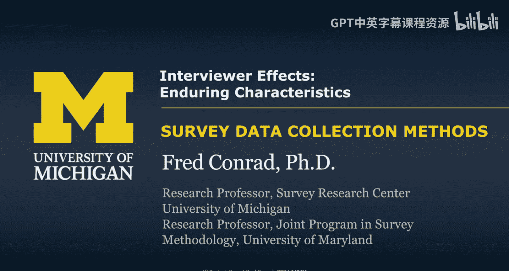
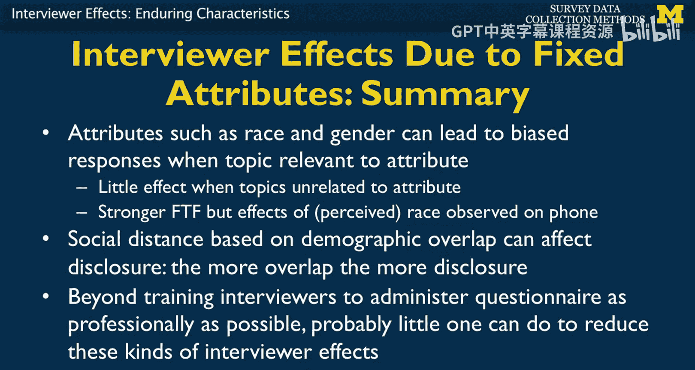

# 密歇根大学《调查数据收集和分析》：2-6：访员固定属性偏倚

## 概述
在本节课中，我们将学习调查数据收集中的另一种访员效应——访员固定属性偏倚。我们将探讨访员的种族、性别等固定特征如何影响受访者的回答，并了解这些效应在不同调查模式（如面对面、电话）中的表现。

---

在上一节中，我们讨论了由访员行为差异（如追问时机和效果）所反映的访员效应。我们看到，这种效应似乎源于访员行为，尤其是在标准化访谈中未被标准化的部分。

现在，我们转向方法论文献中提到的另一种访员效应，即由于访员持久或固定的特征（如种族和性别）而导致的回答分布差异。

### 性别效应研究
一项关于访员性别效应的知名研究由卡娜·麦考利等人完成。他们发现，无论男性还是女性受访者，在面对女性访员时，都会给出比面对男性访员时更为平等的答案。这里的“平等答案”特指那些与性别相关的问题。

具体而言，当访员为女性时，更多男性报告会分担育儿责任。当访员为女性时，更多女性支持女权主义政策。当问题主题与性别无关时，访员的性别则没有影响。因此，这种效应仅出现在与性别相关的问题上。

另一项由赫蒂及其同事进行的研究报告了选举前调查中的多种访员性别效应。在这种情况下，男性与女性受访者表现出相同的访员性别效应。以下是产生访员性别效应的问题示例，即受访者对女性和男性访员的回答在十分制量表上存在差异，这些问题包括：女权主义身份认同、平等角色（如育儿和家务分工）、支持堕胎权、支持平权法案等。因此，对于与性别相关的问题，访员是男性还是女性确实会造成显著差异。

### 种族效应研究
访员种族效应与性别效应类似，它们仅在问题与种族相关时被观察到，并且通常在面对面访谈中出现。尽管有研究表明，在电话调查中，访员的种族也会影响关于种族问题的回答。

以下哈特和舒曼的研究结果说明了我们所说的访员种族效应。在本案例中，受访者为白人。如图所示，当访员是黑人时，更多受访者赞同特定立场；而当访员是白人时则较少。例如，当提问的访员是黑人时，更多受访者表示不介意自己的亲属与黑人结婚；更多白人受访者表示相信黑人和白人学生应该上同一所学校。当提问此问题的访员是黑人时，表示不会因同阶层的黑人搬入其居住街区而感到困扰的受访者数量，远多于访员是白人的情况。当提问的访员是黑人时，更多受访者表示相信黑人和白人儿童应该自由地一起玩耍。

舒曼和康弗斯的一项研究显示了黑人受访者中类似的模式。当提问的访员是白人时，更多受访者表示可以信任白人、信任大多数白人。当被问及黑人父母是否与黑人老师合作最好时，如果提问的访员是白人，回答“是”的受访者较少；如果访员是黑人，则较多。当被问及最喜欢的娱乐明星是谁时，如果提问的访员是白人，只提及黑人明星的受访者较少；如果访员是黑人，则较多。

前两种效应可能源于一种社会期望偏差，即受访者希望以他们认为能减少冒犯或取悦访员（考虑到访员的种族）的方式来回答问题。第三种效应通常被归因于一种启动效应或刻板印象与信念的激活。仅仅是看到黑人访员的脸，可能比看到白人访员的脸更能让人联想到黑人娱乐明星。因此，这第三种效应可能与社会期望无关，而仅仅是访员特征所引发的联想示例。

### 效应来源的区分
区分源于社会期望的效应和源于启动或激活的效应是复杂的。克雷森和库珀的一项研究在这方面取得了一些进展。他们让访员在面对面访谈或视频录制访谈中询问与种族相关的问题。他们将视频录制访谈称为“视频ACASI”。这使得我们可以比较面对面访谈中的社会期望效应与视频录制访谈中的刻板印象激活效应。

他们报告的结果模式很复杂，但确实有助于我们区分这类访员效应的两种不同起源。例如，他们报告称，在面对面访谈中，非裔美国人受访者对白人访员报告的种族态度不如对黑人访员时自由，这与我们刚讨论的两项研究结果一致。但在录制访谈中也出现了这种情况。第一种效应可能是社会期望效应。第二种效应则不太可能是社会期望，因为访员是录制的，受访者没有动机去取悦录制的访员。但这可能很像我们在讨论音频ACASI时看到的虚拟电脑动画访员的情况，录制访员的社会存在可能触发了与真人访员相同的反应。

白人受访者对黑人录制访员报告的种族态度比对白人录制访员时更为保守。这也被归因于刻板印象的激活，但模式方向相反。如果模式与非裔美国人受访者显示的方向相同，那么这些白人受访者应对黑人录制访员报告的种族态度比对白人录制访员时更不保守。但作者认为，这是一个黑人录制访员的面孔启动了这些白人受访者关于非裔美国人的现有态度的案例，他们真实、忠实地报告了这些态度，大概是因为他们不受抑制，没有动机在视频录制的访员面前展现自己好的一面。

这些模式的解释可能看起来有些特殊，但如果你提高一个层次来看，所有这些结果都表明，受访者对访员的种族属性高度敏感，无论是真人还是录制的。这项研究有助于区分这种效应的不同起源。

### 电话调查中的种族效应
目前我们几乎完全集中在面对面或至少是面部特征可见的访谈上，比如录制的视频访谈。那么电话访谈呢？电话调查中是否存在访员种族效应？答案是肯定的。

一个例子来自戴维斯的一项研究，他考察了1984年全国黑人选举研究中的访员种族效应。这是一项针对非裔美国人受访者的电话调查，共有48名白人访员和27名非裔美国人访员。证明存在访员种族效应的发现是一种二阶效应，即两个问题答案之间的相关性：一个关于种族意识的问题，另一个关于对杰西·杰克逊（1980年代民主党总统提名中第一位有竞争力的非裔美国人候选人）的支持。

研究发现，这两个项目之间的相关性在访员是非裔美国人时比访员是白人时更高（虽然不是很高）。其观点是，受访者更可能或更愿意同时报告高种族意识和支持杰西·杰克逊。而对于白人访员，这些非裔美国人受访者会缓和给访员留下的印象。这是在电话调查中发生的，关于访员族裔或种族的唯一信息是通过声音传达的。

### 受访者对访员种族的感知准确性
戴维斯和西尔弗进行的一项研究与受访者在电话中如何准确分类访员种族的问题相关。他们发现，首先，受访者的判断实际上可能相当不准确。他们正确判断种族的能力在14%（很差）到82%（很好）之间变化。关键发现是，当黑人受访者认为电话中提问的访员是白人时，他们正确回答政治知识问题的数量少于他们认为访员是黑人的情况。作者将此归因于所谓的“刻板印象威胁”，即少数族裔学生在标准化测试中表现比白人学生差，因为他们花费大量努力和精力去反驳他们认为他人赋予他们的负面刻板印象（即他们会表现不佳），结果反而从任务中分心，最终表现不佳。

作者认为，调查中相对常见的知识问题（尤其是政治调查）非常接近标准化测试，因此可能引发刻板印象威胁。重点是，当黑人受访者认为访员是白人时，他们表现更差。这是通过研究人员询问“你认为访员是什么种族？”来确定的。但当作者考虑了访员自我报告的种族后，这种当黑人受访者认为访员是白人时表现下降的效应消失了。这表明，虽然受访者可能很难不根据电话中的信息对访员种族进行分类，但他们并不擅长这样做，因此他们可能会做出相应反应，但触发这些行为的判断实际上是不正确的。

### 社会距离效应
另一种可能涉及种族的效应是我们已经讨论过的社会距离，它被定义为两个人属性之间的匹配程度，在本案例中是访员与受访者之间的属性匹配。正如你会回忆起的，约翰逊及其同事发现，受访者与访员共享的属性越多（包括种族和族裔），他们报告药物使用的可能性就越大。这项研究也是在电话上进行的。这再次表明，受访者对访员的种族以及其他持久属性很敏感。

约翰逊及其同事表明，访员和受访者彼此共享的属性越多，受访者报告的药物使用（包括终身和近期）就越多。这些属性包括种族和族裔。因此，这再次表明，即使在电话中，受访者对访员通过声音和言语传达的属性（至少是他们认为传达的属性）也相当敏感。

---

## 总结
本节课中，我们一起学习了由访员固定属性（如种族和性别）引起的访员效应。

这些属性的影响程度取决于问题是否涉及这些属性。当涉及相关属性时，答案可能会有相当大的偏差。例如，在关于堕胎的问题上，当提问者是女性访员时，更多受访者报告支持堕胎权。这类效应在面对面访谈中比在电话访谈中更强，但在电话访谈中也能观察到，至少在受访者对访员属性的感知准确时能观察到。

正如我们刚刚回顾的，基于人口统计重叠的社会距离会影响信息披露，即使在电话沟通中也是如此。重叠越多，信息披露越多。因此，受访者在构思答案时，确实会察觉并在某种程度上关注这些属性。

除了训练访员尽可能专业地执行问卷外，可能很难从源头上减少这类访员效应，尽管可以通过分析手段加以处理。