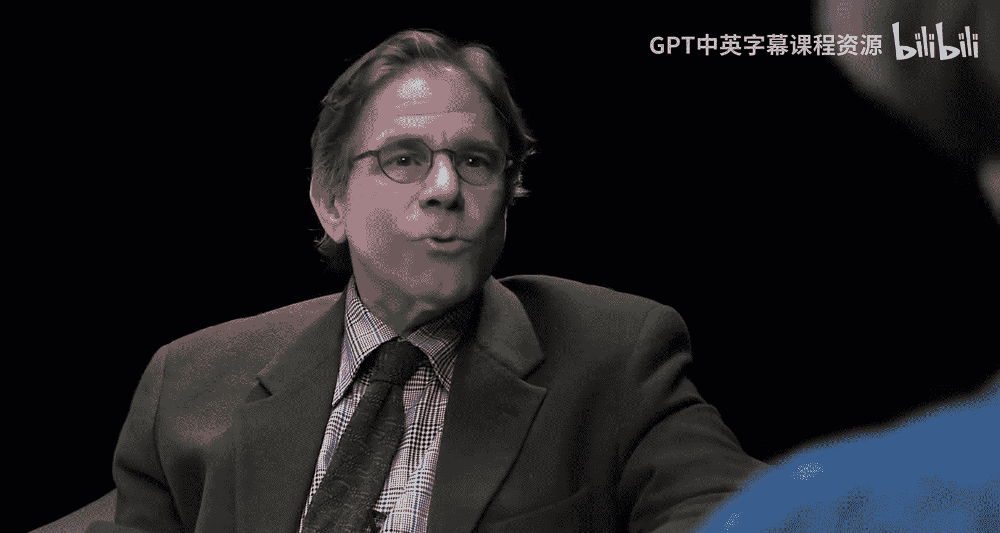

# 密歇根大学《调查数据收集和分析（2-6：方法、社调问卷设计、抽样、缺失数据、分析）｜Survey Data Collection and Analytics》 p30 29_3.4 威斯康星大学Nora Cate Schaeffer教授访谈：招募与访谈.zh_en -BV1fw4m1e7Zh_p30-

So I'm delighted to welcome Dr。 Nora Kate Schefffer。

 the Sewell Bascom professorfesor of Sociology at the University of Wisconsin。

 and the F director of the Survey Research Center at the University of Wisconsin。Dr。

 Schaefffer is a world renowned sociologist and survey methodologist， and best known at least to me。

 for her teaching and research on questionnaire design and the interaction between interviewers and respondents and the impact this might have on survey data quality。

So thank you so much， Nora for making time to be with us here today in person。

 I really appreciate it to talk about interviewers and how they can make things better hopefully for or not。

嗯。So I'd like to first talk a little bit about interviewers in a role other than asking questions and recording answers and that's as recruiters。

 obtaining interviews and this is of course important because it affects response rates you've done lots of interesting and thoughtful work in this area。

 so I guess the first question I wanted to ask you is whether。

It really is fair to interviewers to ask them to sort of switch the hat they're wearing from conducting a relatively。

Imrovised recruitment。We can call it interview， but really interaction to a more structured scripted standardized interview。

 should we really be using specialists who can you know one of whom might do the recruitment and then another of whom conducts the interview or or is this just is is this just what survey interviewing involves this kind of path switching？

I think first of all， thanks for that very kind introduction， Fred。

 and I think there's been a lot of work at both at Michigan and at Wisconsin and in a lot of places around the world on the subject that really all kind of fit together into a lot big package of recent studies about interviewing so it's really nice to have all of that to call on。

I think that。That interviewers do have to switch hats。 And was when I thought about this question。

 I was one thing I thought is that if you have specialists for recruiting。

 then you've got this challenge of how do you pass the sample member off to somebody new And how does that affect the risk of losing the cooperation that you gained because the respondent gave their cooperation to person A and just that act of passing them off to somebody else or to another mode can sometimes lose you a case。

 So its I think in a lot of cases， we really do want to have the same skill set for both recruiting and interviewing in the same person。

 But I think in a lot of cases。We just don't have。In my opinion， just based on observation。

 a good set of a good list of what are the skills an interviewer needs to do to recruit。 We know。

 we know a lot more about what they need to do to do a standardized interview。

 Maybe not other genres of interview， but even for that。

 we don't really know a lot about actual training of interviewers。 What is the most。I mean。

 the major study of training of interviewers， there were a handful。

 two or three that are cited repeatedly。So， I think。I mean， I。

 I think that practically speaking interviewers do need both sets of skills， but that as a field。

 we need to have a better sense of what are the what are the tasks an interviewer needs to do during recruitment。

And how do they fit together in the course of an interaction and how how do you train interviewers to actually do those things in a way that inspires trust and cooperation at the stage of recruitment without。

嗯。Without encouraging what Will Dykstra called ingratiation in one of his great studies of interviewing back in 1987。

 which we're pretty sure is detrimental to data quality within the interview so does that Yeah that addresses my question any ideas how that training。

 what the content of that training might be， how recruitment。First of all。

 we'd have to separate phone from， I mean， there's so many things you have to take into account at once。

 one is the mode。Another is the sample design， do you have it named sample member or do you have to do selection？

Those are totally different。Stranger interactions from the respondent's point of view and the skills that the interviewer needs to negotiate those are pretty different。

 But I would say， in general， introducing themselves。Explaining the survey。

 Ken Pruitt gave a talk at a telephone。Methodology conference a few years ago in which he said something to the effect of。

 you know， our main way of explaining ourselves to respondents is to say it's important by which we mean it's important to us。

 And that's really not very persuasive to people。 And I don't think we've made a lot of progress beyond that。

And。Training interviewers to listen to what the respondent's actual concern is and to then address that concern and not。

Something else， I think， is a big challenge。 So I would say introducing themselves。

 hearing the concern， addressing the concern， and then exiting appropriately when this isn't a good time。

 And the exit， I think， is something where're we've started to look at。

 I don't have anything to say about it， except。They're sure a lot of different exhibits。

 but exactly how we on the telephone， you want the interviewer to exit at the right time and the right way。

 I think。😊，So I think that would be another skill。GreatThank you just a little more on training。

In some of your very interesting research， I think in particular of your 2013 paper with Garbarsky F and Maynard。

 you demonstrated that among。Other utterances respondents or sample members because they're not yet respondents exhibit cues of what seem to be evidence of their likelihood of participation so for example you showed that if respondents well whether or not respondents ask a WH type question like for example how long will this take I suppose or you know what will it be about whether or not they ask that question is a powerful predictor of whether they will participate and similarly in work we did the prevalence of of back channel saying or okay on the phone is a strong predictor of whether they will ultimately agree to do the interview or not so there are these cues and I'm wondering if if being able to attend to these cues and。

Adjust the recruitment strategy midstream is something that's trainable。

 or if this could just be there are individual differences and some people may be perfectly good at conducting the interview part of the data collection。

 but just don't have this ability to kind of attend to these cues and change what they're doing to increase participation。

I think it's a really good question。 And I think that。哎呀。You know， again， you in addition to the。

The workup that you just referred to that involved looking at the role of the cons。

 There's other work that you all have done here at Michigan that's related。

 And I think complements some of what we looked at。 I think that we found that。If， if a respondent。

 the W H questions actually were just。Pretty much who is this and what is this about if they asked。

 how long will this take that that question is typically associated with acceptance of the request。

 So from。For me， that is one example that we potentially could train interviewers to recognize if the respondent asks。

 how long will this take。The interviewer cannot relax。

 but focus not so much on the task of persuasion， but on the task of explaining that it could be done in parts or that we're happy to schedule around what you。

 you know that it's a different kind of task that the interviewer faces at that point。

 whereasas we're pretty sure from what we've seen that the W H questions about who is this or what is this about。

 occur when the interviewer doesn't introduce herself properly at the beginning。

 So the interviewer now in the study that we did that you're referring to。

We were in the privileged position of having a list sample effectively because it was a longitudinal study。

 so the interviewer could begin by asking for the respondent the sample member by name。And。

If the interviewer did that。Then without introducing themselves first。

 they left themselves open to having the respondent kind of our sample member turn the tables and say。

 who is this， what's this about and that does predict we it does predict refusals at that in that call not necessarily ultimately we don't know that。

 but in that particular call So we find that when interviewers begin the call by saying this is Nor K Chafer I'm calling from the University of Wisconsin May。

 please speak with Fred Conrad， they're much more likely I mean that。

The respondent or sample member is not at that point then in the position to turn the tables on them without a W。

 H type question and。And。The result is more likely to be an interview。 Now。

 it turns out all of those things are so highly stacked in together。And correlated empirically。

 you can't disentangle。 And this is what we discovered as we looked at it more closely in a newer paper that we're working on that。

You can't。 We can't。 One could disentangle the effects of those different components of the introduction。

 but we can't， because interviewers either say， may please speak with Frank Conrad or they say the whole yes。

 introduction。 And there there isn't a lot of variation in the。 Yeah， yeah， yeah， very interesting。

 Thank you。 So thank you。 No， Well， so so speaking of。behaviors。

 interviewer behaviors like introducing themselves or being polite。

 respondents in the same study seemed very sensitive to that and more generally to the speech and presumably vocal qualities of the interviewers。

So I guess what I'm wondering is does telephone and this study was all， you know。

 telephone invitations and the study that I was involved in I mentioned telephone invitations。

 So I guess my question is， does telephone kind of amplify the importance of。

Interviewer speech and interviewer vocal qualities relative to face to face interviewing。

 or do you think that this really doesn't depend on mode。

 This is really speech is the predominant channel in survey introductions whether they're done face to face or on the telephone I think another good question Brad I think it's plausible I don't think we have enough information to know I mean because we don't have。

It's so hard to get。Record data on doorstep introductions and by the time that doorstep introduction happens。

 often there's been a phone call， there's been an advance letter which I think is another point we could talk about。

 but i'll try to stick with the。And the introduction part first。

It seems plausible that voice is more important， but I'm guessing that the the in the phone。

 it's really the structure of the interaction and the footing between the two parties that's。I mean。

 the conversation analysts have studied phone calls and the openings and endings of phone calls for a long time。

 And at least for traditional landlines， they had a certain， very predictable structure。

 And I think if you violated that structure or。Violated the the kind of underlying principles of the parties wanting to be on the same footing。

 right， If I'm a stranger and I call you， and I say。Is Fred there without introducing myself。

 I've shown that I know who you are and that you live at this number。

 But I haven't revealed anything about myself。 And that's。That's something that。

That people on the other end of the phone often react to with irritation for pretty good reasons。

 Now， those studies were done with。Landlines。In， you know， over the last 10 years。

 along many decades， how is that different for cell phones and probably extremely different。

 And how is it different for young people， My guess is the footing issue is not different。

 but the way the structure in within which the parties establish。

Explore or change their footing could be vi of each other could be very different。

 and the language or the casualness with which they do it could be different。

 But knowing who's calling you and why， and how they got your number， that， I think。

 is an issue for cell phones， as it was for landlines， for young people。

 as it is for the older people in the Wisconsin longitudinal study But the mechanics of how that's worked out could be really different。

 And I personally don't know anything about it。 And I don't know if we do as as a field。

 And I think it's important。I mean， it seems to me that a survey invitation on a cell phone。

 a mobile phone。Will anything that seems intrusive on a landline phone will be magnified on a mobile phone because this is a personal device。

 it's a one person device is you know this is in my pocket or as opposed to in a central location in the household is that your intuition that would be my intuition and and you can and you probably yourself and I know I've done it I don't know who that's from and my cell phone and I just don't answer it and if they don't leave a message I never investigate And so I think it also changes the way we think about leaving messages and the work that you've done on texting and other kinds of。

You know strategies， lots of people don't listen to their messages on phone if you want to on their cell phone。

 if you want to reach them on sale you have to text them and if I wanted to know about that you were the person I would be interviewing so I think how about turning the table。

But， but I think another thing that this discussion suggests is， you know。

 we really also have to pay attention to where that contact comes within the whole study design because that phone call doesn't occur in a vacuum。

And the advance， I mean， when we think about。Grovs and Cooper work from many years ago about。

The decision to participate in a survey occurring across calls。To me。

 one of the things that started me thinking about was how you exit from that first call to make it when you when the person says I'm not interested。

 the chance that you're going to persuade them on that call， pretty close to 0。

 And the chance that you're going to irritate them if you try is clearly pretty high。

 So maybe the strategy。I mean， I think we need sort of。Things we want interviewers to recognize are。

 you know， when is the time to pull the plug and get out and exit in a graceful way so that then I can call back later。

 I mean， definitely， you don't want to say， may I call back。

 We know that from listening to calls in which the respondent that are the sample member。

 depending on whether you've selected them or not says， you know。You know。

 don't call me back ever again。 You don't want to leave that opening。 But how do you leave， you know。

 how do you offer something in that exit to the respondent that might endgender the kind of reciprocity that we want later。

 and that then creates an opening for that， the refusal conversion letter that follows。 I mean。

 I think everything。Everything has to， in principle。

 everything would work together to create trust and communicate to the respondent that this is a research activity that if they accept the idea of and validity of a research enterprise。

 they might， you know， at least be opening to be open to hearing about。

But the fact that many people no longer accept that。In a way that I think wasn't true 30 years ago。

 I think that's。That's a challenge that I don't know how we right， right。 So assuming that。

An interviewer is actually able to conduct an interview transitioning to this to sort why they're called interviewers in the first place Oh yeah that thing thing。

You know， so you you've documented a number of your studies in very compelling ways， the kind of。

The kind of disconnect between a formal structured interaction from the perspective of the interviewer and the way people want to talk and that you know so for example。

 repairs， you've written about repairs in which instead of answering a question say yes。

 no question with a yes or a no， the respondent describes her circumstances and basically as saying to the interviewer you decide。

And and this is common I mean you've documented it and you know I think just on intuitive grounds this is common because people are not generally in the habit of only using the options that they're provided by the speaker in everyday interaction just as an example so so I guess the question is why do survey researchers for example I imagine this is the practice at the Wisconsin Survey Center and here at the University of Michigan Research Center。

 why do researchers still kind of push for what you've called paradigmatic interactions where the respondents are basically doing what we want them to they're just using the response options or they're not straying from ideal interactions in some sense what's the rationale for sort of trying to structure the interaction that way？

Well， okay， so there's a lot packed into that question。I would say。In terms。Whenever。

I would say in almost every case， when I look at an interaction where the respondent produces。

What we called a report following Paul Drs。 So the respondent produces。

Content that' that's relevant for the answer but not formatted as the question so you have a yes no question。

 it projects yes or no as an answer and the respondent says for example。

 did you work last week and the respondent says I was on maternity leave so that's a classic example that occurred in one of our early data sets and in in a case like that。

 the respondents answer from my point of view is indicating a lack of fit between her situation and the assumptions and categories offered by the question Now in that case I think the issue has to do with what's defined as a job right and so in principle。

 and it's a fairly I'm not sure how common maternity leave is so I don't know how how frequently one would expect a rapport。

Or。Based on maternity leave to come up in a national sample。

 But if when we do training about questionnaire design， one of the things we train try to。

Encourage people to do is in the course of question testing。

 whenever you encounter a report like that， that tells you there's some issue in the question that has to be dealt with。

Now。One of the most common situations in which we see a report， I think。 And when I say that。

 it's very impressionistic， you know。Most of the time in。In standardized interviews。

 most of the question answer sequences are very straightforward in what。

You could call paradigmatic question， answer possibly a receipt token。

 Does this mean the data of her high quality， No， I mean， maybe there are。 maybe they aren't。

 Maybe there are problems lurking underneath No way of knowing， but things go smoothly。

And there is little opportunity for the interviewer to intervene， so。

So we know that the interviewer is not contributing to interviewer variants in those situations。

 there may be bias， there may be other sources of unreliability。

 but the actions of the interviewer aren't exacerbating the situation。

 so that's the good news when you get that kind of sequence。Now。

 to the extent that we strive to have that kind of。Of paradigmatic sequence。

 we're sort of striving for it in the only way you can really strive for it is by designing good questions。

I think， and so as I started to say a moment ago， one of the most common situations in which we have reports。

 I think， in my impressionistic way， is when you have sort of threshold problems and questions。

 So an example would be have you have you discussed end of life plans with anyone。

And the respondent says briefly。So that's a kind of common threshold problem where the question doesn't indicate how much of a discussion you need to have had in order to say yes。

 Does discussion mean， well， it was a lot。 Does it mean you discussed it and figured it out。

 Do you mean you brought it up one time with one person。

 There's no indication in the question itself of what the threshold is to say yes。

 So in terms of a guideline for writing a question， One guideline would be。

 write a question where it's clear what the threshold is to say yes。

 Did you speak with anyone about this even one time， gives you at least a clearer threshold。

 Will it take care of all problems absolutely not， because something will come up about Well。

 what is end of life plans or some other term in the question， so。

So that's kind of the first line of trying to。Kind of lead to paradigmatic sequences is to write questions that respondents can actually answer。

The second。IfWhen， when it fails， then。The hope is that the practices of standardized interviewing。

In a situation like this where the person says， briefly and the interviewer has two courses in a standardized interview。

 She can either say， let me reread the question or would you say yes or no。

 And when we in a case like this， when we see interviewers engaging in those actions。

It doesn't seem particularly disruptive or irritating to the respondent。 There are situations。

Like the maternity leave one where irritations really can be engendered by the practices of standardized interviewing。

 but it isn't inevitable。 And in some cases， those practices are clearly reducing the opportunity for interviewer variant。

 Now， are they。嗯。Can the interviewer say something about what end of life planning means or define discussion or something in a way that might increase the validity of the item very possibly。

 But ideally， you would want a definition or a scenario that was read to all the respondents in order to。

 you know， make their answers more comparable。Now， you do get irritation in a situation like。

The maternity leave example， if。I mean， that respondent knows her situation。

 She's on maternity leave。 She doesn't know what you mean by a job。

 And it's really up to the investigator。 So I think we need practices for dealing with those situations where there really isn't a fit。

 whether it's providing definitions， whether it's writing down the answer and having somebody who knows what counts as a job coded later。

 But clearly， the respondent doesn't know what the survey researcher。

What the principal investigator thinks a job is。 And it's not up to the interviewer to be able to adjudicate every possible kind of thing that might count as a job unless the structure of questions does it。

 I could， I mean， we could talk about this for another hour。 that would be fine。

 as you're speaking though，' it's occurring to me that。

One of my earlier questions was wearing two different hats for recruitment and conducting the interview。

But actually。It's from your description of what I guess a skilled standardized interviewer would do in these situations。

 it sounds like there is as much judgment and discretion and。

Strategic behaving as in as in the recruitment phase of the， I don't about as much。

 but there is certainly a component of that so the skills maybe are not so distinct between recruitment and interviewing。

You know， I think that's a good observation。 I think there's a lot of， you know。

 if an interviewer has to choose between repeating the question or following up with。

 would you say yes or no， I mean， that's a bit of discretion there and there's some she's got to make some judgment about which is going to be most useful to the respondent and which will give the respondent as much support as she can give the respondent in choosing an answer。

The other thing that happens in the situation we were just talking about is。If。

If in this this question， have you discussed your end of life plans with anyone。

 if the respondent says probably。The interviewers is in this kind of funny situation where。

The respondent has said something that in a lot of situations， we would take as equivalent to yes。

And that's a situation in which。Interviewers are more likely to engage in what we might call a leading probe。

 So to instead of saying， would you say yes or no， just say， well， would you say yes。

 or and sometimes they'll sort of trail off， Would you say yes or and the respondent will say yes。

 So one of the things we've been doing recently is collecting the way respondents answer questions of different formats to sort of see。

 well， what are the situations that interviewers really are confronted with。

 What kinds of decisions do they have to make， And do we really want them following up probably。

 or do we want to just say that's a synonym for yes， And if probably as a synonym for yes。

 what else is a synonym for yes， and can interviewers remember all these synonyms for yes。

 let's say we want to say all these things。Are the same as yes。

 because we never see any respondents change their minds when they're followed up。Yeah I you know。

 we'll never have enough data to really answer that question adequately。

 I mean we can sort of observe it in data sets we have and then make a guess。

 but interviewers need to be able they need to know probably counts as yes or you have to follow it up。

 but if they follow it up by saying would you say yes or no， if we ask them to do that。

 a lot of them will trail off before they ever get to vet no。

Because they feel silly saying would you say yes or no right probably definitely it may not mean yes。

 but it definitely doesn't say no that's really interesting so I really just wanted to ask you one more question about it's really a more general question about interviewers you've alluded to interviewer effects or impact on interviewer variance or impact on total variance and and certainly interviewers have an effect for better or worse on response rates interviewers can。

inhibit sort of candid disclosure of sensitive information and probably the main sort of impediment to conducting interviews is the expense interviewers are you know in studies with interviews。

 they tend to be the largest line item。So the question is why when there are alternatives like web surveys where there's you know no marginal cost per case there's like a fixed cost to field the instrument but beyond that there's doesn't cost more to collect data from a thousand00 people than 100 people。

 why would we not do everything by web， why for example。

 in producing official statistics in government agencies or or many social science surveys。

 why are we still using interviewers， there must be good reason to do this。Well。

 there are reasons whether they're good I not sure， but I think the reasons are that。

Interviewers tend to be better at persuading people than letters or emails。

 so if we to the extent that we think participation is important。

 interviewers tend to be associated with higher participation。

One of the challenge with web surveys is that we don't yet have sampling frames that necessarily let us。

Use and people don't have fixed email addresses the way they used to have landlines associated with households and and in the way that many people。

 although a very selective portion of people have cell phone numbers that they now take with them pretty。

 you know， so there's an interaction between the need for interviewers as a way of recruitment and sampling frame。

 but even when you have populations that，For which email addresses and web knowledgeability is high like students。

 we often get much better response rates。Until recently with male questionnaires because we could deliver the incentive that along with the paper questionnaire and there。

There have been the sexual assault climate surveys that were done on many university campuses recently included two。

Different surveys about sexual assault on the University of Michigan campus。

 one conducted by the American Association of Universities by using for a census of。

 I think undergrads and graduate students who responded by Webb who had an invitation to participate via web and a sample done by。

 I think web with an interviewer follow up for nonresponse。

To a sample of about 3000 and that sample of 3000 had with the interviewer follow up。

Had a response rate of between 60 and 70%， I think about 67%。

 whereas the web survey had a response rate of about 17%， much larger N。

Much smaller N incentives in both。 And so the fixed cost of this web survey has to include。

I mean there's the fixed cost， but then there's the cost of the letter of invitation and the incentive for all the end so that and the followup letter so but that's not it doesn't it's not as cheap as you might think it's not as cheap as you might think but the point is still I mean one that you have to think about but in the interviewer assisted version of this survey at the University of Michigan the interviewer had an iPad and it was still a self-administered instrument the interviewer did not asked the questions of the respondent because they were highly sensitive and as you mentioned interviewers can interfere with people's willingness to disclose sensitive information so the interviewer handed the iPad to the sample member who then completed it but I think it just it's a nice contrast to show the importance of the interviewer and getting co。

And you know the relative expense of the studies I don't know and I can't comment on but so I think participation is one difference。

 I think because getting the interviewer to the respondent is so expensive now whether by phone or face to face at least for the studies that we do there's kind of an impulse to for researchers to make the studies really big like two hours and if you want to interview have somebody participate in two hours of data collection。

 you really need somebody there to help them and guide them through it。

Even more so because that two and a half hours or two hours of data collection is likely to include physical assessments。

 measurements of height and weight， strength measurements， gait， cognitive testing。

 and with enough incentive and well trained interviewers。

 I mean for the Wisconsin longitudinal study， we still had， you know， very close， you know。

 very high response rates， even with that kind of demanding。

those sorts of demanding requests and that's something you can't get people to do I think the other big issue is explaining about consent forms that we would like people to give us like linking to Social security records things that are very difficult to explain to people and talk to people about over the phone or remotely you can't I think it's hard to send somebody a request for access to their social security records by mail and expect them to actually sign the consent form and send it back to you and then lastly I think a lot of complex study designs involve respondent selection and once we figure out good ways I mean like。

In principle for now that we do。AndNow that we have access to the delivery sequence files。

 in principle， we can do area based studies that have。Less clustering than traditional。 I mean。

 this is another thing about interviewer studies that we didn't talk about is the fact that if they're face to face studies in order to make field costs manageable。

 the sample has to be highly clustered， and the design effect reduces your。

Effective sample and size really I mean， very substantially in principle， we could do。

Address bait studies without that kind of clustering。

 if we did them by mail or telephone using the area to draw the the area frame to draw the sample and then either following up by mail or telephone。

 but。Random selection of respondent within household is something that respondents or whoever gets them it's just hard to get people to do that it's complicated we don't even know how well interviewers do it really we assume they do it well but we don't really know so I think that's another thing that we really rely on interviewers to do and until we have a technology which I think people are working on to you know adapt our sample designs or have procedures that。

Household members can implement on a self administered form to a reasonable level of accuracy。

 I think we'll use interviewers for that too so they'll be around for a while I'm glad to hear that。

Well， as you said， we could talk for hours， but just in the interest of allowing you to move on with the rest of your life。

 I want to just thank you so much for spending this time with me and everybody who's enrolled in this course and sharing your expertise it's really been a lot of fun I've enjoyed it thank you I enjoyed it too thank you f and thanks for participating。

