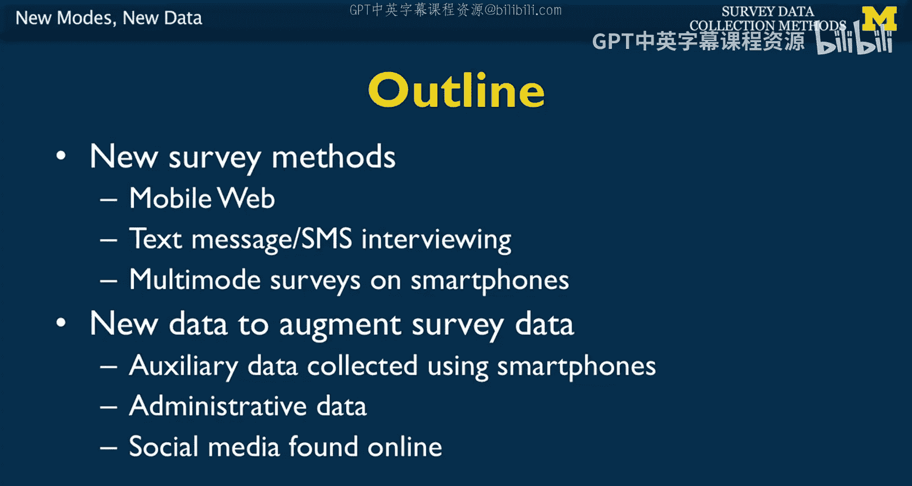
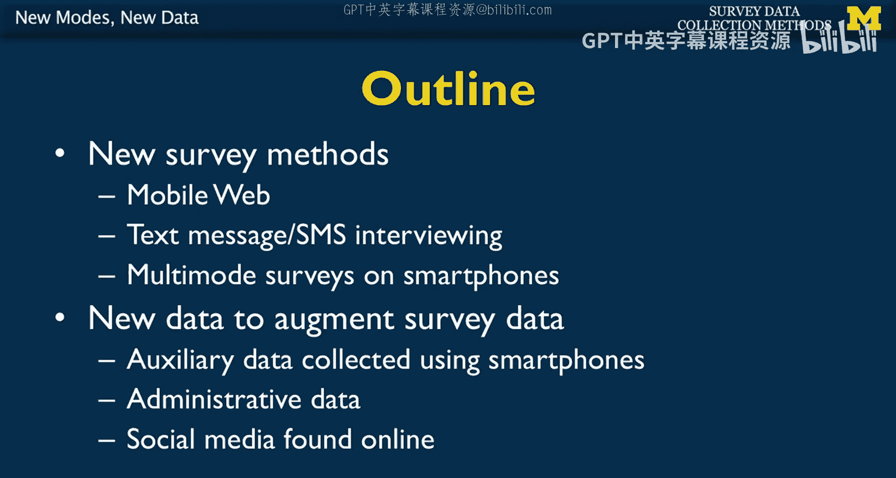
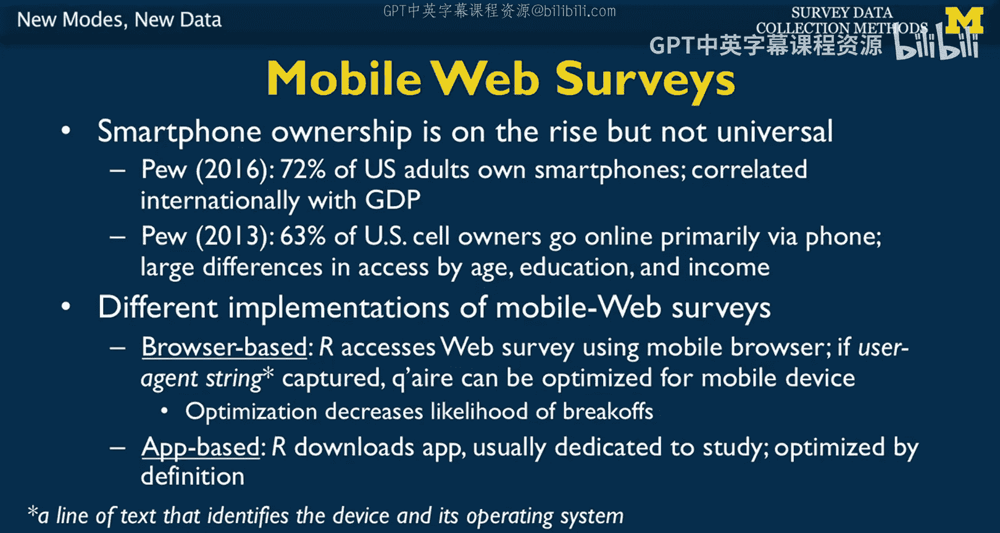
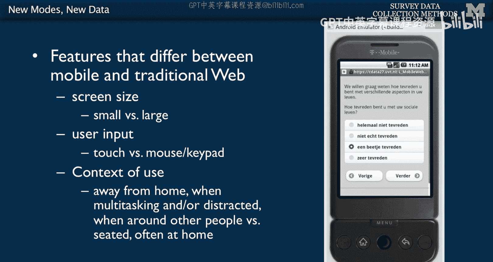
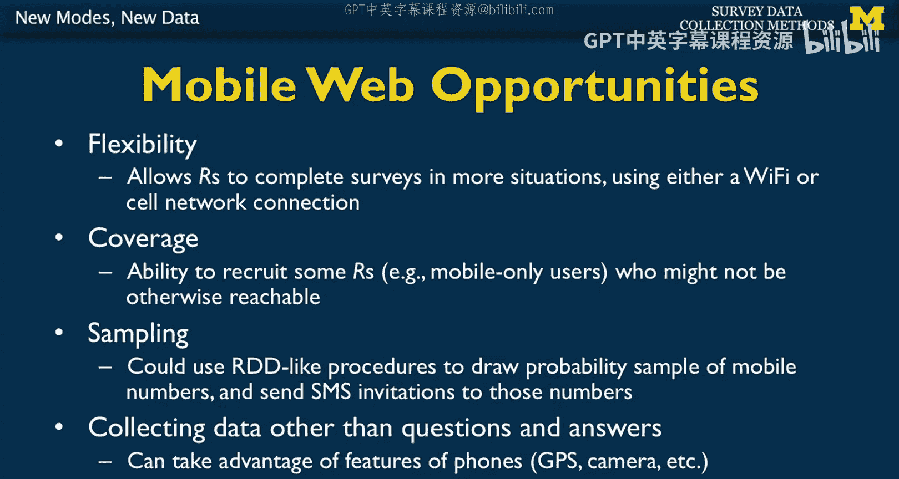
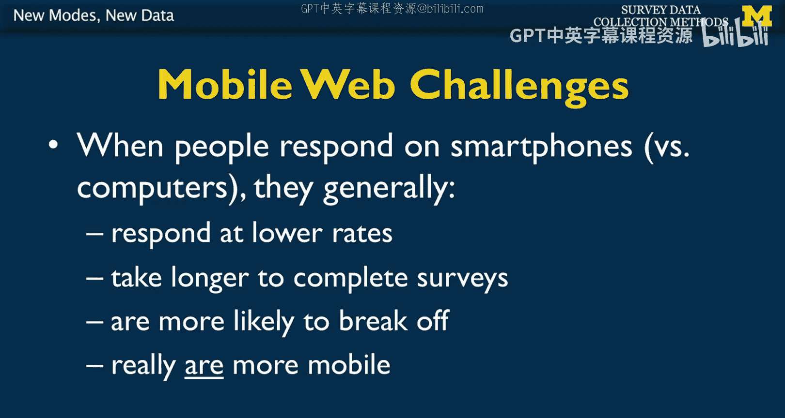
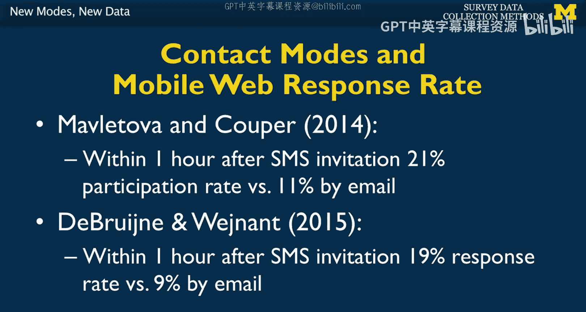
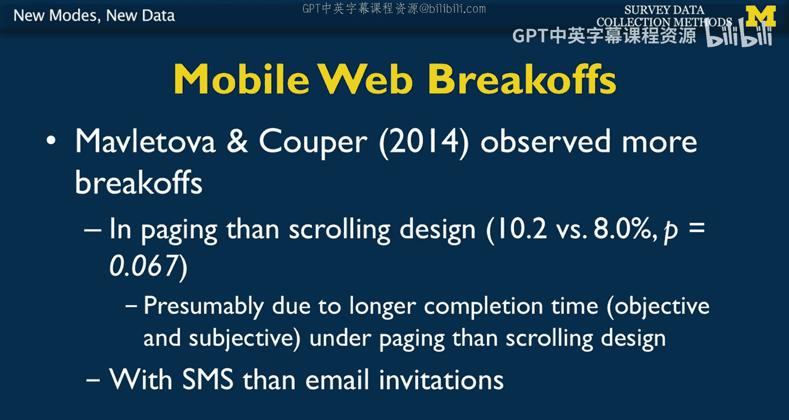
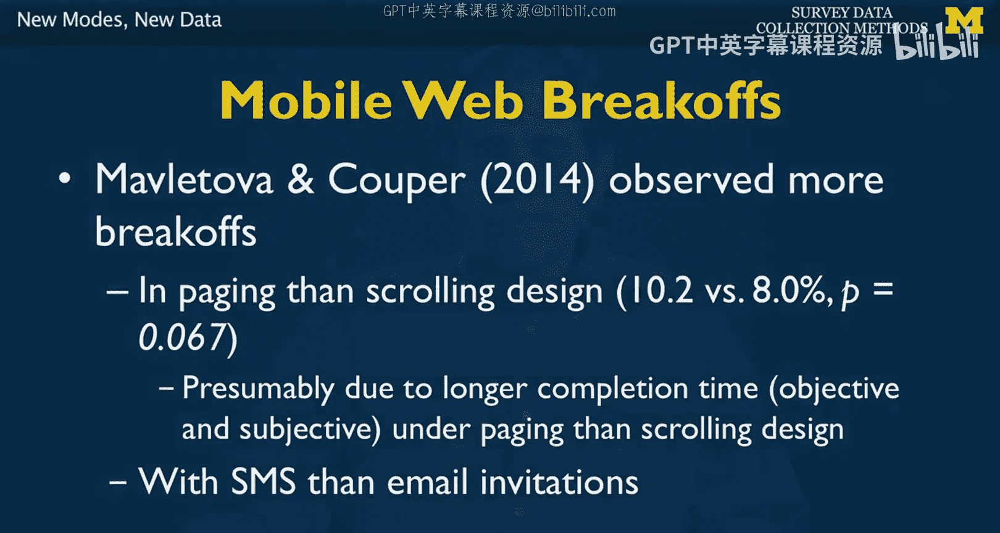

# 密歇根大学《调查数据收集和分析（2-6：方法、社调问卷设计、抽样、缺失数据、分析）｜Survey Data Collection and Analytics》 p31 30_4.1.1 新模式与新数据.zh_en -BV1fw4m1e7Zh_p31-

Welcome back， this is our fourth and final lesson on new and emerging methods and new sources of data。

 so our outline is as follows we'll first look at mobile web which we've talked about briefly in our discussion of web surveys more generally。

 this is basically conventional online surveys completed on a mobile device such as a smartphone。

 then we'll talk about interviews conducted via text messages or SMS in some ways quite similar to mobile web but a different technology。

 it's SMS and kind of different interactive flavor。

And we'll touch briefly on multimodode surveys on smartphones where the issue of mode choice becomes quite important。

 that is which of a number of modes available to a respondent。

 do they actually decide to use for completing the questionnaire， can they switch modes midstream。

 for example， one of the questions that comes up when thinking about multimodal surveys on smartphones？

Then we'll talk about new data sources that can potentially augment or even replace survey data。

 by which I mean， self reports of the sort we've been talking about throughout the whole course。

So there are auxiliary data collected on smartphones。

 sometimes called passive data collection like GPS data。

 so global positioning information can be quite useful in understanding a respondents movements for example and there are other sources of data that are generated health data for example。

 are generated kind of automatically， administrative data are records that are often maintained by governments or businesses about citizens and customers and these sometimes contained data that are quite close to what a survey question is designed to eicit。

 so if these can be used in place， if the administrative data can be used in place of a survey question that reduces burden and on respondents and saves money by not having to ask as many questions。

 whether the data are exactly the same is another question。

まあ。Probably unlikely and in many cases the administrative data are more complementary than likely to replace the survey questions and so that raises the issue of linkage how can you link or connect the records for a particular individual to survey responses for that individual because the records may have a slightly different name or in some other way be not a definitive match。

 so linkage and also consent to。To link our issues that come up with administrative data。

And then finally， we'll talk about social media and some related data sources that are found online。

 but never really intended for the purposes of doing the kind of work that people do with surveys。

 but may nonetheless be able to as I've been describing about all these data sources。

 supplement or even in some cases replace survey data so we'll turn first to mobile web。

This becomes something quite relevant now that smartphone ownership has become quite widespread。

 so in some recent data from Pew， 72% of US adults own smartphones。Internationally。

 the rates of smartphone ownership are generally correlated with GDP。In 2013。

 Pew reported that 63% of mobile phone owners in the US go online primarily via their phone。

 this is not the same for all members of the public， so there are differences by age。

 education and income where younger respondents are more likely to go online primarily via phone。

 respondents with lower levels of education， more likely to go online primarily via their phone。

 respondents at intermediate levels of income are more likely to go online primarily via their phone。

So because smartphone ownership is really becoming quite widespread。

 the idea that online questionnaires can be administered to users of mobile devices becomes a question we can ask and it becomes actually an important one。

There really are two types of mobile web implementations， browser based and app based。

 so the browser based implementations are just what you would think a respondent。

Access is an online questionnaire using the browser app。

 but the browser that comes with or maybe installed in a smartphone， if the user agent string。

 which is a line of text that identifies the device and its operating system if this is captured。

 then the questionnaire can be optimized for the mobile device without this it really wouldn't be possible to know whether this is a computer or a mobile device and if it's a mobile what type of mobile device。

 that really wouldn't be knowable and so there would have to be only one implementation of the interface for all users。

 but when optimization is possible it does lead to a better user experience and better quality survey data。

It also probably reduces the likelihood of breakoffs because the users， the respondents。

 are generally more satisfied with the experience。

In contrast to browserbased implementations， app-based implementations require the respondent to download an app。

 which is usually dedicated to the study， but there are some general purposese survey apps that they might be asked to download as well kind of by definition an app is optimized for mobile device because they are mobile apps and the notion of optimization really assumes that there is a wide range of device types involved in a study that users a wide range of devices are responding to the study I mean that's not always the case some studies are just targeted at mobile users and some are targeted users of particularly mobile devices like iPhones but optimization really is an important option for designers when either there's known to be a large range of devices involved or the range of devices is unknown ahead of time So a number of features。

beween mobile and traditional web surveys， screen size， for example。

 mobile devices are almost always smaller than desktop computers and laptop computers。

 although the distinction is becoming blurred， the way users register their responses。

 user input differs， so with mobile devices generally users touch the screen with a finger whereas with desktop and laptop computers。

 they use a mouse or keypad as a pointing device。

And the context of use may well differ so that with mobile web surveys。

 the respondents are often away from home or they can be away from home。

 they can be completing the questionnaire when multitasking or distracted by the environment。

 and they may be completing the questionnaire when they're around other people。

 which is important for purposes of disclosure。In the case of more conventional web questionnaires。

 the respondent is more likely seated and often at home or in the workplace。

Mobile web presents a number of opportunities for designers， it introduces more flexibility。

 so the mode allows respondents to complete surveys in more situations than is possible with a larger。

 more stationary computer， either using wF or the cellular network connection。

Coverage is potentially improved with mobile web because it makes it possible to recruit some respondents。

 for example， mobile only users who might not be otherwise reachable。

Sampling is potentially improved because one could use RDD like procedures。

 there's random dig dialing procedures where mobile numbers are generated randomly to draw a probability sample of mobile numbers and then send SMS invitations to those numbers。

 so the fact that there's a phone number associated with the mobile device opens up lots of possibilities that really don't exist for traditional web questionnaires。

 at least in principle。

And collecting data other than questions and answers， other than self reports。

 so mobile web allows researchers to take advantage of features of the phones such as GPS， camera。

 and other features that a traditional computer doesn't have。

Mobile webb presents opportunities but it presents challenges。

 what's known so far in the relatively small literature on mobile web is that when people respond on smartphones as opposed to computers they generally respond at lower rates。

 take longer to complete the surveys are more likely to break off and they are more mobile。

 and while they could use the mobile device much like a computer that is sitting at home maybe even next to the computer or sitting at the workplace next to the computer。

 they are in fact at least according to the early evidence， they are more mobile。

 they're out of the house， out of the office， more of the time and they're even in motion they're moving when completing the questionnaire。

So we'll spend a little bit of time in this segment talking about issues of non response and breakoffs or completion。

And then the next segment we'll talk more about measurement issues。

 including those that might be affected by mobility。

 like the fact that there are other people nearby， which can as we were discussing become important for disclosing sensitive information。

 the idea is that a mobile web respondent might be less likely to answer a sensitive question。

 honestly or candidly if there are others within earshot。

So this figure displays results from a number of studies that were actually pulled together by Antone。

 but these are studies that compare response rates in mobile web to PC web that is completing a questionnaire on a personal computer by the way。

 the literature is somewhat mixed about the term used for conventional web surveys or traditional web surveys。

 PC web is one term meaning personal computer， but another term or distinction is desktop web。

 meaning not that is necessarily a desktop computer the respondent is using versus a laptop。

 but rather that the operating system uses a desktop metaphor you'll hear PC web desktop web and just conventional or traditional web survey all meaning the same thing。

So as you can see， the response rate is higher in most of these comparisons for the PC web versus mobile web。

 and so this is a relatively strong finding for whatever reason and we'll talk about some of those reasons as we go on。

 people seem to be less likely to follow up on an invitation to participate in mobilebi web than they are in PC or traditional web。

One thing that can affect participation rates is the way mobile web respondents are contacted and invited to participate。

 the main distinction is between SMS invitations which are really only available。

 only feasible with mobile web versus email invitations which are possible really for both mobile and conventional web。

The findings are quite similar in the few studies that have made this comparison。

 so Mavelatova and Cooper in 2014 looked at cumulative response rate over a number of hours after the invitation had been sent and found that within one hour of sending an SMS invitation the participation rate was 21% but within one hour sending an email invitation 11%。

 and De Brown and Viynant found that within one hour of sending an SMS invitation。

 the response rate was 19% versus only 9% by email so SMS is much more immediate。

 and if you think about it it's a personal device as opposed to perhaps a computer that's that one is carrying and wearing。

 it alerts the user to the fact that they've been invited and if they want to participate at that moment。

 no matter where they are， it's quite possible to do that less possible if invited by email because on a mobile device email generally requires。

Oing the app and scrolling through the inbox， so SMS is particularly kind of immediate。

 and this is replicated in across these two studies。

The issue of breakoffs is also important to consider with mobilebi web because breakoffs seem to be higher than N PC web and breakoffs seem to be affected by the design。

By design here I'm really referring to the distinction was kind a paging and a scrolling design。

 which a paging design presents one question usually per page。

 or at least no more questions than are visible on a page。

 whereas a scrolling design generally refers to vertical scrolling。

 it's possible to put many questions or even the entire questionnaire on a single page and require the respondent to scroll。

 usually vertically but sometimes horizontally。Movelatova and Cooper found that a paging design leads to more breakoffs than a scrolling design。

 presumably because the completion time was longer with paging than scrolling。

 both objectively measured with timestamps and subjectively through selfreport the longer completion time for the paging design is attributed to just server transmission time。

 so it's possible that。

As this becomes faster universally， that this distinction will be reduced。

They also report more breakoffs with SMS than email invitations not just a minute ago we said that SMS led to faster completion of the sample。

 higher response rates。But what seems to be happening is those who start the questionnaire via SMS are less likely to complete than those who start via email invitations。

 so while more may start with SMS， fewer seem to complete to my knowledge that has not been replicated。

 but it's certainly something to consider so that provides a brief discussion issues of non-response and breakoffs in mobile web。

 in our next segment will move to issues of measurement。

 which will include issues that have to do with the environment in which the respondent completes the questionnaire that is whether there are others present。

 whether the respondent is mobile and or multitasking， and other issues of of design。

 including paging and scrolling。

