# 密歇根大学《调查数据收集和分析（2-6：方法、社调问卷设计、抽样、缺失数据、分析）｜Survey Data Collection and Analytics》 p32 31_4.1.2 移动网络调查.zh_en -BV1fw4m1e7Zh_p32-

Welcome back， we're continuing with our discussion of mobile web surveys and focusing now on measurement error in mobile web One issue is that mobile web is actually mobile so people can complete questionnaires really anywhere。

 including away from home outdoors while traveling。

 hopefully not driving and this is potentially a double-edge sword so while this may be more convenient allowing people to complete the in locations that work for them it may also inhibit honest responding to sensitive questions because people may find themselves in context and social context which are not private and so the chances that somebody might see their answers to sensitive questions as they're entering them is potentially increased and this could potentially discourage giving undesirable answers。

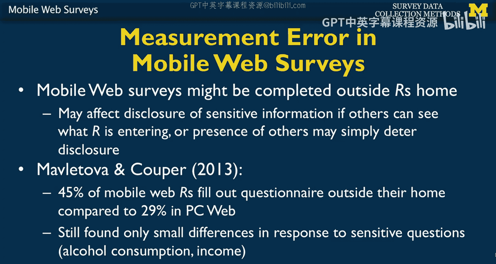

Movelettova and Cooper looked into the context in which web surveys are completed and they found that 45% of respondents of their respondents filled out the questionnaire outside their home versus 29% who did this in there with a conventional computer or laptop they still found only small differences in responses to sensitive questions despite the increased completion away from home so they' finding anyway is that mobility doesn't inhibit responding candidly to sensitive questions these are data from Antone who did an experiment on the Dutch list panel in which the same respondents completed the questionnaire once on a mobile device and once。

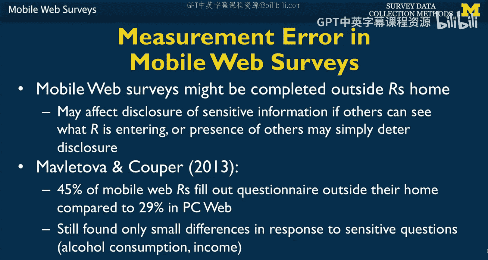

On a conventional computer or laptop。And he found that those using the mobile device were responded away from home more often。

 they were walking or moving more often， they changed locations more often。

 they engaged in multitasking more often no reliable effect no significant effect of being distracted by other things but the mobile respondents or when respondents were mobile they found that they were around other people more often so the mobile respondents really are more mobile than the PC respondents the question is how did this affect responses to sensitive questions is we'll see in a moment。

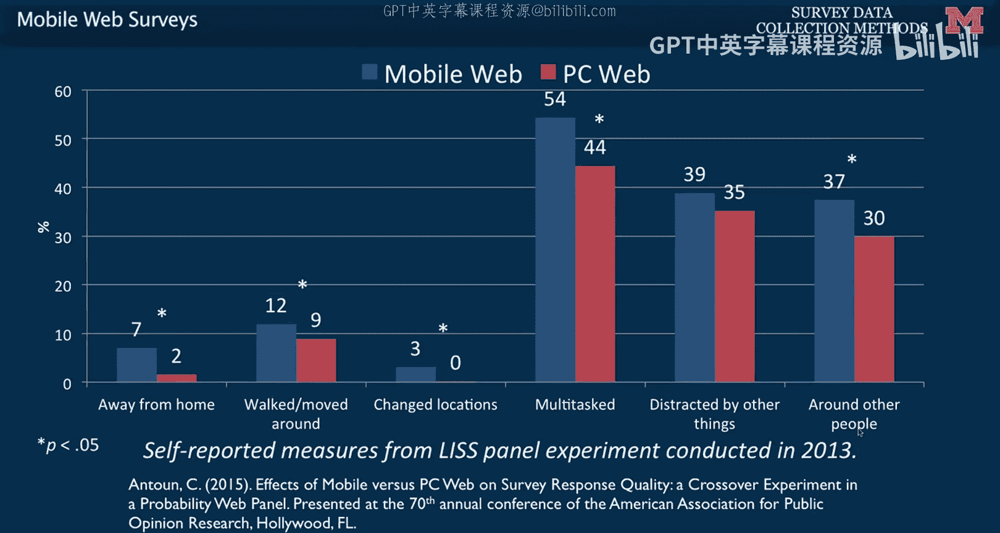

Antoone also like Movlotova and Cooper found no evidence that mobility inhibited honest responding to sensitive questions。

 One design feature that has been explored quite a bit we're still in the early days of evaluating mobile web but even in the early days this feature paging versus scrolling has been examined in a number of studies so the idea that with a paging design。

 there's usually just one or maybe two questions per screen per page with a scrolling design the entire questionnaire or at least many questions can be contained on was in effect one page or one screen。

 but to see all the questions the respondent needs to scroll generally vertically。

So with mobile devices， Mavotova and Cooper found that paging design took more time than a scrolling design 9。

1。Minutes to complete the questionnaire with paging versus really about half that time， 4。

5 minutes to complete the questionnaire by scrolling。The Brown and Vinon found a very similar effect。

 59 versus 43 seconds per question for the paging design versus the scrolling design， so again。

 scrolling seems to be faster than paging now。

The explanation in Molotova and Cooper and also in the Brown and Vynnon is that this could well be due to download time。

 it might not be that it's a usability issue， it might not be that users that respondents are actually slower to page and then to scroll but that the paging design requires more download to download for every new page and that given the speed of the connection that could be responsible for the increased time for paging versus scrolling whatever the reason for the slower completion。

 the longer completion times in paging， it doesn't seem to affect response quality。

 the Brown and Vinon found no effect on the response distributions from this distinction in design and no evidence that primacy is responsible for faster times with scrolling so you might imagine that with the scrolling design respondents are just picking the first option and then moving to the next question。

They found no evidence for that also Pae Chevin Hill。

 whose study was done a few years earlier than the two we've just been discussing。

 found no effect of a different kind of scrolling on the response distributions so in their design。

They presented a question with five response options， a a scale with five options。

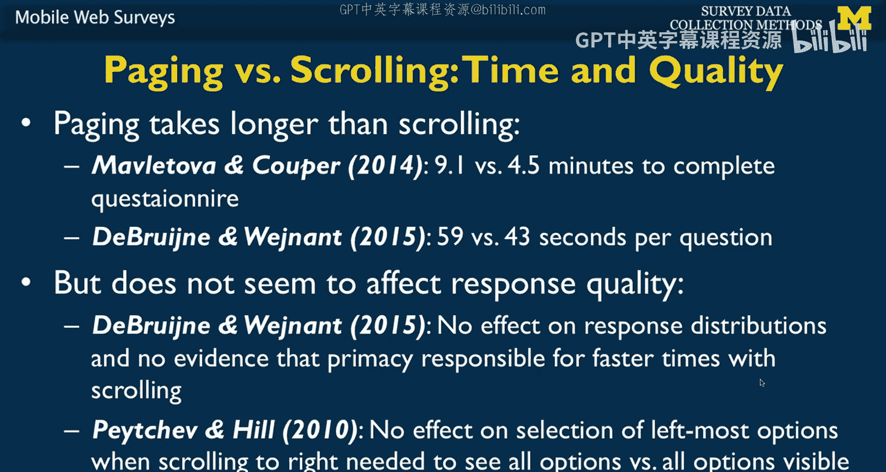

In one design， only three were visible on the screen at one time in the other。

 all five were visible and they asked the question whether seeing only three options would lead to a kind of preference or bias for those options that were initially visible in that design over the ones that required scrolling to be displayed。

 they found no evidence of that either so in other words respondents were willing to or expose the final two options。

 the right most options， often enough so that there were no differences。

 there was no bias toward the options that were initially visible compared to the condition in which all five were visible。

A general theme coming out of these studies is that the response process is quite similar in mobile web and conventional web PC web。

 it even seems to be similar to the response process observed in other modes。

This was the finding of Pachevin Hill who tried to replicate well-known response effects that is a phenomena that were observed。

 generally differences between two designs that were observed in other modes。

 they attempted to replicate these in mobile web just to see if the response processes were comparable。

 so for example， they replicated the well-known question order or context effect published by Heyman and Schtzli in the original study。

 they were more likely to say that the USS should allow at the time 1950s Cold War was underway。

 should allow communist reporters to enter the USS and report the news as they see it if they were first asked a question about whether a US reporter should be allowed into Russia to report the news back if they weren't asked that question first。

 they were much less willing to consent to have a commmunist reporter enter the US。

S and report the news so the order。

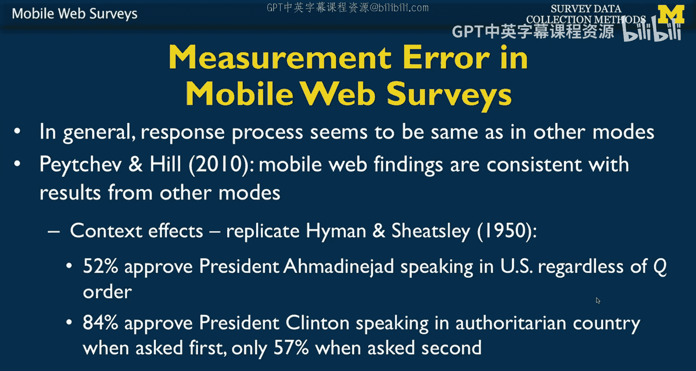

The questions mattered is the point in Pchevin Hills attempted replication of this study。

 they updated it and they asked two questions， one was about the Iranian President Ahma D Najad speaking in the U and the other was about the USS President Clinton speaking in an authoritarian country like Iran。

What they found was that there was about 50% support for Ahmadjad speaking in the US。

 whether the question was asked first or second， the question about Clinton if asked first led to 84% approval。

 so 84% of the respondents approved of Clinton speaking in an authoritarian country， however。

 if they had previously been asked about Ahmadi Najad where half were opposed to his speaking in the US。

S， only 57% felt that Clinton should speak in an authoritarian country。

 so they call us the norm of reciprocity in the original study。

 and it's essentially replicated here on mobile devices。

Pe Evanvin Hill also successfully replicated well-known study by Schwartz and his colleagues。

 which asked people to report on the frequency with which they watch television using two response scales with Schwartz and colleagues called a scale with low frequency alternatives and one with high frequency alternatives and as you can see。

 they're actually very similar， but the low frequency alternative scale starts with an increment of a half an hour。

 the high。Frequency alternative scale starts with an increment of up to two and a half hours。

 then both scales proceed in increments of half an hour。

What Schwartz and his colleagues found was that the low frequency scale。

 more people picked a response option that was less than two and a half hours than in the high frequency scale。

 and they attribute this to respondents really not paying attention to the numerical properties of the scale but picking a position in the scale so for example if a respondent reason well I watch a about as much TV as most people。

 so I'll pick the middle option that would lead to very different numbers。

 numerical values depending on the scale。

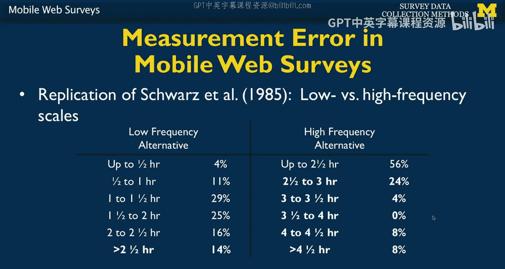

This is exactly what page Evanvin Hill replicated what they observed when presenting this on a mobile device。

 so they found that with the low frequency scale， only 14% of people picked a value of more than two and a half hours on the high frequency scale。

 44% picked an option that was greater than2 and a half hours and it's not surprising if you look at the scale for the high frequency scale。

 this means 44% picked anything besides the first option so there seems to be some evidence that the basic response processes are similar in mobile web and other modes。

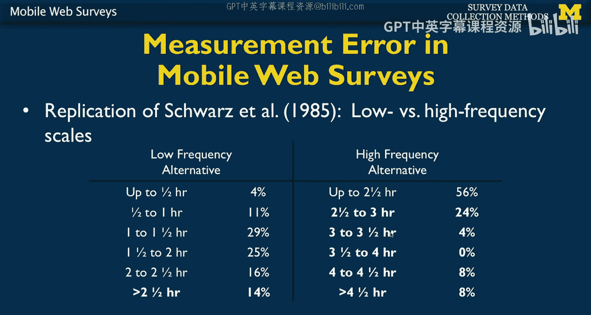

But there are features of mobile devices and the way they're used that really could affect measurement or response quality Anone investigated this in a study in which he had responseents answer the same questions either on a mobile device and then on a conventional computer or in the opposite order。

 first conventional computer and then mobile device。

 so he had it within subjects comparison which strengthens the ability to make inferences and conclusions。

 so there's some evidence that the response processes are quite similar。

 the sort of basic response processes are quite similar in mobile web and other modes。

 at least according to these replication findings by page Evan Hill。

More recently， Antone has done a direct comparison between mobile and conventional web surveys。

 used a crossover design in which the same respondents answered the same set of questions in both modes。

 either they were first assigned to the mobile condition and then answered the questions on a PC or vice versa。

 so this is actually gives them a much more powerful kind of comparison than some of the other studies we've talked about。

The findings were that there was no difference in satisfying remember these are kind of mental shortcuts that survey respondents often take it's not that he didn't find any evidence of satisfying it's just that it was no different between the two types of web surveys there was one reversal he was using a measure of the length of open responses the number of words or characters as an indication of satisfying the idea that it's easier for respondents to enter fewer questions and he found that the open responses were longer in mobile than PC and this is not what one might expect。

 one might think that entering text and a small devices is more complicated。

 but as he doesn't really have an explanation but that was a finding it's considered reversal but for the other measures of satisfying such as straight line and giving the same answer to a number of questions and primacy effects there was really no difference between mobile and PC web no differences in disclosure of sensitive information so we earlier talked about the fact that in this study。

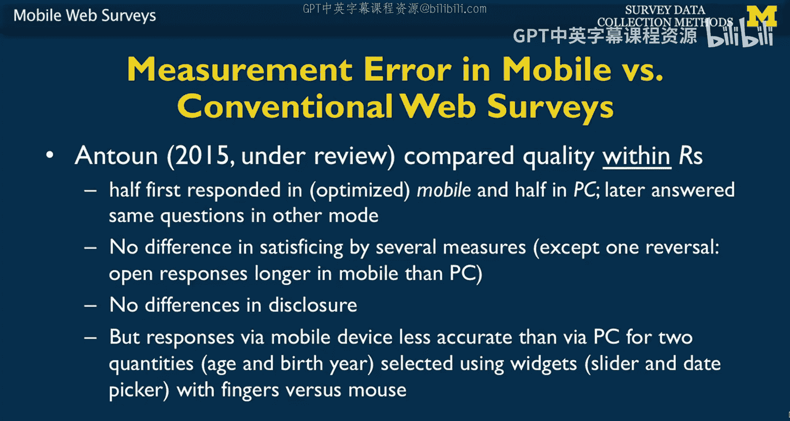

The mobile respondents were far more engaged with their surroundings the than when they answered the questions on a PC and yet there was no effect on disclosure。

 so the concern that being around others being away from home would。

Inhibit honest responding to sensitive questions seems not to be the case。

But Anone did find a couple of pieces of evidence that response quality is lower on mobile devices than on PCs and in particular answers to questions about the respondent's age and their birth year and the reason he used these he had true values in the sampling frame。

 so what he concluded was that it was the widgets that the respondents used。

 the data entry features that respondents used on the mobile device that were responsible for lower accuracy。

 they used a slider for their age and what he called the date picker to indicate their birth year and the idea is that this requires considerable dexterity and it can be challenging on a small screen so his conclusion was that while most of the indications of data quality that survey researchers use were no different between mobile and web where screen size。

wa an issue， there was a difference and in the direction of apparently lower quality on mobile than PC data collection so small screen seems to be sort of the culprit in the Antone study this is actually consistent with some of the early evidence from Pachevin Hill。

One finding in the literature they were unable to replicate was a visual contrast effect that Cooper and colleagues had shown and we talked about this when we talked about conventional web surveys。

 a measurement error in conventional web surveys and you may recall the finding was that people's self- rated health was affected by an image on the screen or actually on a previous screen of a person who was either quite healthy looking or quite unhealthy looking Paige Che Hill did essentially the same study and they were unable to produce the same contrast effect in the sense that people rated their health higher when the image depicted someone who was quite unhealthy than when it depicted someone who was quite healthy。

 so they were unable to replicate this with similar images and suggested number one that this was a positive outcome because this is really a source of error that you would hope wouldn't occur。

 but it was really kind of a null finding which makes it hard to interpret does this。

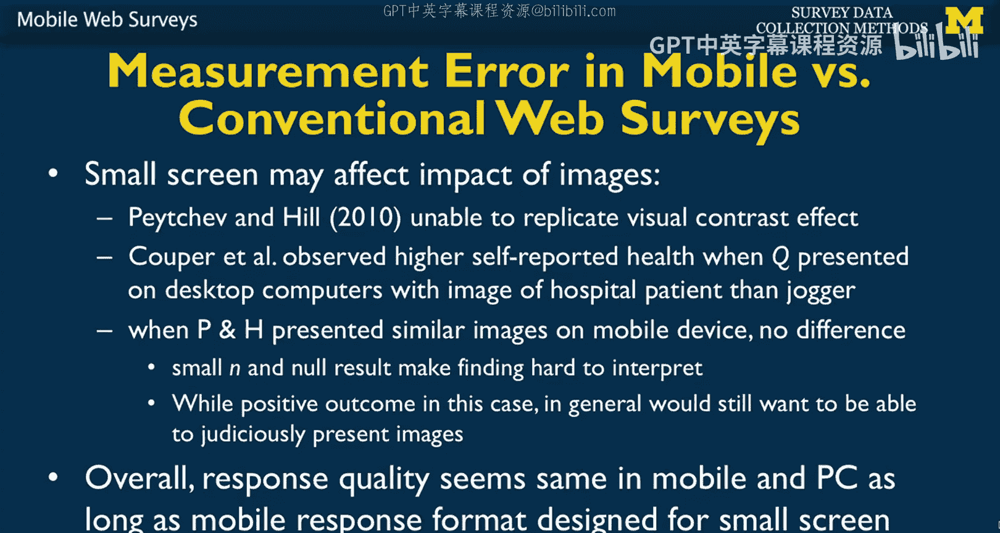

that there is never an effect of an image on a mobile device on a small screen that's one kind of limitation of this finding and also if the take home message is that images are not noticed on a small screen that's not necessarily good news because even designing for a small screen。

 one would like to be able to judiciously present images over all the studies we've we've now discussed。

 response quality seems very much the same in mobile and PC modes as long as the mobile response format is designed for a small screen。

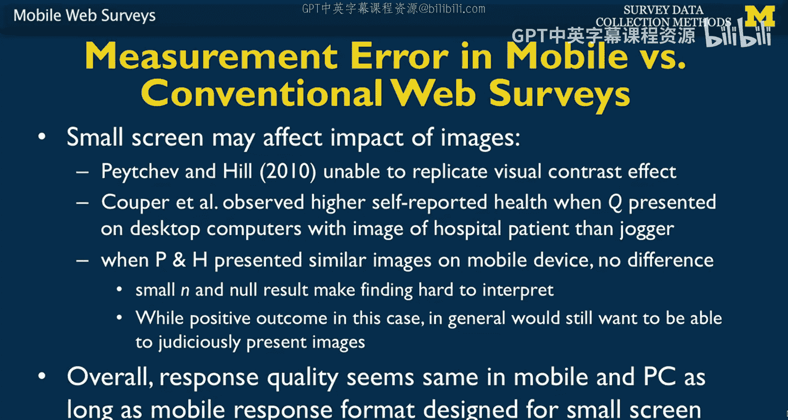

One other aspect of mobile web surveys is that particularly in the early days of mobile web responding。

 designers actually intended for all responses to be entered through conventional devices。

 not mobile devices so responses via mobile devices were considered unintended and really unwanted and designers did not optimize the design for mobile devices Bosniak and colleagues compared the so-called unintended mobile respondents to desktop laptop participation into meta analyses that as they looked across a number of studies and summarize the findings in one study they found that the average participation rate of unintended mobile users was 5。

8% they found that younger respondents were generally more likely to participate via mobile devices and that males more than females were likely to participate on mobile devices the breakoff rate was actually。

wa higher for mobile than desktop devices and this could well be because the design was not optimized for mobile devices that is the screens were not designed for a small display。

Despite the higher breakoff rate for mobile than desktop devices。

 the number of pages completed before breakoff was actually higher on mobile than on desktop。

 not clear exactly why， but it could be that these respondents are quite motivated to complete the questionnaire。

 but eventually give up。

In the other meta analysis， Bosniak and his colleagues found that about 8% of respondents used a mobile device which was unintended at least once and that 2。

1% of respondents participated via mobile device in at least seven out of eight waves of this longitudinal study so really in terms of prevalence this unintended mode was relatively high they also found that older respondents and women were less likely to use mobile devices consistent with the finding in the other metaana so to summarize our discussion of mobile web surveys。

 smartphone and tablet coverage is far from the general population but it' rapidly growing and it' potentially an alternative to in home internet。

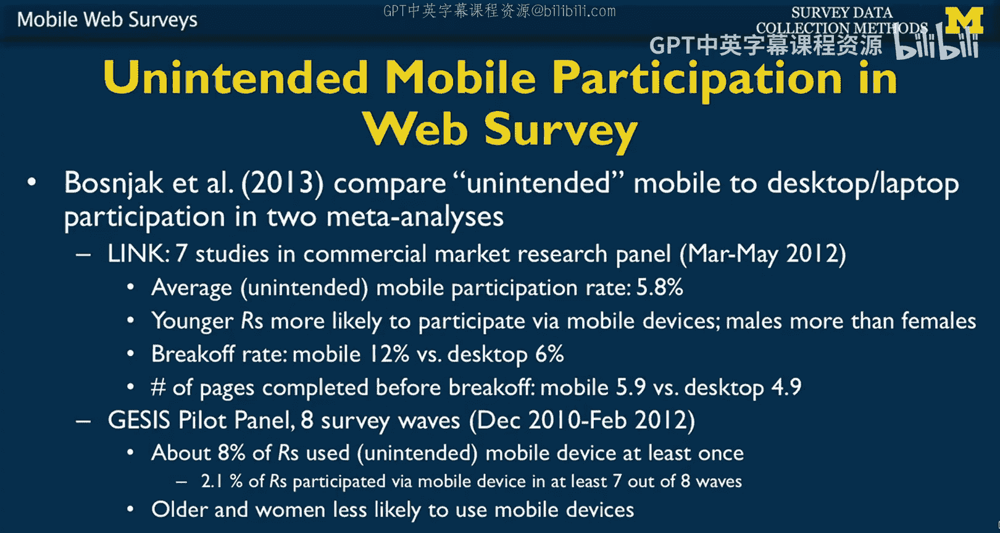

Access for at least certain subgroups of the population who may have no other way to go online。

We talked about SMS as a contact mode and it does seem to be promising that is sending people a text message about an upcoming web survey seems to be more effective than other modes such as email or physical letter the other advantage of SMS is that it may potentially allow sampling of phone numbers which could overcome a number of the coverage issues that we've spoken about with web surveys the difficulty or the challenge for using SMS is that it may be hampered by legal restrictions that unsolicited SMS messages may be prohibited in certain countries and it may require that respondents give prior consent to being texted before a researcher tries to contact respondent that way。

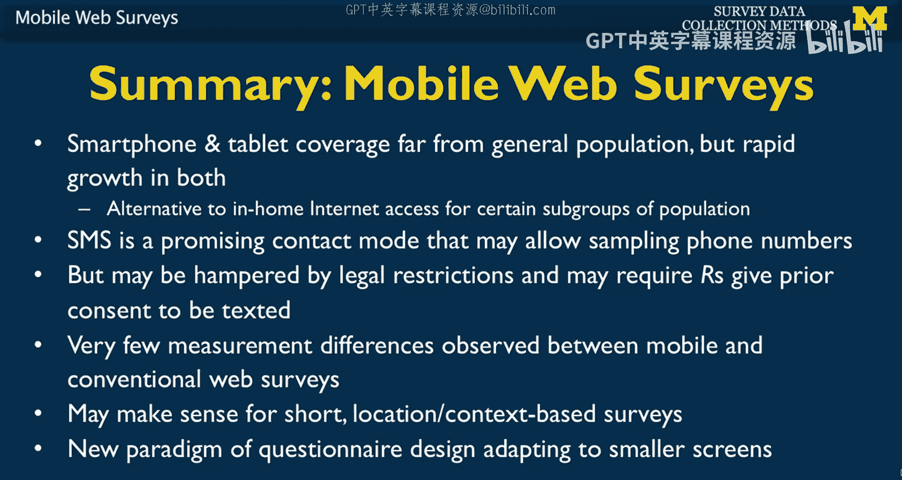

When we looked at measurement， there was really very little evidence that mobile and conventional web surveys differed in the quality of individual responses。

 that is measurement error seemed to be about the same in the two types of web surveys。Finally。

 it may make sense to use mobile web for short location or context based surveys rather than for longer questionnaires。

 as is really the norm， or as is more common with conventional web surveys。

The critical design challenge seems to be creating questions and other measurement items that will work on small screens as well as on larger screens。

 so we'll turn next to a discussion of SMS or texting as a data collection or interview mode we've talked about SMS and texting as a way to contact potential response。

 but we haven't discussed it yet as a way to collect data and it is actually being used widely in some parts of the world and a number of investigations or evaluations of the method have taken place。

 so we'll turn to those next see you shortly。

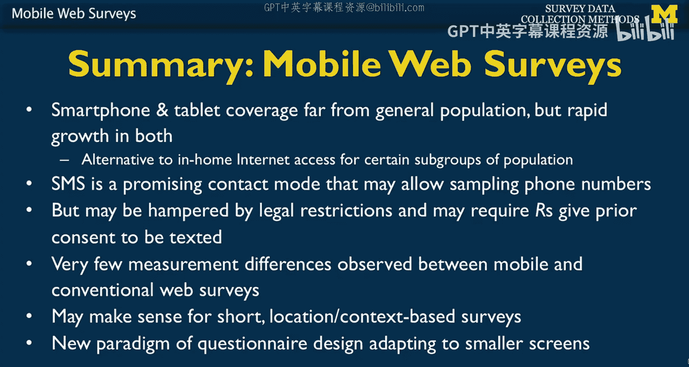

