# 密歇根大学《调查数据收集和分析（2-6：方法、社调问卷设计、抽样、缺失数据、分析）｜Survey Data Collection and Analytics》 p33 32_4.1.3 短信调查.zh_en -BV1fw4m1e7Zh_p33-

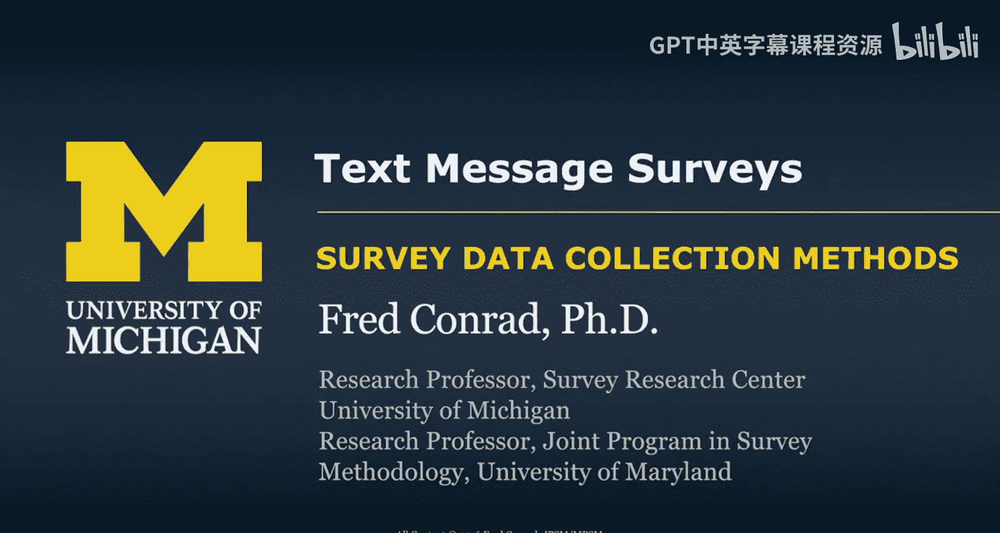

Welcome back， we're continuing with our discussion of mobile data collection。

 we've talked about mobile web surveys and we'll now shift to a discussion of text message surveys using texting or SMS to collect data not just to invite or contact participants。

 so the first thing to really think about is that texting is ubiquitous。

 it's the primary method of daily communication in many parts of the world。

 even the most basic mobile phones support texting。

Billions of text messages are sent each month in the US and billions more globally。

 so it's at least worth exploring as a survey mode。

 as we've discussed for recruiting or contacting participants into data collection and other modes like web。

 including mobile web and telephone， but our focus now is on texting as a data collection mode as an interview mode。

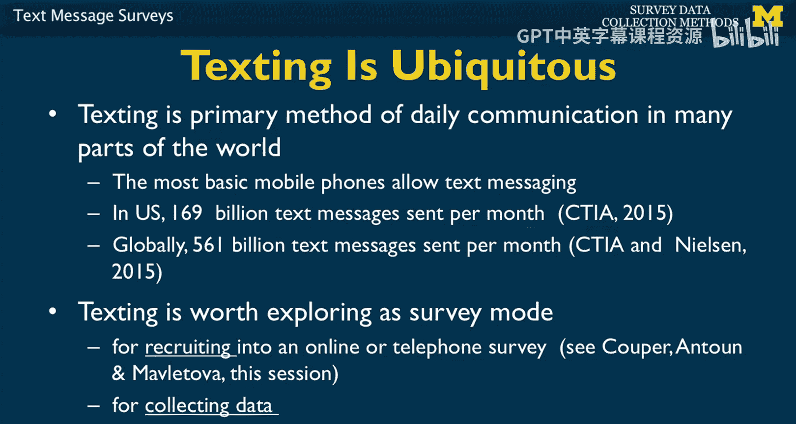

What do we mean by texting because it's possible to interpret the term differently。

 sending receiving character based messages limited to 160 characters？

In SMS or short messaging service， or in internetbased app， the number of characters is unlimited。

 both of those are within scope for current purposes。

 these text messages are created either with an alphanumeric keyboard or keypad which generally requires pressing the same key multiple times to produce different letters versus virtual alphabetic keypads which are more common on smartphones。

 so they're on screen keypads with the full all alphabetic characters available。

 the messages are either displayed individually or they're threaded in the case of smartphones。

 so when they're threaded the entire kind of history。

 the conversational history is visible when just individual messages are available in older cell phones it's harder to reconstruct the history and the arrival of a message generally alerts。

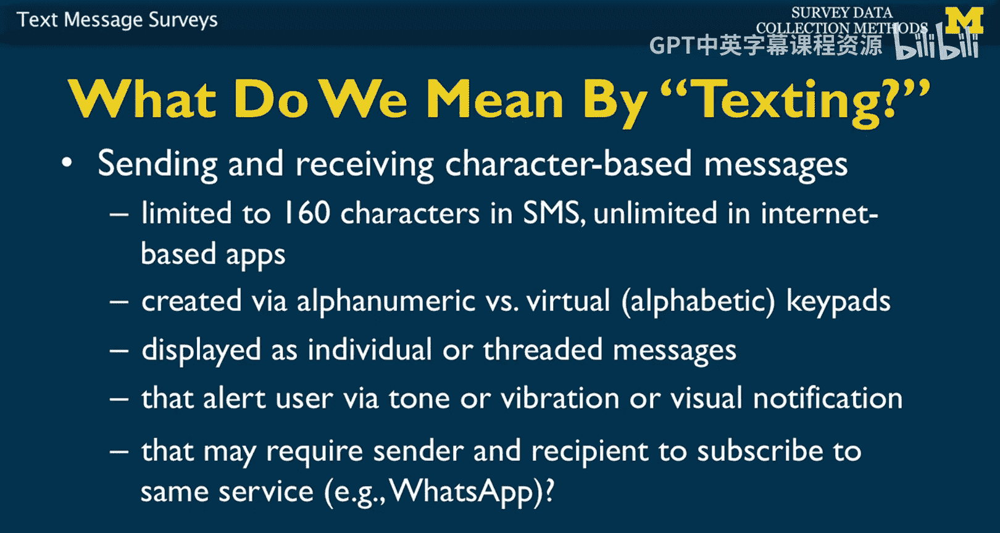

User via a tone or a vibration or some kind of visual notification that the message has arrived and it kind of grabs their attention and this is one of the potential advantages of texting for and survey data collection is that even when one isn't particularly thinking about being a survey participant the arrival of a message may well grab the respondent's attention and then finally texting。

May require the send recipient to subscribe to a service such as WhatsApp。

 but because texting is native to virtually every mobile phone many。

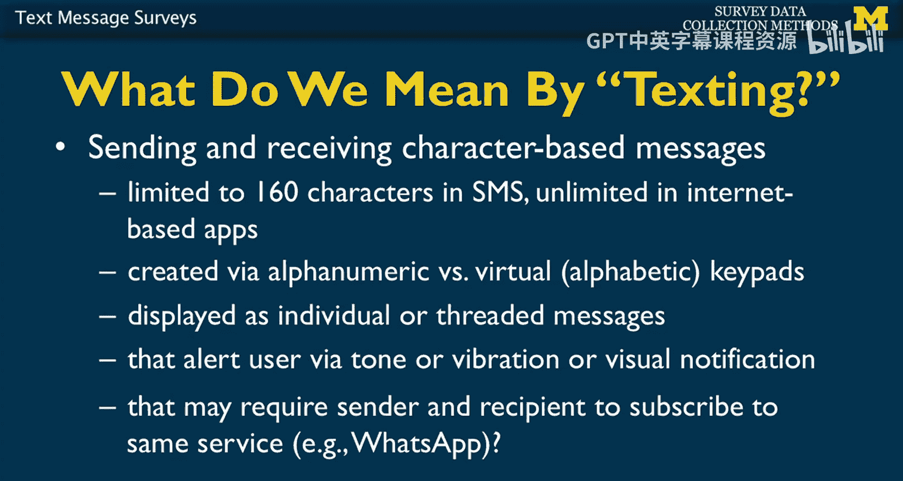

Much text communication can occur without any subscription services involved。

This table kind of lays out the attributes of texting in comparison to the attributes of voice communication so if we think about survey data collection this would be telephone surveys telephone interviews versus text-based interviews but really these features applied to these these media in general and I won't go through the entire table just mention a few of the features in the table so the first is synchrony so the idea is that voice is fully synchronous that is when a speaker asks say a question or produces some speech。

 it's really expected that the listener will produce some speech almost immediately often within a second with texting is much less synchronous while there can be that kind of rapid back and forth communication and texting quite common for the response to be sent when the user has a moment has time when it's convenient there just isn't the same expectation for an immediate。

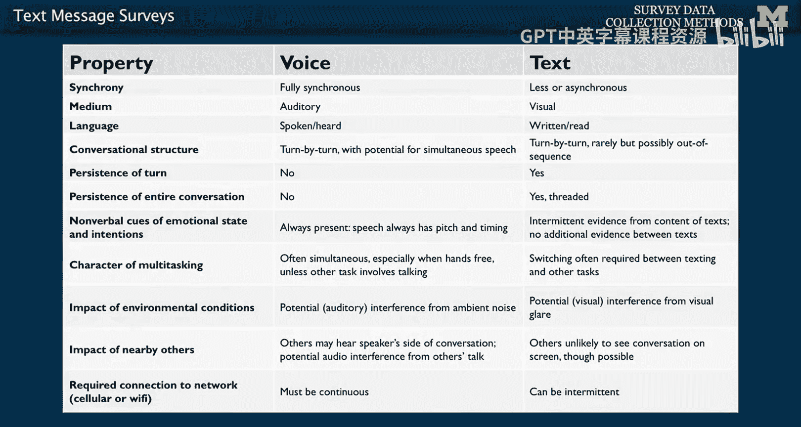

Response in text that there is in voice。Another feature that differs between voice and text is the conversational structure so spoken communication occurs turn by turn that is the one person speaks and then the person was the listener becomes the speaker and it works quite well but there are occasionally errors in which the participants get kind of tripped up and they speak at the same time。

 but it's pretty rare and there are remarkably good mechanisms in place to overcome simultaneous speech in texting。

 well it is also turn by turn， each message is a turn。

 there really is no analog to simultaneous speech in texting although occasionally text messages may arrive out of order out of sequence but that's pretty rare so while they're both turn by turn the idea of stepping on the other person's toes is pretty unlikely in texting。

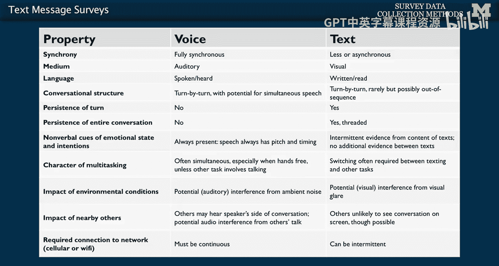

Another feature that really distinguishes texting in voice communication is persistence。

 so texting is persistent that is one sends a text message and because it's visual it doesn't go away unless unless the user deletes it it remains in the users on the user's phone and also remains in in the cloud but that's a separate issue in voice communication that turns are ephemeral they go away once they're uttered unless they're audio recorded there's no record of what has been said so that's a big difference you can imagine that that might affect people's willingness to provide sensitive information they might be reluctant to provide sensitive information if there's permanent record and another distinction between the two ways of communicating has to do with non-verbal cues such as what are somebodys called paralinguistic features likeum's and Us with voice。

Ums and Us are just come with the territory， it's rich with respect to these parainguistic cues。

 with texting， there's virtually none of this unless somebody intentionally includes it so you can type into a text message。

 to communicate， perhaps uncertainty about the rest of the message。

 but short of that there's virtually no analog to paralinguistic forms of speech。

And then a final attribute that's quite different between voice and texting is the way multitasking occurs。

 so there are types of multitasking with voice and text but they're different。

 so with voice it tends to be simultaneous so one might be speaking on the phone while cooking kind of doing the two things in parallel at some deep internal level shifting between the tasks but really engaging in the two tasks at the same time。

 but with texting it's pretty unlikely that one is both entering text into a text message and doing another task。

 but once a text message is sent its。

Completely normal to switch to another task between the time the text message is sent and the time the user reads the reply to that text message so all kinds of the rest of life takes place between text messages so it's really a task switching approach versus a simultaneous multitasking with voice so these are a number of differences and there are others in this table that could lead to differences between the data and particularly data quality collected with text and voice。

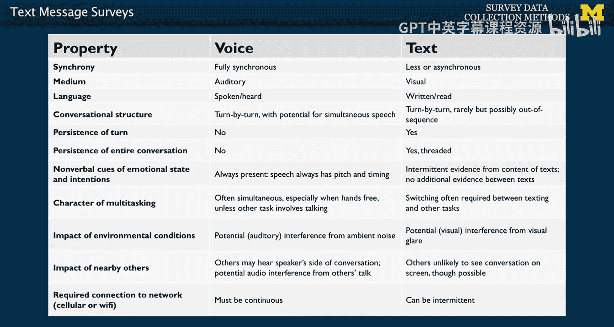

So we'll turn shortly to evidence about measurement quality in text versus voice。

 but before doing that， let's talk about coverage and coverage error in text interviews。

 because if the people who text are different from the people who don't text。

 then we have the same kind of problem we've discussed with web access in general。

 so the idea is that of course people who are not mobile phone owners are not likely to be texters。

 but it could well be that among mobile phone owners those who do not text。

arere different on some of the attributes we might want to measure in a survey than those who do text。

 but we just don't know， so a first investigation of coverage error is reported in an impressed chapter by Conrad and colleagues in which the authors looked at results from a telephone survey conducted by the Pew organization in which they asked among other things whether they were mobile phone owners and if they were they asked them if they texted。

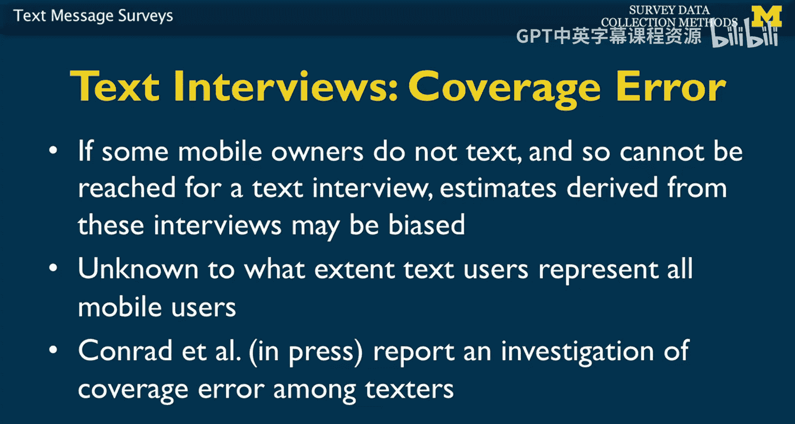

And the survey also produced demographic data for these respondents。

 so we can see if those mobile phone owners who text differ demographically from those mobile phone owners who do not text and in the table here you can see that the demographic variables produced by this survey are age。

 sex， education， race， ethnicity and income。If you look under the column A for mobile phone owners and compare that to the values in column B for mobile phone owners who text。

 you can see that there are a few differences， but not many， there are differences in age。

 so fewer mobile phone owners who text are older than 34 years old， in other words。

 texters are younger than nontexters， and there are slightly more college graduates significantly but slightly more college graduates among mobile phone owners who text than those who don't text。

 but other than that there are no differences in the other attributes。

 and so the question is whether these two differences are likely to affect the answers that are collected in a survey that's conducted via texting。

 another thing to consider is that the proportion of texters among mobile phone owners is growing and that as it grows。

 any bias。

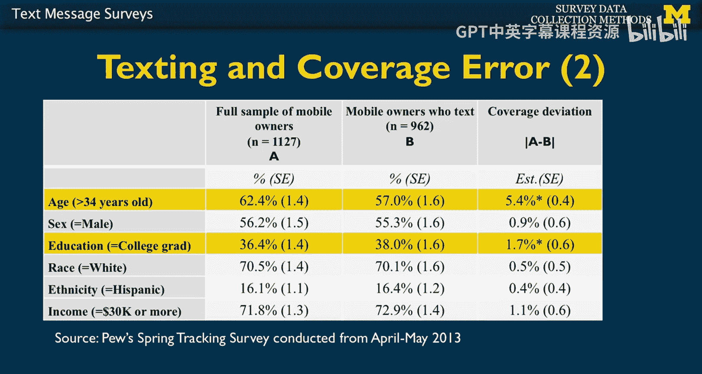

In terms for example， of age and education is likely to be reduced so also from Pw texting rates among US mobile phone owners have been on the rise and are continuing to rise。

 so if we were to project where texting by mobile phone owners is going。

 we can see that we're approaching full coverage and that there may be no difference between mobile phone owners who text and those who don't。

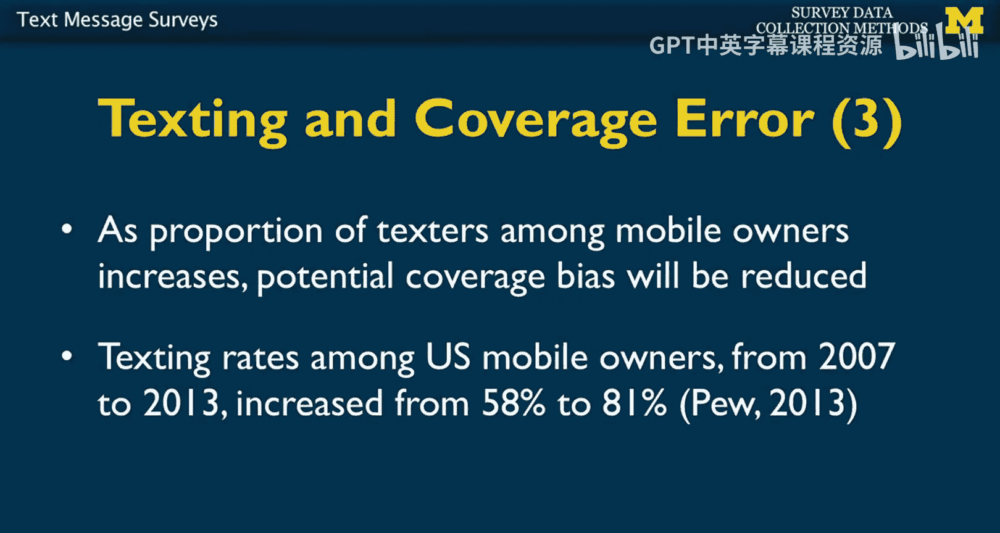

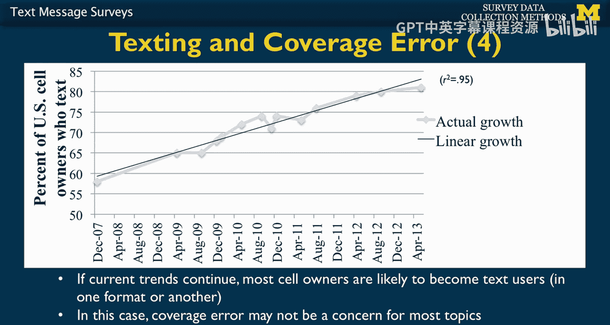

So we'll turn next to a discussion of measurement in text message surveys。

 focusing on a laboratory experiment that compares text and voice data collection。

 we'll see in just a minute。

