# 密歇根大学《调查数据收集和分析（2-6：方法、社调问卷设计、抽样、缺失数据、分析）｜Survey Data Collection and Analytics》 p34 33_4.1.4 文本与语音访谈对比.zh_en -BV1fw4m1e7Zh_p34-

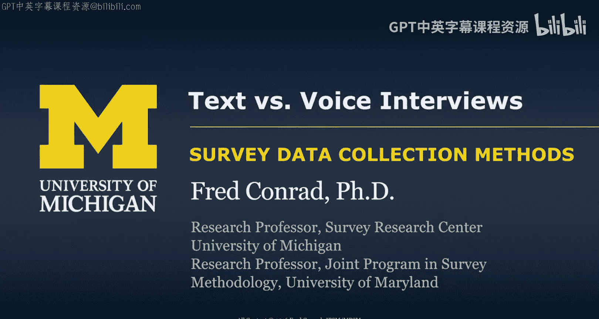

Welcome back， we're continuing with our discussion of texting as an interview mode and shifting to a discussion of measurement issues primarily when it comes to using text for collecting data。

There's really one study in the literature which compares texting to voice interviews by Schchoer et all。

 and it actually looks at four modes of data collection to involve voice and two involve SMS。

 one of the voice modes is conducted by，Live human interviewers。

 the other by an automated system that speaks questions and recognizes spoken answers。

The two text modes are similarly administered by human interviewers who will send questions via text and respondents will send answers via text and by an automated system。

 so the automated system will text questions and accept texted answers。

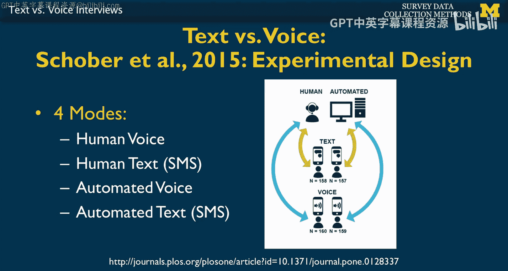

In their study， the participants who were actually just using iPhones so that platform was the same across all participants。

Were recruited through various online sources and then they screened into the study so they knew that they were going to be taking part in the study they just didn't know in what mode the data would be collected and what mode they would be interviewed so keeping in mind that they have screened in already the response rates were generally pretty high but reliably higher for text than voice interviews or text than voice contact so why is this well the higher response rates in text could be due to the persistence of the message so there's no non-contact in the sense that if the survey organization text a message inviting a sample member to participate that message will remain on the phone and the organization would be confident it was received it's very rare that a text message doesn't reach its destination at least without some indication to the sender。

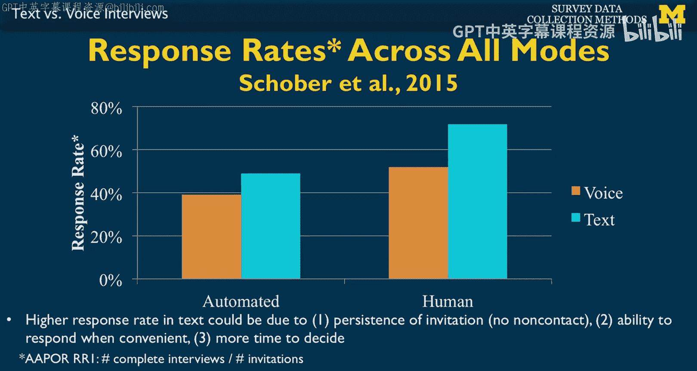

The higher response rate might also be due to the fact that it' simply it's possible to participate when convenient in text。

 whereas in voice， you're contacted and generally you're invited to participate at that moment and it might not be convenient。

 but with text， it's possible to respond when it is convenient。

And the higher response rate might come about because in text invitation。

 the sample member has more time to decide whether or not to participate。

 they're not put on the spot the same way that a sample member is with voice。

 so it may be that once they take some time and find themselves in a different situation than were in when the message arrived。

 they realized yeah， I could participate in this。Another look at response rates concerns the speed with which the interviews that are eventually conducted are actually conducted so if we look at this figure we can see that within one day of sample members being invited to participate in the automated text mode over 90% of those interviews have been conducted and in the human text mode over 70% of those interviews have been conducted。

 so these are substantially and reliably faster than the two voice modes in which about 60% and 50% of the cases have been completed within one day。

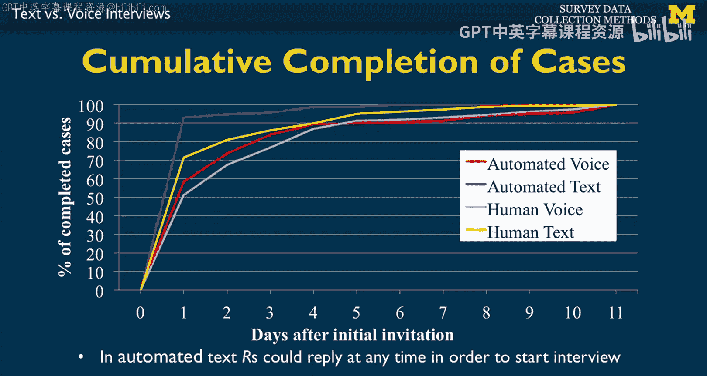

Although response rates are higher with text than voice and the sample is completed faster with text than voice。

 breakoffs are higher with text than voice， so by breakoffs here we mean that at the end of the field period a case was not completed and so why might this be well it could be that there's less social presence in text than voice。

 less evidence of some kind of agents at the other end of this communication。

 particularly the absence of voice， so it could be that without that social presence participants are feel freer to simply not answer the next question they receive or they kind of just drift off without realizing or remembering that they're in the middle of an interview and related to that the asynchronous character of text may be partly responsible for this so while as we'll see there are benefits to the。

synchronous character of text， it mean does mean that respondents don't need to answer right away and that lack of time pressure could translate into just taking an infinitely long amount of time to respond。

 which would be essentially a break off。

So the breakoff rate is higher in automated than human modes as well as higher in text and voice。

 and this is probably due to the fact that there's no human interviewer present to kind of keep the respondent connected and engaged。

嗯。And the respondents who broke off are know。Whether in automated versus human modes or text versus voice。

 the respondents who broke off are no different demographically than those who completed the questionnaire。

 so except for slightly more females breaking off， so it doesn't seem that this is a demographically driven issue and that it might introduce any kind of bias。

 it just there is just more there are more breakoffs in text than voice and an automated than human administered modes。

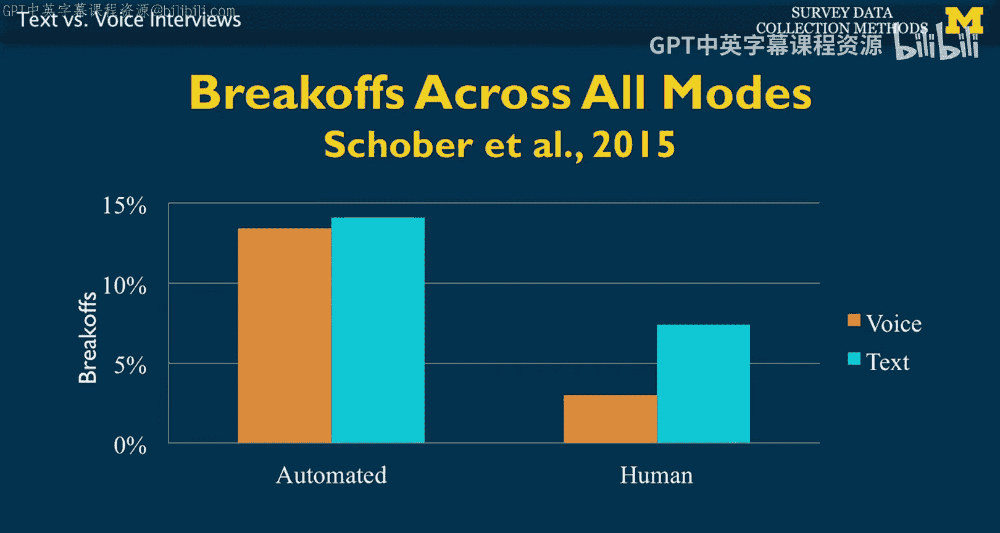

So turning to measurement in the same study， the authors compared a couple of measures of data quality between text and voice。

 they used two measures of sating， one was the frequency of rounded numerical answer so questions requiring a number for the response that were divisible by5 were treated as evidence of kind of taking a mental shortcut。

 the idea is that if somebody were to say 100 which is divisible by5 versus 97。

 you'd be more likely to assume that they've been kind of engaged in accounting a deliberate count strategy when coming up with 97 versus 100 but 100 be more kind of top of the head a top of the head estimate or kind of approximation the other satisfying measure with straightlining and which respondents give the same answer to all of the questions using a single response scale running from strongly favor。

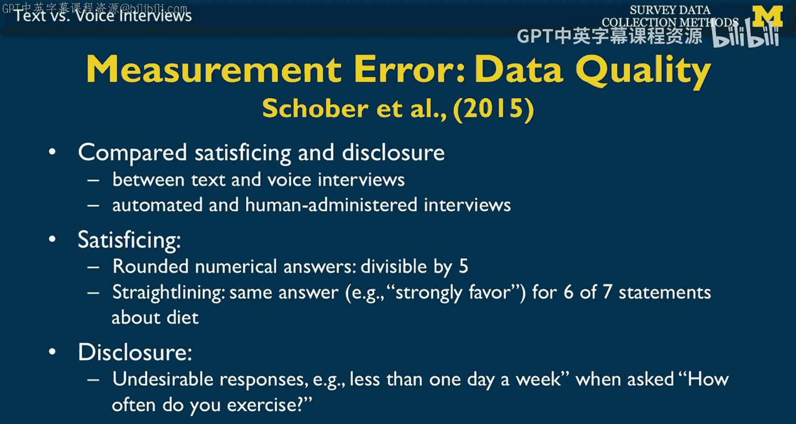

Strongly opposed， in this case， the authors considered straightlining a set of responses。

That included the same answer to six of seven questions using this scale so there were those two measures of satising and then also a disclosure of sensitive information so the frequency of giving undesirable responses such as saying less than one day when asked how often do you exercise。

 that would be an undesirable responses and so if people are giving more of those in one mode than the other that would indicate they're giving higher quality answers in one mode than the other。

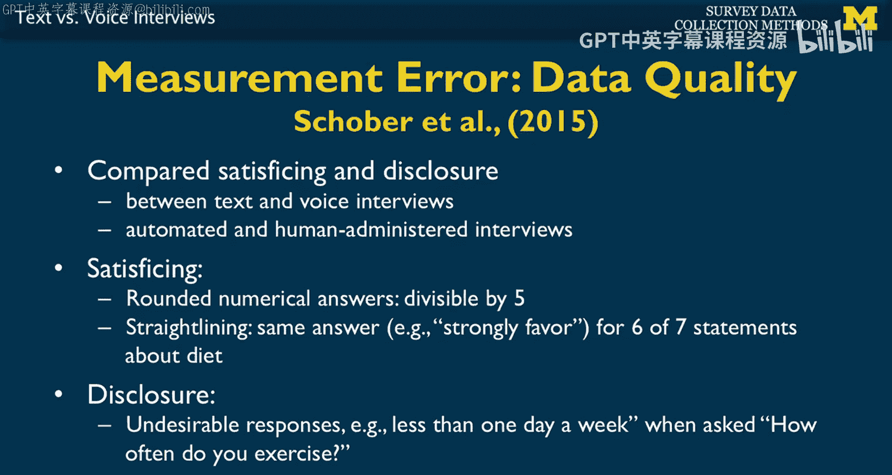

So text respondents on iPhones entered answers like this respondent in the human administered modes。

 the interviewers used an interface like this one， which the question was displayed and they could send probes to the respondents by selecting from the windows in the lower part of the screen。

And another view of the threaded exchange between respondents and the interviewer what are likely outcomes well with respect to satising it could be that there's more satising with text than voice respondents might import their kind of least effort strategies from usual texting practices and which it's common to use truncated and abbreviated forms of speech or forms of of communication just because there's effort involved in entering text but texting might lead to less satisfying because of the reduced time pressure so respondents can answer when they have time to think about their answers and possibly consult records which would lead to higher quality results so that could go either way in the view of these authors and with respect to disclosure that too could go either way there might be more disclosure of sensitive information in texting than voice because of the reduced social presence the fact that there's no。

Interviewer face or voice that would be better quality data， but there could be less disclosure。

 lower quality data because of concerns that the questions and the answers are permanent。

 they're visual， they're persistent as we discussed in the previous segment what were the results well turning first to satisfying the authors reported that there was less satisfying in text which the orange bars in this figure represent than in voice so better quality data in text than voice。

 fewer numerical answers ending in a zero or five and the other measure satisfying straightlining also told the same story there was less straightlining in text than in voice。

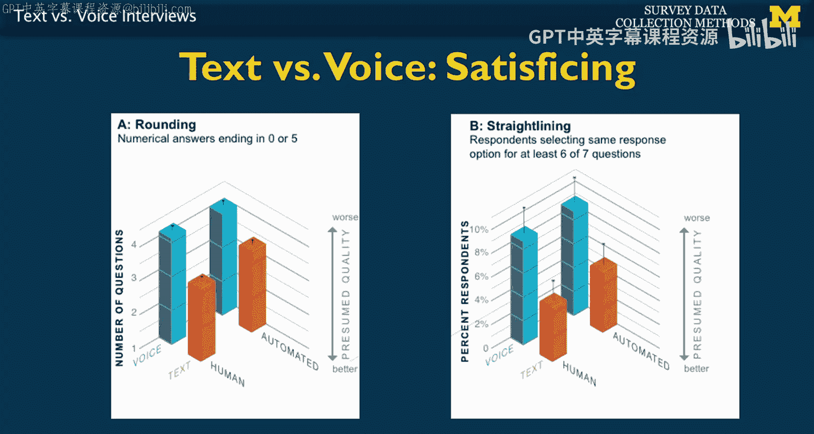

With respect to disclosure， texting also led to higher quality data， there was more disclosure。

 the orange bars are taller than the blue bars in text than in voice there also was an advantage for automated over human aministered modes quite similar to the advantage we've seen for self-administ with computerized data collection such as aAsie when we talked about those kinds of modes in the context of interviews and again for the same reasons the fact that these modes are automated means that there's not an interviewer present who might inhibit candid responding so texting is leading to less satisfyising by two measures and more disclosure of sensitive information。

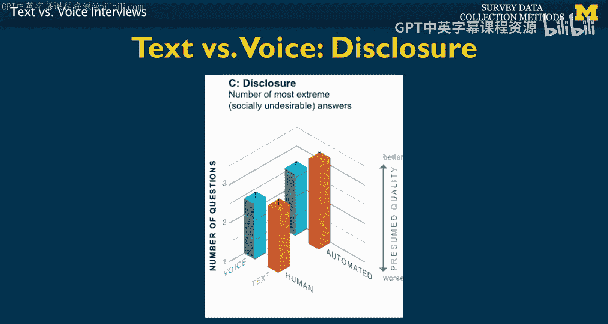

All all of which is positive when it comes to considering text as a mode of interviewing。

There are some properties of text interviews that are worth considering when evaluating the mode for interviewing for data collection。

 the key feature is that text interviews take longer than voice interviews so this figure illustrates that in the lower part of the figure the orange bars indicate questions that were texted either by a human or by an automated system and the black bars are the answers or anything else。

 and as you can see relative to the voice interviews in the top part of the panel where the blue bars indicate questions that are asked by voice and the black bars indicate both answers and kind of any other spoken content。

 the text message interviews are much more spread out in time。

 there's more space between the orange bars and the black bars that follow questions than there is between the blue bars for voice interviews and the black bars that follow the question so presumably this is because the text respondents are taking more time before answer。

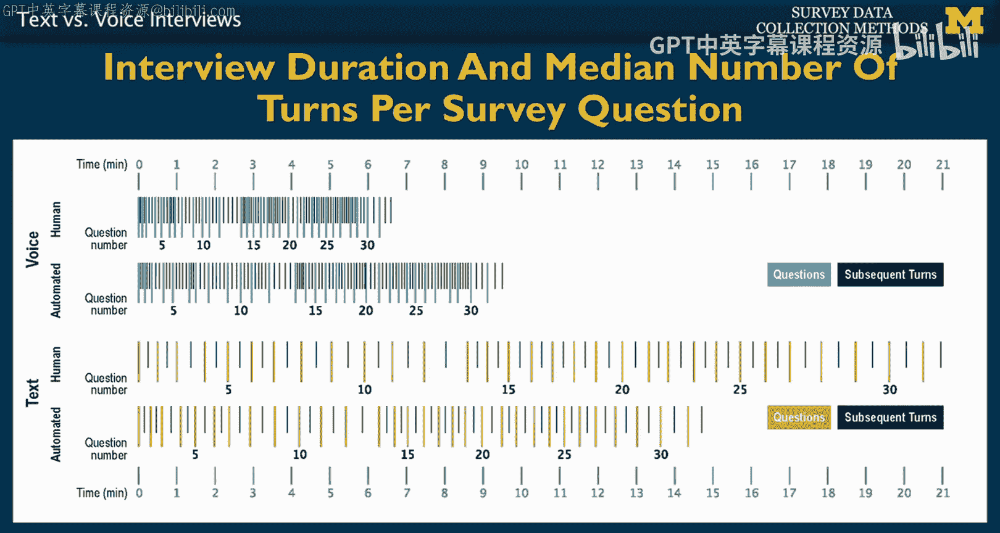

To think about their answers leading to the higher quality results that we've just discussed。

The other distinction is that there are more verbal interactions， more spoken interactions。

 more spoken turns that are not necessarily answers in voice than in text interviews。

 so really if you look at the text interviews they're really of the form question answer。

 question answer， but in voice there's a lot more being said by the respondents primarily。

 so in that sense they're less efficient， even though the voice interviews are completed in a shorter period of time。

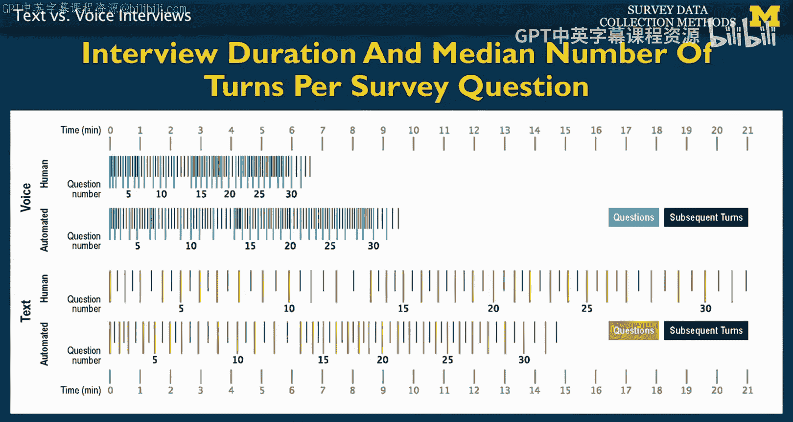

That concludes our discussion of texting as an interview mode and as a contact mode。

 in particular texting as a contact or precontact mode seems to increase participation in both web and mobile data collection more than preconact in other modes in particular email and paper invitation as an interview mode。

 there are a number of promising features of texting。

 there was very little evidence of coverage error， just differences in age and education and the evidence is that mobile phone owners who do text are growing in numbers so that even these differences between age and education may vanish in the near future。

With respect to nonresponse， response rates were higher in text than in voice。

 although breakoffs were higher in text than voice， and then with respect to measurement。

 there was evidenced by a number of measures， the texting leads to higher quality data than voice interviews。

 by two measures of satisfying， there was better data that is there was less satisfying in texting than voice。

 a few rounded numerical answers， less straightlining。

 and there was more disclosure of sensitive information in text than in voice interviews。

And then finally， with respect to efficiency。Although the interviews take longer in text and voice。

 this is presumably because they're spread out in time as respondents think through their answers more carefully。

The field period is shorter for text than voice， that is the sample is completed more quickly in text interviews than voice。

 particularly for automated text， we saw that there were over 90% of the interviews that were completed were completed within one day of the invitation being distributed。

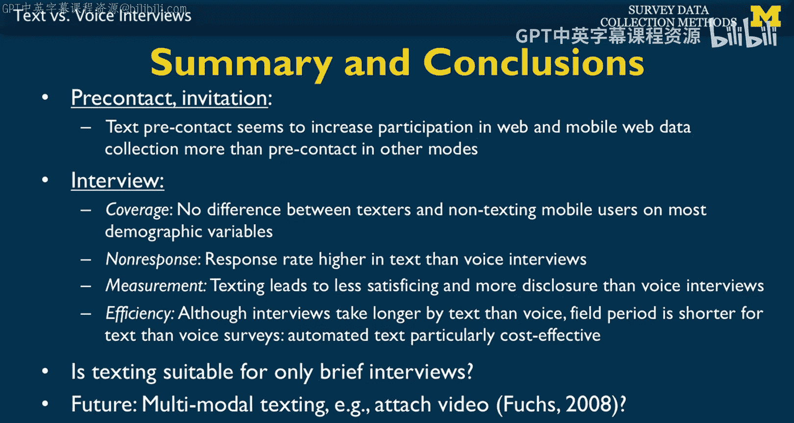

Some things to think about with respect to texting as an interview mode is。

 is it only suitable for brief interviews in the study we've talked about。

 these participants had all screened in and compensated pretty well for their time。

 but it could be that respondents won't tolerate a very long interview when it's conducted via text。

 on the other hand， because they can participate when it's convenient。

 they may be willing to tolerate more questions than we might think。

Another thing to think about is how texting might evolve as an interview mode。

 so it's now actually quite easy to attach various media to a text message or to speak a text message and for to be converted to text。

 an early idea was proposed by FoOs who suggested that when texting is used as a contact mode to attach a video of a human interviewer inviting sample members to participate。

So it remains to be seen where texting goes， but the initial evidence is that it's promising as another mode of conducting surveys。

So that concludes our treatment of mobile data collection， both mobile web and SMS。

For our final topic， we'll address alternative modes of data。

 not necessarily involving self-report as in answering survey questions。

 but involving sources of data such as administrative records or social media or other types of would have been called found as opposed to design data in that these sources of data were never really intended for use as in social measurement。

 but increasingly researchers are finding ways to use these other data sources in social measurement。

 so in our final segment we'll address both of those and look forward to seeing you them。

